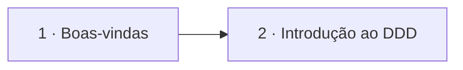

# Introdução

## Índice

| # | Aula | Duração |
| --- | --- | --- |
| 1 | [Boas-vindas](./1%20-%20Boas-vindas.md) | 03:40 |
| 2 | [Introdução ao DDD](./2%20-%20Introdu%C3%A7%C3%A3o%20ao%20DDD.md) | 09:23 |

## Sequência das aulas

