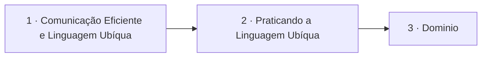

# Conceitos Fundamentais

## Índice

| # | Aula | Duração |
| --- | --- | --- |
| 1 | [Comunicação Eficiente e Linguagem Ubíqua](./1%20-%20Comunica%C3%A7%C3%A3o%20Eficiente%20e%20Linguagem%20Ub%C3%ADqua.md) | 09:47 |
| 2 | [Praticando a Linguagem Ubíqua](./2%20-%20Praticando%20a%20Linguagem%20Ub%C3%ADqua.md) | 07:44 |
| 3 | [Dominio](./3%20-%20Dominio.md) | 10:02 |

## Sequência das aulas

