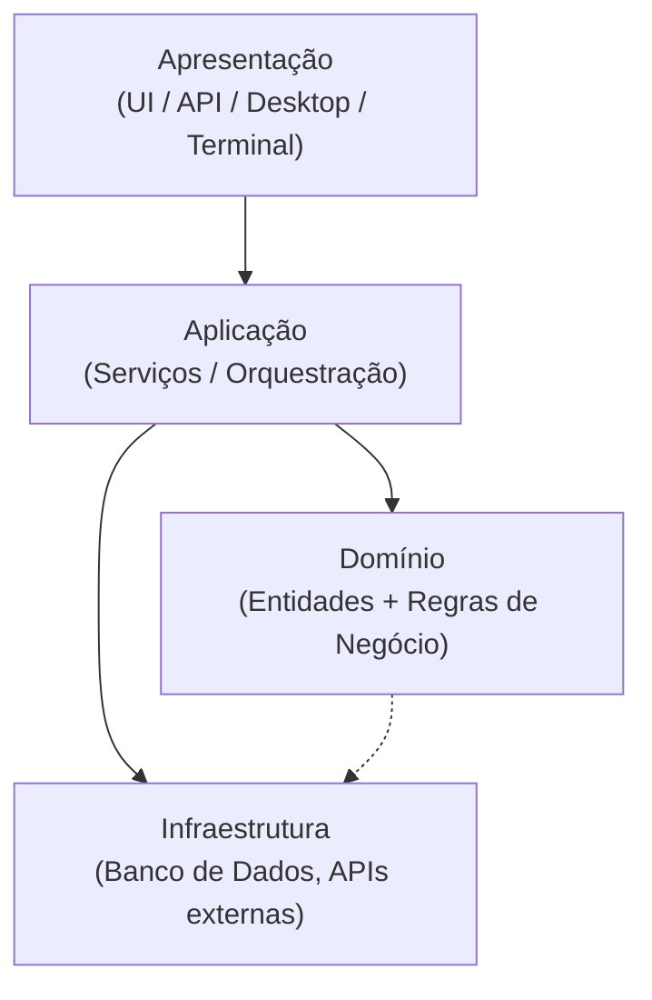
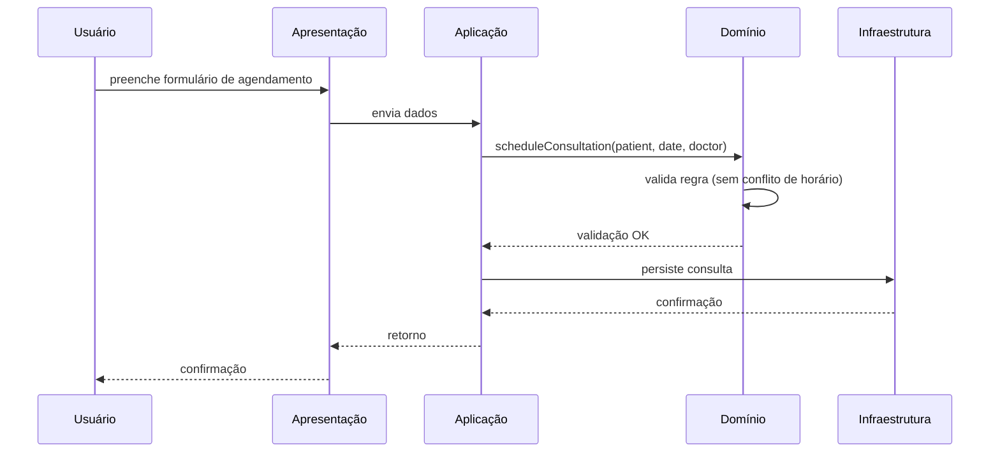
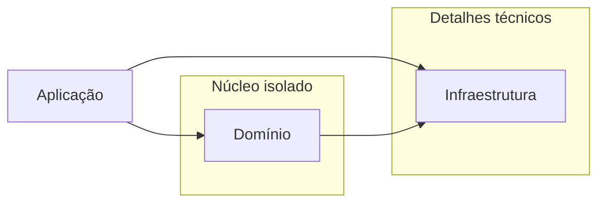

# Isolando o Domínio com Arquitetura em Camadas

## Introdução e contexto

Esta aula dá sequência ao estudo de **Domain-Driven Design (DDD)** — o design orientado ao domínio e ao modelo. Nas aulas anteriores foram consolidados conceitos importantes:

- A **linguagem ubíqua** (ou onipresente), estabelecida para que desenvolvedores e especialistas de domínio construam juntos um modelo capaz de resolver o problema do cliente.
- O **domínio** como o coração do software, e sua relação com a orientação a objetos, que facilita a representação dos conceitos de negócio.
- O **processo de isolamento do domínio**: separar a parte inerente ao problema do restante da aplicação.

O isolamento é essencial porque o restante da aplicação é mais facilmente reaproveitado por outros sistemas, enquanto o domínio tende a ser restrito a um campo específico. Agora aprofundamos a **arquitetura de software**, começando pela arquitetura em camadas.

A arquitetura em camadas é utilizada há décadas e é, provavelmente, uma das mais populares. Eric Evans usou essa abordagem em **todos os exemplos** do livro *Domain-Driven Design* (2003) porque era a mais popular na época — e continua relevante mais de 20 anos depois. Outras arquiteturas surgiram com o mesmo propósito de isolar o domínio, como a **arquitetura hexagonal** (~2005), tema da próxima aula.

## O que é a Arquitetura em Camadas

É uma **abordagem clássica para a organização do software**. O domínio se enquadra muito bem nela: fica na base da estrutura e interage apenas com a **camada de aplicação** e a **camada de infraestrutura**.

Esse é o **marco (o máximo) de comunicação oferecido pelo domínio** — é o que permite isolá-lo facilmente do restante da aplicação. Cada camada possui uma **única responsabilidade**.

Nomenclaturas alternativas comuns:

- **Apresentação** → frequentemente chamada de *interface do usuário*.
- **Aplicação** → geralmente referida como *camada de serviços*.



## As quatro camadas

### Apresentação (interface do usuário)

Responsável pela **interface do usuário** e pelo meio pelo qual os usuários interagem com o sistema. É um **meio de acesso**.

- Pode ser representada por um front-end, aplicação desktop, interface gráfica, terminal, API ou qualquer outro mecanismo de interação.
- **"Usuário" é um termo genérico**: não precisa ser uma pessoa — pode ser um computador ou outro sistema que integra com o nosso.
- Pode ter **múltiplas implementações** para o mesmo sistema: mobile, web, desktop, terminal ou API.
- Comunica-se **diretamente com a camada de aplicação**, enviando os dados que os usuários inseriram (por exemplo, o cadastro de um paciente).

### Aplicação (camada de serviços)

Responsável por **orquestrar as operações do sistema**. É o *gatilho* para a execução das regras de negócio.

- No sistema hospitalar, é aqui que o agendamento de uma consulta é chamado — o método em si é disparado a partir de um objeto.
- As **regras de negócio** ficam no domínio; aqui apenas se invoca o comportamento.
- Concentra **validações que não cabem no front-end** (por exemplo, um validador de CPF — não faz sentido implementá-lo dentro de um terminal).
- **Depende fortemente do domínio**, pois é ela que chama o domínio sempre que algo é necessário.

### Domínio

Lida com as **entidades, as regras de negócio e a lógica central do programa**, independentemente dos detalhes técnicos (banco de dados, APIs de terceiros como pagamento etc., que vão para a infraestrutura).

- No **foco único no negócio**, exemplos de regras: *"um paciente não pode agendar duas consultas no mesmo horário"* — afinal, não é possível estar em dois lugares ao mesmo tempo nem ser atendido duas vezes simultaneamente.
- No sistema hospitalar, contém os conceitos centrais: **paciente, consulta, exame**.
- A regra pode ser implementada dentro da entidade, como `Patient`, ou extraída para uma classe/objeto dedicado.
- É importante que permaneça **isolado da camada de infraestrutura**.

### Infraestrutura

Lida com os **detalhes técnicos**:

- Interação com o **banco de dados** e responsabilidade pela **persistência**.
- Integração com **APIs externas** — serviço de pagamento, serviço de laboratório (para o qual se envia o material coletado, a fim de que o exame seja feito externamente), entre outros.
- Fornece o **artefato (ex.: ORM)** para persistir os dados.

## Fluxo de comunicação e exemplo prático

A principal característica da arquitetura em camadas: **as camadas superiores dependem das inferiores**.

| Camada superior | Depende de |
| --- | --- |
| Apresentação | Aplicação |
| Aplicação | Domínio e Infraestrutura |
| Domínio | Infraestrutura |

O domínio é parcialmente isolado porque essa interação entre múltiplas camadas sempre repassa a responsabilidade para a camada seguinte: o usuário insere dados na apresentação → a aplicação orquestra → o domínio valida as regras → a infraestrutura persiste.

**Passo a passo do agendamento de consulta:**

1. Na **apresentação**, o usuário informa que quer agendar uma consulta para um determinado paciente.
2. A **aplicação** chama a camada de **domínio**, passando as informações.
3. O **domínio** valida as regras — verifica se o paciente pode ou não fazer o agendamento (ele pode já ter consulta marcada naquele horário).
4. A **infraestrutura** persiste os dados — e assim sucessivamente.





### Exemplo de regra de negócio no domínio

Ilustração da regra *"um paciente não pode agendar duas consultas no mesmo horário"* implementada dentro da entidade de domínio (inspirado no `patient.ts`):

```typescript
class Patient {
  #consultations: Consultation[] = [];

  scheduleConsultation(consultation: Consultation): void {
    const conflict = this.#consultations.some(
      (c) => c.date.getTime() === consultation.date.getTime(),
    );

    if (conflict) {
      throw new Error(
        "Patient already has a consultation scheduled at this time.",
      );
    }

    this.#consultations.push(consultation);
  }

  get consultations(): ReadonlyArray<Consultation> {
    return [...this.#consultations];
  }
}
```

## Benefícios

- **Isola o domínio**: as regras ficam centralizadas e protegidas de mudanças externas (ainda que exista relação entre aplicação e infraestrutura, o domínio fica à parte).
- **Facilita os testes**: com o domínio mais isolado, basta mockar/injetar as outras camadas e testar os métodos do domínio separadamente.
- **Escalável**: novas funcionalidades podem ser inseridas no domínio sem precisar mexer no banco de dados.
- **Boa para projetos pequenos e médios**: por isso ainda é uma das arquiteturas preferidas dos desenvolvedores — em projetos pequenos, ela é quase o caminho automático.

## Limitações

- **Pode se tornar difícil de manter em projetos maiores.**
- Contraponto importante: isso sempre está relacionado à **capacidade do time**. Se o time faz um bom trabalho no processo de escala — especificação de módulos, pacotes e demais elementos relevantes ao sistema —, dificilmente a manutenção se torna problemática.

## Implementações comuns

- **MVC** (Model-View-Controller) e variações são a especificação mais frequente da arquitetura em camadas. Muitas vezes já projetamos o sistema mentalmente seguindo esse esquema de camadas.

## Conclusão

A arquitetura em camadas organiza o software em **apresentação, aplicação, domínio e infraestrutura**, cada uma com responsabilidade única, mantendo as regras de negócio isoladas no domínio. É simples, testável, escalável e excelente para projetos pequenos e médios, exigindo atenção ao design de módulos em projetos maiores.

Na **próxima aula**, exploraremos a **arquitetura hexagonal** — uma evolução que também tem como propósito isolar o domínio da aplicação.
