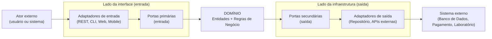
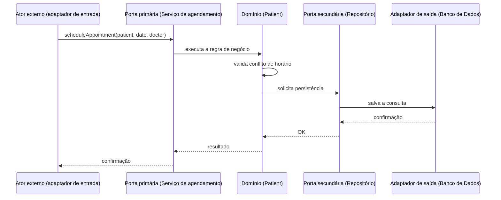
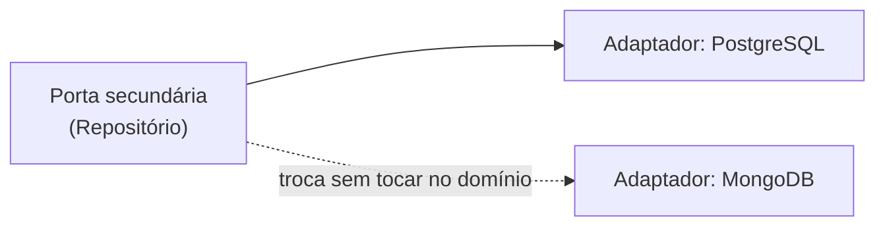

# Isolando o Domínio com Arquitetura Hexagonal

## Introdução e contexto

Dando sequência ao estudo das **arquiteturas de software** e de como elas ajudam a alavancar e isolar o domínio dentro do **Domain-Driven Design (DDD)**, esta aula apresenta a **arquitetura hexagonal** — também conhecida como **Portas e Adaptadores**.

Na aula anterior vimos o poder da arquitetura em camadas. A hexagonal vai além: ela tende a isolar o domínio **ainda mais**, de modo que o domínio se torna **efetivamente o coração da aplicação**.

Essa arquitetura foi criada em **2005** com o objetivo de evitar que as regras de negócio fiquem presas ou muito associadas a **frameworks**, **bancos de dados** e outras ferramentas externas. É uma arquitetura mais nova, em plena ascensão, e será a base do nosso sistema hospitalar.

## O que é a Arquitetura Hexagonal

No centro da aplicação está o **domínio**. Ao redor dele existem formas diferentes de **acessá-lo** ou de fazer com que ele **haja em nosso favor** para realizar alguma tarefa.

O nome "hexagonal" é um pouco difícil de visualizar; o nome **Portas e Adaptadores** é bem mais descritivo do que realmente acontece. Ambos os nomes são válidos, mas "arquitetura hexagonal" é o mais conhecido.

O padrão conecta-se ao domínio por meio de **portas** e **adaptadores** — por exemplo, um terminal, um sistema web, um sistema de mensagens ou um banco de dados.

## Portas (especificações / interfaces)

As **portas** definem **como o domínio é acessado**. Elas são **especificações** — ou seja, **interfaces** —, que determinam como uma ação é executada sobre o domínio.

Existem dois tipos principais de portas:

| Tipo | Lado | Papel |
| --- | --- | --- |
| **Primárias** (portas de entrada) | Esquerdo | Especificam **como o domínio é acessado** por agentes externos (usuário, terminal, aplicação web). |
| **Secundárias** (portas de saída) | Direito | Fixam a **infraestrutura**: persistência, envio de mensagens, API de pagamento, API de laboratório. |

- As **portas primárias** permitem especificar como o domínio pode ser acessado por agentes externos — é o mesmo que dizer "como podemos acessar o nosso sistema e obter uma conexão com o domínio".
- As **portas secundárias** tratam de como o domínio **interage para sair**: persistir dados no banco, enviar mensagem para uma API de terceiro, interagir com a API de pagamento ou com a API de um laboratório para solicitação de exames.

Resumindo: **as portas especificam**.

## Adaptadores (implementações)

Os **adaptadores implementam** — fazem a implementação concreta daquilo que foi especificado nas interfaces das portas.

- Existem adaptadores no **lado da interface** (entrada) e no **lado da infraestrutura** (saída).
- Eles estabelecem, de forma concreta, **como tudo o que está fora interage com o domínio**, seja por meio de entrada, seja por meio de saída.
- No **lado de saída** está um adaptador muito importante: o **repositório**. Ele especifica **como os dados são armazenados e recuperados** no sistema — ou seja, como a persistência de fato é feita. Os repositórios serão aprofundados em aulas futuras.

Resumindo: **os adaptadores implementam**.



## Aplicando ao sistema hospitalar

Vamos tomar como exemplo a regra de negócio já discutida: **o paciente não pode agendar duas consultas no mesmo horário**.

- No DDD, essa regra fica no **domínio**, **independentemente da arquitetura** utilizada (em camadas ou hexagonal). O domínio é quem implementa a regra.
- A arquitetura hexagonal ajuda a **isolar** essa regra, garantindo que ela não seja afetada por nada externo — nem em termos de **interface**, nem de **infraestrutura**.
- A regra fica no **coração do sistema**; o `Patient` especifica como a regra se comporta.
- As **portas**, em suas interfaces, são as especificações de como um serviço de **agendamento de consulta** ou de **realização de exames** pode ser executado.
- Os **adaptadores** implementam essas interfaces — dos dois lados. No **lado de saída** está a **persistência** e a comunicação com o banco de dados, via o adaptador **repositório**.



### Exemplo de porta e adaptador

Ilustração de uma **porta** (interface = especificação) e de um **adaptador** que a implementa (exemplo inspirado no domínio hospitalar do `patient.ts`):

```typescript
// Domain: the business rule lives here, isolated.
class Patient {
  #appointments: Appointment[] = [];

  scheduleAppointment(appointment: Appointment): void {
    const conflict = this.#appointments.some(
      (c) => c.date.getTime() === appointment.date.getTime(),
    );

    if (conflict) {
      throw new Error(
        "Patient already has an appointment scheduled at this time.",
      );
    }

    this.#appointments.push(appointment);
  }

  get appointments(): ReadonlyArray<Appointment> {
    return [...this.#appointments];
  }
}

// Secondary (output) port: specifies the persistence contract.
export interface PatientRepository {
  save(patient: Patient): Promise<void>;
  findById(id: string): Promise<Patient | null>;
}

// Output adapter: concrete implementation of the port.
export class PostgresPatientRepository implements PatientRepository {
  async save(patient: Patient): Promise<void> {
    // Converts the domain object and persists it in the relational database.
  }

  async findById(id: string): Promise<Patient | null> {
    // Fetches and rehydrates the domain entity.
    return null;
  }
}
```

## Arquitetura hexagonal vs. arquitetura em camadas

As duas arquiteturas são bastante similares em fluxo: uma **interface** de entrada acessa o **domínio**, e o domínio acessa a **infraestrutura**.

| Aspecto | Arquitetura em Camadas | Arquitetura Hexagonal |
| --- | --- | --- |
| Fluxo | Apresentação → Aplicação → Domínio ↔ Infraestrutura | Interface → Domínio ↔ Infraestrutura (via portas/adaptadores) |
| Isolamento do domínio | Parcial | **Total** |
| Dependência do domínio | Depende de detalhes técnicos nas camadas inferiores | Independente de frameworks e banco de dados |
| Adaptação entre arquiteturas | — | Relativamente fácil de migrar de uma para a outra |

A arquitetura em camadas foi apresentada porque é assim que o livro de Eric Evans (*Domain-Driven Design*) trata o tema — era a arquitetura mais popular à época, poucos anos antes do surgimento da hexagonal. Ainda assim, a implementação feita em uma arquitetura é, de certa forma, fácil de adaptar para a outra.

## Benefícios

- **Isolamento total do domínio**: as regras de negócio ficam totalmente protegidas de mudanças externas.
- **Facilita os testes**: como o domínio está isolado, não dependemos de banco de dados ou API — conseguimos **mockar tudo**.
- **Flexibilidade**: se estamos com o banco X e queremos trocar para o banco Y, basta trocar o **adaptador**, sem alterar **nenhuma linha** do domínio.
- **Evolução modular**: dá para trabalhar só no domínio, só na interface ou só na infraestrutura, sem impactar as demais partes.
- **Reuso**: assim como na arquitetura em camadas, aumenta o reaproveitamento.
- **Boa para projetos de grande porte**: é possível adicionar quantas portas e interfaces forem necessárias (um app mobile, uma API de pagamento etc.) sem impactar o domínio.



## Limitações

- Ela tem **muitas partes** ("intempéries").
- **Em projetos pequenos pode não valer a pena**: se o sistema é mínimo (um front-end e um banco de dados), talvez seja melhor ficar apenas na arquitetura em camadas.
- **Depende da capacidade do time**: essa questão de ser difícil em projetos menores está relacionada ao próprio desenvolvedor e ao time. É preciso que o time inteiro **estude o negócio** para colocar em prática — não adianta uma só pessoa saber e o restante fazer bagunça. Caso o time não domine a arquitetura, a vantagem pode acabar se tornando uma desvantagem.

## Conclusão

A arquitetura hexagonal (portas e adaptadores) coloca o **domínio no centro** e o isola **totalmente** das interfaces e da infraestrutura: as **portas especificam** e os **adaptadores implementam**. Isso traz testabilidade, flexibilidade e escalabilidade, especialmente em **projetos de grande porte** — em projetos pequenos, pode ser exagero, e a escolha depende muito da maturidade do time.

Na **próxima etapa**, aplicaremos a arquitetura hexagonal na construção do **sistema hospitalar**, aproveitando que ela é mais nova e está em ascensão — e, se preferir, a implementação pode ser adaptada para a arquitetura em camadas depois.
