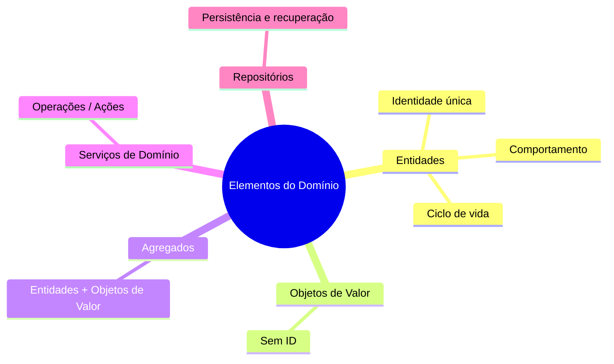
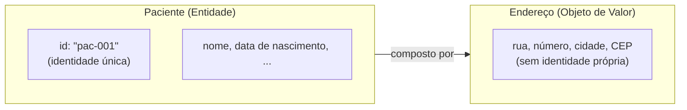
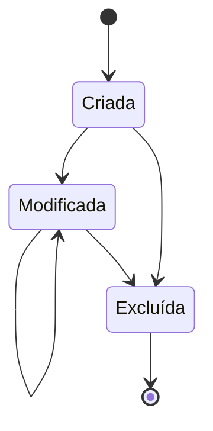
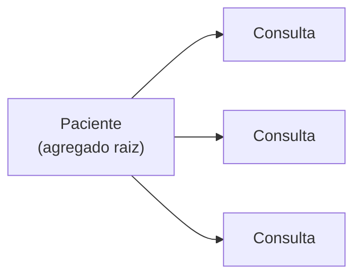
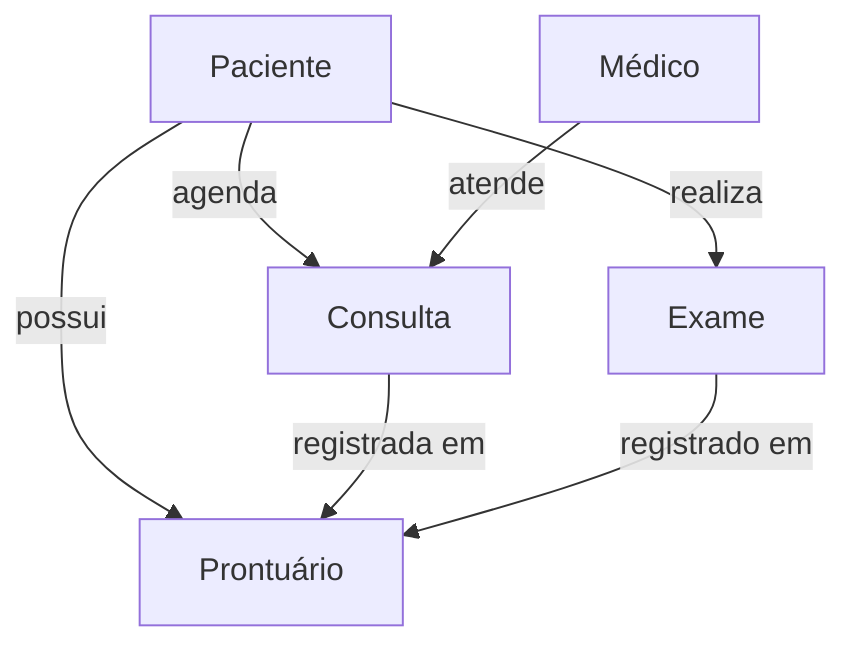

# Entidades

## Introdução e contexto

Depois de explorarmos o que é o **domínio**, como **isolá-lo** e como as **arquiteturas de software** (em camadas e hexagonal) ajudam nesse isolamento, chega a hora de discutir **quais elementos do domínio** são de fato relevantes para modelar o nosso problema.

Retomando um marco anterior: quando estabelecemos o princípio da **linguagem ubíqua** e conversamos com o especialista de domínio, chegamos ao **paciente** como algo importante para o sistema hospitalar — e mencionamos que ele é uma **entidade**. Esta aula explora **por que** ele é uma entidade.

## Os elementos do modelo

O livro de Eric Evans (*Domain-Driven Design*) especifica **cinco elementos principais** — não são os únicos, mas são os centrais:

| Elemento | Papel |
| --- | --- |
| **Entidades** | Objetos com **identidade única** (foco desta aula). |
| **Objetos de valor** | Objetos importantes, mas que **dificilmente têm um ID** associado. |
| **Agregados** | Blocos que **relacionam objetos de valor com entidades**. |
| **Serviços de domínio** | Operações que **não pertencem a uma entidade específica**. |
| **Repositórios** | Responsáveis por **persistir e recuperar** entidades/agregados. |



## O que é uma Entidade

De forma bem geral, as **entidades** são objetos dentro do sistema que possuem uma **identidade única**. Geralmente — não sempre — isso significa um **ID único** associado ao objeto.

**Duas entidades são diferentes mesmo que tenham os mesmos atributos.** Alguns exemplos:

- Você e sua esposa podem residir no **mesmo endereço**, ser pais das **mesmas crianças** e dirigir o **mesmo carro** — mas são **duas pessoas diferentes**.
- No sistema hospitalar, podemos ter **dois pacientes homônimos**, com o mesmo nome, a mesma data de nascimento, que deram entrada no hospital no mesmo dia e têm consultas marcadas naquele dia. Ainda assim, são **pacientes diferentes**, porque cada um possui uma **identidade única**.

É a **identidade**, e não o conjunto de atributos, que define a individualidade de uma entidade.



## Ciclo de vida

As entidades podem ser **criadas**, **modificadas** e **excluídas**.

- No âmbito do **programa**, a exclusão de objetos que não estão mais em uso geralmente fica a cargo do **garbage collector** — até porque, no século XXI, a maioria das linguagens facilita isso.
- Há também o **ciclo de vida do objeto de domínio**: por exemplo, remover o paciente do **banco de dados** (e não apenas da memória). Isso pode ser exigido por lei, como pela **LGPD**.
- A maioria das entidades tem seu papel a cumprir e "padece"; algumas, porém, vivem até que alguém "puxe o servidor da tomada".



## Comportamento

O **comportamento** de uma entidade são os seus **métodos** — e as entidades devem refletir **regras de negócio**.

No exemplo do `Paciente`, temos o método `agendarConsulta`, que carrega várias regras, como a já discutida: **duas consultas no mesmo horário não podem acontecer**.

Há um insight importante: ao definir o método, percebe-se que `agendarConsulta` precisa receber um **médico**. Ora — se precisamos de um médico, o **médico também não seria uma entidade**? Sim! Só pela definição de um método de outra entidade, já identificamos uma **nova entidade**.

É assim que as coisas vão se **desdobrando**: daqui pra frente vamos **pensar e codar**, fixando conceitos e descobrindo novas premissas e possibilidades dentro do sistema.

## Como identificar entidades

Não existe **método mágico** — tudo **depende do domínio** em que você está trabalhando. Para identificar entidades é preciso:

1. **Entender o domínio** e conversar com um **especialista de domínio** para obter informações sobre as personas/objetos do sistema.
2. **Double check**: verificar se algo **realmente precisa** de um ID.

Exemplo recorrente: será que vale a pena ter um ID para o **endereço**? A resposta é um sonoro **"depende"** — como quase tudo na modelagem de software.

- No **sistema hospitalar**, o foco é o paciente, e o endereço é apenas um detalhe associado a ele: nesse caso, o endereço é um **objeto de valor**.
- Se fosse um **sistema de busca de endereços**, o cenário seria outro.

## Entidades vs. Objetos de Valor

- **Entidades**: possuem **identidade única** (normalmente um ID) e ciclo de vida significativo.
- **Objetos de valor**: são importantes para o sistema, mas **dificilmente recebem um ID** — isso depende do problema. O `Endereço` associado ao `Paciente` é o exemplo clássico.

## Agregados, Serviços de Domínio e Repositórios

Uma visão geral dos outros elementos que acompanham as entidades:

- **Agregados**: blocos de código/entidades que **relacionam objetos de valor com entidades**. Ex.: o `Paciente` junto do seu **histórico de consultas** — uma coisa está diretamente associada à outra.
- **Serviços de domínio**: determinam as **operações que não pertencem a uma entidade específica**. Costumam estar ligados a um **verbo/ação** executada sobre as entidades.
- **Repositórios**: responsáveis por **persistir e recuperar** a entidade/agregado. Já mencionados algumas vezes, terão suas implementações exploradas em breve.



## As entidades do sistema hospitalar

Com base em tudo que já vimos, o levantamento inicial das entidades do sistema hospitalar é:

| Entidade | Responsabilidade |
| --- | --- |
| **Médico** | Atender os pacientes. |
| **Paciente** | Receber o cuidado/atendimento. |
| **Consulta** | Relacionar pacientes e médicos. |
| **Exame** | Exame médico realizado e atrelado ao paciente. |
| **Prontuário** | Reunir todo o histórico médico do paciente no hospital. |

Cada uma dessas entidades tem uma **identidade única** e seu próprio **ciclo de vida**.

Fica aberta para as próximas aulas a discussão de **como organizar** o prontuário: se nele ficarão apenas consultas e exames e seus resultados, ou se vale a pena detalhar mais.



## Exemplo de entidade (código)

Ilustração de uma **entidade** com identidade explícita, ciclo de vida e comportamento que reflete regras de negócio (estilo DDD do `paciente.ts`):

```typescript
export interface Consulta {
  data: Date;
  medico: string;
}

interface PacienteDTO {
  id: string;
  nome: string;
  dataNasc: Date;
  historico: string;
  alergia: string;
  endereco: string;
  telefone: string;
  email: string;
}

type CriarPacienteDTO = Omit<PacienteDTO, "id">;

class Paciente {
  // Identidade única: diferencia esta entidade de qualquer outra,
  // mesmo que os demais atributos sejam idênticos.
  readonly id: string;

  nome: string;
  dataNasc: Date;
  historico: string;
  alergia: string;
  endereco: string;
  telefone: string;
  email: string;

  #consultas: Consulta[] = [];

  constructor(dados: CriarPacienteDTO) {
    this.id = crypto.randomUUID();
    this.nome = dados.nome;
    this.dataNasc = dados.dataNasc;
    this.historico = dados.historico;
    this.alergia = dados.alergia;
    this.endereco = dados.endereco;
    this.telefone = dados.telefone;
    this.email = dados.email;
  }

  // Comportamento: método que carrega regras de negócio.
  agendarConsulta(data: Date, medico: string): void {
    const conflito = this.#consultas.some(
      (c) => c.data.getTime() === data.getTime(),
    );

    if (conflito) {
      throw new Error(
        "Paciente já possui uma consulta agendada neste horário.",
      );
    }

    this.#consultas.push({ data, medico });
  }

  get consultas(): ReadonlyArray<Consulta> {
    return [...this.#consultas];
  }
}
```

## Conclusão

As **entidades** são objetos com **identidade única** — que as diferencia mesmo quando os atributos coincidem — e que possuem **ciclo de vida** (criar, modificar, excluir) e **comportamento** que expressa regras de negócio. Identificá-las **depende do domínio** e exige conversa com o especialista.

No sistema hospitalar, partimos das entidades **Médico, Paciente, Consulta, Exame e Prontuário**, cada uma com sua identidade e ciclo de vida. Daqui em diante, a prática é essencial: **desenhar diagramas, codar e ir descobrindo** novas possibilidades.

Na **próxima aula**, aprofundaremos os **Objetos de Valor**.
