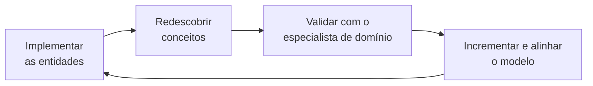
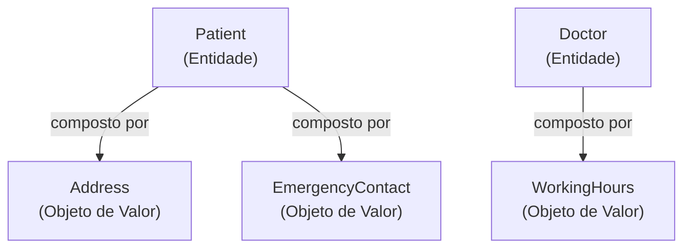
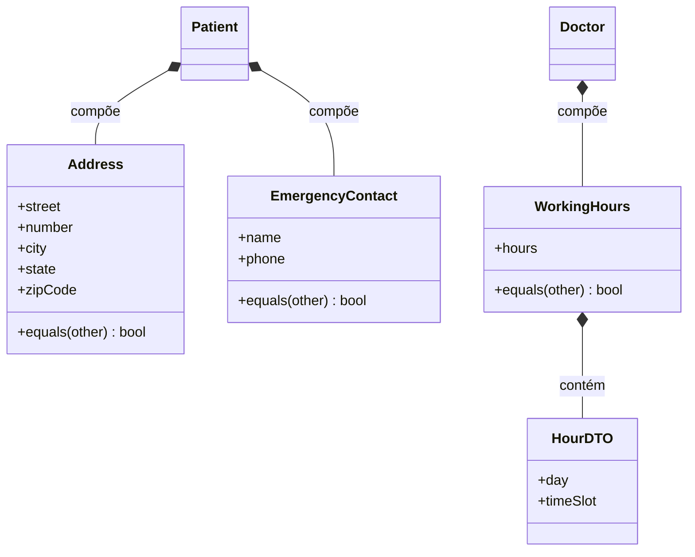

# Objeto de Valor

## Introdução e contexto

Seguimos no **Domain-Driven Design (DDD)**, tratando os **elementos do modelo**. Na aula anterior discutimos amplamente as **entidades** — conceitos do domínio com **identidade única**, ciclo de vida e comportamento. Hoje avançamos para os **objetos de valor**.

Um detalhe interessante: alguns objetos de valor **já apareceram enquanto implementávamos as entidades**. Naquele momento, algo como um endereço "aparentemente poderia ser outra classe, quem sabe". Muito do trabalho em DDD é **implementar e redescobrir** esses conceitos — e, conforme redescobrimos, levamos a descoberta ao **especialista de domínio** para validar se ela faz sentido. Se fizer, damos **um passinho atrás**, incrementamos o modelo atual e o **alinhamos com o domínio** como um todo.

Partimos do sistema já implementado nas aulas passadas, com suas entidades básicas, e agora vamos incrementá-lo com os objetos de valor identificados em **Doctor**, **Patient** e **Appointment**.



## O que são Objetos de Valor

Ao contrário das entidades, os **objetos de valor** são objetos que **não possuem uma identidade única**. Vale destacar: o "valor" aqui **não é financeiro**.

- Um objeto de valor é definido **unicamente por meio dos seus atributos**.
- **Dois objetos de valor são iguais se todos os seus atributos forem iguais.**

Compare com a entidade `Patient`: posso ter **dois pacientes homônimos**, com o mesmo nome, a mesma data de nascimento e a mesma data de entrada no hospital — ainda assim, **são pessoas distintas**. Isso **não** se aplica ao objeto de valor.

O exemplo clássico no nosso contexto hospitalar é o **Address**:

- Dois endereços com os **mesmos atributos** (mesma rua, mesmo número, mesmo bairro, mesma cidade, mesmo CEP) **são o mesmo endereço** — a mesma casa, o mesmo apartamento.
- Ainda assim, esse mesmo endereço pode **pertencer a entidades diferentes**. Se você e seu cônjuge recebem tratamento no mesmo hospital, ambos possuem **o mesmo endereço**, mas **são pessoas diferentes**.


## Imutabilidade

Os objetos de valor são ditos **imutáveis**: eles **não podem ser alterados**.

- Eles são **criados**, são **excluídos**, mas **não alterados**.
- "Mas eu acabei de citar o endereço e eu mudei de endereço?" — Nesse caso, você **cria um novo objeto** que **sobrescreve integralmente** o endereço antigo. O conceito em si é mantido: o objeto permanece imutável, apenas é substituído **por inteiro**. O novo endereço passa a estar associado àquela entidade.

Isso traz uma consequência prática importante: toda "mudança" é uma **troca de objeto**, não uma mutação de atributos.

## Como identificar Objetos de Valor

Não há método mágico — assim como acontece com as entidades, **depende do domínio**. Mas seguimos um caminho **na contramão da identidade**:

1. **Buscar conceitos sem identidade.** Em regra, são coisas que **não têm um ID explícito**. Pode até existir um ID na tabela do banco de dados, mas **não um ID representacional e único** para aquele objeto de valor.
2. **Analisar os atributos.** O conceito pode ser **definido única e exclusivamente por seus atributos**?
3. **Verificar a imutabilidade.** O conceito **pode ser imutável** dentro da nossa modelagem e do domínio em que trabalhamos?

O terceiro ponto esconde uma **limitação** relevante: se o objeto é imutável e precisa ser **atualizado com frequência**, cada atualização exige **criar um novo objeto**, interagir com o banco de dados e sobrescrever — o que gera **overhead de recurso computacional**.

> Exemplo: se um paciente tivesse uma consulta em um endereço diferente toda semana, criar um novo endereço toda semana não valeria a pena. Nesse caso, é **melhor deixá-lo mutável** — e, ao deixá-lo mutável, ele **deixa de ser um objeto de valor**.

## Objetos de Valor vs. Entidades

| Aspecto | Entidade | Objeto de Valor |
| --- | --- | --- |
| **Identidade** | Tem identidade única (geralmente um ID). | **Não tem** identidade própria. |
| **Igualdade** | Pela identidade, mesmo com atributos iguais. | **Pelos atributos**: iguais se todos os atributos forem iguais. |
| **Mutabilidade** | Pode ser modificada ao longo da vida. | **Imutável**: criada, excluída e substituída, nunca alterada. |
| **Ciclo de vida** | Criada, modificada e excluída. | Criada e excluída (a "mudança" é um novo objeto). |

## Os Objetos de Valor do sistema hospitalar

A partir da implementação das entidades básicas, chegamos a três objetos de valor no nosso contexto:

| Objeto de Valor | Atributos | Associado a | Observações |
| --- | --- | --- | --- |
| **Address** | street, number, city, state, zipCode | `Patient` | Poderia existir também para clínica ou médico, mas isso é **detalhe de implementação** que depende do contexto. |
| **EmergencyContact** | name + phone | `Patient` | Duas características bem definidas; dificilmente o paciente tem **diversos** contatos de emergência. |
| **WorkingHours** | dias da semana + horários (tuplas) | `Doctor` | Ex.: atende na **segunda das 14h às 18h** e na **terça das 8h às 12h**. |



Esses objetos **já estavam dentro das entidades** e agora **saem** para ter suas **implementações concretas** — mas continuarão sendo **referenciados por composição**. Ou seja, as entidades passam a depender desses objetos de valor.

## Exemplo de objeto de valor (código)

Ilustração dos três objetos de valor no estilo DDD do repositório (`address.ts`, `emergencyContact.ts` e `workingHours.ts`): **construtor com um único DTO**, estado encapsulado em campos privados (`#campo`), **imutabilidade** (cópias + `Object.freeze`) e **igualdade por atributos**.

> **Implementação:** nas aulas seguintes esses objetos ganham implementação concreta (`address.ts`, `emergencyContact.ts` e `workingHours.ts`). Aqui o foco é o conceito.

```typescript
// domain/address.ts — objeto de valor: definido apenas pelos atributos.
interface AddressDTO {
  street: string;
  number: string;
  city: string;
  state: string;
  zipCode: string;
}

export class Address {
  #street: string;
  #number: string;
  #city: string;
  #state: string;
  #zipCode: string;

  constructor(data: AddressDTO) {
    this.#street = data.street;
    this.#number = data.number;
    this.#city = data.city;
    this.#state = data.state;
    this.#zipCode = data.zipCode;

    // Imutável: criado e substituído por inteiro, nunca alterado.
    Object.freeze(this);
  }

  get street(): string {
    return this.#street;
  }

  get number(): string {
    return this.#number;
  }

  get city(): string {
    return this.#city;
  }

  get state(): string {
    return this.#state;
  }

  get zipCode(): string {
    return this.#zipCode;
  }

  // Dois objetos de valor são iguais se todos os atributos forem iguais.
  equals(other: Address): boolean {
    return (
      this.#street === other.#street &&
      this.#number === other.#number &&
      this.#city === other.#city &&
      this.#state === other.#state &&
      this.#zipCode === other.#zipCode
    );
  }

  toString(): string {
    return `${this.#street}, ${this.#number} - ${this.#city}/${this.#state} - ${this.#zipCode}`;
  }
}
```

```typescript
// domain/emergencyContact.ts — nome + telefone, nada além disso.
interface EmergencyContactDTO {
  name: string;
  phone: string;
}

export class EmergencyContact {
  #name: string;
  #phone: string;

  constructor(data: EmergencyContactDTO) {
    this.#name = data.name;
    this.#phone = data.phone;

    Object.freeze(this);
  }

  get name(): string {
    return this.#name;
  }

  get phone(): string {
    return this.#phone;
  }

  equals(other: EmergencyContact): boolean {
    return this.#name === other.#name && this.#phone === other.#phone;
  }
}
```

```typescript
// domain/workingHours.ts — dias e horários (tuplas) do médico.
export interface HourDTO {
  day: string; // ex.: "Segunda"
  timeSlot: string; // ex.: "14:00-18:00"
}

export class WorkingHours {
  #hours: ReadonlyArray<HourDTO>;

  constructor(hours: ReadonlyArray<HourDTO> = []) {
    // Copia e congela os horários para preservar a imutabilidade.
    this.#hours = Object.freeze(hours.map((hour) => Object.freeze({ ...hour })));

    Object.freeze(this);
  }

  get hours(): ReadonlyArray<HourDTO> {
    return [...this.#hours];
  }

  equals(other: WorkingHours): boolean {
    return (
      this.#hours.length === other.#hours.length &&
      this.#hours.every((hour, index) => {
        const otherHour = other.#hours[index];
        return (
          hour.day === otherHour.day && hour.timeSlot === otherHour.timeSlot
        );
      })
    );
  }
}
```

Agora as entidades **referenciam esses objetos por composição** — as propriedades que antes eram `string` soltas passam a ser objetos de valor:

```typescript
// domain/patient.ts (trecho) — composição com objetos de valor.
import { EmergencyContact } from "./emergencyContact.ts";
import { Address } from "./address.ts";

interface CreatePatientDTO {
  name: string;
  birthDate: Date;
  address: Address;
  emergencyContact: EmergencyContact;
}

export class Patient {
  #name: string;
  #birthDate: Date;
  #address: Address;
  #emergencyContact: EmergencyContact;

  constructor(data: CreatePatientDTO) {
    this.#name = data.name;
    this.#birthDate = data.birthDate;
    this.#address = data.address;
    this.#emergencyContact = data.emergencyContact;
  }

  get address(): Address {
    return this.#address;
  }

  // "Mudar de endereço" = substituir o objeto antigo por inteiro.
  changeAddress(newAddress: Address): void {
    this.#address = newAddress;
  }
}

// O mesmo endereço pode pertencer a entidades (pacientes) diferentes.
const sharedAddress = new Address({
  street: "Rua das Flores",
  number: "123",
  city: "São Paulo",
  state: "SP",
  zipCode: "01000-000",
});

const exactCopy = new Address({
  street: "Rua das Flores",
  number: "123",
  city: "São Paulo",
  state: "SP",
  zipCode: "01000-000",
});

console.log(sharedAddress.equals(exactCopy)); // true — mesmo objeto de valor
```



## Conclusão

Os **objetos de valor** completam o quadro dos elementos do modelo ao lado das entidades. Enquanto uma entidade é definida pela sua **identidade única**, um objeto de valor é definido **apenas pelos seus atributos** — dois deles são iguais quando **todos** os atributos coincidem — e é **imutável**: criado, excluído e **substituído por inteiro**, nunca alterado.

Identificá-los é caminhar **na contramão da identidade**, procurando conceitos **sem ID representacional**, que se deixem definir **pelos atributos** e que **possam ser imutáveis** no domínio. Quando a atualização é frequente, a imutabilidade vira **overhead** e o objeto, então, **deixa de ser um objeto de valor**.

No sistema hospitalar, chegamos ao **Address** e ao **EmergencyContact** (associados ao paciente) e ao **WorkingHours** (associado ao médico). Esses objetos **saem das entidades** para ganhar implementação concreta, mas continuam **referenciados por composição**. Nas próximas aulas, seguimos incrementando o modelo com os demais elementos do DDD.
