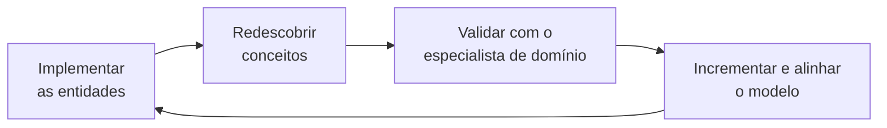
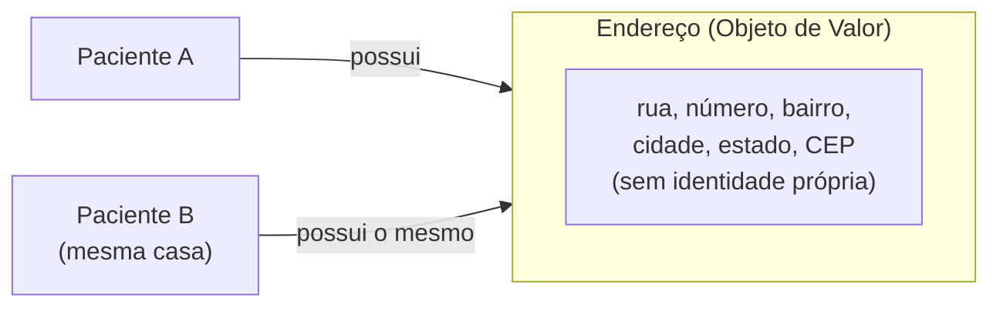
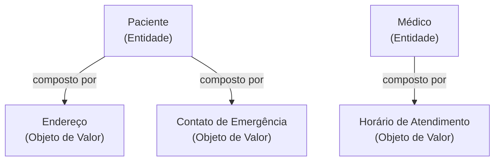
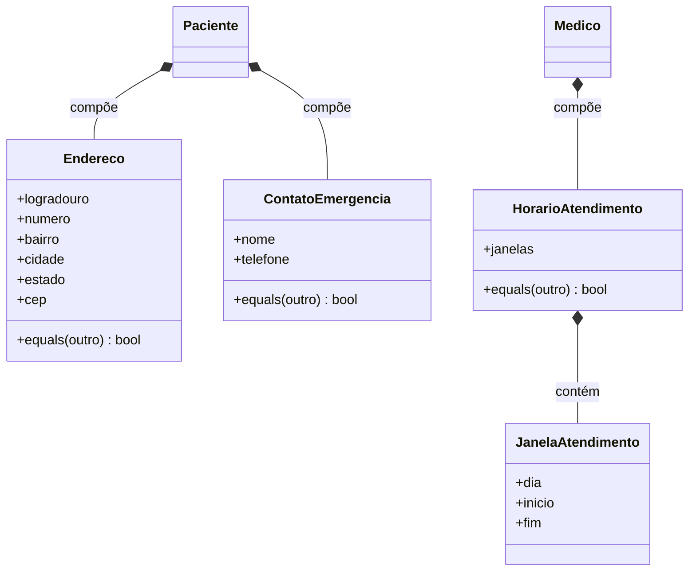

# Objeto de Valor

## Introdução e contexto

Seguimos no **Domain-Driven Design (DDD)**, tratando os **elementos do modelo**. Na aula anterior discutimos amplamente as **entidades** — conceitos do domínio com **identidade única**, ciclo de vida e comportamento. Hoje avançamos para os **objetos de valor**.

Um detalhe interessante: alguns objetos de valor **já apareceram enquanto implementávamos as entidades**. Naquele momento, algo como um endereço "aparentemente poderia ser outra classe, quem sabe". Muito do trabalho em DDD é **implementar e redescobrir** esses conceitos — e, conforme redescobrimos, levamos a descoberta ao **especialista de domínio** para validar se ela faz sentido. Se fizer, damos **um passinho atrás**, incrementamos o modelo atual e o **alinhamos com o domínio** como um todo.

Partimos do sistema já implementado nas aulas passadas, com suas entidades básicas, e agora vamos incrementá-lo com os objetos de valor identificados em **Médico**, **Paciente** e **Consulta**.



## O que são Objetos de Valor

Ao contrário das entidades, os **objetos de valor** são objetos que **não possuem uma identidade única**. Vale destacar: o "valor" aqui **não é financeiro**.

- Um objeto de valor é definido **unicamente por meio dos seus atributos**.
- **Dois objetos de valor são iguais se todos os seus atributos forem iguais.**

Compare com a entidade `Paciente`: posso ter **dois pacientes homônimos**, com o mesmo nome, a mesma data de nascimento e a mesma data de entrada no hospital — ainda assim, **são pessoas distintas**. Isso **não** se aplica ao objeto de valor.

O exemplo clássico no nosso contexto hospitalar é o **Endereço**:

- Dois endereços com os **mesmos atributos** (mesma rua, mesmo número, mesmo bairro, mesma cidade, mesmo CEP) **são o mesmo endereço** — a mesma casa, o mesmo apartamento.
- Ainda assim, esse mesmo endereço pode **pertencer a entidades diferentes**. Se você e seu cônjuge recebem tratamento no mesmo hospital, ambos possuem **o mesmo endereço**, mas **são pessoas diferentes**.



## Imutabilidade

Os objetos de valor são ditos **imutáveis**: eles **não podem ser alterados**.

- Eles são **criados**, são **excluídos**, mas **não alterados**.
- "Mas eu acabei de citar o endereço e eu mudei de endereço?" — Nesse caso, você **cria um novo objeto** que **sobrescreve integralmente** o endereço antigo. O conceito em si é mantido: o objeto permanece imutável, apenas é substituído **por inteiro**. O novo endereço passa a estar associado àquela entidade.

Isso traz uma consequência prática importante: toda "mudança" é uma **troca de objeto**, não uma mutação de atributos.

## Como identificar Objetos de Valor

Não há método mágico — assim como acontece com as entidades, **depende do domínio**. Mas seguimos um caminho **na contramão da identidade**:

1. **Buscar conceitos sem identidade.** Em regra, são coisas que **não têm um ID explícito**. Pode até existir um ID na tabela do banco de dados, mas **não um ID representacional e único** para aquele objeto de valor.
2. **Analisar os atributos.** O conceito pode ser **definido única e exclusivamente por seus atributos**?
3. **Verificar a imutabilidade.** O conceito **pode ser imutável** dentro da nossa modelagem e do domínio em que trabalhamos?

O terceiro ponto esconde uma **limitação** relevante: se o objeto é imutável e precisa ser **atualizado com frequência**, cada atualização exige **criar um novo objeto**, interagir com o banco de dados e sobrescrever — o que gera **overhead de recurso computacional**.

> Exemplo: se um paciente tivesse uma consulta em um endereço diferente toda semana, criar um novo endereço toda semana não valeria a pena. Nesse caso, é **melhor deixá-lo mutável** — e, ao deixá-lo mutável, ele **deixa de ser um objeto de valor**.

## Objetos de Valor vs. Entidades

| Aspecto | Entidade | Objeto de Valor |
| --- | --- | --- |
| **Identidade** | Tem identidade única (geralmente um ID). | **Não tem** identidade própria. |
| **Igualdade** | Pela identidade, mesmo com atributos iguais. | **Pelos atributos**: iguais se todos os atributos forem iguais. |
| **Mutabilidade** | Pode ser modificada ao longo da vida. | **Imutável**: criada, excluída e substituída, nunca alterada. |
| **Ciclo de vida** | Criada, modificada e excluída. | Criada e excluída (a "mudança" é um novo objeto). |

## Os Objetos de Valor do sistema hospitalar

A partir da implementação das entidades básicas, chegamos a três objetos de valor no nosso contexto:

| Objeto de Valor | Atributos | Associado a | Observações |
| --- | --- | --- | --- |
| **Endereço** | rua, número, bairro, cidade, estado, CEP | `Paciente` | Poderia existir também para clínica ou médico, mas isso é **detalhe de implementação** que depende do contexto. |
| **Contato de Emergência** | nome + telefone | `Paciente` | Duas características bem definidas; dificilmente o paciente tem **diversos** contatos de emergência. |
| **Horário de Atendimento** | dias da semana + horários (tuplas) | `Médico` | Ex.: atende na **segunda das 14h às 18h** e na **terça das 8h às 12h**. |



Esses objetos **já estavam dentro das entidades** e agora **saem** para ter suas **implementações concretas** — mas continuarão sendo **referenciados por composição**. Ou seja, as entidades passam a depender desses objetos de valor.

## Exemplo de objeto de valor (código)

Ilustração dos três objetos de valor no estilo DDD do repositório (`endereco.ts`, `contatoEmergencia.ts` e `horarioAtendimento.ts`): **construtor com um único DTO**, estado encapsulado em campos privados (`#campo`), **imutabilidade** (cópias + `Object.freeze`) e **igualdade por atributos**.

> **Atualização (aulas de implementação):** nas notas *6 - Implementando Objetos de Valor - Parte 1* e *7 - Implementando Objetos de Valor - Parte 2* esses objetos passaram a usar **nomes em inglês** — `address.ts` (`Address`), `emergencyContact.ts` (`EmergencyContact`) e `workingHours.ts` (`WorkingHours`). O código abaixo mantém os nomes em **português** apenas para ilustrar o conceito desta aula.

```typescript
// domain/endereco.ts — objeto de valor: definido apenas pelos atributos.
interface EnderecoDTO {
  logradouro: string;
  numero: string;
  bairro: string;
  cidade: string;
  estado: string;
  cep: string;
}

export class Endereco {
  #logradouro: string;
  #numero: string;
  #bairro: string;
  #cidade: string;
  #estado: string;
  #cep: string;

  constructor(dados: EnderecoDTO) {
    this.#logradouro = dados.logradouro;
    this.#numero = dados.numero;
    this.#bairro = dados.bairro;
    this.#cidade = dados.cidade;
    this.#estado = dados.estado;
    this.#cep = dados.cep;

    // Imutável: criado e substituído por inteiro, nunca alterado.
    Object.freeze(this);
  }

  get logradouro(): string {
    return this.#logradouro;
  }

  get numero(): string {
    return this.#numero;
  }

  get bairro(): string {
    return this.#bairro;
  }

  get cidade(): string {
    return this.#cidade;
  }

  get estado(): string {
    return this.#estado;
  }

  get cep(): string {
    return this.#cep;
  }

  // Dois objetos de valor são iguais se todos os atributos forem iguais.
  equals(outro: Endereco): boolean {
    return (
      this.#logradouro === outro.#logradouro &&
      this.#numero === outro.#numero &&
      this.#bairro === outro.#bairro &&
      this.#cidade === outro.#cidade &&
      this.#estado === outro.#estado &&
      this.#cep === outro.#cep
    );
  }

  toString(): string {
    return `${this.#logradouro}, ${this.#numero} - ${this.#bairro}, ${this.#cidade}/${this.#estado} - ${this.#cep}`;
  }
}
```

```typescript
// domain/contatoEmergencia.ts — nome + telefone, nada além disso.
interface ContatoEmergenciaDTO {
  nome: string;
  telefone: string;
}

export class ContatoEmergencia {
  #nome: string;
  #telefone: string;

  constructor(dados: ContatoEmergenciaDTO) {
    this.#nome = dados.nome;
    this.#telefone = dados.telefone;

    Object.freeze(this);
  }

  get nome(): string {
    return this.#nome;
  }

  get telefone(): string {
    return this.#telefone;
  }

  equals(outro: ContatoEmergencia): boolean {
    return this.#nome === outro.#nome && this.#telefone === outro.#telefone;
  }
}
```

```typescript
// domain/horarioAtendimento.ts — dias e horários (tuplas) do médico.
export interface JanelaAtendimento {
  dia: string; // ex.: "Segunda"
  inicio: string; // ex.: "14:00"
  fim: string; // ex.: "18:00"
}

export class HorarioAtendimento {
  #janelas: ReadonlyArray<JanelaAtendimento>;

  constructor(janelas: ReadonlyArray<JanelaAtendimento>) {
    // Copia e congela as janelas para preservar a imutabilidade.
    this.#janelas = Object.freeze(janelas.map((janela) => Object.freeze({ ...janela })));

    Object.freeze(this);
  }

  get janelas(): ReadonlyArray<JanelaAtendimento> {
    return [...this.#janelas];
  }

  equals(outro: HorarioAtendimento): boolean {
    return (
      this.#janelas.length === outro.#janelas.length &&
      this.#janelas.every((janela, indice) => {
        const outra = outro.#janelas[indice];
        return (
          janela.dia === outra.dia &&
          janela.inicio === outra.inicio &&
          janela.fim === outra.fim
        );
      })
    );
  }
}
```

Agora as entidades **referenciam esses objetos por composição** — as propriedades que antes eram `string` soltas passam a ser objetos de valor:

```typescript
// domain/paciente.ts (trecho) — composição com objetos de valor.
import { ContatoEmergencia } from "./contatoEmergencia.ts";
import { Endereco } from "./endereco.ts";

interface CriarPacienteDTO {
  nome: string;
  dataNasc: Date;
  endereco: Endereco;
  contatoEmergencia: ContatoEmergencia;
}

export class Paciente {
  #nome: string;
  #dataNasc: Date;
  #endereco: Endereco;
  #contatoEmergencia: ContatoEmergencia;

  constructor(dados: CriarPacienteDTO) {
    this.#nome = dados.nome;
    this.#dataNasc = dados.dataNasc;
    this.#endereco = dados.endereco;
    this.#contatoEmergencia = dados.contatoEmergencia;
  }

  get endereco(): Endereco {
    return this.#endereco;
  }

  // "Mudar de endereço" = substituir o objeto antigo por inteiro.
  mudarEndereco(novoEndereco: Endereco): void {
    this.#endereco = novoEndereco;
  }
}

// O mesmo endereço pode pertencer a entidades (pacientes) diferentes.
const enderecoCompartilhado = new Endereco({
  logradouro: "Rua das Flores",
  numero: "123",
  bairro: "Centro",
  cidade: "São Paulo",
  estado: "SP",
  cep: "01000-000",
});

const copiaExata = new Endereco({
  logradouro: "Rua das Flores",
  numero: "123",
  bairro: "Centro",
  cidade: "São Paulo",
  estado: "SP",
  cep: "01000-000",
});

console.log(enderecoCompartilhado.equals(copiaExata)); // true — mesmo objeto de valor
```



## Conclusão

Os **objetos de valor** completam o quadro dos elementos do modelo ao lado das entidades. Enquanto uma entidade é definida pela sua **identidade única**, um objeto de valor é definido **apenas pelos seus atributos** — dois deles são iguais quando **todos** os atributos coincidem — e é **imutável**: criado, excluído e **substituído por inteiro**, nunca alterado.

Identificá-los é caminhar **na contramão da identidade**, procurando conceitos **sem ID representacional**, que se deixem definir **pelos atributos** e que **possam ser imutáveis** no domínio. Quando a atualização é frequente, a imutabilidade vira **overhead** e o objeto, então, **deixa de ser um objeto de valor**.

No sistema hospitalar, chegamos ao **Endereço** e ao **Contato de Emergência** (associados ao paciente) e ao **Horário de Atendimento** (associado ao médico). Esses objetos **saem das entidades** para ganhar implementação concreta, mas continuam **referenciados por composição**. Nas próximas aulas, seguimos incrementando o modelo com os demais elementos do DDD.
