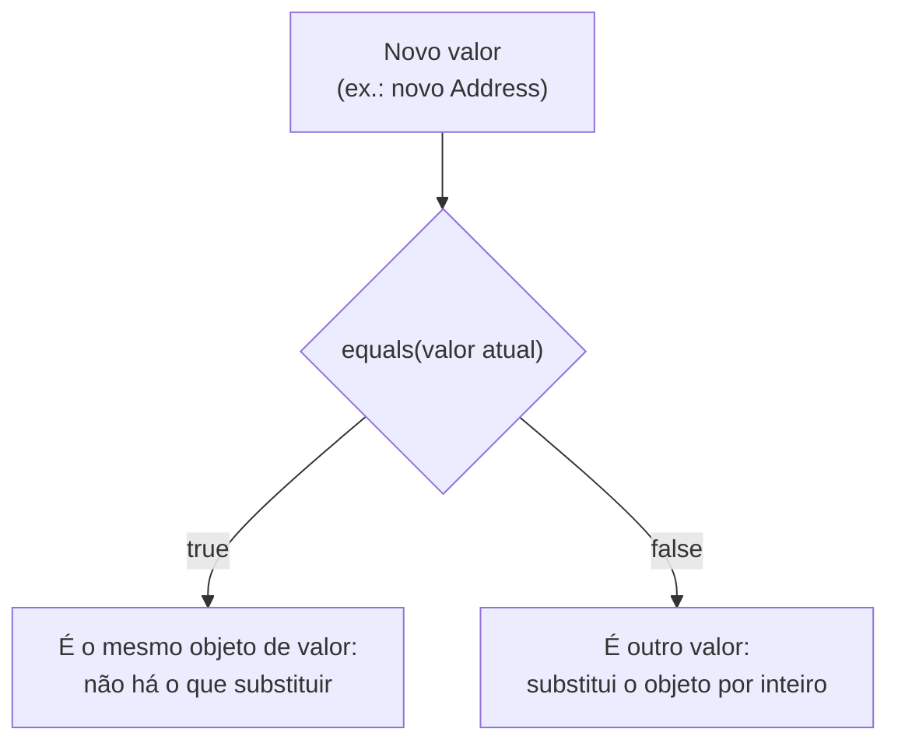
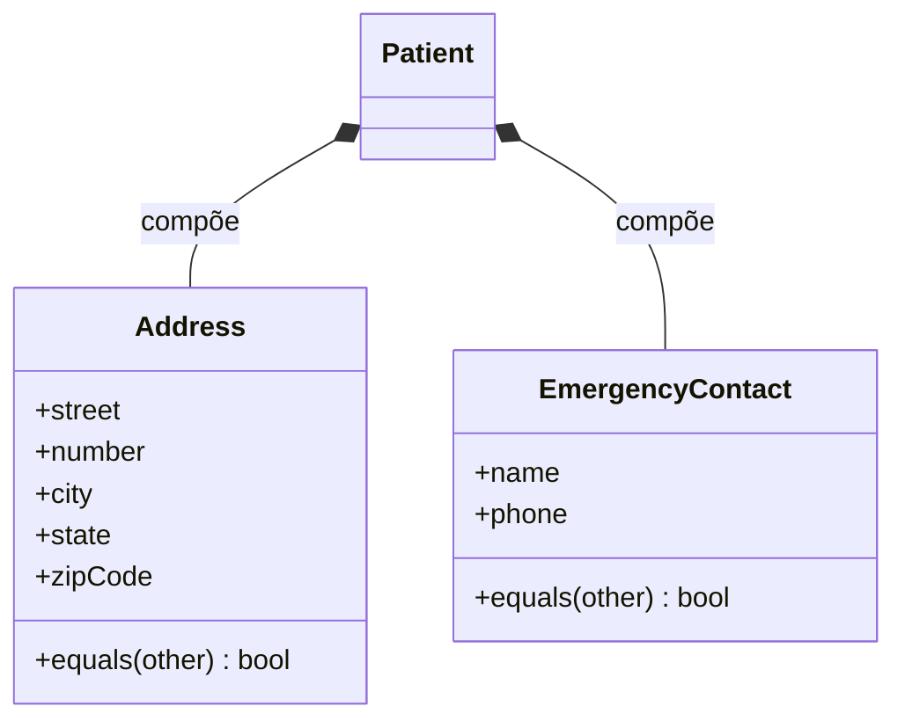

# Implementando Objetos de Valor - Parte 1

## Introdução e contexto

Chegou a hora de **implementar os objetos de valor** identificados na modelagem. Dois deles afetam diretamente a entidade **Patient**:

- **Address** (endereço);
- **EmergencyContact** (contato de emergência).

Esta primeira parte cobre justamente esses dois. Os objetos de valor ligados ao **Médico** ficam para a próxima parte, porque vão provocar **múltiplas alterações** na implementação atual daquela entidade.

## Convenção: nomes em inglês

A partir desta aula, o código passa a adotar **nomes em inglês** — para **arquivos**, **classes**, **atributos** e demais identificadores. A justificativa é **universalizar** o sistema: o sistema hospitalar **não será utilizado apenas por hospitais no Brasil**.

| Conceito | Antes (português) | Agora (inglês) |
| --- | --- | --- |
| Endereço | `endereco` | `address` |
| Rua | `rua` | `street` |
| Número | `numero` | `number` |
| Cidade | `cidade` | `city` |
| Estado | `estado` | `state` |
| CEP | `cep` | `zipCode` |
| Contato de emergência | `contatoEmergencia` | `emergencyContact` |
| Nome | `nome` | `name` |
| Telefone | `telefone` | `phone` |

> **Nota:** os objetos de valor desta aula já nascem com identificadores em inglês. A migração das demais entidades para o inglês acontece em seguida — na *Parte 2*, `medico` vira `Doctor`, e depois `Paciente`→`Patient`, `Consulta`→`Consultation`, `Exame`→`Exam` e `Prontuario`→`MedicalRecord`.

## O objeto de valor Address

De forma simplificada, o endereço é composto por:

| Atributo | Significado |
| --- | --- |
| `street` | Rua/logradouro |
| `number` | Número |
| `city` | Cidade |
| `state` | Estado |
| `zipCode` | Código postal (CEP) |

Campos **complementares** — prédio, apartamento, bloco — podem ser adicionados. A quantidade de linhas de endereço **depende da modelagem** e da conversa com o **especialista de domínio**: é ele quem define o que é **realmente relevante** para o projeto.

## O objeto de valor EmergencyContact

O contato de emergência é ainda mais simples: possui apenas **dois campos**.

| Atributo | Significado |
| --- | --- |
| `name` | Nome do contato |
| `phone` | Telefone do contato |

## O papel do método `equals`

Os dois objetos de valor implementam **`equals`**. O método retorna `true` ou `false` com base na comparação de **todos os atributos** — afinal, como vimos, **dois objetos de valor são iguais se todos os seus atributos forem iguais**.

Ele serve para verificar se a alteração pretendida **recai em um objeto que já existe**. Exemplo: ao **substituir o endereço de um paciente**, verificamos se não estamos fazendo a mesma substituição pelo mesmo endereço.

Com isso, ganhamos:

- **Uniformidade** no modelo;
- Garantia de que **não estamos tentando alterar um objeto já existente** — algo especialmente relevante porque objetos de valor **geralmente são imutáveis**.

> Quanto mais atributos um objeto de valor tiver, **mais trabalhosa** fica a comparação — mas é o preço da igualdade por valor.



## "O contato pode ser igual e o paciente não?"

Essa é uma dúvida natural. O paciente pode ter **nome e data de nascimento iguais** a outro e ainda assim ser **outra pessoa**, porque é uma **entidade** com **identidade única**. Por que o contato de emergência pode ser considerado igual apenas por `name` e `phone`?

- O contato está **atrelado ao paciente**, e o paciente é a **entidade** — ele tem um **identificador único**.
- A relação é **um para um**: **um paciente → um contato de emergência**.

Ou seja, a identidade do paciente **reduz drasticamente** a possibilidade de ambiguidade. Não é preciso se preocupar com múltiplos contatos associados ao mesmo paciente.

## Implementação

### `address.ts`

```typescript
// domain/address.ts — objeto de valor imutável, comparado por atributos.
export interface AddressDTO {
  readonly street: string;
  readonly number: string;
  readonly city: string;
  readonly state: string;
  readonly zipCode: string;
}

export class Address implements AddressDTO {
  readonly street: string;
  readonly number: string;
  readonly city: string;
  readonly state: string;
  readonly zipCode: string;

  constructor(data: AddressDTO) {
    this.street = data.street;
    this.number = data.number;
    this.city = data.city;
    this.state = data.state;
    this.zipCode = data.zipCode;

    // Imutabilidade em runtime: o objeto não aceita reatribuição nem novos atributos.
    Object.freeze(this);
  }

  // true somente se todos os atributos forem iguais.
  equals(otherAddress: Address): boolean {
    return (
      this.street === otherAddress.street &&
      this.number === otherAddress.number &&
      this.city === otherAddress.city &&
      this.state === otherAddress.state &&
      this.zipCode === otherAddress.zipCode
    );
  }
}
```

### `emergencyContact.ts`

```typescript
// domain/emergencyContact.ts — dois atributos, nada além disso.
export interface EmergencyContactDTO {
  readonly name: string;
  readonly phone: string;
}

export class EmergencyContact implements EmergencyContactDTO {
  readonly name: string;
  readonly phone: string;

  constructor(data: EmergencyContactDTO) {
    this.name = data.name;
    this.phone = data.phone;

    // Imutabilidade em runtime: o objeto não aceita reatribuição nem novos atributos.
    Object.freeze(this);
  }

  equals(otherContact: EmergencyContact): boolean {
    return this.name === otherContact.name && this.phone === otherContact.phone;
  }
}
```

## Integrando ao teste do hospital

Com as classes criadas e exportadas, instanciamos os objetos e os passamos ao paciente no lugar dos valores soltos (antes, `address` e `emergencyContact` eram apenas `string`):

```typescript
// testHospital.ts (trecho)
import { Address } from "./domain/address.ts";
import { EmergencyContact } from "./domain/emergencyContact.ts";

const address1 = new Address({
  street: "Rua das Flores",
  number: "123",
  city: "São Paulo",
  state: "SP",
  zipCode: "01234-567",
});

const emergencyContact1 = new EmergencyContact({
  name: "Maria Silva",
  phone: "(11) 88888-8888",
});

const patient1 = new Patient({
  // ...demais dados do paciente...
  address: address1,
  emergencyContact: emergencyContact1,
});
```

Agora o endereço e o contato de emergência são **objetos de valor de verdade**, com igualdade por atributos, e a entidade `Patient` os referencia por **composição**.

## Impacto no modelo



## Conclusão

Nesta parte implementamos os objetos de valor que impactam diretamente o **Patient**:

- **`Address`** com `street`, `number`, `city`, `state` e `zipCode` — extensível com complementos conforme o domínio exigir;
- **`EmergencyContact`** com `name` e `phone`.

Ambos são **imutáveis** e implementam **`equals`**, comparando **todos os atributos** para garantir que não estamos substituindo um valor por ele mesmo nem tentando alterar um objeto já existente. Também adotamos **nomes em inglês** em todo o código, preparando o sistema para uso internacional.

Na **próxima parte**, criamos os objetos de valor relacionados ao **Doctor** — o que vai exigir **várias alterações** na implementação atual dessa entidade.
