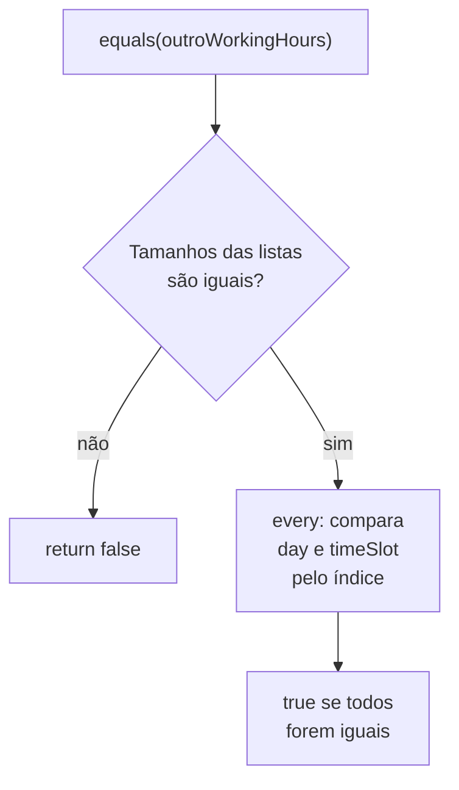
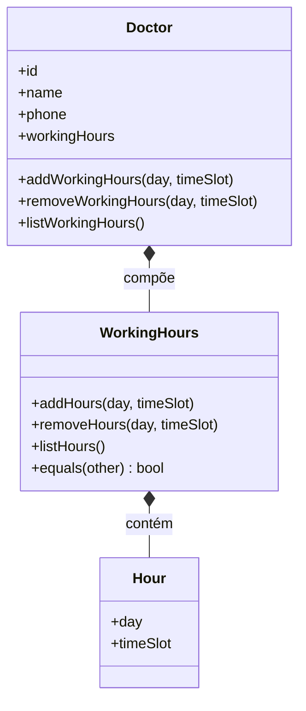

# Implementando Objetos de Valor - Parte 2

## Introdução e contexto

Chegamos ao **grande final sobre objetos de valor**. O objeto da vez é o **horário de atendimento** — o `WorkingHours`: as **horas dos dias da semana** em que um determinado **médico** estará trabalhando.

É o primeiro caso em que lidamos com uma **lista** de horários: uma verdadeira "rede" de horas e dias da semana. E é também o primeiro objeto de valor que expõe **métodos de manipulação** — adicionar, remover e listar horários.

## O cenário: horários variados

Um médico pode trabalhar em **dias diferentes**, com **intervalos diferentes**:

| Dia | Horário |
| --- | --- |
| Segunda | 14h às 18h |
| Quarta | 8h às 12h |
| Sexta | 14h às 18h |

Modelar isso como um **objeto de valor** facilita a vida: o médico deixa de ter horas soltas e passa a ter um objeto coeso, com comportamento próprio.

## Imutabilidade na prática

As horas **podem mudar**. Não é muito frequente — mas, em tese, é **mais frequente do que o endereço era**. Cenários comuns:

- O médico passa a atender em um **novo dia** nesta semana;
- O médico **não atende** em determinado dia (por ser **feriado**, por exemplo);
- O médico atende em **outra cidade** e vem apenas em **dias específicos**.

Por isso, `addHours` e `removeHours` **não alteram** as entradas existentes: eles **sobrescrevem a lista**, produzindo uma **nova lista**. O objeto de valor continua sendo tratado como **imutável** — não ferimos a premissa "objetos de valor tendem a ser imutáveis".

> Ponto-chave da aula: alterar um horário **não é mutar o objeto**, e sim **trocar a lista por uma nova** — remoção, por exemplo, é feita com `filter`, que devolve uma **nova coleção**.

## A "API" do WorkingHours

| Método | Papel |
| --- | --- |
| `addHours(day, timeSlot)` | **Adiciona** um horário (dia + intervalo) à lista. |
| `removeHours(day, timeSlot)` | **Remove** o horário correspondente ao dia + intervalo informados. |
| `listHours()` | **Lista** os horários disponíveis para atendimento daquele médico. |
| `equals(otherWorkingHours)` | **Compara** dois horários de atendimento (lista a lista). |

## Removendo com `filter`

Na remoção, informamos **qual dia** e **qual intervalo** queremos tirar. Como pode haver mais de um intervalo no mesmo dia (de manhã e à tarde), a comparação precisa considerar **as duas coisas**. A lista original é sobrescrita com o resultado do filtro:

- **Permanece** o horário cujo `day` for **diferente** do dia que queremos remover **ou** cujo `timeSlot` for diferente;
- Em outras palavras: só sai exatamente a combinação **dia + intervalo** que pedimos para remover.

## `equals`: tamanho primeiro, depois campo a campo

Sendo um objeto de valor, o `WorkingHours` também implementa `equals`. A comparação segue uma estratégia eficiente:

1. Se o **tamanho** das listas for **diferente**, sabemos de imediato que os objetos são diferentes → retorna `false`.
2. Se os tamanhos forem **iguais**, comparamos **objeto por objeto, campo por campo**, usando o **índice**: o `day` existente com o `day` do outro e o `timeSlot` existente com o `timeSlot` do outro.



## Implementação — `workingHours.ts`

```typescript
// domain/workingHours.ts — objeto de valor: lista de dias e intervalos.
export interface Hour {
  day: string;
  timeSlot: string;
}

export class WorkingHours {
  #hours: Hour[] = [];

  // O construtor nasce vazio de propósito: o médico vai preenchendo os
  // horários aos poucos, em vez de recebê-los todos de uma vez.
  addHours(day: string, timeSlot: string): void {
    this.#hours.push({ day, timeSlot });
    console.log(`Horário adicionado: ${day} ${timeSlot}.`);
  }

  removeHours(day: string, timeSlot: string): void {
    // Sobrescreve a lista com uma NOVA lista (filter), mantendo a imutabilidade.
    this.#hours = this.#hours.filter(
      (hour) => hour.day !== day || hour.timeSlot !== timeSlot,
    );
    console.log(`Horário removido: ${day} ${timeSlot}.`);
  }

  listHours(): ReadonlyArray<Hour> {
    return [...this.#hours];
  }

  equals(otherWorkingHours: WorkingHours): boolean {
    // Tamanhos diferentes: já é o suficiente para concluir que são diferentes.
    if (this.#hours.length !== otherWorkingHours.#hours.length) {
      return false;
    }

    // Mesmo tamanho: compara campo por campo, pelo índice.
    return this.#hours.every((hour, index) => {
      const otherHour = otherWorkingHours.#hours[index];
      return hour.day === otherHour.day && hour.timeSlot === otherHour.timeSlot;
    });
  }
}
```

## Integrando ao `Doctor`

Os métodos do objeto de valor são **repassados** ao médico, que passa a **delegar** para o `WorkingHours`. Com isso, o horário de atendimento **não é mais passado por parâmetro** no construtor do médico: ele nasce **vazio** (`new WorkingHours()`) e é preenchido aos poucos.

```typescript
// domain/doctor.ts (trecho)
import { WorkingHours, type Hour } from "./workingHours.ts";

export class Doctor {
  id: string;
  crm: string;
  name: string;
  phone: string;
  workingHours: WorkingHours;

  #specialties: string[];

  constructor(data: DoctorDTO) {
    this.id = data.id;
    this.crm = data.crm;
    this.name = data.name;
    this.phone = data.phone;
    this.#specialties = data.specialties;

    // O horário de atendimento nasce vazio.
    this.workingHours = new WorkingHours();
  }

  // Delegação: o Doctor apenas repassa para o objeto de valor.
  addWorkingHours(day: string, timeSlot: string): void {
    this.workingHours.addHours(day, timeSlot);
  }

  removeWorkingHours(day: string, timeSlot: string): void {
    this.workingHours.removeHours(day, timeSlot);
  }

  listWorkingHours(): ReadonlyArray<Hour> {
    return this.workingHours.listHours();
  }
}
```



## Atualização de nomenclatura

Seguindo a adoção do **inglês** iniciada na Parte 1, a entidade `Medico` também é renomeada:

| Antes (português) | Agora (inglês) |
| --- | --- |
| `Medico` | `Doctor` |
| `horarioAtendimento` | `workingHours` |
| `nome` | `name` |
| `especialidades` | `specialties` |
| `telefone` | `phone` |
| `crm` | `crm` (sigla mantida — Conselho Regional de Medicina) |

## Testando no hospital

No `testHospital.ts`, passamos a **adicionar** horários ao médico em vez de informá-los na construção. Cada horário adicionado é um **objeto à parte** — um representando a **segunda-feira** e outro representando a **quarta-feira**:

```typescript
// testHospital.ts (trecho)
const doctor1 = new Doctor({
  id: "med-001",
  crm: "CRM-SP 123456",
  name: "Maria Santos",
  specialties: ["Cardiologia"],
  phone: "(11) 91234-5678",
});

doctor1.addWorkingHours("Segunda", "14:00-18:00");
doctor1.addWorkingHours("Quarta", "14:00-18:00");

console.log(doctor1);
```

## Conclusão

Fechamos a série de **objetos de valor** com o **`WorkingHours`** — o primeiro deles a lidar com uma **lista** e a expor comportamento de **adicionar**, **remover** e **listar** horários. Mesmo com essas operações, a imutabilidade é preservada: a lista é **sobrescrita por uma nova**, e não mutada. O `equals` compara primeiro o **tamanho** e depois **campo a campo**.

O `WorkingHours` é referenciado pelo **`Doctor`** por **composição**, e o médico apenas **delega** as chamadas — o horário de atendimento deixou de ser parâmetro de construção.

Na **próxima aula**, começamos a falar de **agregados**: como relacionar **entidades e objetos de valor** de uma forma melhor do que a que vimos fazendo até aqui. Até lá!
