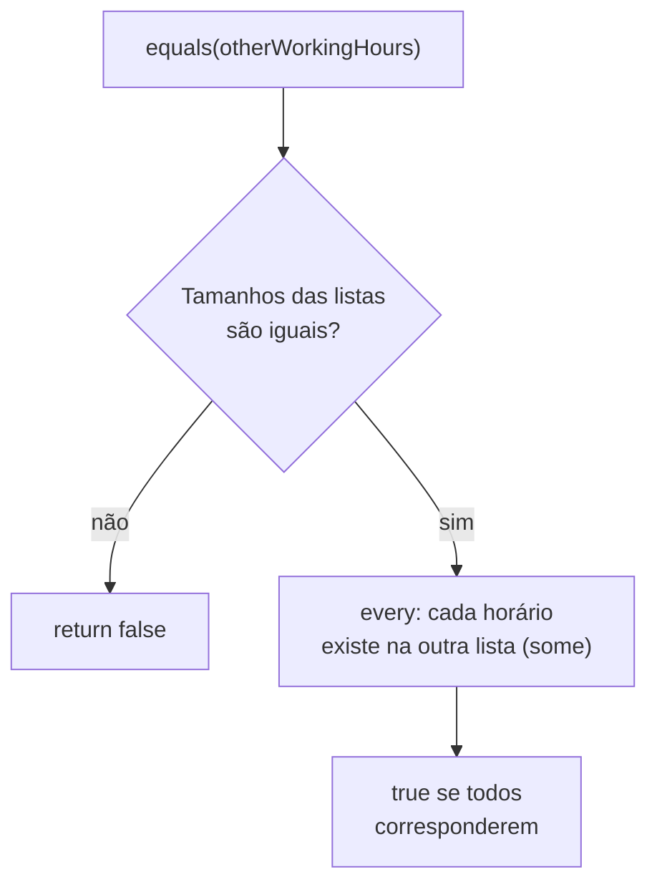
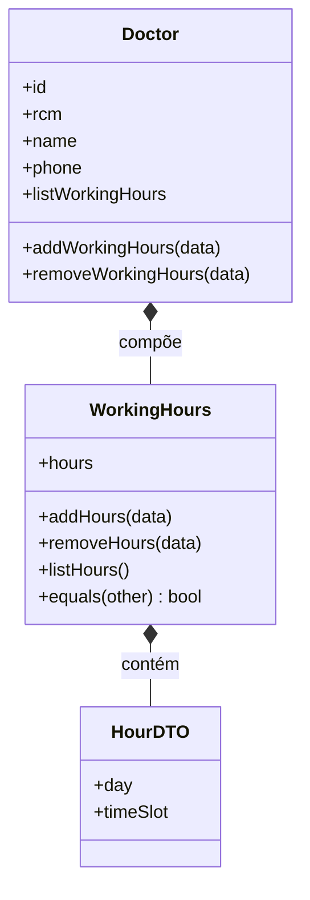

# Implementando Objetos de Valor - Parte 2

## Introdução e contexto

Chegamos ao **grande final sobre objetos de valor**. O objeto da vez é o **horário de atendimento** — o `WorkingHours`: as **horas dos dias da semana** em que um determinado **médico** estará trabalhando.

É o primeiro caso em que lidamos com uma **lista** de horários: uma verdadeira "rede" de horas e dias da semana. E é também o primeiro objeto de valor que expõe **métodos de manipulação** — adicionar, remover e listar horários.

## O cenário: horários variados

Um médico pode trabalhar em **dias diferentes**, com **intervalos diferentes**:

| Dia | Horário |
| --- | --- |
| Segunda | 14h às 18h |
| Quarta | 8h às 12h |
| Sexta | 14h às 18h |

Modelar isso como um **objeto de valor** facilita a vida: o médico deixa de ter horas soltas e passa a ter um objeto coeso, com comportamento próprio.

## Imutabilidade na prática

As horas **podem mudar**. Não é muito frequente — mas, em tese, é **mais frequente do que o endereço era**. Cenários comuns:

- O médico passa a atender em um **novo dia** nesta semana;
- O médico **não atende** em determinado dia (por ser **feriado**, por exemplo);
- O médico atende em **outra cidade** e vem apenas em **dias específicos**.

Por isso, `removeHours` **não altera** as entradas existentes: ele **sobrescreve a lista**, produzindo uma **nova lista** (via `filter`). O objeto de valor continua sendo tratado como **imutável** — não ferimos a premissa "objetos de valor tendem a ser imutáveis". Já `addHours` adiciona **um novo horário** à coleção, após garantir que ele ainda **não existe**.

> Ponto-chave da aula: alterar um horário **não é mutar o objeto**, e sim **trocar a lista por uma nova** — a remoção, por exemplo, é feita com `filter`, que devolve uma **nova coleção**.

## A "API" do WorkingHours

| Método | Papel |
| --- | --- |
| `addHours(data: HourDTO)` | **Adiciona** um horário (`day` + `timeSlot`) à lista. |
| `removeHours(data: HourDTO)` | **Remove** o horário que combine `day` + `timeSlot` informados. |
| `listHours()` | **Lista** os horários disponíveis para atendimento daquele médico. |
| `equals(otherWorkingHours)` | **Compara** duas listas de horários, **independente da ordem**. |

O `addHours` também protege contra **duplicidade**: se o par `day` + `timeSlot` já existir, ele **não adiciona de novo** e apenas avisa que o horário já está registrado.

## Removendo do conjunto

Na remoção, informamos o `day` e o `timeSlot` que queremos tirar. Como pode haver mais de um intervalo no mesmo dia (de manhã e à tarde), a comparação precisa considerar **as duas coisas**: primeiro localizamos o **índice** do horário que casa com `day` + `timeSlot` (`findIndex`) e, em seguida, sobrescrevemos a lista com uma **nova lista** (`filter`) sem aquele índice.

- Se o horário **não existir**, o método apenas avisa que **não foi encontrado**;
- A lista original é sempre **substituída por uma nova** — reforçando a ideia de imutabilidade.

## `equals`: tamanho primeiro, depois cada horário

Sendo um objeto de valor, o `WorkingHours` também implementa `equals`:

1. Se o **tamanho** das listas for **diferente**, sabemos de imediato que os objetos são diferentes → retorna `false`.
2. Se os tamanhos forem **iguais**, verificamos se **cada horário de uma lista existe na outra** — usando `every` combinado com `some`. A comparação é **independente da ordem** dos horários.



## Implementação — `workingHours.ts`

```typescript
// domain/workingHours.ts — objeto de valor: lista de dias e intervalos.
export interface WorkingHoursDTO {
  hours: Array<HourDTO>;
}

export interface HourDTO {
  day: string;
  timeSlot: string;
}

export class WorkingHours implements WorkingHoursDTO {
  hours: HourDTO[];

  // O construtor nasce vazio de propósito: o médico vai preenchendo os
  // horários aos poucos, em vez de recebê-los todos de uma vez.
  constructor() {
    this.hours = [];
  }

  addHours(data: HourDTO): void {
    const { day, timeSlot } = data;
    const existingHour = this.hours.find(
      (hour) => hour.day === day && hour.timeSlot === timeSlot,
    );

    if (existingHour) {
      console.log(`O horário ${timeSlot} do dia ${day} já está registrado.`);
      return;
    }

    this.hours.push({ day, timeSlot });
  }

  removeHours(data: HourDTO): void {
    const { day, timeSlot } = data;
    const index = this.hours.findIndex(
      (hour) => hour.day === day && hour.timeSlot === timeSlot,
    );

    if (index !== -1) {
      // Substitui a lista por uma NOVA lista (filter).
      this.hours = this.hours.filter((_, i) => i !== index);
      console.log(`O horário ${timeSlot} do dia ${day} foi removido.`);
    } else {
      console.log(`O horário ${timeSlot} do dia ${day} não foi encontrado.`);
    }
  }

  equals(other: WorkingHours): boolean {
    if (this.hours.length !== other.hours.length) {
      return false;
    }

    // Cada horário de uma lista precisa existir na outra (ordem indiferente).
    return this.hours.every((hour) =>
      other.hours.some(
        (otherHour) =>
          otherHour.day === hour.day && otherHour.timeSlot === hour.timeSlot,
      )
    );
  }

  listHours(): Array<HourDTO> {
    if (this.hours.length === 0) {
      console.log("Nenhum horário registrado.");
    }

    console.log("Horários registrados:");
    this.hours.forEach((hour) => {
      console.log(`Dia: ${hour.day}, Horário: ${hour.timeSlot}`);
    });

    return this.hours;
  }
}
```

## Integrando ao `Doctor`

Os métodos do objeto de valor são **repassados** ao médico, que passa a **delegar** para o `WorkingHours`. Com isso, o horário de atendimento **não é mais passado por parâmetro** no construtor do médico: ele nasce **vazio** (`new WorkingHours()`) e é preenchido aos poucos — sempre passando pelas regras do objeto de valor (inclusive a **checagem de duplicidade**).

```typescript
// domain/doctor.ts (trecho)
import { type HourDTO, WorkingHours, type WorkingHoursDTO } from "./workingHours.ts";

export class Doctor implements DoctorDTO {
  id: string;
  rcm: string;
  name: string;
  phone: string;

  #specialties: string[];
  #workingHours: WorkingHours;

  constructor(data: CreateDoctorDTO) {
    this.id = data.id;
    this.rcm = data.rcm;
    this.name = data.name;
    this.phone = data.phone;
    this.#specialties = data.specialties;

    // O horário de atendimento nasce vazio.
    this.#workingHours = new WorkingHours();
  }

  get specialties(): ReadonlyArray<string> {
    return [...this.#specialties];
  }

  // Delegação: o Doctor repassa para o objeto de valor WorkingHours.
  addWorkingHours(data: HourDTO): void {
    this.#workingHours.addHours(data);
  }

  removeWorkingHours(data: HourDTO): void {
    this.#workingHours.removeHours(data);
  }

  get listWorkingHours(): WorkingHoursDTO {
    return this.#workingHours;
  }
}
```



## Atualização de nomenclatura

Seguindo a adoção do **inglês** iniciada na Parte 1, a entidade `Medico` também é renomeada:

| Antes (português) | Agora (inglês) |
| --- | --- |
| `Medico` | `Doctor` |
| `crm` | `rcm` (campo do Conselho Regional de Medicina) |
| `nome` | `name` |
| `especialidades` | `specialties` |
| `telefone` | `phone` |
| `horarioAtendimento` | `workingHours` |
| `Paciente` | `Patient` |
| `Consulta` | `Appointment` |
| `Exame` | `Exam` |
| `Prontuario` | `MedicalRecord` |

## Testando no hospital

No `testHospital.ts`, passamos a **adicionar** horários ao médico em vez de informá-los na construção. Cada horário adicionado é um **objeto à parte** — um representando a **segunda-feira** e outro representando a **quarta-feira**:

```typescript
// testHospital.ts (trecho)
const doctor1 = new Doctor({
  id: "101",
  rcm: "CRM/SP 123456",
  name: "Dr. Carlos",
  specialties: ["Cardiologia", "Clínica Geral"],
  phone: "(11) 77777-7777",
});

doctor1.addWorkingHours({ day: "Monday", timeSlot: "08:00-12:00" });
doctor1.addWorkingHours({ day: "Wednesday", timeSlot: "08:00-12:00" });

console.log(doctor1);
```

## Conclusão

Fechamos a série de **objetos de valor** com o **`WorkingHours`** — o primeiro deles a lidar com uma **lista** e a expor comportamento de **adicionar**, **remover** e **listar** horários. Mesmo com essas operações, a imutabilidade é preservada: a lista é **sobrescrita por uma nova**, e não mutada. O `equals` compara primeiro o **tamanho** e depois verifica, **horário a horário**, se as listas têm os mesmos itens (sem depender da ordem).

O `WorkingHours` é referenciado pelo **`Doctor`** por **composição**, e o médico **delega** para ele em `addWorkingHours` e `removeWorkingHours`, expondo ainda o getter `listWorkingHours` — o horário de atendimento deixou de ser parâmetro de construção.

Na **próxima aula**, começamos a falar de **agregados**: como relacionar **entidades e objetos de valor** de uma forma melhor do que a que vimos fazendo até aqui. Até lá!
