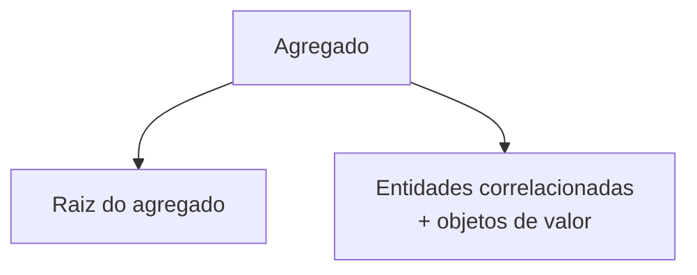
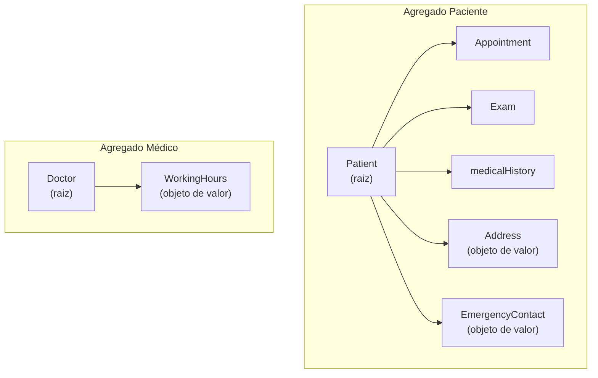
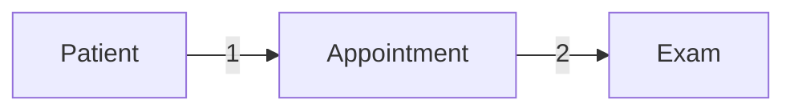
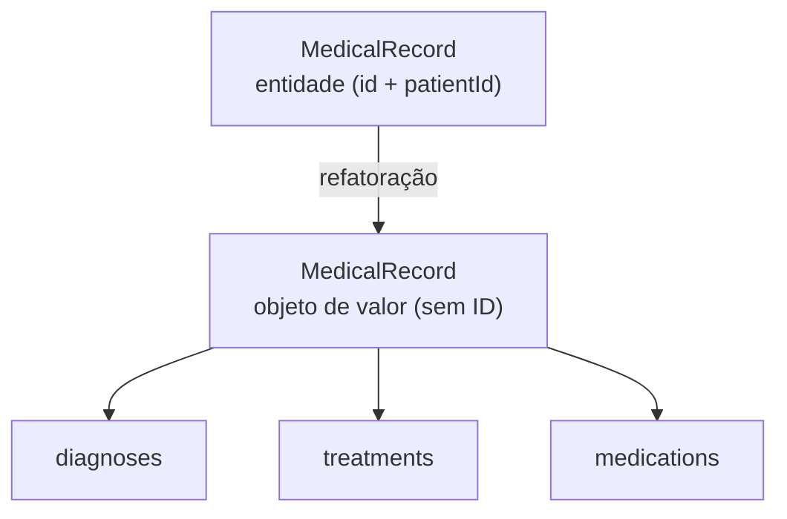

# Agregados

## Introdução e contexto

Já demos **dois passos** na compreensão dos elementos que compõem o modelo do domínio: as **entidades** — conceitos com **identidade única**, como `Patient`, `Doctor`, `Appointment`, `Exam` e `MedicalRecord` — e os **objetos de valor** — elementos **sem ID**, como `Address` e `EmergencyContact` (do paciente) e `WorkingHours` (do médico).

Agora entram os **agregados**. Eles nos ajudam a **estruturar o projeto** e a **manter a integridade do domínio**, trazem ainda mais clareza para decidir se algo é uma **entidade** ou um **objeto de valor** e representam **mais um grau de refatoração** no nosso código.

O ponto de partida é um modelo que já tem "cara bagunçada": há muitas classes espalhadas, e esse número **só vai crescer**. Com os agregados, esse crescimento passa a ser mais **estruturado e fácil de compreender**.

## O que são Agregados

Um **agregado** é um **grupo de entidades e objetos de valor relacionados**, tratados como **uma única unidade**.

Cabe a nós **balancear** se determinada entidade pertence ou não a um agregado — e, com isso, **restringir melhor o domínio**.

Um agregado é composto por **duas partes**:

- a **raiz do agregado**; e
- as **entidades correlacionadas** à raiz e os **respectivos objetos de valor**.



## A raiz do agregado

A **raiz** é a parte principal que **controla o acesso a todo o agregado**. Se eu preciso de determinada informação e, para chegar até ela, tenho que percorrer um caminho de classes, a **primeira classe** por onde passo é a raiz do agregado.

A raiz é, **geralmente, uma entidade**. As demais entidades correlacionadas e os objetos de valor ficam sob essa raiz, no escopo gerenciável do agregado.

## Os agregados do sistema hospitalar

No sistema hospitalar dá para diagnosticar **dois agregados** importantes:

| Agregado | Raiz | Entidades correlacionadas | Objetos de valor |
| --- | --- | --- | --- |
| **Paciente** | `Patient` | `Appointment`, `Exam` (+ histórico médico) | `Address`, `EmergencyContact` |
| **Médico** | `Doctor` | — | `WorkingHours` |

O `Patient` é a raiz **natural** do agregado de paciente — é a necessidade mais importante do sistema. Para saber qual é a consulta, é preciso **navegar pelo paciente**; o mesmo vale para os exames. Os objetos de valor (`Address`, `EmergencyContact`) também estão associados a ele, assim como o **histórico médico**.

No agregado do médico, temos o próprio `Doctor` e o objeto de valor `WorkingHours` — **quais dias da semana** e **em que horários** ele atende.



## Benefícios

Os agregados trazem benefícios de curto e de **longo prazo**:

- **Regras de negócio contidas no escopo do agregado.** Todas as regras passam a ser aplicadas e contidas dentro daquele agregado — agora temos um **limite explícito** para elas.
- **Maior consistência.** Garantimos que as regras de negócio sejam aplicadas no lugar certo.
- **Acesso simplificado.** Vamos **direto ao agregado** e navegamos até o que interessa (ex.: os exames de um paciente).
- **Melhor desempenho.** Reduzimos o número de transações ao banco, porque navegamos **passo a passo** apenas para o que interessa, em vez de carregar tudo de uma vez só.



## O caso do prontuário: de entidade a objeto de valor

Até aqui, `Patient`, `Exam`, `Appointment` e `MedicalRecord` foram diagnosticados como **entidades**. Mas a relação entre **prontuário** e **paciente** é forte o suficiente para reavaliar o prontuário.

Para ver o prontuário de um paciente, é preciso **passar pelo paciente** — é o paciente quem acessa o seu prontuário e, a partir dele, adicionamos um **diagnóstico**, um **tratamento** ou um **medicamento**. Além disso, o prontuário guarda **listas** (diagnósticos, tratamentos, medicamentos) que já vimos que poderiam ser **objetos de valor**.

A decisão da aula é **remover** o `id` e o `patientId` do prontuário e **amarrá-lo ao histórico médico do paciente**. Assim, o paciente passa a ter os meios de acessar o próprio prontuário, e o prontuário **deixa de precisar de um ID** — ou seja, **passa a ser um objeto de valor**. E, por ser objeto de valor, precisa do método **`equals`**.

| Antes (entidade) | Depois (objeto de valor) |
| --- | --- |
| `MedicalRecord` com `id` e `patientId` | `MedicalRecord` **sem ID**, acessado pelo histórico do paciente |
| Listas de `string` | Listas de **objetos de valor** |
| Igualdade não definida | Igualdade **por atributos** (`equals`) |

> **Exceção:** `Exam` e `Appointment` **continuam entidades** com ID. Vale ter um ID para cada porque pode-se querer buscá-los individualmente — ex.: quantos hemogramas foram feitos hoje, ou quantas consultas um médico atendeu.



```typescript
// domain/medicalRecord.ts — direção da refatoração: prontuário como objeto de valor.
// Sem `id` e sem `patientId`: o acesso se dá pelo histórico do paciente.
export class MedicalRecord {
  #diagnoses: Diagnoses[];
  #treatments: Treatment[];
  #medications: Medication[];

  // Objeto de valor: igualdade por atributos.
  equals(other: MedicalRecord): boolean {
    // comparação de todas as listas (diagnósticos, tratamentos, medicamentos)
  }
}
```

## Pontos de atenção

- Definir a **fronteira do agregado** é uma **decisão de projeto**: cabe a nós balancear o que entra e o que fica de fora.
- Agregados **mal delimitados** tendem a ficar **grandes e pesados** de carregar — o ganho de desempenho depende de navegar apenas o necessário.
- A refatoração **muda o modelo**: ao transformar o prontuário em objeto de valor, `Exam` e `Appointment` **mantêm** seus IDs.

## Conclusão

Os **agregados** são **grupos de entidades e objetos de valor relacionados**, tratados como **uma única unidade**, com uma **raiz** que controla o acesso a todo o agregado. Eles **delimitam as regras de negócio** e trazem **consistência, acesso simplificado e melhor desempenho**.

No sistema hospitalar, chegamos a **dois agregados**: **Paciente** (raiz `Patient`, com `Appointment`, `Exam`, histórico médico, `Address` e `EmergencyContact`) e **Médico** (raiz `Doctor`, com o objeto de valor `WorkingHours`). E tomamos uma decisão de projeto importante: o **prontuário** deixa de ser entidade e passa a ser **objeto de valor** (`MedicalRecord`), sem ID, acessado pelo histórico do paciente — o que exige implementar o método `equals`.

Na **próxima aula**, colocamos a mão na massa: começamos a **implementar** essa refatoração.
