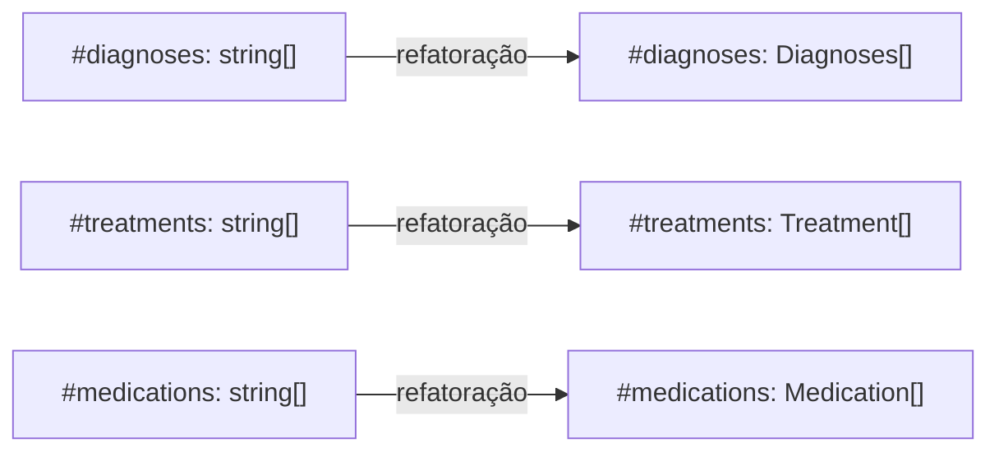
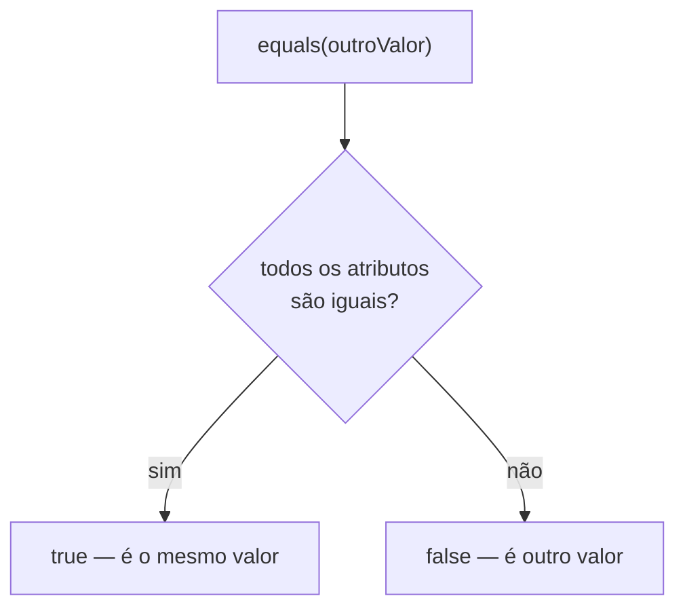
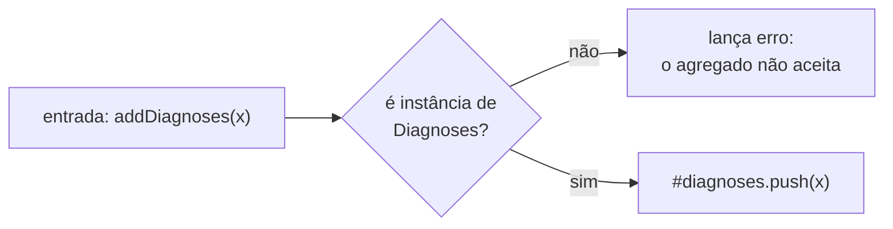
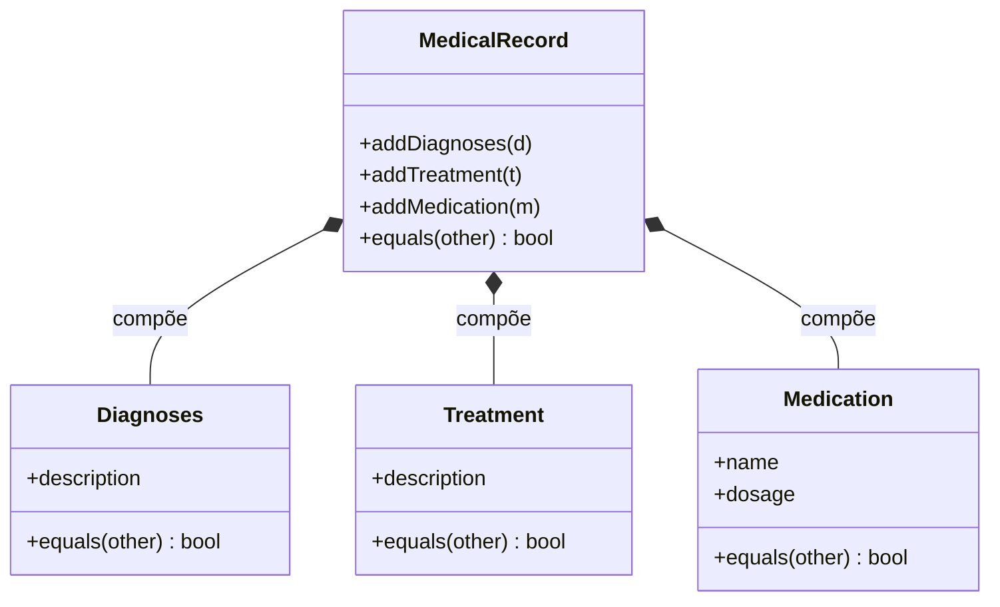

# Implementando Agregados - Parte 1

## Introdução e contexto

Na aula anterior definimos os **agregados** do sistema hospitalar e tomamos uma decisão de projeto: o **prontuário** deixa de ser uma **entidade** e passa a ser um **objeto de valor**, amarrado ao **histórico médico do paciente**. A decisão ficou no papel — agora começa a **refatoração**.

Esta primeira parte ataca o **conteúdo** do prontuário, ou seja, os elementos que ele guarda:

- **diagnósticos**;
- **tratamentos**;
- **medicações**.

Até aqui, cada um deles era apenas uma **`string`** dentro de uma lista (`#diagnoses: string[]`). O objetivo desta aula é transformá-los em **objetos de valor de verdade**: cada um com **sua própria classe**, seu **construtor** e o seu método **`equals`**.

> A classe **`Patient`** fica para a próxima parte. Ela é a **raiz do agregado** e vai passar a guardar o próprio prontuário — por isso concentra mais mudanças.

## Diagnóstico, tratamento e medicação são objetos de valor

Um **objeto de valor** é um conceito que **não possui identidade própria**: ele é definido **pelos seus atributos**. É exatamente o caso dos três elementos do prontuário.

| Elemento | Antes | Agora |
| --- | --- | --- |
| Diagnóstico | `string` na lista `#diagnoses` | objeto de valor **`Diagnoses`** |
| Tratamento | `string` na lista `#treatments` | objeto de valor **`Treatment`** |
| Medicação | `string` na lista `#medications` | objeto de valor **`Medication`** |

O raciocínio é o mesmo que usamos para `Address` e `EmergencyContact`: **dois diagnósticos com a mesma descrição são o mesmo diagnóstico**. Não faz sentido falar em "este diagnóstico" e "aquele diagnóstico" — logo, **não há ID** e a igualdade é **por atributos**.



Os ganhos aparecem de imediato:

- cada conceito ganha **um lugar próprio** para viver e evoluir no código;
- os atributos deixam de ser texto solto e passam a ser **tipados**;
- as regras de comparação ficam **explícitas**, dentro do método `equals`.

## Implementação dos objetos de valor

Todos os três arquivos seguem o mesmo formato: uma **interface DTO** que descreve os dados e uma **classe** que a implementa.

### `diagnosis.ts`

```typescript
// domain/diagnosis.ts — objeto de valor: definido apenas pela descrição.
export interface DiagnosesDTO {
  readonly description: string;
}

export class Diagnoses implements DiagnosesDTO {
  readonly description: string;

  constructor(data: DiagnosesDTO) {
    this.description = data.description;

    // Imutabilidade em runtime: o objeto não aceita reatribuição nem novos atributos.
    Object.freeze(this);
  }

  equals(otherDiagnoses: Diagnoses): boolean {
    return this.description === otherDiagnoses.description;
  }
}
```

### `treatment.ts`

```typescript
// domain/treatment.ts — mesma estrutura: um único atributo.
export interface TreatmentDTO {
  readonly description: string;
}

export class Treatment implements TreatmentDTO {
  readonly description: string;

  constructor(data: TreatmentDTO) {
    this.description = data.description;

    // Imutabilidade em runtime: o objeto não aceita reatribuição nem novos atributos.
    Object.freeze(this);
  }

  equals(otherTreatment: Treatment): boolean {
    return this.description === otherTreatment.description;
  }
}
```

### `medication.ts`

```typescript
// domain/medication.ts — dois atributos: o nome sozinho não identifica a medicação.
export interface MedicationDTO {
  readonly name: string;
  readonly dosage: string;
}

export class Medication implements MedicationDTO {
  readonly name: string;
  readonly dosage: string;

  constructor(data: MedicationDTO) {
    this.name = data.name;
    this.dosage = data.dosage;

    // Imutabilidade em runtime: o objeto não aceita reatribuição nem novos atributos.
    Object.freeze(this);
  }

  // name E dosage: 10mg não é o mesmo que 50mg.
  equals(otherMedication: Medication): boolean {
    return (
      this.name === otherMedication.name && this.dosage === otherMedication.dosage
    );
  }
}
```

O **construtor** recebe sempre um **único objeto DTO**, seguindo a convenção já usada em `Address`, `EmergencyContact` e `WorkingHours`.

## Imutabilidade em duas camadas

Objetos de valor **não mudam**: qualquer alteração significa **substituir o objeto inteiro** por outro — nunca alterar um atributo no lugar. Para que isso não seja apenas uma convenção da equipe, cada classe **garante** a imutabilidade em duas camadas:

| Camada | Recurso | O que impede |
| --- | --- | --- |
| **Compilação** | `readonly` nos atributos (na classe **e** no DTO) | Reatribuição e redefinição em qualquer código TypeScript — vira **erro de compilação** |
| **Runtime** | `Object.freeze(this)` no construtor | Reatribuição e adição de atributos por **qualquer** consumidor, inclusive JavaScript puro |

```mermaid
flowchart TD
    C["new Medication(...)"] --> R["`readonly`: o compilador recusa<br/>qualquer reatribuição"]
    R --> F["Object.freeze(this):<br/>congela a instância"]
    F --> I["objeto de valor imutável"]
```

> **O `freeze` é raso.** Ele não congela objetos aninhados. Aqui isso basta porque **todos os atributos são primitivos** (`string`). Se um objeto de valor passar a guardar uma **coleção** ou outro objeto, ela precisará ser tratada à parte — por exemplo, exposta como `ReadonlyArray`, como já fazemos em `Patient` e `MedicalRecord`.

## O caso da medicação: por que a comparação tem que ser rigorosa

A `Medication` é o exemplo que mostra o que "comparar atributos de forma mais rigorosa" significa na prática. Se o `equals` comparasse **apenas `name`**:

| Prontuário A | Prontuário B | `equals` comparando só `name` | `equals` correto |
| --- | --- | --- | --- |
| Lisinopril **10mg** | Lisinopril **50mg** | `true` — **errado** | `false` — **correto** |

Dois prontuários com **dosagens diferentes** seriam tratados como iguais — um erro clínico, não um detalhe de implementação. Foi isso que motivou a classe a carregar **`dosage`** e a comparar **os dois atributos**.



> **Regra geral:** quanto mais atributos um objeto de valor tiver, **mais trabalhosa** a comparação — e é o preço (e o valor) da igualdade por valor. Ao adicionar um atributo novo à classe, o `equals` **precisa acompanhar**.

## O agregado `MedicalRecord`

Com os três objetos de valor prontos, o próximo passo é o **prontuário**. A classe principal foi **renomeada** e passou a trabalhar com os objetos de valor:

| Antes | Depois |
| --- | --- |
| `Prontuario` | **`MedicalRecord`** |
| `id` + `patientId` | **sem identidade própria**: objeto de valor, acessado pelo histórico do paciente |
| `#diagnoses: string[]` | `#diagnoses: Diagnoses[]` |
| `addDiagnosis(diagnosis: string)` | **`addDiagnoses(diagnoses: Diagnoses)`** |
| `addTreatment(treatment: string)` | **`addTreatment(treatment: Treatment)`** |
| `addMedication(medication: string)` | **`addMedication(medication: Medication)`** |

A adição ficou **mais simples**: em vez de receber `string` e ter que montar o objeto internamente, cada método recebe o **objeto de valor já pronto** — e o prontuário apenas **valida** o que entra e **guarda**.

```typescript
// domain/medicalRecord.ts — trecho refatorado nesta aula.
export class MedicalRecord {
  #diagnoses: Diagnoses[] = [];
  #treatments: Treatment[] = [];
  #medications: Medication[] = [];

  addDiagnoses(diagnoses: Diagnoses): void {
    if (!(diagnoses instanceof Diagnoses)) {
      throw new Error("Diagnoses must be an instance of the Diagnoses class.");
    }
    this.#diagnoses.push(diagnoses);
  }

  addTreatment(treatment: Treatment): void {
    // mesma validação, com a classe Treatment
  }

  addMedication(medication: Medication): void {
    // mesma validação, com a classe Medication
  }

  // Igualdade por atributos: percorre as três listas.
  equals(otherRecord: MedicalRecord): boolean {
    // comparação item a item, usando o equals de cada objeto de valor
  }
}
```

> **Sem `id` e sem `patientId`:** o prontuário saiu de **entidade** para **objeto de valor**. Ele não é mais criado com dados (`new MedicalRecord()`), e sim **preenchido** pelos métodos `add*`. Quem dá identidade ao conjunto é o **`Patient`** — e o vínculo entre os dois é justamente o próximo passo da refatoração.

## Validação na entrada do agregado

As classes dos objetos de valor praticamente não validam nada: elas apenas recebem os dados no construtor. **Quem valida é o agregado**, no momento em que o item entra:

- o argumento precisa ser uma **instância** da classe esperada (`instanceof`) — o que impede que uma `string` ou um objeto literal entre no lugar de um objeto de valor;
- regras específicas do elemento são checadas ali (ex.: o diagnóstico precisa ter `description`).



Assim, a **fronteira do agregado** funciona como um **guarda-corpo** do domínio: nada entra sem passar pela regra.

## Impacto no modelo



## Pontos de atenção

- **Ordem das listas.** A comparação percorre as listas **item a item**, por posição. Dois prontuários com os **mesmos itens em ordens diferentes** podem ser considerados diferentes — vale decidir se, para o domínio, o prontuário é um **conjunto** ou uma **sequência**.
- **Sem identidade própria, o prontuário depende do agregado.** Como não há `id`, dois prontuários com o mesmo conteúdo são **indistinguíveis** pelo `equals`. Quem separa "o prontuário do João" do "o prontuário da Maria" é o **`Patient`** — por isso o vínculo entre os dois vem na próxima parte.
- **Coleções dentro de objetos de valor exigem cuidado extra.** O `freeze` é **raso**: uma lista guardada dentro de um objeto de valor continuaria mutável. Nesses casos, exponha a coleção como `ReadonlyArray` e **substitua** a lista inteira em vez de alterá-la no lugar.
- **Nome no plural.** `Diagnoses` é a única das três classes no plural (`Treatment` e `Medication` são singulares); `Diagnosis` deixaria os nomes consistentes.

## Conclusão

Nesta aula começamos a refatoração pelos **objetos de valor** que compõem o prontuário:

- **`Diagnoses`**, com `description` e `equals`;
- **`Treatment`**, com `description` e `equals`;
- **`Medication`**, com `name` **e** `dosage` — o caso que mostra por que a comparação precisa ser **rigorosa**.

Todos seguem a mesma convenção: **interface DTO** + **classe** com **construtor por objeto** e **`equals` comparando todos os atributos**. As três classes são **imutáveis**: atributos `readonly` (na classe e no DTO) e instância congelada com `Object.freeze(this)` — qualquer alteração exige **substituir o objeto inteiro**.

O prontuário também mudou de natureza: a classe principal foi **renomeada** para **`MedicalRecord`** e **perdeu `id` e `patientId`**. Os métodos `addDiagnoses`, `addTreatment` e `addMedication` passaram a receber os **objetos de valor** já prontos, validando o que entra no agregado.

Na **próxima parte**, aprimoramos a classe **`Patient`** — a **raiz do agregado** — que vai passar a acessar o prontuário e a receber os objetos de valor que criamos aqui.
