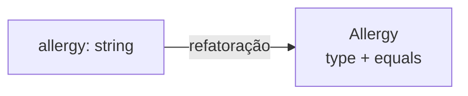
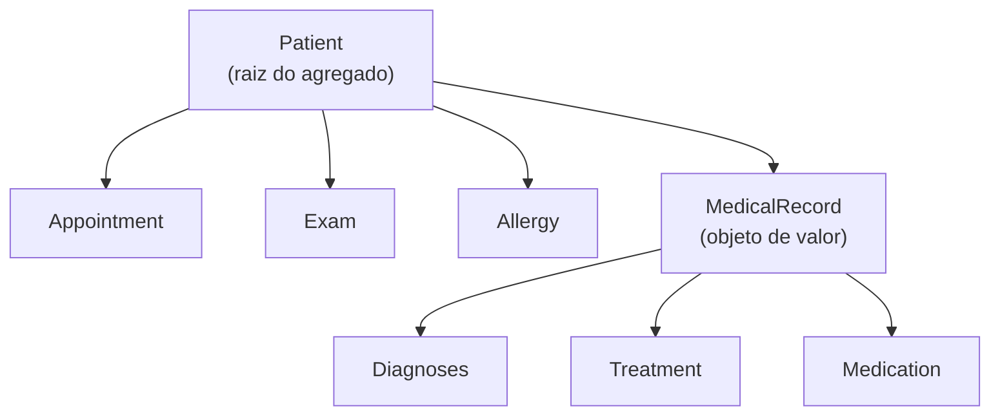
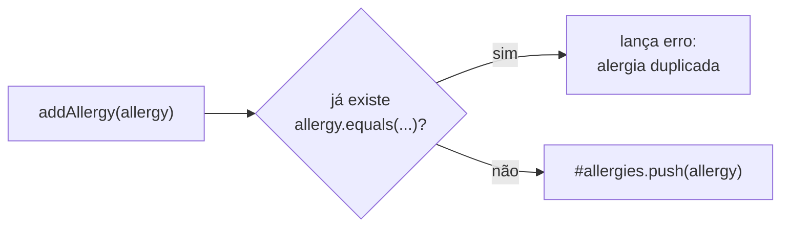
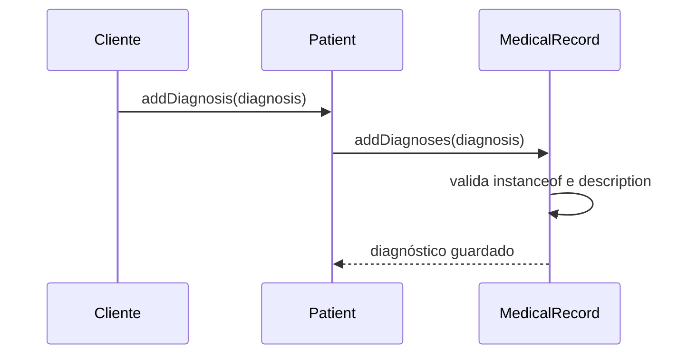
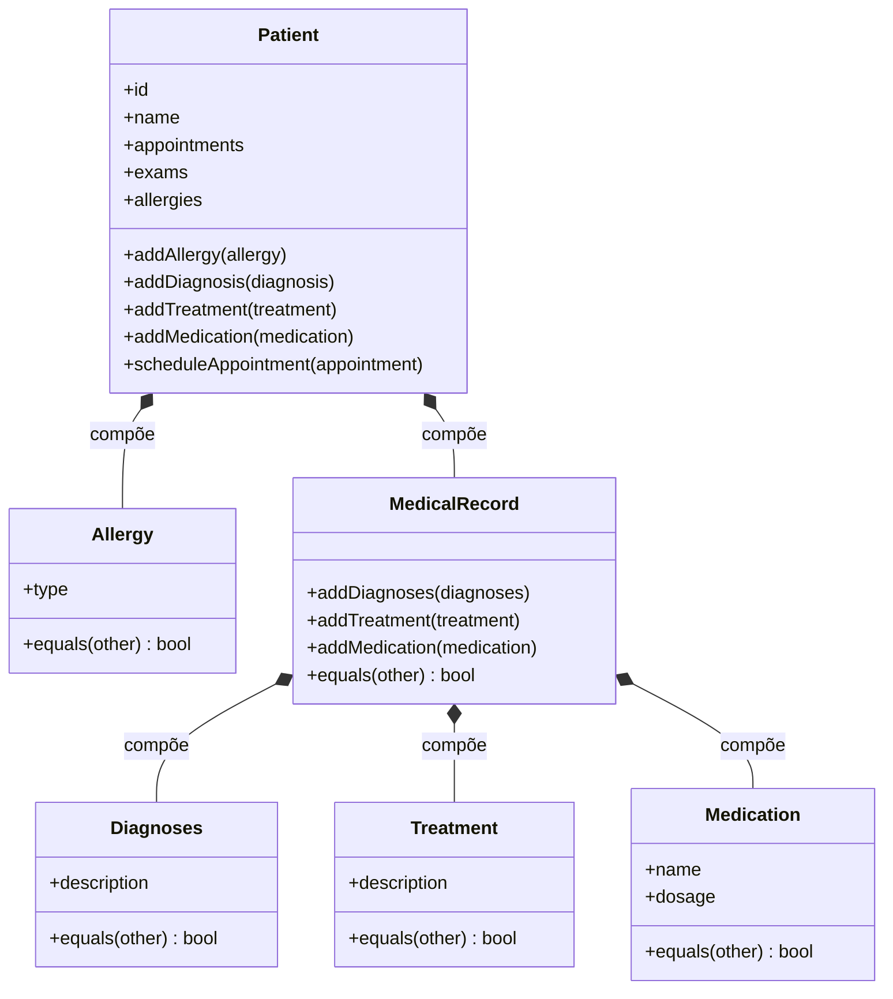

# Implementando Agregados - Parte 2

## Introdução e contexto

Na *Parte 1*, refatoramos o **conteúdo** do prontuário: `Diagnoses`, `Treatment` e `Medication` viraram **objetos de valor**, e o `MedicalRecord` perdeu `id` e `patientId` para se tornar um objeto de valor acessado pelo histórico do paciente.

Faltava a peça central do agregado: o **`Patient`**. Nesta aula, a refatoração chega à **raiz do agregado**, que passa a:

- guardar a **lista de alergias**;
- possuir o próprio **`MedicalRecord`**;
- **delegar** ao prontuário a adição de diagnósticos, tratamentos e medicações;
- concentrar as regras que dizem respeito ao paciente — como impedir **alergias duplicadas** e **consultas no mesmo horário**.

> A ideia central é simples: o `Patient` é a **porta de entrada do agregado**. Para mexer em alergias, consultas, exames ou prontuário, passamos por ele — e não saímos alterando as partes internas diretamente.

## A alergia é um objeto de valor

Uma **alergia** é definida pelo seu **tipo** — por exemplo, “Dipirona” ou “Amendoim”. Não faz sentido falar em “esta alergia” e “aquela alergia” quando as duas são do mesmo tipo: elas são o **mesmo valor**.

Por isso, `Allergy` **não tem ID**. Como todo objeto de valor, sua identidade vem dos **atributos** e é expressa pelo método **`equals`**.

| Antes | Depois |
| --- | --- |
| `allergies: Array<string>` no DTO e no construtor | lista privada `#allergies: Allergy[]`, preenchida por `addAllergy` |
| Texto solto, sem comportamento | classe **`Allergy`**, com `type` e `equals` |
| Nenhuma regra de duplicidade | `Patient.addAllergy` rejeita alergias repetidas |



Com a classe própria, a alergia deixa de ser apenas um texto e passa a ter **um lugar para evoluir** — por exemplo, se o domínio precisar de gravidade, reação ou data de descoberta.

## Implementação de `Allergy`

A classe segue o formato enxuto dos demais objetos de valor: uma **interface DTO** e uma **classe** que recebe esse DTO no construtor.

```typescript
// domain/allergy.ts — objeto de valor: definido pelo tipo.
export interface AllergyDTO {
  type: string;
}

export class Allergy {
  type: string;

  constructor(data: AllergyDTO) {
    this.type = data.type;
  }

  equals(otherAllergy: Allergy): boolean {
    return this.type === otherAllergy.type;
  }
}
```

O critério de igualdade é o **tipo**. Duas instâncias com o mesmo `type` são consideradas a **mesma alergia**, mesmo que sejam objetos diferentes em memória.

> **Ponto de atenção:** nesta versão, `Allergy` ainda não usa `readonly` nem `Object.freeze(this)`, ao contrário dos objetos de valor da *Parte 1*. Alinhar essa proteção é uma melhoria natural para a próxima refatoração.

## O `Patient` como raiz do agregado

O `Patient` é a **entidade principal** e a **raiz** do agregado. Tudo o que pertence ao paciente fica sob sua responsabilidade:

- `Appointment` — as consultas agendadas;
- `Exam` — os exames realizados;
- `Allergy` — as alergias conhecidas;
- `MedicalRecord` — o prontuário, com diagnósticos, tratamentos e medicações.

As coleções ficam em campos **privados** e são expostas por **getters** que devolvem **cópias** (`ReadonlyArray`). Assim, o mundo externo consulta os dados, mas não altera as listas internas por acidente.



O construtor recebe apenas os dados de identidade e os objetos de valor do paciente. As coleções **nascem vazias** e são preenchidas aos poucos, sempre pelos métodos do próprio `Patient`:

```typescript
type CreatePatientDTO = Omit<
  PatientDTO,
  "appointments" | "exams" | "allergies" | "medicalRecord" | "scheduleAppointment" | "addExam"
>;
```

> **Por que as coleções não vêm no construtor?** Porque elas têm regras próprias. Se o paciente já nascesse com alergias, consultas e exames prontos, seria preciso validar tudo dentro do construtor. Criando o paciente “vazio” e adicionando item a item, cada entrada passa pela regra certa.

## A lista de alergias no `Patient`

A lista de alergias é privada e só pode ser modificada por `addAllergy`:

```typescript
#allergies: Allergy[] = [];

addAllergy(allergy: Allergy): void {
  const exists = this.#allergies.some((a) => a.equals(allergy));

  if (exists) {
    throw new Error(`Allergy ${allergy.type} already exists for this patient.`);
  }

  this.#allergies.push(allergy);
  console.log(`Allergy ${allergy.type} added for ${this.name}.`);
}

get allergies(): ReadonlyArray<Allergy> {
  return [...this.#allergies];
}
```

O detalhe importante é o uso de **`equals`** na verificação de duplicidade. Comparar com `===` não funcionaria para objetos de valor: duas instâncias diferentes com o mesmo `type` seriam tratadas como alergias diferentes.



O getter devolve uma **cópia** da lista. Quem tem acesso ao paciente pode ler `patient.allergies`, mas não consegue fazer `push` na coleção interna.

## O prontuário dentro do paciente

O `Patient` passa a **compor** um `MedicalRecord`. Em vez de espalhar as listas de diagnósticos, tratamentos e medicações pela entidade, ele **delega** as operações ao prontuário:

```typescript
#medicalRecord: MedicalRecord = new MedicalRecord();

addDiagnosis(diagnosis: Diagnoses): void {
  this.#medicalRecord.addDiagnoses(diagnosis);
}

addTreatment(description: TreatmentDTO): void {
  this.#medicalRecord.addTreatment(new Treatment(description));
}

addMedication({ dosage, name }: Medication): void {
  this.#medicalRecord.addMedication(new Medication({ dosage, name }));
}
```

| Método do `Patient` | Recebe | Delega para |
| --- | --- | --- |
| `addDiagnosis` | uma instância de `Diagnoses` | `MedicalRecord.addDiagnoses` |
| `addTreatment` | um `TreatmentDTO` | cria `Treatment` e chama `MedicalRecord.addTreatment` |
| `addMedication` | uma instância de `Medication` | recria `Medication` e chama `MedicalRecord.addMedication` |

O `MedicalRecord` continua sendo o **guardião do prontuário**: é ele que valida o tipo recebido (`instanceof`), mantém as listas privadas e implementa a igualdade por conteúdo. O `Patient` apenas **orquestra** a entrada no agregado.



> **Fronteira do agregado:** quem está fora não precisa conhecer o `MedicalRecord` para adicionar um diagnóstico. Basta chamar o método do `Patient`; o caminho até o prontuário é responsabilidade da raiz.

## Responsabilidades bem definidas

O ganho mais importante da aula não é a quantidade de código, e sim a **divisão de responsabilidades**:

| Classe | Responsabilidade | O que **não** faz |
| --- | --- | --- |
| `Allergy` | Representar e comparar o tipo da alergia | Não valida duplicidade nem conhece o paciente |
| `MedicalRecord` | Guardar, validar e comparar diagnósticos, tratamentos e medicações | Não conhece a identidade do paciente |
| `Patient` | Ser a raiz do agregado: identidade, coleções, regras de agendamento e de alergia | Não implementa a comparação interna do prontuário |
| `Appointment` / `Exam` | Representar entidades do agregado, com identidade própria | Não decidem as regras do paciente |

Essa separação deixa o modelo mais fácil de **ler, testar e evoluir**. Quando uma regra muda, sabemos exatamente onde mexer:

- regra de **duplicidade de alergia** → `Patient.addAllergy`;
- regra de **conflito de horário** → `Patient.scheduleAppointment`;
- regra de **validação do prontuário** → `MedicalRecord.add*`;
- **igualdade** de um objeto de valor → `equals` da própria classe.

## Benefícios da refatoração

- **Regras no lugar certo.** Cada classe concentra as regras que realmente lhe pertencem.
- **Acesso único pela raiz.** O `Patient` controla o que entra e o que sai do agregado.
- **Coleções protegidas.** Campos privados + getters que retornam cópias evitam mutações externas.
- **Prontuário reutilizável.** O `MedicalRecord` pode ser testado e comparado sem depender do paciente.
- **Evolução mais segura.** Novos objetos de valor ou novas regras entram em pontos bem definidos.

## Impacto no modelo



## Pontos de atenção

- **Imutabilidade de `Allergy`.** A classe ainda permite reatribuir `type`. O ideal é seguir o padrão das demais: `readonly` no DTO e no atributo + `Object.freeze(this)` no construtor.
- **Validação de entrada.** `Patient.addAllergy` não verifica `instanceof`; um objeto literal poderia entrar em runtime e quebrar o `equals`. O `MedicalRecord` já faz essa proteção.
- **APIs mistas no `Patient`.** `addDiagnosis` e `addMedication` recebem instâncias prontas, enquanto `addTreatment` recebe um DTO e cria o objeto. Padronizar a abordagem deixa a interface mais previsível.
- **Reconstrução desnecessária.** `addMedication` recebe uma `Medication` e cria outra igual. Se a intenção é receber o objeto de valor pronto, basta delegar sem recriar.
- **Tamanho do agregado.** O `Patient` concentra muitas operações. Ele deve **orquestrar** e guardar as regras do agregado, não absorver responsabilidades que pertencem ao prontuário ou aos objetos de valor.
- **Duplicidade por atributo.** A regra atual considera o `type` da alergia. Se novos atributos entrarem no `equals`, a definição de “alergia duplicada” muda junto.

## Conclusão

Nesta aula, fechamos a implementação do **agregado do paciente**:

- `Allergy` virou um **objeto de valor** sem ID, comparado por `type`;
- o `Patient` passou a manter a **lista privada de alergias** e a impedir duplicatas com `equals`;
- o `Patient` passou a **compor** um `MedicalRecord` e a **delegar** a ele a adição de diagnósticos, tratamentos e medicações;
- as responsabilidades ficaram explícitas: o paciente é a **raiz**, o prontuário é o **guardião dos dados clínicos** e cada objeto de valor cuida da própria igualdade.

Com o agregado bem delimitado, o próximo passo é discutir operações que **não pertencem a uma única entidade** — os **serviços de domínio** — e, mais adiante, como **persistir e recuperar** esses agregados com os **repositórios**.
