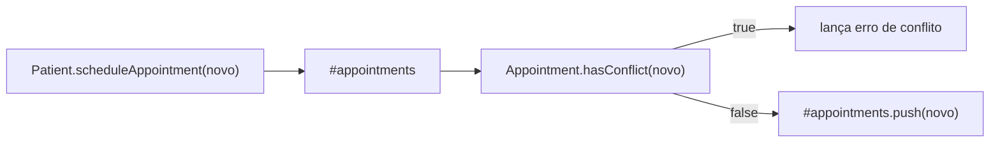
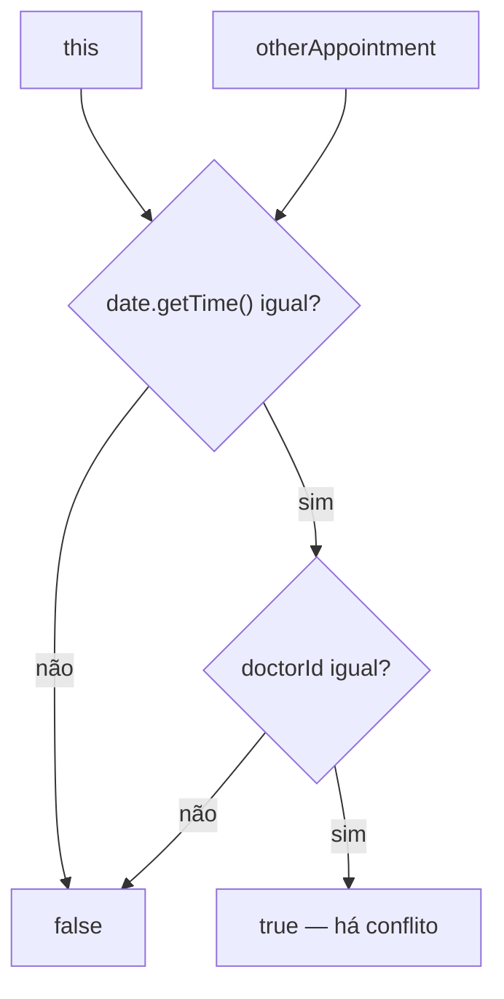
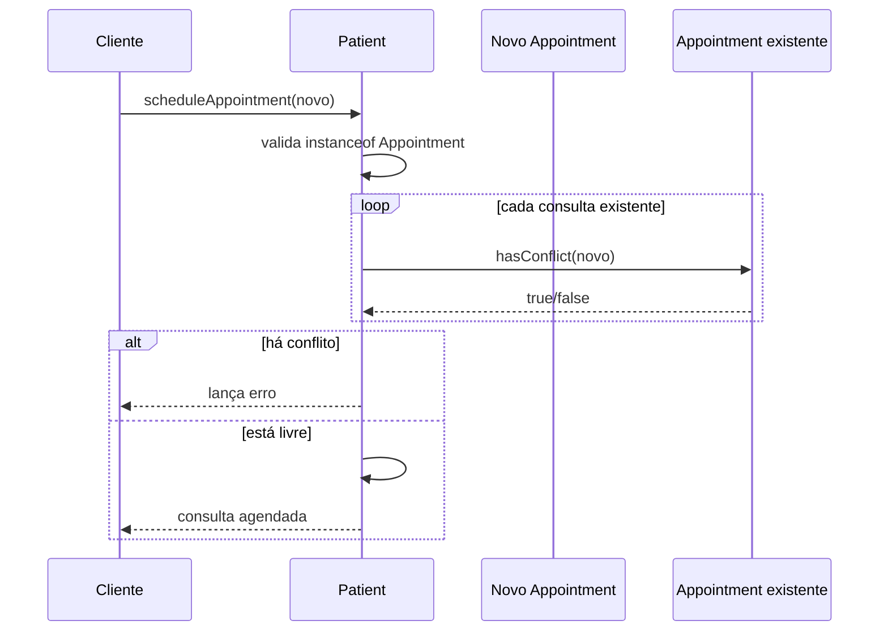
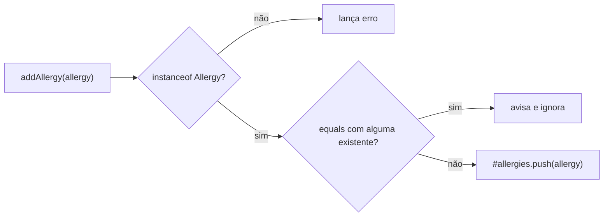
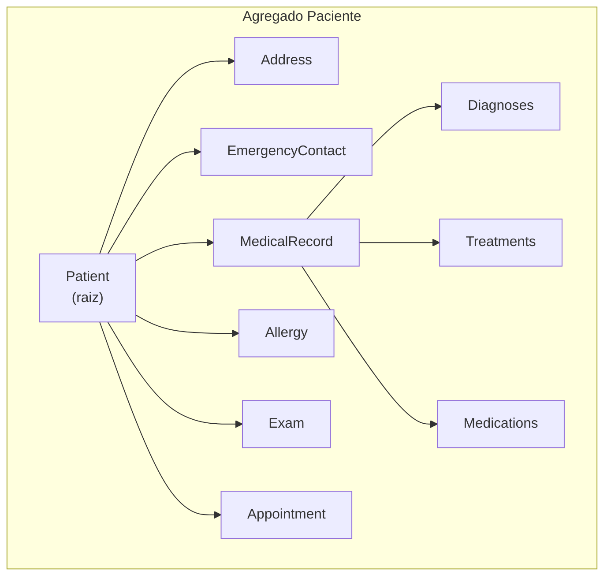
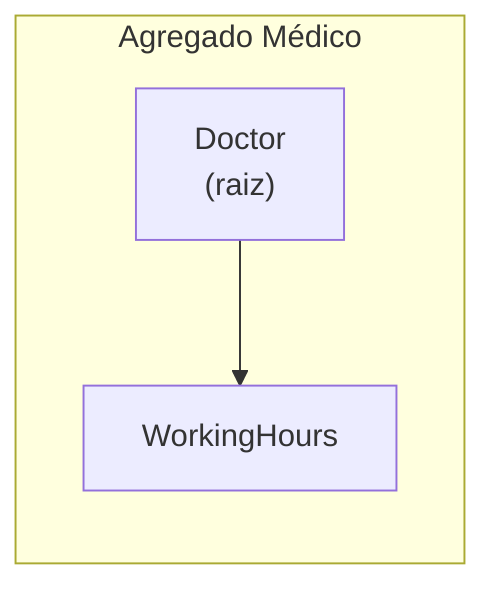

# Implementando Agregados - Parte 3

## Introdução e contexto

Nas partes anteriores, o **agregado do paciente** ganhou forma: `Diagnoses`, `Treatment` e `Medication` viraram objetos de valor, o `MedicalRecord` perdeu a identidade própria e o `Patient` passou a cuidar das alergias e a delegar as operações do prontuário.

Faltava **fechar o agregado**. Nesta aula, os últimos ajustes saem da classe `Patient` e vão para o lugar certo:

- a regra de **conflito de agendamento** passa a viver na entidade **`Appointment`**, no método `hasConflict`;
- o `Patient` continua **orquestrando a lista** de consultas, mas não compara mais datas e médicos diretamente;
- as entradas do agregado ganham **validação de tipo em runtime** (`instanceof`) em `addAllergy`, `addExam` e `scheduleAppointment`;
- a **duplicidade de alergia** passa a ser verificada com `equals`, comparando objeto a objeto.

> A ideia central: cada classe deve conhecer **as regras que os seus próprios dados permitem decidir**. O `Appointment` sabe quando dois agendamentos conflitam; o `Patient` sabe quais agendamentos pertencem àquele paciente.

## A regra de conflito muda de lugar

Antes, o `Patient.scheduleAppointment` percorria a lista e comparava `date` diretamente. Agora, a decisão “isto conflita com aquilo?” pertence ao **`Appointment`**.

| Antes | Depois |
| --- | --- |
| `Patient` comparava datas e médicos | `Appointment.hasConflict` concentra a regra |
| A lista e a regra ficavam no mesmo método | O `Patient` percorre a lista e **delega** a comparação |
| A entidade não tinha comportamento de conflito | A entidade expressa o que é um conflito |



O `Patient` não perde a responsabilidade sobre a **coleção**: ele ainda decide o que fazer com o resultado (lançar erro ou adicionar). O que muda é **quem conhece o critério** de conflito.

## `hasConflict` na `Appointment`

O novo método compara dois agendamentos:

```typescript
hasConflict(otherAppointment: Appointment): boolean {
  return (
    this.date.getTime() === otherAppointment.date.getTime() &&
    this.doctorId === otherAppointment.doctorId
  );
}
```

O critério implementado é:

- **mesmo instante** — `date.getTime()` igual;
- **mesmo médico** — `doctorId` igual.

O `patientId` não entra na comparação porque o método é usado dentro da lista de consultas de um único paciente: o contexto do agregado já garante de quem são os agendamentos.



> **Ponto de atenção:** como a lista pertence ao paciente, vale confirmar com o domínio se o conflito não deveria considerar **qualquer médico**. Do jeito atual, duas consultas no mesmo horário com médicos diferentes não são sinalizadas — mas o paciente também não pode estar em dois lugares ao mesmo tempo. Se a regra mudar, o ajuste fica concentrado em `hasConflict`.

## O novo `scheduleAppointment`

Com a regra na entidade, o método do agregado fica menor e mais declarativo:

```typescript
scheduleAppointment(appointment: Appointment): void {
  if (!appointment || !(appointment instanceof Appointment)) {
    throw new Error("Invalid appointment object.");
  }

  const hasConflict = this.#appointments.some((existing) =>
    existing.hasConflict(appointment)
  );

  if (hasConflict) {
    throw new Error(
      `Appointment conflict: ${this.name} already has an appointment with Dr. ${appointment.doctorId} at ${appointment.date}.`,
    );
  }

  this.#appointments.push(appointment);
  console.log(
    `Appointment scheduled for ${this.name} with Dr. ${appointment.doctorId} on ${appointment.date}.`,
  );
}
```

O fluxo tem três etapas:

1. **Validação de fronteira:** o argumento precisa ser uma instância de `Appointment`.
2. **Verificação de conflito:** `some` percorre as consultas existentes e para no primeiro conflito encontrado.
3. **Inclusão:** se não houver conflito, a consulta entra na lista privada.



> **`some` é curto-circuito:** ao encontrar o primeiro conflito, a verificação para. Não é necessário percorrer a lista inteira quando a resposta já é “não pode agendar”.

## Validação na fronteira do agregado

Além da regra de conflito, a aula adiciona verificações de tipo nas entradas do agregado:

| Método | Verificação | Se inválido | Regra adicional |
| --- | --- | --- | --- |
| `addAllergy` | `instanceof Allergy` | lança erro | duplicidade via `equals` (avisa e ignora) |
| `addExam` | `instanceof Exam` | lança erro | — |
| `scheduleAppointment` | `instanceof Appointment` | lança erro | conflito via `hasConflict` |
| `addDiagnosis` / `addMedication` / `addTreatment` | delegam ao `MedicalRecord` | o prontuário valida | listas internas do prontuário |

Essas verificações são especialmente importantes em **JavaScript/TypeScript**:

- o tipo `Allergy`, `Exam` ou `Appointment` existe apenas em **tempo de compilação**;
- em runtime, um objeto literal ou uma `string` pode chegar de qualquer lugar;
- o `instanceof` garante que o agregado só aceite **instâncias de verdade**, com os métodos esperados — por exemplo, `equals` e `hasConflict`.

> Em linguagens com tipagem mais rígida, como Java ou C#, parte dessas verificações seria desnecessária. No JavaScript “vanilla”, elas funcionam como a **última linha de defesa** do agregado.

## Duplicidade de alergia

A lista de alergias também ganhou sua verificação completa:

```typescript
addAllergy(allergy: Allergy): void {
  if (!allergy || !(allergy instanceof Allergy)) {
    throw new Error("Invalid allergy object.");
  }

  const hasAllergy = this.#allergies.some((existing) =>
    existing.equals(allergy)
  );

  if (hasAllergy) {
    console.log(`Allergy "${allergy.type}" already exists for ${this.name}.`);
    return;
  }

  this.#allergies.push(allergy);
  console.log(`Allergy "${allergy.type}" added to ${this.name}'s medical history.`);
}
```

A comparação é **objeto a objeto**, usando o `equals` do objeto de valor. Não adianta comparar com `===`: duas instâncias diferentes de `Allergy` com o mesmo `type` representam a mesma alergia.



> **Mudança de responsabilidade:** o `Patient` não cria mais a alergia internamente. Quem chama precisa entregar um **`Allergy` já instanciado**; o agregado apenas valida e guarda. O mesmo raciocínio vale para exames e agendamentos.

> **Em relação à *Parte 2*:** a duplicidade deixou de lançar exceção. Agora o método **avisa e ignora** a alergia repetida, e a validação `instanceof` também passou a fazer parte da entrada.

## O agregado do paciente, enfim

Com as últimas validações, o agregado fica fechado. Tudo é acessado a partir da raiz **`Patient`**:



A navegação segue sempre o mesmo caminho: **primeiro a raiz, depois as partes internas**.

| Agregado | Raiz | Elementos internos |
| --- | --- | --- |
| **Paciente** | `Patient` | `Address`, `EmergencyContact`, `MedicalRecord` (`Diagnoses`, `Treatments`, `Medications`), `Allergy`, `Exam`, `Appointment` |
| **Médico** | `Doctor` | `WorkingHours` |

- Quero o endereço do paciente? `patient.address`.
- Quero as consultas? `patient.appointments`.
- Quero o histórico clínico? Os métodos `patient.addDiagnosis`, `addTreatment` e `addMedication` chegam ao `MedicalRecord`.
- Quero os horários do médico? Partimos de `doctor.listWorkingHours`.



## Benefícios

- **Regra no lugar certo.** `Appointment.hasConflict` expressa o critério de conflito; o `Patient` apenas coordena a coleção.
- **Paciente mais simples.** O método de agendamento ficou menor e mais fácil de ler.
- **Fronteira protegida.** `instanceof` impede que objetos literais entrem no agregado em runtime.
- **Duplicidade resolvida por valor.** `equals` compara o conteúdo da alergia, não a referência.
- **Agregado navegável.** Qualquer informação do paciente é alcançada a partir da raiz, sem acessar listas internas diretamente.
- **Modelo pronto para evoluir.** Novas regras de agendamento ficam concentradas na entidade que conhece os dados do agendamento.

## Pontos de atenção

- **Critério de conflito.** Hoje `hasConflict` exige o **mesmo médico**. Se a regra do domínio for “o paciente não pode ter dois compromissos no mesmo horário”, a comparação deve considerar apenas a data/hora — ou o `patientId`, caso a verificação saia do agregado do paciente.
- **Precisão do horário.** `date.getTime()` compara o instante exato. Se o sistema trabalhar com **faixas de horário** (ex.: 08:00–09:00), a regra precisa considerar sobreposição, não igualdade.
- **Política de duplicidade.** Uma alergia repetida apenas **avisa e ignora**; um agendamento conflitante **lança exceção**. Vale padronizar a semântica: o que é um aviso e o que é uma violação de regra?
- **`instanceof` é uma proteção de runtime.** Ela não substitui a tipagem em tempo de compilação; serve para o JavaScript que consome o domínio sem passar pelo TypeScript.
- **APIs mistas no `Patient`.** `addDiagnosis` e `addMedication` recebem instâncias; `addTreatment` recebe um DTO. Padronizar reduz a ambiguidade (herdado da *Parte 2*).
- **O agregado não é a aplicação inteira.** O `Patient` coordena o agregado, mas casos de uso que cruzam pacientes, médicos ou persistência pertencem a outras camadas — o próximo assunto da trilha.

## Conclusão

Esta aula fecha o tema de **agregados**:

- a regra de conflito saiu do `Patient` e virou comportamento do **`Appointment`** (`hasConflict`);
- o `Patient.scheduleAppointment` passou a **validar a entrada, delegar a comparação e orquestrar a lista**;
- `addAllergy` e `addExam` ganharam validação de tipo em runtime;
- a duplicidade de alergia é verificada com **`equals`**, comparando valor a valor;
- o agregado do paciente ficou completo, com `Address`, `EmergencyContact`, `MedicalRecord`, `Allergy`, `Exam` e `Appointment`;
- o agregado do médico ficou simples: `Doctor` + `WorkingHours`.

Agora que o modelo está bem delimitado, a próxima preocupação é **organização do projeto**: com muitas classes e arquivos, entra a discussão sobre **módulos**. Em seguida, os **repositórios** — como persistir e recuperar esses agregados sem misturar infraestrutura com domínio.
