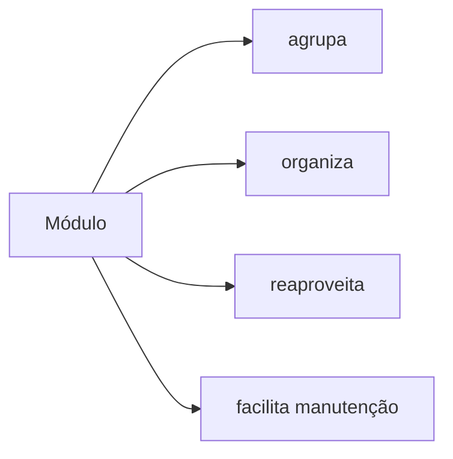
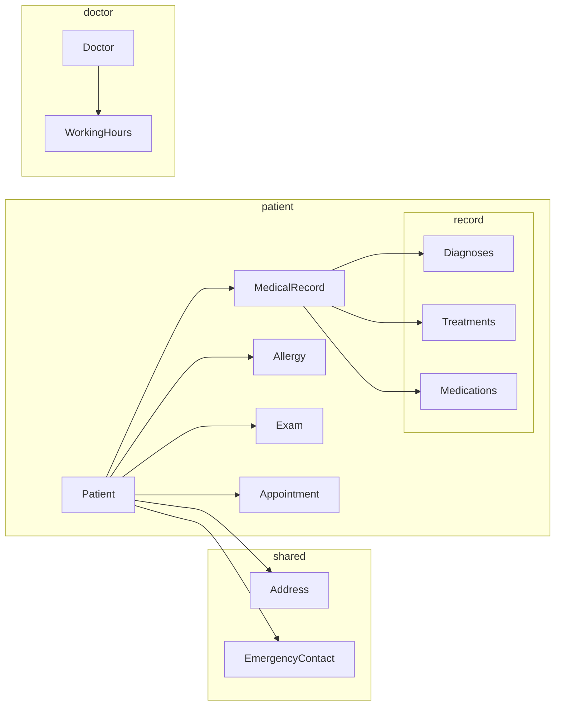
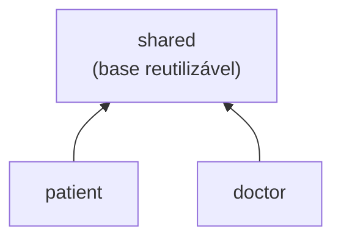
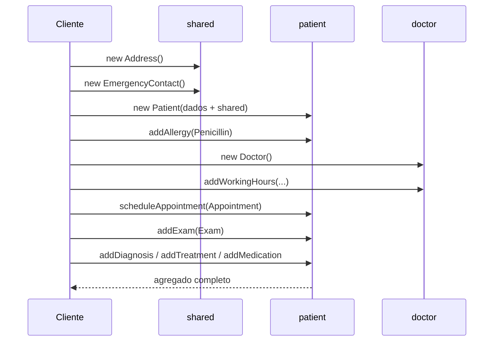

# Agregando em Módulos

## Introdução e contexto

Chegamos a um **interlúdio** da trilha. Até aqui o foco foi entender **quais elementos** representam o domínio — entidades, objetos de valor e agregados — e como implementá-los. O modelo cresceu, ganhou classes, validações, listas internas e regras de negócio. Cresceu **sem parar**.

Esta aula faz uma pausa para **dar estrutura** a esse código por meio de **módulos**. A ideia é simples: o domínio continua no **coração do sistema**, mas agora organizado em unidades que agrupam **código com funcionalidade relacionada**.

O cenário de partida são os **dois agregados** já modelados:

| Agregado | Raiz | Elementos internos |
| --- | --- | --- |
| **Paciente** | `Patient` | `Address`, `EmergencyContact`, `MedicalRecord` (`Diagnoses`, `Treatments`, `Medications`), `Allergy`, `Exam`, `Appointment` |
| **Médico** | `Doctor` | `WorkingHours` |

A partir deles, o projeto é reorganizado em **três módulos principais**: `doctor`, `patient` e `shared`.

> A aula também aproveita a reorganização para migrar todo o projeto de **CommonJS** para **ESM** (`"type": "module"`, imports com extensão `.ts`).

## Por que modularizar

Um **módulo** é uma unidade que agrupa **código com funcionalidade relacionada**. Em qualquer linguagem, modularizar traz os mesmos benefícios:

- **Organização.** Cada conceito tem um lugar previsível para viver.
- **Reaproveitamento.** O que é comum a várias classes — ou a vários projetos — é escrito uma vez.
- **Manutenção.** Quem chega depois encontra o código agrupado por assunto, e não espalhado.
- **Legibilidade.** Fica mais fácil saber **onde procurar** e **o que depende do quê**.
- **Evolução.** Novas classes entram no módulo certo, sem aumentar o caos.



> **Módulo não é agregado.** O agregado é um conceito de **domínio**: define o que muda junto e onde ficam as regras. O módulo é uma decisão de **organização de código**. Nesta aula os dois se encontram — cada agregado ganha um módulo —, mas os conceitos são diferentes.

## O mapa dos módulos

A estrutura definida na aula é esta:



O desenho deixa claro o papel de cada módulo:

- o **`patient`** é o maior: concentra a raiz do agregado, as entidades correlacionadas, as alergias, os exames e o **prontuário**, que por sua vez agrupa diagnósticos, tratamentos e medicações;
- o **`doctor`** é enxuto: apenas a entidade `Doctor` e o objeto de valor `WorkingHours`;
- o **`shared`** guarda o que **não pertence a um agregado específico** e pode ser reutilizado por outras partes do sistema — ou por outros projetos.



As setas apontam **para baixo**, na direção do `shared`. É uma regra de dependência: `shared` **não conhece** `patient` nem `doctor`.

## A estrutura de diretórios

No projeto, os módulos ficam dentro de `domain/`:

```text
domain/
├── shared/
│   ├── Address.ts
│   └── EmergencyContact.ts
├── doctor/
│   ├── Doctor.ts
│   └── WorkingHours.ts
└── patient/
    ├── Patient.ts
    ├── Allergy.ts
    ├── Appointments.ts
    ├── Exam.ts
    └── record/
        ├── Diagnosis.ts
        ├── MedicalRecord.ts
        ├── Medication.ts
        └── Treatment.ts
```

A pasta `record/` é um **submódulo** dentro de `patient`: o prontuário é um objeto de valor do agregado do paciente, e seus três componentes vivem juntos. Isso reduz a quantidade de arquivos soltos no módulo maior.

| Módulo | Responsabilidade | Classes |
| --- | --- | --- |
| `shared` | Conceitos reutilizáveis, sem dono específico | `Address`, `EmergencyContact` |
| `doctor` | Agregado do médico | `Doctor`, `WorkingHours` |
| `patient` | Agregado do paciente | `Patient`, `Allergy`, `Appointment`, `Exam` |
| `patient/record` | Prontuário e seus componentes | `MedicalRecord`, `Diagnoses`, `Treatment`, `Medication` |

## ESM: imports explícitos

A reorganização veio junto com a migração para **ESM**. Na prática:

```typescript
// package.json
{
  "type": "module"
}
```

```typescript
// O caminho completo e a extensão .ts tornam a dependência explícita.
import { Patient } from "./domain/patient/Patient.ts";
import { Address } from "./domain/shared/Address.ts";
import { Doctor } from "./domain/doctor/Doctor.ts";
```

Diferente do CommonJS (`require`), o ESM exige que **cada import seja declarado**. Isso tem um efeito colateral didático: se uma classe não foi importada, o código **quebra** — e a mensagem aponta exatamente qual dependência está faltando. Na aula isso acontece ao instanciar `Patient` e, depois, `Exam`: os erros não são “bugs”, são o módulo mostrando **de onde cada peça vem**.

> **Detalhe do projeto:** os imports relativos usam a extensão `.ts`. É o que o Node precisa para resolver o arquivo diretamente, sem etapa de build.

## O módulo `shared`

`Address` e `EmergencyContact` são objetos de valor que **não pertencem exclusivamente ao paciente**. Endereço pode ser usado por médico, hospital, convênio; contato de emergência pode aparecer em outros cadastros. Por isso eles saem do agregado e vão para um módulo **compartilhado**.

```typescript
export interface AddressDTO {
  readonly street: string;
  readonly number: string;
  readonly city: string;
  readonly state: string;
  readonly zipCode: string;
}
```

O `Patient` não importa a **classe** necessariamente: ele pode trabalhar com o **DTO** e receber o endereço já pronto. É uma forma de depender do **formato** sem acoplar a implementação.

> **Cuidado com o `shared`:** ele não é uma pasta de “resto”. Só entram ali conceitos **realmente genéricos**. Um objeto específico do paciente deve ficar em `patient`, mesmo que seja usado em mais de um arquivo. Caso contrário, o módulo compartilhado vira um depósito e perde o sentido.

Além de `shared`, é comum o projeto ter um diretório de **utilitários** (`utils`) para funções de apoio usadas por vários módulos. A diferença é de propósito: `shared` guarda **conceitos do domínio** reutilizáveis; `utils` guarda **apoio técnico**, sem regra de negócio.

## O módulo `doctor`

O agregado do médico é simples: a raiz `Doctor` e o objeto de valor `WorkingHours`.

```typescript
const doctor = new Doctor({
  id: "101",
  rcm: "CRM/SP 123456",
  name: "Dr. Carlos",
  specialties: ["Cardiology", "General Practice"],
  phone: "(11) 77777-7777",
});

doctor.addWorkingHours({ day: "Monday", timeSlot: "14:00-18:00" });
doctor.addWorkingHours({ day: "Wednesday", timeSlot: "14:00-18:00" });
```

O `Doctor` **delega** o trabalho ao objeto de valor: `addWorkingHours` repassa a chamada para `WorkingHours`, e `listWorkingHours` devolve os horários. A regra de quais dias e faixas são válidos pertence ao objeto de valor, não à entidade.

| Método | O que faz |
| --- | --- |
| `addWorkingHours(data)` | delega a inclusão ao `WorkingHours` |
| `removeWorkingHours(data)` | delega a remoção ao `WorkingHours` |
| `listWorkingHours` | expõe o objeto de valor com os horários |

> A aula comenta uma validação possível: exigir que o médico já tenha horário de atendimento no momento do cadastro. Como o comportamento ainda não está fechado, a decisão fica **em aberto**.

## O módulo `patient`

É o módulo com mais arquivos, porque o agregado do paciente é o mais rico. Ele contém:

- a raiz **`Patient`**;
- os objetos de valor e entidades do agregado: `Allergy`, `Appointment`, `Exam`;
- o submódulo **`record/`**, com o prontuário e seus três objetos de valor.

O acesso continua sendo **pela raiz**. O `Patient` guarda as coleções privadas e expõe getters somente leitura; para o prontuário, expõe métodos que delegam ao `MedicalRecord`:

```typescript
patient.addAllergy(new Allergy({ type: "Penicillin" }));

patient.addDiagnosis(new Diagnoses({ description: "Hypertension" }));
patient.addTreatment(new Treatment({ description: "Reduced salt intake" }));
patient.addMedication(new Medication({ name: "Captopril", dosage: "25mg" }));
```

Nada disso exige que o restante do sistema saiba **onde** o prontuário está guardado. O módulo esconde a estrutura interna e mantém a fronteira do agregado.

## Demonstração: montando o hospital

A aula fecha com um exemplo executável que percorre o fluxo completo. A ordem importa, porque cada peça depende da anterior.

| Passo | O que é criado | De onde vem |
| --- | --- | --- |
| 1 | `Address` | `shared` |
| 2 | `EmergencyContact` | `shared` |
| 3 | `Patient` (com endereço e contato) | `patient` |
| 4 | `Allergy` (penicilina) | `patient` |
| 5 | `Doctor` + horários | `doctor` |
| 6 | `Appointment` | `patient` |
| 7 | `Exam` | `patient` |
| 8 | Diagnóstico, tratamento e medicação | `patient/record` |

```typescript
import { Address } from "./domain/shared/Address.ts";
import { EmergencyContact } from "./domain/shared/EmergencyContact.ts";
import { Patient } from "./domain/patient/Patient.ts";
import { Allergy } from "./domain/patient/Allergy.ts";
import { Appointment } from "./domain/patient/Appointments.ts";
import { Exam } from "./domain/patient/Exam.ts";
import { Diagnoses } from "./domain/patient/record/Diagnosis.ts";
import { Treatment } from "./domain/patient/record/Treatment.ts";
import { Medication } from "./domain/patient/record/Medication.ts";
import { Doctor } from "./domain/doctor/Doctor.ts";

// 1 e 2 — peças compartilhadas.
const address = new Address({
  street: "Rua das Flores",
  number: "123",
  city: "São Paulo",
  state: "SP",
  zipCode: "01234-567",
});

const emergencyContact = new EmergencyContact({
  name: "Maria Silva",
  phone: "(11) 88888-8888",
});

// 3 — raiz do agregado.
const patient = new Patient({
  id: "1",
  identificationDocument: "123.456.789-00",
  name: "João Silva",
  birthDate: new Date("1990-01-01"),
  gender: "Male",
  bloodType: "O+",
  address,
  phone: "(11) 99999-9999",
  email: "joao.silva@email.com",
  emergencyContact,
});

// 4 — alergia.
patient.addAllergy(new Allergy({ type: "Penicillin" }));

// 5 — médico e horários.
const doctor = new Doctor({
  id: "101",
  rcm: "CRM/SP 123456",
  name: "Dr. Carlos",
  specialties: ["Cardiology"],
  phone: "(11) 77777-7777",
});

doctor.addWorkingHours({ day: "Monday", timeSlot: "14:00-18:00" });
doctor.addWorkingHours({ day: "Wednesday", timeSlot: "14:00-18:00" });

// 6 — consulta: referencia paciente e médico por ID.
const appointment = new Appointment({
  id: "201",
  date: new Date("2023-10-15"),
  patientId: patient.id,
  doctorId: doctor.id,
  reason: "Chest pain",
});

patient.scheduleAppointment(appointment);
```

Depois entram o exame e o prontuário:

```typescript
// 7 — exame.
const exam = new Exam({
  id: "301",
  type: "Blood count",
  result: "Normal",
  date: new Date("2023-10-10"),
  location: "Lab X",
  responsible: "Dr. Ana",
  patientId: patient.id,
});

patient.addExam(exam);

// 8 — prontuário, sempre a partir da raiz.
patient.addDiagnosis(new Diagnoses({ description: "Hypertension" }));
patient.addTreatment(new Treatment({ description: "Reduced salt intake" }));
patient.addMedication(new Medication({ name: "Captopril", dosage: "25mg" }));
```

O resultado impresso confirma o estado do agregado:

- o paciente nasce com **listas vazias** (consultas, exames, alergias);
- após `addAllergy`, a lista traz **penicilina**;
- a consulta aponta para o paciente e para o médico **por ID**;
- o prontuário registra **hipertensão**, **redução do consumo de sal** e **captopril**.



> **Referência por ID:** `Appointment` guarda `patientId` e `doctorId`, não objetos `Patient` e `Doctor`. Isso evita que o módulo `patient` importe o módulo `doctor` e crie uma dependência circular. Os agregados se conversam **por identidade**.

## Benefícios

- **Código agrupado por assunto.** Paciente, médico e conceitos compartilhados têm lugares previsíveis.
- **Reaproveitamento real.** `Address` e `EmergencyContact` podem sair do projeto sem serem reescritos.
- **Fronteiras visíveis.** O caminho do import mostra a qual módulo cada classe pertence.
- **Manutenção mais barata.** Alterações no prontuário ficam em `patient/record`, isoladas do restante.
- **Dependências controladas.** `shared` é base; os agregados dependem dele, não o contrário.
- **Menos acoplamento entre agregados.** Consultas e exames referenciam paciente e médico por **ID**.
- **Modelo pronto para crescer.** Novas classes entram no módulo certo, sem inflar a raiz do projeto.

## Pontos de atenção

- **`shared` não pode virar depósito.** Só entra o que é genuinamente reutilizável. O resto fica no módulo do agregado.
- **Módulo ≠ agregado.** Um módulo pode conter mais de uma classe; um agregado é delimitado por regras de consistência. Não use a pasta como desculpa para misturar responsabilidades.
- **Direção das dependências.** `patient` e `doctor` podem depender de `shared`; `shared` **não deve** importar nenhum dos dois. Se isso acontecer, o conceito deixou de ser compartilhado.
- **Ciclos de import.** `Patient` e `Doctor` não devem se importar mutuamente. A referência por `doctorId`/`patientId` resolve o acoplamento e também prepara o terreno para a persistência.
- **`import type` para DTOs.** Quando o módulo só precisa do **formato**, importar apenas o tipo evita dependência em runtime.
- **ESM é detalhe de plataforma.** O domínio não deveria depender de `require`, de caminho absoluto ou de configuração de build. Imports relativos com `.ts` mantêm o exemplo simples e executável.
- **A organização não substitui a modelagem.** Mover arquivos para pastas não corrige regra de negócio no lugar errado; só deixa o problema mais visível.
- **Ainda não há persistência.** O exemplo vive em memória e recria tudo a cada execução. É exatamente a lacuna que a próxima aula começa a fechar.

## Conclusão

Esta aula foi um **interlúdio de organização**:

- o domínio foi dividido em **três módulos**: `doctor`, `patient` e `shared`;
- o **`patient`** concentra a maior parte das classes, incluindo o submódulo **`record/`**;
- o **`doctor`** ficou enxuto, com `Doctor` e `WorkingHours`;
- o **`shared`** abriga `Address` e `EmergencyContact`, reutilizáveis por outros contextos;
- o projeto passou a usar **ESM** e imports explícitos com extensão `.ts`;
- o exemplo executável percorre o fluxo completo — endereço, contato, paciente, alergia, médico, consulta, exame e prontuário — e comprova que a reorganização **não quebrou o domínio**.

Com o código organizado, o próximo passo é **persistir** esses agregados. A próxima aula entra em **repositórios**: como implementar um repositório manualmente, como conectá-lo a um banco **em memória** e como a **camada de infraestrutura** se relaciona com o domínio sem contaminá-lo.
