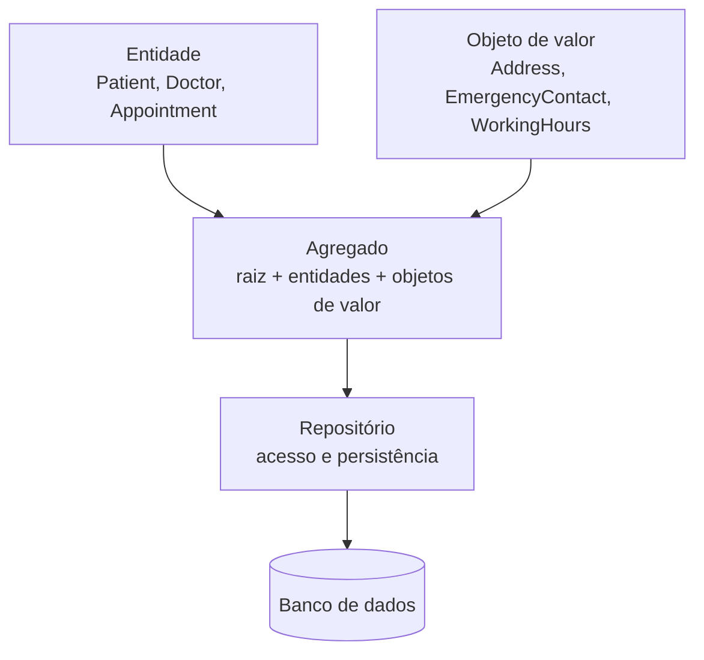
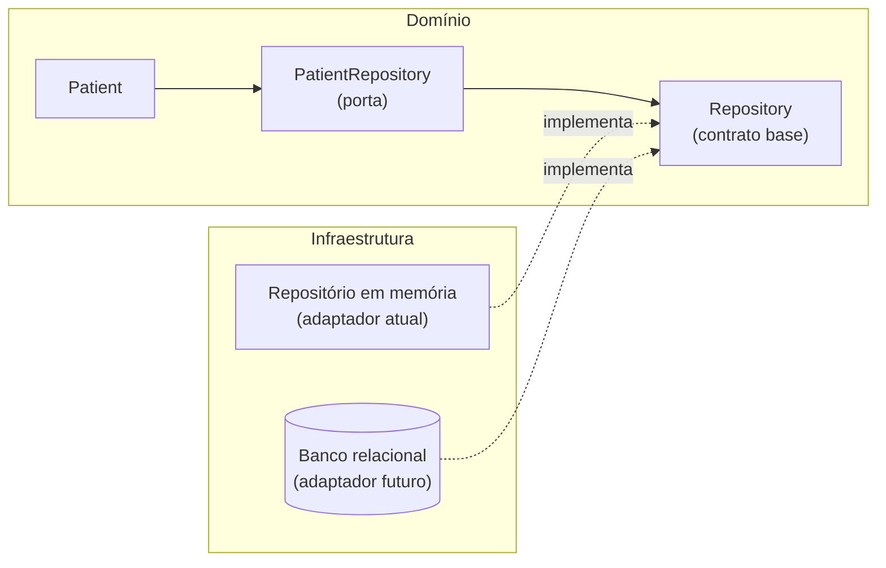
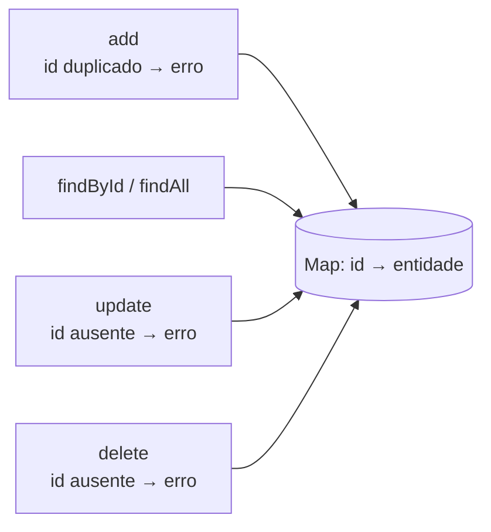
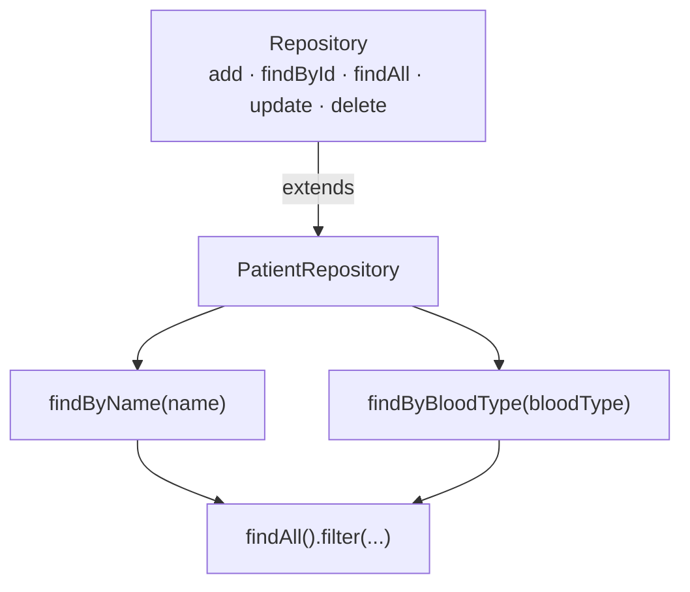
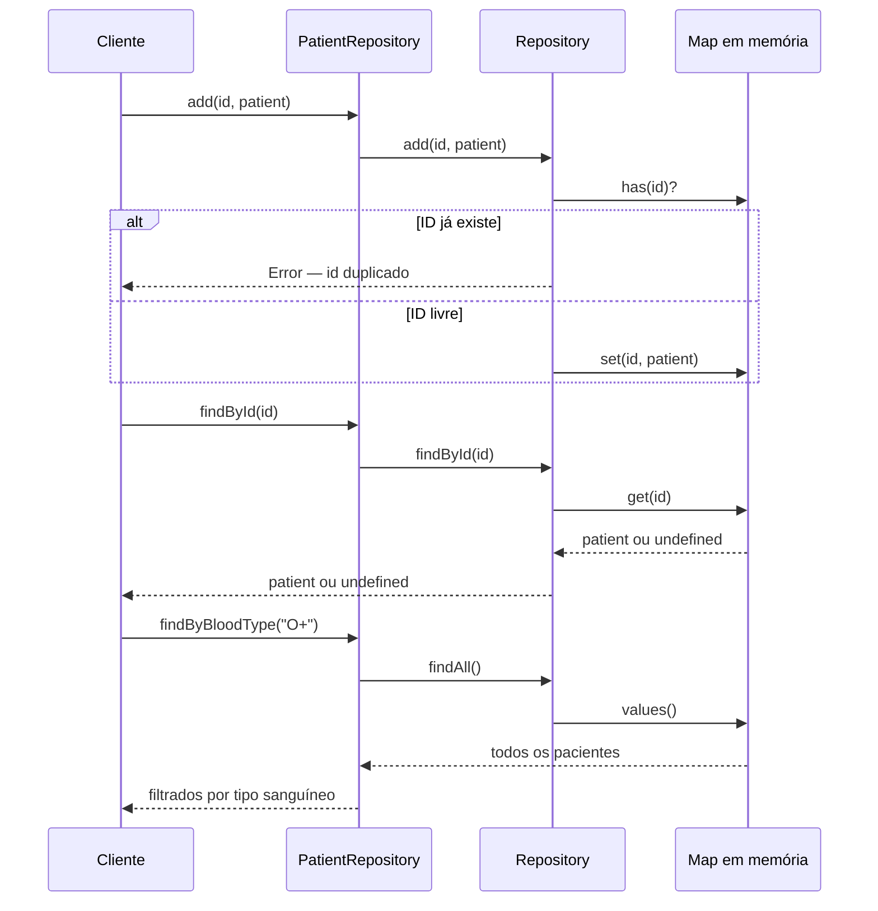

# Repositórios

## Introdução e contexto

Já percorremos **três elementos** do modelo de domínio:

| Elemento | Papel | Exemplos do sistema hospitalar |
| --- | --- | --- |
| **Entidade** | Conceito com **identidade única** | `Patient`, `Doctor`, `Appointment`, `Exam` |
| **Objeto de valor** | Conceito **sem ID**, comparado por atributos | `Address`, `EmergencyContact`, `WorkingHours` |
| **Agregado** | Grupo tratado como **unidade**, com uma **raiz** | Paciente (raiz `Patient`) e médico (raiz `Doctor`) |

Falta a peça que liga esse modelo ao **mundo externo**: **onde** e **como** os dados são guardados. Até aqui o domínio vive em memória e é recriado a cada execução — não há persistência de verdade.

É aí que entram os **repositórios**: eles **encapsulam o acesso e a persistência** dos dados e dão ao resto do sistema a impressão de que o agregado é apenas uma **coleção de objetos**. Esta aula apresenta o conceito e implementa duas peças: um **repositório base**, com as operações de CRUD, e um **repositório de pacientes**, com buscas específicas do agregado.



## O que são Repositórios

Um **repositório** é um **padrão de design** que **encapsula o acesso aos dados** e a forma como a **persistência** é feita. Ele esconde do domínio os detalhes de banco: se o armazenamento é um `Map` em memória, um arquivo ou um banco relacional, quem usa o repositório **não precisa saber**.

Os repositórios oferecem os meios para exercer o **CRUD**:

- **C**reate — salvar uma entidade;
- **R**ead — buscar por ID ou listar;
- **U**pdate — atualizar uma entidade existente;
- **D**elete — excluir uma entidade.

No **DDD**, os repositórios têm um papel adicional: **gerenciar os agregados**. Um agregado reúne várias classes que trabalham juntas para atender a uma necessidade do domínio, e o repositório é quem **garante a consistência** desses dados ao **carregar e salvar o agregado como uma unidade**. A fronteira do repositório acompanha a fronteira do agregado — não a fronteira da tabela.

> **Repositório não é DAO.** O DAO é uma abstração genérica de acesso a dados, muitas vezes por tabela. O repositório é uma abstração **do domínio**, orientada ao **agregado**, e fala a língua do negócio: `findByBloodType`, `findByName`.

## Repositório como porta e adaptador

Na **arquitetura hexagonal** — também chamada de **portas e adaptadores** —, o repositório é a **porta**: o domínio declara *o que* precisa (buscar um paciente pelo ID) sem dizer *como*. O **adaptador** é a peça de infraestrutura que implementa essa porta: um repositório em memória, um repositório com PostgreSQL, um cliente de API.

Na **arquitetura em camadas**, essa mesma ideia aparece como a **camada de repositório**, que faz a ponte entre o domínio e a persistência.



O ganho é a **inversão de dependência**: o domínio **não importa** o banco. Ele depende de uma abstração que pode ser trocada sem tocar nas regras de negócio — e, no meio do caminho, permite testar tudo **sem banco nenhum**.

> **Enquanto não há banco real**, o repositório é implementado dentro do próprio domínio. Quando a persistência de verdade entrar, a classe concreta migra para a camada de infraestrutura e o domínio fica apenas com a porta.

## A classe base `Repository`

Todos os repositórios compartilham o mesmo esqueleto de CRUD. Por isso, o primeiro passo é criar uma **classe base**, genérica, em `shared/` — ela não pertence a nenhum agregado específico e será reutilizada por todos.

No lugar de um banco de dados, a base usa um **`Map`**: uma estrutura **chave-valor** em memória, em que a chave é o **ID** da entidade. No mundo real, é no **construtor** que a conexão com o banco seria recebida; hoje ele apenas inicializa o `Map` vazio.

```typescript
// src/domain/shared/PatientRepository.ts — classe base de todos os repositórios.
// No mundo real, o construtor receberia a conexão com o banco de dados.
export class Repository {
  data: Map<string, any>;

  constructor() {
    this.data = new Map();
  }

  // Cria: guarda a entidade usando o id como chave.
  add(id: string, entity: any) {
    if (this.data.has(id)) {
      throw new Error(`Entity with id ${id} already exists.`);
    }
    this.data.set(id, entity);
  }

  // Lê por chave: devolve a entidade ou undefined.
  findById(id: string): any | undefined {
    return this.data.get(id);
  }

  // Lê tudo: transforma os valores do Map em um array.
  findAll(): any[] {
    return Array.from(this.data.values());
  }

  // Atualiza: substitui a entidade inteira.
  update(id: string, entity: any) {
    if (!this.data.has(id)) {
      throw new Error(`Entity with id ${id} does not exist.`);
    }
    this.data.set(id, entity);
  }

  // Exclui: só remove se a chave existir.
  delete(id: string) {
    if (!this.data.has(id)) {
      throw new Error(`Entity with id ${id} does not exist.`);
    }
    this.data.delete(id);
  }
}
```

### O contrato do CRUD

| Método | Assinatura | Comportamento | Quando o ID não existe |
| --- | --- | --- | --- |
| `add` | `add(id, entity)` | insere a entidade sob a chave `id` | — (o problema é o contrário: ID **duplicado** lança erro) |
| `findById` | `findById(id)` | devolve a entidade | retorna `undefined` |
| `findAll` | `findAll()` | devolve **um array novo** com todos os valores | retorna `[]` |
| `update` | `update(id, entity)` | **sobrescreve** a entidade daquela chave | lança erro |
| `delete` | `delete(id)` | remove a chave do `Map` | lança erro |



Dois detalhes de implementação merecem atenção:

- **`add` valida a duplicidade.** Se a chave já existe, a operação falha em vez de sobrescrever silenciosamente. É uma decisão conservadora: quem quer substituir deve chamar `update`.
- **`findAll` devolve uma coleção nova.** `Array.from` cria um array a partir dos valores do `Map`; mexer nesse array (dar `pop`, `push`) **não altera** o estado interno do repositório. É o mesmo princípio dos getters que devolvem cópias nas entidades.

### `update`: substituir ou completar?

A implementação acima **sobrescreve a entidade inteira** com o objeto recebido. Existem outras abordagens:

| Abordagem | O que faz | Efeito |
| --- | --- | --- |
| **Substituição** (atual) | troca o objeto inteiro | simples, mas exige enviar todos os campos |
| **Atualização parcial** | aplica só os campos modificados (ex.: `Object.assign` ou *patch*) | evita reenviar dados, mas precisa saber o que mudou |
| **Comparação atributo a atributo** | detecta o que mudou e persiste só isso | mais controle, mais código e mais validação |

A aula levanta também a possibilidade de **`upsert`**: se o ID não existir, simplesmente **adicionar**. O código final optou por **lançar erro**, deixando explícito que `update` pressupõe uma entidade existente. São decisões de projeto — o importante é que o contrato fique **claro para quem chama**.

## O `PatientRepository`

Com o CRUD resolvido na base, o repositório do agregado só precisa **herdar** e acrescentar o que é **específico do paciente**:

```typescript
// src/domain/patient/PatientRepository.ts
import { Repository } from "../shared/PatientRepository.ts";

export class PatientRepository extends Repository {
  constructor() {
    // O construtor da base é vazio hoje; amanhã receberá a conexão.
    super();
  }

  // Busca pelo nome completo do paciente.
  findByName(name: string): any[] {
    return this.findAll().filter((patient) => patient.name === name);
  }

  // Busca pelo tipo sanguíneo — útil, por exemplo, em campanhas de doação.
  findByBloodType(bloodType: string): any[] {
    return this.findAll().filter((patient) => patient.bloodType === bloodType);
  }
}
```

O `super()` é obrigatório: a subclasse **não recria** o `Map`, apenas reaproveita o da base. `add`, `findById`, `findAll`, `update` e `delete` chegam de graça.

As buscas personalizadas funcionam por **filtro sobre `findAll`**: pegam todos os pacientes e mantêm apenas os que satisfazem o critério. É simples e suficiente para o volume atual.



Esse é o ponto em que o repositório ganha **inteligência de domínio**. Buscar por tipo sanguíneo não é um detalhe técnico: é uma pergunta do negócio — "quais pacientes têm este tipo sanguíneo?", por exemplo para localizar **candidatos a doação**. O nome do método **expressa a intenção**, em vez de expor um `WHERE blood_type = ?`.

| Repositório | Herda | Métodos próprios |
| --- | --- | --- |
| `Repository` | — | `add`, `findById`, `findAll`, `update`, `delete` |
| `PatientRepository` | `Repository` | `findByName`, `findByBloodType` |

## Demonstração

Com as duas classes prontas, um **script de teste** exercita o fluxo completo: **adicionar → buscar → atualizar → excluir**.

```typescript
// testHospital.ts — demonstração do repositório de pacientes.
import { Patient } from "./domain/patient/Patient.ts";
import { PatientRepository } from "./domain/patient/PatientRepository.ts";

const repository = new PatientRepository();

// `patient` é uma instância de `Patient` já montada com os dados do agregado.
// Add: a chave é o próprio id do paciente.
repository.add(patient.id, patient);

// FindById: recupera o paciente pela chave.
console.log(repository.findById(patient.id));

// Update: substitui a entidade inteira por uma nova instância de `Patient`.
repository.update(patient.id, updatedPatient);
console.log(repository.findById(patient.id)?.name);

// Delete: remove pela chave.
repository.delete(patient.id);
console.log(repository.findById(patient.id)); // undefined

// Buscas específicas do agregado.
console.log(repository.findByName("João Silva"));
console.log(repository.findByBloodType("O+")); // devolve um array
```

O resultado confirma o comportamento esperado:

| Operação | Saída observada |
| --- | --- |
| `findById` após `add` | o objeto `Patient` (ex.: João Silva) |
| `findById` após `update` | o paciente com o **nome atualizado** |
| `findById` após `delete` | `undefined` |
| `findByBloodType("O+")` | um **array** com os pacientes compatíveis |



> **Detalhe do projeto:** o ID é tratado como **`string`** em todo o repositório (`Map<string, any>`). Manter o **mesmo tipo** na entidade e na chave evita comparações que falham por diferença de tipo — um `1` numérico não encontra `"1"`.

## Benefícios

- **Domínio protegido dos detalhes de banco.** O `Patient` não sabe se está num `Map` ou num PostgreSQL.
- **Contrato único de persistência.** Todo agregado nasce com o mesmo CRUD, sem repetição.
- **Consistência do agregado.** O repositório carrega e salva a **unidade** definida pelo agregado, não tabelas soltas.
- **Consultas com nome de negócio.** `findByBloodType` diz mais do que um SQL genérico.
- **Testabilidade.** O repositório em memória permite exercitar as regras sem infraestrutura.
- **Ponto de troca bem definido.** Migrar para banco real significa criar um **novo adaptador**, não reescrever o domínio.
- **Evolução incremental.** Primeiro o CRUD genérico, depois as buscas específicas — cada necessidade entra no repositório certo.

## Pontos de atenção

- **Ainda não há persistência real.** O `Map` vive na memória do processo: ao encerrar, **tudo se perde**. É um adaptador didático, não uma solução de produção.
- **`any` enfraquece os tipos.** A base aceita qualquer entidade e devolve `any`, então o compilador não ajuda. Um próximo passo natural é `Repository<T>` com `PatientRepository extends Repository<Patient>`.
- **`update` substitui tudo.** Se o objeto recebido vier incompleto, campos são **perdidos**. Atualização parcial exige outra estratégia (patch ou comparação campo a campo).
- **Buscas são comparações exatas.** `findByName` diferencia maiúsculas e exige o nome inteiro; `"João"` não encontra `"João Silva"`. Busca parcial, normalização e ordenação ainda não existem.
- **`findAll` carrega tudo.** As buscas específicas filtram **em memória**; com muitos registros isso deixa de escalar. Num banco real, o filtro vira cláusula da consulta.
- **Sem paginação, transação ou tratamento de concorrência.** São responsabilidades que aparecem quando o armazenamento real entrar.
- **Um repositório por raiz de agregado.** Não crie um repositório por tabela nem por classe interna: `Appointment` e `Exam` são acessados **pelo** `Patient`.
- **Repositório não é regra de negócio.** Ele guarda e recupera; validar se o paciente pode ter duas consultas no mesmo horário continua sendo papel do **agregado**.
- **Expor o `Map` público** (`data`) permite que qualquer código mexa no estado interno. O ideal é torná-lo **privado** (`#data`), como já fazemos nas entidades.
- **Nome do arquivo da base.** A classe genérica ficou em `shared/PatientRepository.ts`; como ela serve a **todos** os agregados, o nome mais adequado para o arquivo seria `Repository.ts`.

## Conclusão

Os **repositórios** encapsulam **acesso e persistência** e oferecem o **CRUD** sobre os **agregados**, escondendo do domínio o mecanismo de armazenamento. Na arquitetura hexagonal, são **portas**; na prática de hoje, foram implementados como um **adaptador em memória**.

A implementação ficou em **duas camadas**:

- **`Repository`**, em `shared/`, com `add`, `findById`, `findAll`, `update` e `delete` sobre um `Map<id, entidade>` — o esqueleto comum a todos os agregados;
- **`PatientRepository`**, em `patient/`, que faz `extends Repository` e acrescenta `findByName` e `findByBloodType`, trazendo **perguntas do domínio** para a camada de persistência.

O **script de teste** comprovou o ciclo completo: adicionar, buscar por ID, atualizar, excluir — e, depois do `delete`, o `findById` devolve `undefined`.

Na **próxima aula**, a implementação continua: os demais repositórios do sistema e a passagem para um armazenamento **mais próximo da realidade**, antes de finalmente trocar o `Map` por persistência de verdade.
