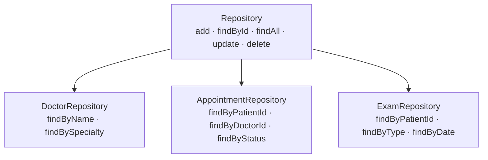

# Implementando Repositórios

## Introdução e contexto

Na aula anterior montamos a **base dos repositórios**: a classe `Repository`, com o CRUD sobre um `Map<id, entidade>`, e o `PatientRepository`, que acrescentou `findByName` e `findByBloodType` por **filtro sobre `findAll`**.

Agora o mesmo raciocínio é aplicado aos **demais agregados** do sistema hospitalar:

- `DoctorRepository` — buscas por **nome** e por **especialidade**;
- `AppointmentRepository` — consultas por **paciente**, por **médico** e por **status**;
- `ExamRepository` — exames por **paciente**, por **tipo** e por **data**.

Nenhum deles reimplementa CRUD: todos fazem `extends Repository`, chamam `super()` e adicionam apenas as perguntas que fazem sentido para o seu agregado.



> O padrão é sempre o mesmo: **herdar o CRUD** e **especializar as consultas**. O que muda de um repositório para outro é só o **critério de busca** — e esse critério vem do domínio, não do banco.

## O `DoctorRepository`

O repositório do médico é a versão mais direta do padrão. Ele herda tudo da base e ganha duas buscas: uma por **nome** e outra por **especialidade**.

```typescript
// src/domain/doctor/DoctorRepository.ts
import { Repository } from "../shared/PatientRepository.ts";

export class DoctorRepository extends Repository {
  constructor() {
    super();
  }

  findByName(name: string): any[] {
    return this.findAll().filter((doctor) => doctor.name === name);
  }

  findBySpecialty(specialty: string): any[] {
    return this.findAll().filter((doctor) =>
      doctor.specialties.includes(specialty)
    );
  }
}
```

A diferença entre os dois métodos está no **tipo do atributo comparado**:

| Método | Atributo | Comparação | Exemplo |
| --- | --- | --- | --- |
| `findByName` | `name` (string) | igualdade exata (`===`) | `"Maria Santos"` |
| `findBySpecialty` | `specialties` (coleção) | pertinência (`includes`) | `"Cardiology"` |

Como `specialties` é uma **coleção**, não basta comparar com `===`: é preciso perguntar se a especialidade procurada **está dentro** da lista do médico. Um cardiologista que também atende clínica geral aparece tanto em `findBySpecialty("Cardiology")` quanto em `findBySpecialty("General Practice")`.

Na prática, o fluxo é sempre: `findAll()` → `filter(...)` → lista apenas com os médicos que têm a especialidade.

Também é possível buscar um médico pelo **ID** com o `findById` herdado — foi o que a aula usou para confirmar que o `Doctor` estava sendo gravado e recuperado corretamente.

## O `AppointmentRepository`

As consultas são o coração do sistema hospitalar, então o repositório de consultas precisa responder a três perguntas frequentes:

- quais consultas são de **determinado paciente**;
- quais consultas são de **determinado médico**;
- quais consultas estão em **determinado status**.

```typescript
// src/domain/patient/AppointmentRepository.ts
import { Repository } from "../shared/PatientRepository.ts";
import { Appointment } from "./Appointments.ts";

export class AppointmentRepository extends Repository {
  constructor() {
    super();
  }

  findByPatientId(patientId: string): Appointment[] {
    return this.findAll().filter(
      (appointment) => appointment.patientId === patientId
    );
  }

  findByDoctorId(doctorId: string): Appointment[] {
    return this.findAll().filter(
      (appointment) => appointment.doctorId === doctorId
    );
  }

  findByStatus(status: "scheduled" | "completed" | "canceled"): Appointment[] {
    return this.findAll().filter(
      (appointment) => appointment.status === status
    );
  }
}
```

Repare que as consultas referenciam o paciente e o médico **por ID** (`patientId`, `doctorId`), exatamente como as entidades foram modeladas. Isso evita acoplar o repositório a objetos inteiros e mantém a fronteira do agregado.

| Método | Pergunta de negócio | Uso típico |
| --- | --- | --- |
| `findByPatientId` | “quais consultas este paciente tem?” | histórico do paciente |
| `findByDoctorId` | “quais consultas este médico tem?” | agenda do médico |
| `findByStatus` | “quais consultas estão pendentes/concluídas/canceladas?” | acompanhamento e pendências |

O **status** é um conjunto fechado de valores — `"scheduled"`, `"completed"` e `"canceled"` — e nasce como `"scheduled"` no construtor de `Appointment`. O repositório apenas **consulta** esse estado; quem **muda** o status são os métodos da própria entidade (`complete()` e `cancel()`), que validam a transição.

> **A agenda do dia não é um método pronto.** `findByDoctorId` devolve todas as consultas do médico; para “as consultas de amanhã”, é preciso **combinar** o filtro do médico com o filtro de data — ou criar um método específico quando essa necessidade aparecer. O repositório cresce guiado pelo domínio, não por antecipação.

### Quem agenda é o paciente, não o repositório

Ao testar, surge uma tentação: usar `appointmentRepository.add(id, appointment)` para “agendar” a consulta. Mas **adicionar ao repositório é persistir**, não agendar. A regra que impede duas consultas do mesmo médico no mesmo horário vive no **agregado**:

```typescript
// Patient.scheduleAppointment() valida o conflito antes de guardar.
patient.scheduleAppointment(appointment); // regra de negócio
appointmentRepository.add(appointment.id, appointment); // persistência
```

O próprio instrutor comenta que, quando os **serviços de domínio** entrarem, essa orquestração vai para o serviço: ele pede ao paciente para agendar (validando as regras) e ao repositório para salvar. O repositório **não decide** se a consulta pode existir.

| Etapa | Quem faz | Como |
| --- | --- | --- |
| Validar o agendamento | `Patient` (domínio) | `scheduleAppointment()` → `hasConflict()` |
| Persistir | `AppointmentRepository` | `add(id, appointment)` |

## O `ExamRepository`

O último repositório da aula segue a mesma receita, agora para os exames do paciente:

```typescript
// src/domain/patient/ExamRepository.ts
import { Repository } from "../shared/PatientRepository.ts";
import { Exam } from "./Exam.ts";

export class ExamRepository extends Repository {
  constructor() {
    super();
  }

  findByPatientId(patientId: string): Exam[] {
    return this.findAll().filter((exam) => exam.patientId === patientId);
  }

  findByType(type: string): Exam[] {
    return this.findAll().filter((exam) => exam.type === type);
  }

  findByDate(date: Date): Exam[] {
    return this.findAll().filter(
      (exam) => exam.date.toDateString() === date.toDateString()
    );
  }
}
```

O detalhe interessante está em `findByDate`: ele **não compara o timestamp** (`getTime()`), e sim `toDateString()`. Assim, dois `Date` no **mesmo dia**, mas em horários diferentes, são considerados iguais — que é o comportamento esperado para “exames realizados nesta data”.

| Método | Critério | Observação |
| --- | --- | --- |
| `findByPatientId` | igualdade de `patientId` | todos os exames do paciente |
| `findByType` | igualdade de `type` | ex.: `"Hemograma"`, `"Blood count"` |
| `findByDate` | mesmo **dia** (`toDateString`) | ignora horas e minutos |

Assim como no repositório de médicos, os filtros são **extensíveis**: buscar por médico responsável (`responsible`) ou por local (`location`) seria só mais um método com o mesmo formato. A decisão de **quais** filtros existem é do domínio — implementa-se o que o sistema realmente precisa.

## O padrão que se repete

Com os quatro repositórios prontos, a estrutura fica uniforme:

| Repositório | Herda | Métodos próprios | Retorno tipado |
| --- | --- | --- | --- |
| `Repository` | — | `add`, `findById`, `findAll`, `update`, `delete` | `any` |
| `PatientRepository` | `Repository` | `findByName`, `findByBloodType` | `any[]` |
| `DoctorRepository` | `Repository` | `findByName`, `findBySpecialty` | `any[]` |
| `AppointmentRepository` | `Repository` | `findByPatientId`, `findByDoctorId`, `findByStatus` | `Appointment[]` |
| `ExamRepository` | `Repository` | `findByPatientId`, `findByType`, `findByDate` | `Exam[]` |

Todas as buscas específicas têm a mesma anatomia:

```typescript
this.findAll().filter((entidade) => entidade.criterio === valor);
```

É um **filtro em memória**: o repositório materializa todos os registros e mantém apenas os que satisfazem o predicado. Simples, legível e suficiente enquanto o volume é pequeno — mas, como veremos adiante, é justamente o que muda quando um banco de dados real entra em cena.

## Demonstração

O roteiro de teste da aula replica o que já tínhamos feito com pacientes:

```typescript
// Repositório de médicos.
const doctorRepository = new DoctorRepository();
doctorRepository.add(doctor.id, doctor);

console.log(doctorRepository.findById(doctor.id));
console.log(doctorRepository.findBySpecialty("Cardiology"));

// Repositório de consultas.
const appointmentRepository = new AppointmentRepository();
appointmentRepository.add(appointment.id, appointment);

console.log(appointmentRepository.findByPatientId(patient.id));
console.log(appointmentRepository.findByDoctorId(doctor.id));
console.log(appointmentRepository.findByStatus("scheduled"));

// Repositório de exames.
const examRepository = new ExamRepository();
examRepository.add(exam.id, exam);

console.log(examRepository.findByPatientId(patient.id));
console.log(examRepository.findByType("Hemograma"));
console.log(examRepository.findByDate(new Date("2023-10-10")));
```

| Operação | Saída observada |
| --- | --- |
| `doctorRepository.findById(id)` | o `Doctor` gravado, com especialidades e horários |
| `findBySpecialty("Cardiology")` | apenas os médicos que têm essa especialidade na lista |
| `appointmentRepository.findByPatientId(id)` | as consultas daquele paciente |
| `appointmentRepository.findByStatus("scheduled")` | as consultas ainda pendentes |
| `examRepository.findByDate(data)` | os exames do mesmo dia, independentemente do horário |

## Benefícios

- **CRUD herdado, sem repetição.** Cada repositório novo é pequeno: só as buscas do agregado.
- **Consultas com nome de negócio.** `findBySpecialty` e `findByStatus` expressam a intenção melhor do que um `WHERE` genérico.
- **Fronteira do agregado preservada.** Consultas e exames continuam sendo acessados no pacote do paciente; médicos no pacote do médico.
- **Regras no lugar certo.** O repositório guarda e consulta; as validações ficam nas entidades (`Patient.scheduleAppointment`, `Appointment.complete`/`cancel`).
- **Testabilidade.** Tudo roda em memória, sem banco, sem configuração e sem rede.
- **Evolução previsível.** Quando um banco real entrar, o CRUD e as assinaturas das buscas continuam os mesmos; muda apenas o adaptador.
- **Critérios guiados pelo domínio.** Os filtros nascem de perguntas reais (agenda do médico, histórico do paciente, acompanhamento por status), não de detalhes de tabela.

## Limitações e pontos de atenção

- **Ainda é memória pura.** O `Map` morre com o processo; não há persistência entre execuções.
- **Filtro em memória.** `findAll()` carrega todos os registros antes de filtrar; com volume alto, o custo cresce e o banco real passa a ser necessário.
- **Comparações exatas.** `findByName`, `findByType` e `findBySpecialty` diferenciam maiúsculas e exigem o valor completo; não há busca parcial, normalização nem ordenação.
- **`toDateString()` depende do fuso local.** `findByDate` compara o dia no fuso do processo — em cenários com fusos diferentes, isso precisa ser explicitado.
- **`any` enfraquece os tipos.** A base e o `DoctorRepository` devolvem `any[]`; `AppointmentRepository` e `ExamRepository` já tipam o retorno. O ideal é evoluir a base para `Repository<T>`.
- **O `Map` é público.** `repository.data` permite mexer no estado interno; deveria ser privado (`#data`), como nas entidades.
- **Sem paginação, transação ou concorrência.** São responsabilidades que só aparecem com armazenamento real.
- **Um repositório por raiz de agregado.** Não crie um repositório por tabela nem por classe interna: `Appointment` e `Exam` pertencem ao agregado do paciente.
- **Nome do arquivo da base.** A classe genérica continua em `shared/PatientRepository.ts`; como serve a todos os agregados, o nome ideal seria `Repository.ts`.
- **Repositório não é serviço.** Ele não orquestra regras, não valida conflito e não decide se a consulta pode ser agendada — apenas persiste e consulta.

## Conclusão

A aula completou a **camada de repositórios** dos principais agregados do sistema hospitalar:

- **`DoctorRepository`** — buscas por nome e por especialidade;
- **`AppointmentRepository`** — consultas por paciente, por médico e por status;
- **`ExamRepository`** — exames por paciente, por tipo e por data.

Todos seguem o mesmo desenho: **`extends Repository`**, `super()` no construtor e buscas específicas implementadas como `findAll().filter(...)`. O CRUD continua centralizado na base, e cada subclasse carrega apenas o vocabulário do seu agregado.

A aula também deixou explícita uma separação importante: **agendar é regra do paciente; guardar é papel do repositório**. Essa distinção será essencial na **próxima aula**, quando entram os **serviços de domínio** — o lugar de orquestrar paciente, médico, consulta e persistência. Depois disso, o próximo passo é trocar o `Map` por um **banco de dados em memória**, mais próximo de um cenário real, e seguir em direção à API.
