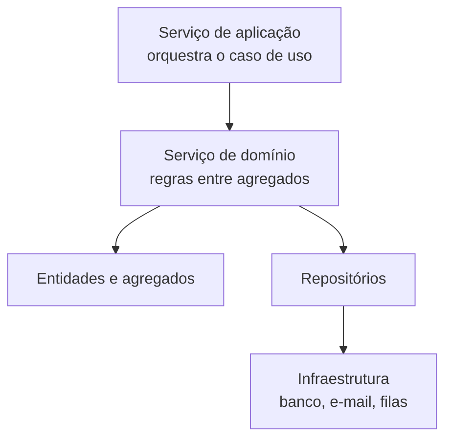

# Serviços de Domínio

## Introdução e contexto

Até aqui, o modelo do domínio foi construído com quatro elementos:

| Elemento | Papel | Exemplos do sistema hospitalar |
| --- | --- | --- |
| **Entidade** | Objeto com **identidade única** | `Patient`, `Doctor`, `Appointment`, `Exam` |
| **Objeto de valor** | Objeto **sem ID**, comparado por atributos | `Address`, `EmergencyContact`, `Allergy`, `MedicalRecord` |
| **Agregado** | Grupo de entidades e objetos de valor tratado como **unidade** | Paciente (raiz `Patient`) e médico (raiz `Doctor`) |
| **Repositório** | **Persistência** e acesso aos agregados | `PatientRepository`, `DoctorRepository`, `AppointmentRepository` |

Falta o elemento que **coordena** tudo isso: o **serviço**. Ele entra quando a operação não pertence a uma única entidade — como agendar uma consulta, que envolve paciente, médico, agenda e disponibilidade — ou quando a regra é complexa demais para ficar espalhada pelo agregado.

Esta aula apresenta os **serviços de domínio** e implementa o primeiro deles: o `PatientService`, que assume as responsabilidades que estavam sobrecarregando o `Patient`.

## O que são serviços

Um **serviço** é uma classe (ou componente) que **encapsula lógica de negócio** que não pertence naturalmente a uma entidade ou a um objeto de valor. Ele existe para:

- **coordenar operações que envolvem múltiplos agregados** — por exemplo, agendar uma consulta exige verificar o paciente, o médico e a agenda;
- **concentrar regras e validações complexas** que não têm um dono natural no modelo;
- **orquestrar a comunicação entre objetos** — buscar um paciente, alterar seu estado e persistir o resultado.

> **Serviço não é repositório.** O repositório guarda e recupera; o serviço **decide o que fazer** com o que foi recuperado. Também não é controller: o controller lida com HTTP/entrada e saída, o serviço lida com o **domínio**.

## As três categorias de serviços

No DDD, os serviços costumam ser classificados em três tipos:

| Categoria | Responsabilidade | Exemplo no sistema |
| --- | --- | --- |
| **Serviço de aplicação** | Orquestra o **caso de uso**: recebe a chamada, coordena serviços de domínio e devolve o resultado | um controller que recebe `POST /patients` e chama `PatientService.addPatient` |
| **Serviço de domínio** | Concentra **regras de negócio** que cruzam agregados ou entidades | `PatientService`, `AppointmentService` |
| **Serviço de infraestrutura** | Integra com recursos técnicos: banco, e-mail, filas, APIs externas | adaptador do repositório, envio de notificação |



O foco desta aula é o **serviço de domínio**. A fronteira com o serviço de aplicação fica para quando o sistema virar uma API.

## O `PatientService`

O `Patient` acumulava responsabilidades demais: cadastrar alergia, diagnóstico, medicação e tratamento, além de agendar consulta e adicionar exame. Isso mistura **estado do agregado** com **operações de cadastro e persistência**.

O `PatientService` nasce para tirar esse peso de cima da entidade. Ele recebe o **repositório por injeção de dependência** e passa a ser a camada que conversa com a persistência:

```typescript
// src/domain/patient/PatientService.ts
import { Patient } from "./Patient.ts";
import { PatientRepository } from "./PatientRepository.ts";

export class PatientService {
  private readonly patientRepository: PatientRepository;

  constructor(patientRepository: PatientRepository) {
    this.patientRepository = patientRepository;
  }

  // ...
}
```

O construtor **não cria** o repositório: ele recebe uma instância pronta. Isso permite trocar a implementação (memória, banco real, mock) sem alterar o serviço.

### Cadastro e consultas

As operações de escrita e leitura delegam ao repositório, mas com nomes e fluxo do domínio:

```typescript
addPatient(patientData: Patient): Patient {
  const patient = new Patient(patientData);
  this.patientRepository.add(patient.id, patient);

  return patient;
}

findPatientById(patientId: string): Patient | undefined {
  return this.patientRepository.findById(patientId);
}

findAllPatients(): Patient[] {
  return this.patientRepository.findAll();
}

findPatientsByName(name: string): Patient[] {
  return this.patientRepository.findByName(name);
}

findPatientsByBloodType(bloodType: string): Patient[] {
  return this.patientRepository.findByBloodType(bloodType);
}
```

| Método do serviço | Chama no repositório | Pergunta respondida |
| --- | --- | --- |
| `addPatient` | `add(id, patient)` | cadastrar um novo paciente |
| `findPatientById` | `findById(id)` | “quem é este paciente?” |
| `findAllPatients` | `findAll()` | “quais pacientes existem?” |
| `findPatientsByName` | `findByName(name)` | “quais pacientes têm este nome?” |
| `findPatientsByBloodType` | `findByBloodType(type)` | “quais pacientes têm este tipo sanguíneo?” |

Repare que o serviço **não reimplementa** o filtro: ele reaproveita as buscas específicas do repositório. A camada de serviço orquestra; a camada de repositório consulta.

### Atualização e remoção

`updatePatient` e `deletePatient` primeiro verificam se o paciente existe. Se não existir, o serviço **falha explicitamente** em vez de atualizar ou remover nada em silêncio:

```typescript
updatePatient(patientId: string, updatedData: Partial<Patient>): Patient {
  const patient = this.patientRepository.findById(patientId);
  if (!patient) {
    throw new Error(`Patient with id ${patientId} not found.`);
  }

  Object.assign(patient, updatedData);
  this.patientRepository.update(patientId, patient);

  return patient;
}

deletePatient(patientId: string): Patient {
  const patient = this.patientRepository.findById(patientId);
  if (!patient) {
    throw new Error(`Patient with id ${patientId} not found.`);
  }

  this.patientRepository.delete(patientId);

  return patient;
}
```

O retorno é o **paciente atualizado** ou o **paciente removido**, o que dá ao chamador a confirmação do que aconteceu. A validação de existência fica no serviço porque é uma **regra de uso**, não uma responsabilidade do `Map`.

### Alergias e prontuário

As operações que antes viviam no `Patient` seguem todas o mesmo roteiro:

1. buscar o paciente pelo ID;
2. falhar se ele não existir;
3. validar a entrada (quando aplicável);
4. alterar o agregado;
5. persistir com `update`;
6. devolver o paciente atualizado.

| Método | Validação | O que altera |
| --- | --- | --- |
| `addPatientAllergy` | instância de `Allergy` + duplicata | coleção de alergias do paciente |
| `addPatientDiagnosis` | instância de `Diagnoses` | `medicalRecord.addDiagnoses(...)` |
| `addPatientMedication` | instância de `Medication` | `medicalRecord.addMedication(...)` |
| `addPatientTreatment` | instância de `Treatment` | `medicalRecord.addTreatment(...)` |

A validação de **duplicata** da alergia é um bom exemplo de regra que o serviço precisa manter: antes de adicionar, ele pergunta ao próprio objeto de valor se já existe uma alergia igual (`existing.equals(allergy)`).

### O que sai do `Patient`

Com o serviço, o agregado fica mais enxuto:

| Responsabilidade | Antes | Depois |
| --- | --- | --- |
| Cadastrar, buscar, atualizar e remover | — | `PatientService` |
| Alergias | `Patient.addAllergy` | `PatientService.addPatientAllergy` |
| Diagnósticos | `Patient.addDiagnosis` | `PatientService.addPatientDiagnosis` |
| Medicações | `Patient.addMedication` | `PatientService.addPatientMedication` |
| Tratamentos | `Patient.addTreatment` | `PatientService.addPatientTreatment` |
| Exames | `Patient.addExam` | permanece no `Patient` por enquanto |
| Agendamento | `Patient.scheduleAppointment` | permanece no `Patient` por enquanto |

O `Patient` continua responsável pelo que é **intrínseco** a ele: seus dados, suas coleções e as regras que dependem apenas do próprio estado. Cadastro e persistência saem para o serviço.

> **Exames e consultas terão serviços próprios.** A aula deixa os exames no agregado por enquanto, mas sinaliza que eles devem ganhar um `ExamService`. O agendamento de consultas, por envolver **paciente + médico + agenda + disponibilidade**, será um `AppointmentService` — o exemplo clássico de serviço de domínio.

## Demonstração

Com o repositório e o serviço ligados, o fluxo de cadastro fica assim:

```typescript
// Montagem das dependências.
const patientRepository = new PatientRepository();
const patientService = new PatientService(patientRepository);

// Cadastro: o serviço cria o Patient e delega a persistência.
const patient = patientService.addPatient(new Patient({ /* dados */ }));

// Consultas.
console.log(patientService.findPatientById(patient.id));
console.log(patientService.findAllPatients());
console.log(patientService.findPatientsByName("João Silva"));
console.log(patientService.findPatientsByBloodType("O+"));

// Atualização parcial.
patientService.updatePatient(patient.id, { phone: "(11) 90000-0000" });

// Remoção.
patientService.deletePatient(patient.id);
```

| Operação | Resultado |
| --- | --- |
| `addPatient` | paciente criado e gravado no repositório |
| `findPatientById` | o paciente correspondente ou `undefined` |
| `findPatientsByName` | array com os homônimos encontrados |
| `findPatientsByBloodType` | array com os pacientes compatíveis |
| `updatePatient` | o paciente com os campos alterados |
| `deletePatient` | o paciente removido; depois, `findById` devolve `undefined` |

## Benefícios

- **Entidade mais enxuta.** O `Patient` deixa de acumular operações de cadastro e persistência.
- **Uma responsabilidade por camada.** O serviço orquestra, o repositório persiste e o agregado guarda o estado.
- **Regras centralizadas.** Validações como “paciente existe” e “alergia duplicada” ficam em um único lugar.
- **Reuso.** O mesmo serviço atende controller, CLI, testes e futuras integrações.
- **Testabilidade.** Basta injetar um `PatientRepository` em memória para testar o serviço sem banco.
- **Evolução para múltiplos agregados.** O padrão está pronto para o `AppointmentService`, que vai coordenar paciente, médico e consulta.
- **Ponto natural para transações.** Quando o banco real entrar, o serviço é o lugar de abrir e fechar a unidade de trabalho.

## Limitações e pontos de atenção

- **Encapsulamento do prontuário.** O código atual mantém `#medicalRecord` privado e sem getter, e `allergies` devolve uma **cópia**. Para o serviço alterar essas coleções, o agregado precisa expor operações próprias (ex.: `addAllergy`) ou um acesso controlado — caso contrário, as alterações não chegam ao estado interno.
- **`any` enfraquece os tipos.** As buscas do repositório devolvem `any`, então o serviço perde a checagem do compilador. O próximo passo é tipar `Repository<T>` e `PatientRepository extends Repository<Patient>`.
- **`Partial<Patient>` + `Object.assign`.** A atualização parcial pode **burlar invariantes** do agregado (trocar `id`, apagar campos obrigatórios). O ideal é um DTO com os campos permitidos e validação antes de aplicar.
- **Retorno `Patient | Error`.** Como o serviço **lança** exceções, o tipo `Patient | Error` não protege ninguém; o contrato real é “retorna `Patient` ou lança erro”.
- **ID informado manualmente.** O paciente chega com `id` pronto; o serviço não verifica duplicidade de CPF/e-mail nem gera identidade. É uma decisão aceitável no estágio atual, mas precisa de regra quando o cadastro virar API.
- **`console.log` no serviço.** Log de domínio polui a saída e mistura observabilidade com regra de negócio. O ideal é delegar a um logger ou remover.
- **Erros genéricos.** `throw new Error(...)` não distingue “não encontrado” de “entrada inválida”; tipos de erro específicos melhoram o tratamento no controller.
- **Sem transação.** Em memória, cada `update` é atômico por acaso. Com banco real, operações que alteram mais de uma coisa precisam de transação.
- **Serviço ainda no pacote do agregado.** `PatientService` vive em `patient/`; na reorganização para a arquitetura hexagonal, serviços, repositórios e entidades serão separados por papel.
- **Serviço não substitui o agregado.** Regras que dependem só do estado do paciente continuam no `Patient`; o serviço coordena, não duplica a invariante.

## Conclusão

O **serviço** é o elemento que encapsula a **lógica de negócio que não pertence a uma única entidade** — especialmente operações que cruzam agregados, como o futuro agendamento de consultas.

Nesta aula, o `PatientService` assumiu o cadastro, as buscas, a atualização, a remoção e as operações de alergia e prontuário. O `Patient` ficou mais leve e passou a cuidar apenas do que é intrínseco ao seu estado. A dependência do repositório entra pelo **construtor**, o que mantém o serviço testável e desacoplado da persistência.

Ainda há ajustes importantes — principalmente o **encapsulamento das coleções** e a **tipagem** dos retornos —, mas a direção é clara: entidades com suas invariantes, repositórios com persistência e serviços com a coordenação.

Na **próxima aula**, a implementação continua com os demais serviços. O destaque será o **agendamento de consultas**, que vai unir paciente, médico e agenda em uma única operação de domínio. Depois disso, o sistema se aproxima da **arquitetura hexagonal** e de um armazenamento mais real.
