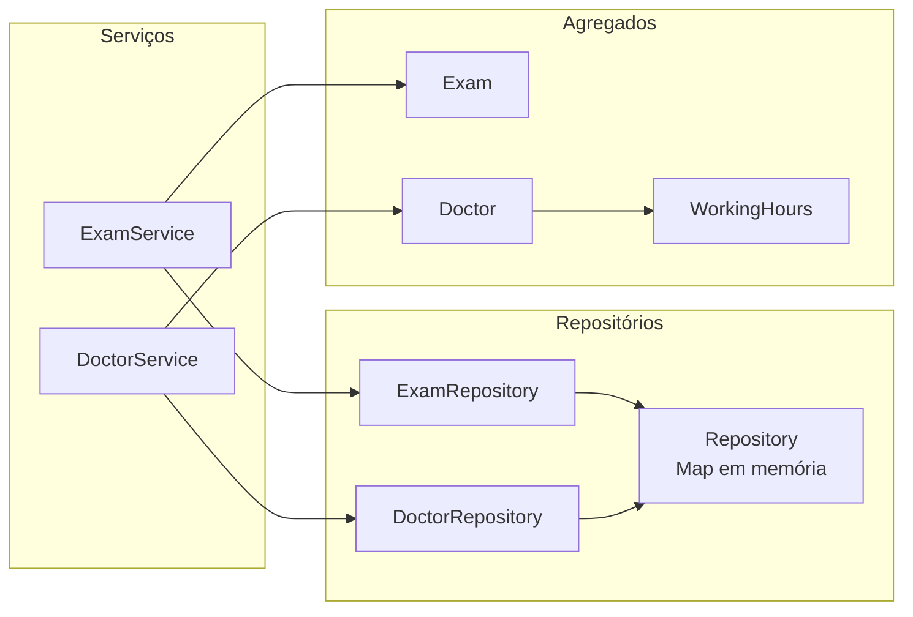
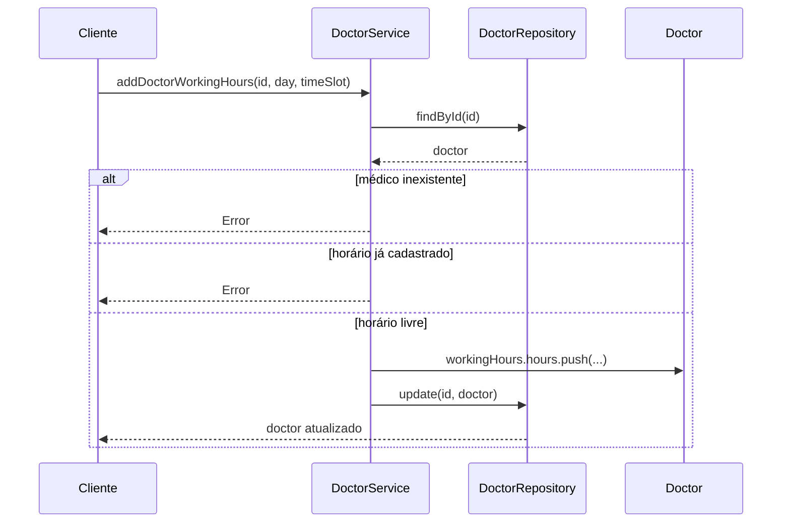

# Implementando Serviços de Domínio

## Introdução e contexto

Na aula anterior, o `PatientService` mostrou o padrão: a entidade guarda o estado, o repositório persiste e o **serviço** coordena as operações. Agora o mesmo desenho é aplicado aos outros dois agregados do sistema:

- **`ExamService`** — exames, que até então viviam apenas dentro do `Patient`;
- **`DoctorService`** — médicos, especialidades e horários de atendimento.

O objetivo é tirar do agregado as operações de cadastro, atualização e remoção, deixando nele apenas o que é intrínseco ao seu estado. No caminho, o `Doctor` e o `WorkingHours` também ficam mais enxutos: os métodos de manipulação saem da entidade e passam a ser responsabilidade do serviço.



## O `ExamService`

O exame é uma entidade simples: tipo, resultado, data, local, responsável e o `patientId`. O `ExamRepository` já sabia filtrar por paciente, tipo e data — faltava uma camada que **orquestrasse** essas operações com nomes de caso de uso.

### Agendamento e buscas

```typescript
// src/domain/patient/ExamService.ts
export class ExamService {
  private examRepository: ExamRepository;

  constructor(examRepository: ExamRepository) {
    this.examRepository = examRepository;
  }

  scheduleExam(examData: Exam): Exam | undefined {
    const exam = new Exam(examData);

    this.examRepository.add(exam.id, exam);
    return exam;
  }

  findExamById(id: string) {
    return this.examRepository.findById(id);
  }

  findExamsByPatientId(patientId: string) {
    return this.examRepository.findByPatientId(patientId);
  }

  findExamsByType(type: string) {
    return this.examRepository.findByType(type);
  }

  findExamsByDate(date: Date) {
    return this.examRepository.findByDate(date);
  }
}
```

| Método | Delega para | Pergunta respondida |
| --- | --- | --- |
| `scheduleExam` | `add(id, exam)` | agendar um novo exame |
| `findExamById` | `findById(id)` | recuperar um exame específico |
| `findExamsByPatientId` | `findByPatientId(id)` | quais exames este paciente fez? |
| `findExamsByType` | `findByType(type)` | quantos hemogramas existem? |
| `findExamsByDate` | `findByDate(date)` | quais exames foram feitos neste dia? |

> **“Schedule” em vez de “add”.** O nome `scheduleExam` expressa a intenção do domínio — agendar um exame — em vez de expor o detalhe de persistência. O serviço fala a língua do negócio; o repositório cuida do `Map`.

A busca por data compara **o dia**, não o instante: `toDateString()` iguala dois exames feitos em horários diferentes do mesmo dia. É o comportamento correto para a pergunta “quais exames foram feitos hoje?”.

### Atualização e remoção

```typescript
updateExam(examId: string, updatedData: Partial<Exam>) {
  const exam = this.findExamById(examId);
  if (!exam) {
    throw new Error("Exam not found.");
  }

  Object.assign(exam, updatedData);
  this.examRepository.update(examId, exam);
  return exam;
}

deleteExam(examId: string) {
  const exam = this.findExamById(examId);
  if (!exam) {
    throw new Error("Exam not found.");
  }

  this.examRepository.delete(examId);
  return exam;
}
```

O roteiro é o mesmo do `PatientService`: **verificar existência → alterar → persistir → devolver**. Se o exame não existe, o serviço falha explicitamente em vez de criar ou remover nada em silêncio.

## O `DoctorService`

O médico tem duas coleções: **especialidades** e **horários de atendimento**. Na versão anterior, ambas eram privadas e só podiam ser alteradas por métodos do próprio `Doctor`. Para o serviço operá-las, o agregado passou a expor:

```typescript
// src/domain/doctor/Doctor.ts
export class Doctor {
  id: string;
  rcm: string;
  name: string;
  phone: string;
  specialties: string[];
  workingHours: WorkingHours;

  constructor(data: CreateDoctorDTO) {
    // ...
    this.specialties = data.specialties;
    this.workingHours = new WorkingHours();
  }
}
```

O `WorkingHours` também ficou mínimo: guarda os horários e sabe comparar, mas **não adiciona nem remove**. Essa responsabilidade saiu para o serviço.

```typescript
// src/domain/doctor/WorkingHours.ts
export class WorkingHours {
  hours: HourDTO[];

  equals(other: WorkingHours): boolean {
    return sameItems(
      this.hours,
      other.hours,
      (hour, otherHour) =>
        hour.day === otherHour.day && hour.timeSlot === otherHour.timeSlot,
    );
  }
}
```

### CRUD e especialidades

| Método | O que faz |
| --- | --- |
| `addDoctor` | cria o `Doctor` e delega `add` ao repositório |
| `findDoctorById` | recupera um médico ou `undefined` |
| `findAllDoctors` | lista todos na ordem de inserção |
| `updateDoctor` | aplica os campos recebidos e persiste |
| `deleteDoctor` | remove e devolve o médico removido |
| `addSpecialty` | adiciona especialidade com checagem de duplicata |

`addSpecialty` concentra uma regra que antes ficava na entidade:

```typescript
addSpecialty(doctorId: string, specialty: string): Doctor {
  const doctor = this.doctorRepository.findById(doctorId);
  if (!doctor) {
    throw new Error('Doctor not found');
  }

  if (doctor.specialties.includes(specialty)) {
    throw new Error('Specialty already exists.');
  }

  doctor.specialties.push(specialty);
  this.doctorRepository.update(doctor.id, doctor);
  return doctor;
}
```

A duplicata é comparada pelo **nome exato** da especialidade. “Cardiologia” e “cardiologia” são tratadas como coisas diferentes — uma decisão simples, mas que precisa ser revista se o cadastro virar API.

### Horários de atendimento

O fluxo de adicionar um horário é o mais rico da aula:



```typescript
addDoctorWorkingHours(doctorId: string, day: string, timeSlot: string) {
  const doctor = this.doctorRepository.findById(doctorId) as Doctor;
  if (!doctor) {
    throw new Error('Doctor not found');
  }

  const hasWorkingHours = doctor.workingHours.hours.some(
    (workingHour) =>
      workingHour.day === day && workingHour.timeSlot === timeSlot
  );

  if (hasWorkingHours) {
    throw new Error('Working hours already exist.');
  }

  doctor.workingHours.hours.push({ day, timeSlot });
  this.doctorRepository.update(doctor.id, doctor);
  return doctor;
}
```

A remoção precisa comparar **dia e faixa juntos**:

```typescript
doctor.workingHours.hours = doctor.workingHours.hours.filter(
  (hour) => !(hour.day === day && hour.timeSlot === timeSlot)
);
```

Esse detalhe importa: usar `day !== day && timeSlot !== timeSlot` removeria **todos** os horários do mesmo dia, mesmo os de faixas diferentes. O predicado correto mantém tudo o que **não** é a combinação exata.

| Operação | Regra |
| --- | --- |
| adicionar | rejeita se a combinação dia + faixa já existe |
| remover | remove apenas a combinação exata |
| listar | devolve os horários do médico (ou lança se ele não existe) |
| médico inexistente | todas as operações lançam `Doctor not found` |

## Testes

A implementação foi acompanhada de suítes por camada:

| Suíte | Testes | Foco |
| --- | --- | --- |
| `Doctor.test.ts` | 4 | dados do médico, coleções vazias e mutáveis |
| `WorkingHours.test.ts` | 6 | igualdade, ordem, duplicatas e tamanho |
| `DoctorService.test.ts` | 17 | CRUD, especialidades e horários |
| `ExamService.test.ts` | 9 | agendamento, buscas, atualização e remoção |

Os testes de serviço usam um `DoctorRepository`/`ExamRepository` em memória — sem banco — e verificam o **efeito persistido**, não apenas o retorno. A suíte de horários cobre os três casos que mais quebram: adicionar, recusar duplicata e remover só o horário informado.

> **Os testes acharam bugs reais.** Na primeira versão do `DoctorService`, adicionar não fazia `push`, remover apagava todos os horários do dia e listar chamava `hours()` como se fosse função. Os testes falharam nos três pontos e as correções ficaram concentradas no serviço.

Os scripts separam as camadas:

```json
"test:domain": "node .../Doctor.test.ts && node .../WorkingHours.test.ts && node .../Patient.test.ts",
"test:services": "node .../DoctorService.test.ts && node .../ExamService.test.ts && node .../PatientService.test.ts"
```

## Benefícios

- **Padrão consistente.** Paciente, médico e exame seguem o mesmo desenho: serviço orquestra, repositório persiste, entidade guarda estado.
- **Agregados mais enxutos.** `Doctor` e `WorkingHours` perdem os métodos de manipulação e ficam focados em dados e igualdade.
- **Regras centralizadas.** Duplicata de especialidade e de horário ficam no serviço, em um único lugar.
- **Buscas reutilizadas.** O serviço não reimplementa filtros; delega ao repositório.
- **Testabilidade.** Repositórios em memória permitem testar cada serviço sem infraestrutura.
- **Evolução previsível.** O mesmo molde serve para o futuro `AppointmentService`.

## Limitações e pontos de atenção

- **Estado público.** `specialties` e `workingHours.hours` são arrays mutáveis: qualquer código pode alterá-los sem passar pela validação do serviço. É o preço de manter a lógica fora da entidade.
- **`addDoctor` clona o médico.** `new Doctor(doctorData)` reinicializa `workingHours`; se o objeto recebido tiver horários, eles são perdidos.
- **`listWorkingHours` devolve o array interno.** O chamador pode mutá-lo e alterar o estado do médico sem persistir.
- **Remoção silenciosa.** `removeWorkingHours` não avisa quando o horário não existe; apenas devolve o médico inalterado.
- **`Partial` + `Object.assign`.** `updateDoctor` e `updateExam` podem sobrescrever campos obrigatórios ou trocar o `id`; o ideal é um DTO com campos permitidos.
- **`any` nas buscas.** `DoctorRepository.findByName` e `findBySpecialty` retornam `any[]`, então o serviço perde a checagem do compilador.
- **Serviços incompletos.** `ExamService` não tem `findAllExams`, e `DoctorService` não expõe as buscas por nome e especialidade que o repositório já oferece.
- **Retorno enganoso.** `scheduleExam` declara `Exam | undefined`, mas sempre devolve um `Exam`; o contrato real é “retorna ou lança”.
- **Sem transação.** Cada `update` é atômico apenas porque o armazenamento é um `Map`. Com banco real, operações que tocam mais de uma coisa precisam de unidade de trabalho.
- **Erros genéricos e mistos.** Inglês e português convivem nas mensagens; tipos de erro específicos ajudariam o controller.

## Conclusão

Esta aula completou a camada de serviços do domínio:

- o **`ExamService`** assumiu agendamento, buscas por paciente/tipo/data, atualização e remoção de exames;
- o **`DoctorService`** assumiu o CRUD de médicos, a inclusão de especialidades e o gerenciamento de horários;
- o **`Doctor`** e o **`WorkingHours`** ficaram mais enxutos, com o estado exposto para o serviço operar;
- as **suítes de teste** por camada passaram a cobrir os dois serviços, revelando e corrigindo três falhas nos horários.

O padrão está pronto para o próximo desafio: **agendar uma consulta**, que envolve paciente, médico, agenda e disponibilidade em uma única operação. Esse será o primeiro serviço que **cruza agregados** — e o gancho para a **arquitetura hexagonal**, na próxima etapa do curso.
