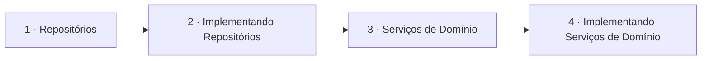

# Repositórios e Serviços

## Índice

| # | Aula | Duração |
| --- | --- | --- |
| 1 | [Repositórios](./1%20-%20Reposit%C3%B3rios.md) | 14:54 |
| 2 | [Implementando Repositórios](./2%20-%20Implementando%20Reposit%C3%B3rios.md) | 12:25 |
| 3 | [Serviços de Domínio](./3%20-%20Servi%C3%A7os%20de%20Dom%C3%ADnio.md) | 15:05 |
| 4 | [Implementando Serviços de Domínio](./4%20-%20Implementando%20Servi%C3%A7os%20de%20Dom%C3%ADnio.md) | 10:13 |

## Sequência das aulas

