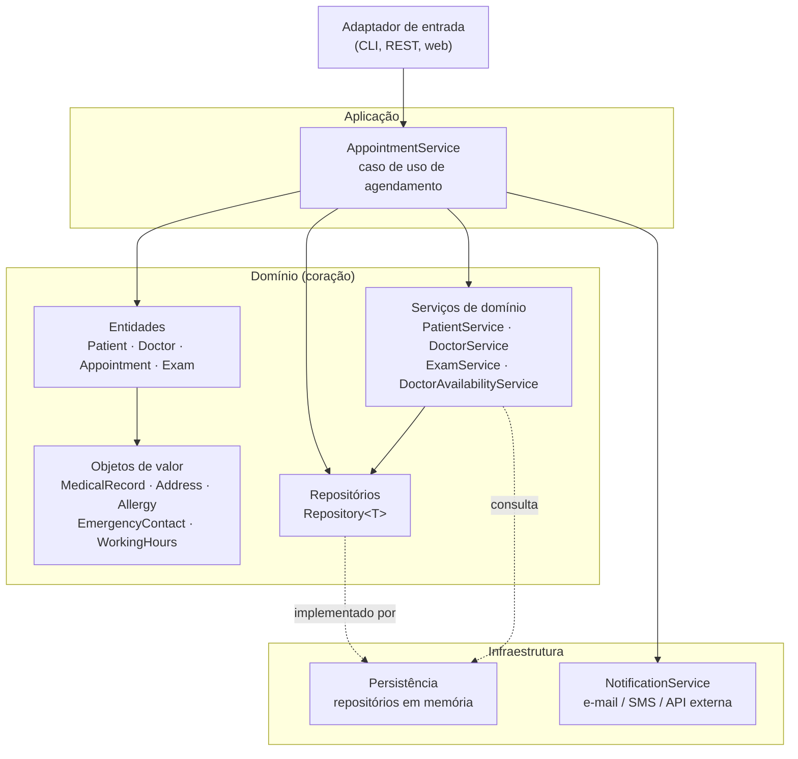
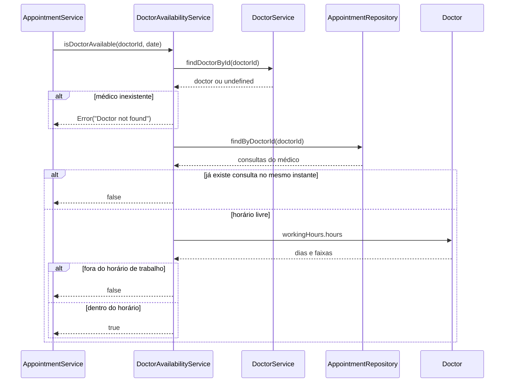
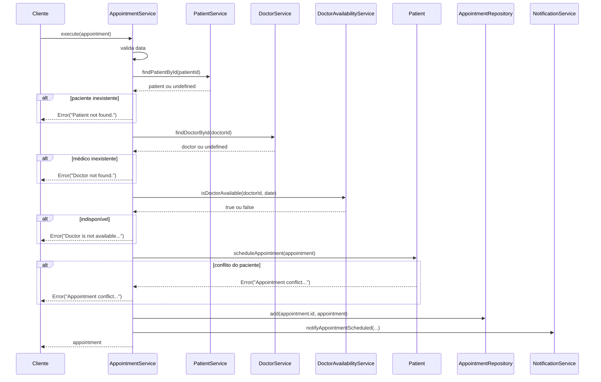

# Hexagonalizando a Aplicação

## Introdução e contexto

Até aqui o sistema hospitalar cresceu por dentro do domínio: entidades, objetos de valor, repositórios e serviços foram implementados, mas ainda misturados em uma bagunça de classes e pacotes. Esta aula faz a **última grande reorganização** do projeto, aplicando na prática a **arquitetura hexagonal** (ou *Ports and Adapters*) estudada anteriormente.

A ideia central continua a mesma: o **domínio é o coração do software**. Ele deve ficar suficientemente isolado para não depender de framework, banco de dados ou mecanismo de entrega — seja qual for a arquitetura adotada. O que muda agora é que cada peça passa a morar no seu devido lugar:

- **domínio** — entidades, objetos de valor, contratos de repositório e serviços de domínio;
- **infraestrutura** — implementações concretas de persistência e comunicação externa;
- **aplicação** — casos de uso que orquestram o domínio;
- **composição** — o ponto único onde tudo é instanciado e conectado.



## A nova estrutura do projeto

A reorganização separa o código por **papel na arquitetura**, não por assunto:

```
src/
├── application/
│   └── services/
│       └── AppointmentService.ts     # caso de uso
├── domain/
│   ├── entities/                     # Patient, Doctor, Appointment, Exam
│   ├── value-objects/                # Address, Allergy, WorkingHours, MedicalRecord...
│   ├── repositories/
│   │   └── Repository.ts             # base dos repositórios
│   └── services/                     # PatientService, DoctorService,
│                                     # ExamService, DoctorAvailabilityService
├── infrastructure/
│   ├── notification/
│   │   └── NotificationService.ts    # adaptador de saída
│   └── persistence/                  # adaptadores de persistência
│       ├── PatientRepository.ts
│       ├── DoctorRepository.ts
│       ├── AppointmentRepository.ts
│       └── ExamRepository.ts
└── testing/
    └── testOutput.ts                 # infraestrutura de testes
```

| Antes | Agora |
| --- | --- |
| classes e pacotes misturados | separação explícita por camada/papel |
| serviços no pacote do agregado | `domain/services/` |
| repositórios concretos junto ao domínio | `infrastructure/persistence/` |
| notificação inexistente | `infrastructure/notification/` |
| agendamento espalhado pela entidade | `application/services/AppointmentService` |

### Entidades e objetos de valor

As entidades que representam o negócio continuam no centro:

| Elemento | Papel no domínio |
| --- | --- |
| `Patient` | recebe o atendimento, guarda consultas, exames e prontuário |
| `Doctor` | atende os pacientes, com especialidades e horários |
| `Appointment` | relaciona paciente e médico, com status |
| `Exam` | exame realizado, vinculado ao paciente |

E os objetos de valor que dão significado a esses dados:

| Objeto de valor | Representa |
| --- | --- |
| `MedicalRecord` | prontuário: diagnósticos, medicações e tratamentos |
| `Address` | endereço do paciente |
| `Allergy` | alergia registrada |
| `EmergencyContact` | contato de emergência |
| `WorkingHours` | dias e faixas de atendimento do médico |

### Repositórios: a porta e o adaptador

A intenção hexagonal é que o domínio declare **o que** precisa e a infraestrutura decida **como** entregar. No código, a base `Repository<T>` continua no domínio, mas as implementações específicas migraram para `infrastructure/persistence/`:

```typescript
// src/domain/repositories/Repository.ts
export class Repository<T> {
  data: Map<string, T>;

  constructor() {
    this.data = new Map();
  }

  add(id: string, entity: T): void {
    if (this.data.has(id)) {
      throw new Error(`Entity with id ${id} already exists.`);
    }
    this.data.set(id, entity);
  }

  findById(id: string): T | undefined {
    return this.data.get(id);
  }

  findAll(): T[] {
    return Array.from(this.data.values());
  }

  update(id: string, entity: T): void {
    if (!this.data.has(id)) {
      throw new Error(`Entity with id ${id} does not exist.`);
    }
    this.data.set(id, entity);
  }

  delete(id: string): void {
    if (!this.data.has(id)) {
      throw new Error(`Entity with id ${id} does not exist.`);
    }
    this.data.delete(id);
  }
}
```

Os repositórios concretos apenas herdam essa base e acrescentam buscas do negócio:

```typescript
// src/infrastructure/persistence/AppointmentRepository.ts
export class AppointmentRepository extends Repository<Appointment> {
  findByPatientId(patientId: string): Appointment[] {
    return this.findAll().filter(
      (appointment) => appointment.patientId === patientId
    );
  }

  findByDoctorId(doctorId: string): Appointment[] {
    return this.findAll().filter(
      (appointment) => appointment.doctorId === doctorId
    );
  }

  findByStatus(status: AppointmentStatus): Appointment[] {
    return this.findAll().filter(
      (appointment) => appointment.status === status
    );
  }
}
```

> **Ainda não é uma porta de verdade.** A base em memória (`Map`) vive no domínio e os serviços de domínio importam os repositórios **concretos** da infraestrutura. A separação física aconteceu; a inversão de dependência completa é o próximo refinamento — e o gancho para as próximas aulas.

## Os três serviços da aula

A aula implementa três peças com naturezas diferentes. Confundir esses papéis é o erro mais comum ao aplicar hexagonal:

| Serviço | Camada | Natureza | Responsabilidade |
| --- | --- | --- | --- |
| `DoctorAvailabilityService` | domínio | regra de negócio | o médico pode atender naquele dia e horário? |
| `NotificationService` | infraestrutura | comunicação externa | avisar o paciente por e-mail/SMS |
| `AppointmentService` | aplicação | caso de uso | orquestrar o agendamento de ponta a ponta |

## `DoctorAvailabilityService`

Este é um **serviço de domínio** porque expressa uma regra que não pertence a uma única entidade: a disponibilidade do médico depende da sua agenda, dos seus horários de trabalho e das consultas já marcadas.

O construtor recebe o repositório de consultas e o `DoctorService`:

```typescript
// src/domain/services/DoctorAvailabilityService.ts
export class DoctorAvailabilityService {
  private readonly appointmentRepository: AppointmentRepository;
  private readonly doctorService: DoctorService;

  constructor(
    appointmentRepository: AppointmentRepository,
    doctorService: DoctorService
  ) {
    this.appointmentRepository = appointmentRepository;
    this.doctorService = doctorService;
  }

  isDoctorAvailable(doctorId: string, date: Date): boolean {
    const doctor = this.doctorService.findDoctorById(doctorId);
    if (!doctor) {
      throw new Error("Doctor not found");
    }

    if (!(date instanceof Date)) {
      throw new Error("Invalid date object.");
    }

    const hasAppointmentConflict = this.hasAppointmentConflict(doctorId, date);
    if (hasAppointmentConflict) {
      console.log("Doctor has a conflict appointment.");
      return false;
    }

    const isWithinWorkingHours = this.isWithinWorkingHours(doctor, date);
    if (!isWithinWorkingHours) {
      console.log("Doctor is not available at this time.");
      return false;
    }

    return true;
  }
  // ...
}
```

O fluxo tem duas perguntas em sequência: **há conflito de agenda?** e **está dentro do horário de atendimento?**



### Conflito de agenda

```typescript
private hasAppointmentConflict(doctorId: string, date: Date): boolean {
  const doctorAppointments =
    this.appointmentRepository.findByDoctorId(doctorId);
  return doctorAppointments.some(
    (appointment) => appointment.date.getTime() === date.getTime()
  );
}
```

A comparação é feita por **instante exato** (`getTime()`): só há conflito se a nova consulta cair no mesmo milissegundo de uma consulta existente. Duas consultas com um minuto de diferença passam — o sistema não conhece a duração do atendimento.

### Horário de atendimento

```typescript
private isWithinWorkingHours(doctor: Doctor, date: Date): boolean {
  const dayOfWeek = date.toLocaleDateString("en-US", { weekday: "long" });
  const timeSlot = date.toLocaleTimeString("en-US", {
    hour: "2-digit",
    minute: "2-digit",
  });

  return doctor.workingHours.hours.some(
    (workingHours) =>
      workingHours.day === dayOfWeek &&
      this.isTimeWithinSlot(timeSlot, workingHours.timeSlot)
  );
}
```

O dia da semana é obtido em inglês (`"Friday"`) porque é assim que os horários são cadastrados. A faixa é comparada em minutos:

```typescript
private isTimeWithinSlot(time: string, timeSlot: string): boolean {
  const [startTime, endTime] = timeSlot.split(" - ");

  const timeToMinutes = (value: string): number => {
    const [hour, minute] = value.split(/:| /).map(Number);
    const period = value.includes("PM") && hour !== 12 ? 12 : 0;
    return (hour + period) * 60 + minute;
  };

  const timeInMinutes = timeToMinutes(time);
  const startInMinutes = timeToMinutes(startTime);
  const endInMinutes = timeToMinutes(endTime);

  return timeInMinutes >= startInMinutes && timeInMinutes <= endInMinutes;
}
```

| Validação | Pergunta | Resultado |
| --- | --- | --- |
| médico existe | o `doctorId` corresponde a alguém? | lança `Doctor not found` |
| data é `Date` | o valor recebido é uma data? | lança `Invalid date object.` |
| conflito | já existe consulta nesse instante? | `false` |
| dia da semana | o médico atende nesse dia? | `false` se não houver faixa |
| faixa de horário | o horário cai dentro do `timeSlot`? | `false` se estiver fora |
| tudo válido | — | `true` |

> **Cuidado com o horário de fechamento.** A comparação usa `<=` no fim: uma consulta exatamente às 17:00 é aceita em uma faixa `09:00 AM - 05:00 PM`. Como não há duração definida, o sistema não sabe se ela terminaria depois do expediente.

## `NotificationService`

A notificação é **infraestrutura**: ela conversa com o mundo externo. Por isso mora em `src/infrastructure/notification/` e não no domínio.

```typescript
// src/infrastructure/notification/NotificationService.ts
export class NotificationService {
  sendEmailNotification(email: string, message: string): void {
    console.log(`Sending email to ${email}: ${message}`);
  }

  notifyAppointmentScheduled(
    appointment: Appointment,
    patient: Patient,
    doctor: Doctor
  ): void {
    const patientMessage = `Your appointment with Dr. ${doctor.name} is scheduled for ${appointment.date}.`;
    this.sendEmailNotification(patient.email, patientMessage);
  }
}
```

Dois métodos, sem construtor:

- `sendEmailNotification` — ponto de integração com o provedor de e-mail (aqui, apenas `console.log`);
- `notifyAppointmentScheduled` — monta a mensagem com os dados da consulta e envia ao paciente.

A classe não tem dependências porque o envio real ainda não existe. Em produção, é aqui que entrariam um SDK de e-mail, a API do Google ou um serviço de SMS. O domínio não precisa saber qual é.

> **Observer no futuro.** A aula cita o padrão *Observer* como evolução natural: assim que a consulta for marcada, os interessados (paciente e, se tivesse e-mail cadastrado, o médico) são notificados sem que o caso de uso conheça cada destinatário.

## `AppointmentService`

O agendamento é um **caso de uso**, não uma regra de domínio: ele combina vários serviços e repositórios para realizar uma operação completa. Por isso vive em `src/application/services/`.

O construtor recebe cinco colaboradores:

```typescript
// src/application/services/AppointmentService.ts
export class AppointmentService {
  private readonly patientService: PatientService;
  private readonly doctorService: DoctorService;
  private readonly appointmentRepository: AppointmentRepository;
  private readonly doctorAvailabilityService: DoctorAvailabilityService;
  private readonly notificationService: NotificationService;

  constructor(
    patientService: PatientService,
    doctorService: DoctorService,
    appointmentRepository: AppointmentRepository,
    doctorAvailabilityService: DoctorAvailabilityService,
    notificationService: NotificationService
  ) {
    this.patientService = patientService;
    this.doctorService = doctorService;
    this.appointmentRepository = appointmentRepository;
    this.doctorAvailabilityService = doctorAvailabilityService;
    this.notificationService = notificationService;
  }

  execute(appointment: Appointment): Appointment {
    const date = appointment.date;
    if (!(date instanceof Date) || isNaN(date.getTime())) {
      throw new Error("Invalid date.");
    }

    const patient = this.patientService.findPatientById(appointment.patientId);
    const doctor = this.doctorService.findDoctorById(appointment.doctorId);

    if (!patient) {
      throw new Error("Patient not found.");
    }

    if (!doctor) {
      throw new Error("Doctor not found.");
    }

    const isDoctorAvailable = this.doctorAvailabilityService.isDoctorAvailable(
      appointment.doctorId,
      date
    );

    if (!isDoctorAvailable) {
      throw new Error("Doctor is not available at the specified date and time.");
    }

    // A entidade valida o conflito do paciente antes de a consulta ser persistida.
    patient.scheduleAppointment(appointment);
    this.appointmentRepository.add(appointment.id, appointment);
    this.notificationService.notifyAppointmentScheduled(
      appointment,
      patient,
      doctor
    );
    return appointment;
  }
}
```

O método `execute` segue um roteiro linear e fácil de acompanhar:



| Etapa | Colaborador | Se falhar |
| --- | --- | --- |
| validar data | — | `Invalid date.` |
| buscar paciente | `PatientService` | `Patient not found.` |
| buscar médico | `DoctorService` | `Doctor not found.` |
| checar disponibilidade | `DoctorAvailabilityService` | `Doctor is not available...` |
| validar conflito do paciente | `Patient` | `Appointment conflict...` |
| persistir consulta | `AppointmentRepository` | exceção do repositório (ID duplicado) |
| notificar paciente | `NotificationService` | a consulta já foi persistida |

> **Um caso de uso, cinco dependências.** A aula reconhece que `execute` é denso e fere o **SRP** (Single Responsibility Principle): há validação, busca, regra de disponibilidade, persistência e notificação no mesmo método. A sugestão é extrair métodos menores e, eventualmente, tornar a operação assíncrona. Fica como exercício de refatoração.

Além de `execute`, o serviço expõe `findById(id)` e `findAll()` para consultar as consultas persistidas, mantendo o adaptador de entrada (como o controller REST) livre de acessar o repositório diretamente.

Vale registrar uma decisão de design comentada na aula: o construtor de `DoctorAvailabilityService` poderia receber um `AppointmentService` mais restrito em vez do repositório. Optou-se pelo repositório porque a responsabilidade de agendar foi deliberadamente empurrada para o **serviço de aplicação**, que terá outros métodos complementares — e o serviço de disponibilidade não deve depender do caso de uso que o utiliza.


## Teste de mesa

Para executar o cenário completo, os dados de teste foram separados em `testCase/`:

| Arquivo | Conteúdo |
| --- | --- |
| `entities.ts` | paciente, médico, consulta e exame já instanciados (mocks) |
| `repositories.ts` | repositórios em memória instanciados |
| `service.ts` | todos os serviços instanciados e conectados |
| `testHospital.ts` | o cenário que usa tudo |
| `testMedicalRecord.ts` | cenário específico do prontuário |

`service.ts` funciona como **composition root** — o único lugar que conhece as implementações concretas e monta o grafo de dependências:

```typescript
export const doctorService = new DoctorService(doctorRepository);
export const examService = new ExamService(examRepository);
export const patientService = new PatientService(patientRepository);
export const doctorAvailabilityService = new DoctorAvailabilityService(
  appointmentRepository,
  doctorService
);

export const notificationService = new NotificationService();
export const appointmentService = new AppointmentService(
  patientService,
  doctorService,
  appointmentRepository,
  doctorAvailabilityService,
  notificationService
);
```

O cenário adiciona o médico, cadastra uma faixa de atendimento na sexta, adiciona o paciente e executa o agendamento:

```typescript
// testCase/testHospital.ts
doctorService.addDoctor(doctor);
doctorService.addDoctorWorkingHours(doctor.id, "Friday", "09:00 AM - 05:00 PM");

patientService.addPatient(patient);

appointmentService.execute(appointment);
```

Executando `pnpm hospital`, a saída termina com:

```text
Sending email to joao.silva@email.com: Your appointment with Dr. Dr. João Silva is scheduled for Fri Mar 07 2025 12:00:00 GMT-0300 (Horário Padrão de Brasília).
```

A consulta de teste cai em uma **sexta-feira, 7 de março de 2025, às 12:00**, dentro da faixa `09:00 AM - 05:00 PM`. Não há conflito, então o repositório recebe a consulta e a notificação é disparada — o caminho completo funciona.

> **Detalhe de saída.** A mensagem atual mostra `Dr. Dr. João Silva` porque o nome do médico já inclui o título. A data também aparece no formato bruto do `Date`, em inglês e dependente do fuso da máquina. São ajustes de apresentação, não de regra.

O `testHospital.ts` também mantém as demonstrações anteriores de paciente, médico, exames e prontuário. A diferença é que agora o **agendamento passa pelo caso de uso**, e não mais por uma chamada direta à entidade.

## Benefícios

- **Fronteiras explícitas.** Cada arquivo tem um papel claro: entidade, objeto de valor, serviço de domínio, caso de uso, adaptador.
- **Domínio no centro.** As regras de disponibilidade e conflito ficam em `domain/`, longe de banco, API e detalhes de apresentação.
- **Serviço de domínio coeso.** `DoctorAvailabilityService` responde a uma pergunta única e reutilizável por qualquer caso de uso.
- **Infraestrutura isolada.** `NotificationService` pode virar e-mail real, SMS ou fila sem tocar no domínio.
- **Caso de uso separado.** `AppointmentService` orquestra sem duplicar regras: ele pergunta, decide e delega.
- **Regra do paciente preservada.** `execute` chama `Patient.scheduleAppointment`, então a validação de conflito continua dentro da entidade e roda antes da persistência.
- **Composição centralizada.** `testCase/service.ts` mostra como montar o sistema em um único ponto, facilitando trocar adaptadores.
- **Teste de mesa integrado.** O cenário exercita todas as camadas juntas e comprova o fluxo de ponta a ponta.

## Limitações e pontos de atenção

- **Dependência invertida pela metade.** `DoctorService`, `PatientService`, `ExamService` e `DoctorAvailabilityService` importam repositórios **concretos** de `infrastructure/persistence/`. Na hexagonal, o domínio deveria depender de interfaces (portas), e a infraestrutura implementá-las.
- **`Repository<T>` é concreto.** A base com `Map` está no domínio e expõe `data`. O ideal é uma interface de porta e uma implementação em memória na infraestrutura.
- **`hasConflict` exige o mesmo médico.** O método da entidade `Appointment` compara data **e** `doctorId`; dois atendimentos do mesmo paciente no mesmo horário com médicos diferentes passam.
- **Conflito por instante exato.** Consultas com minutos de diferença não são detectadas, porque não há duração de atendimento nem cálculo de sobreposição.
- **Consultas canceladas bloqueiam.** `findByDoctorId` não filtra por status; uma consulta `canceled` no mesmo horário ainda faz o médico parecer ocupado, embora `findByStatus` exista.
- **Fuso e locale.** O dia e o horário são derivados com `toLocaleDateString("en-US")`/`toLocaleTimeString("en-US")` no fuso da máquina. Em outro fuso, a consulta pode cair em outro dia da semana.
- **Bug do horário AM.** Em `timeToMinutes`, `"12:00 AM"` vira 720 minutos (meio-dia) em vez de 0, porque a conversão só trata `PM` e ignora `hour === 12` no caso AM.
- **Fim do expediente inclusivo.** `<=` aceita uma consulta que começa exatamente no horário de fechamento, sem saber quando terminaria.
- **`console.log` no domínio.** `DoctorAvailabilityService` imprime mensagens ao retornar `false`, criando efeito colateral e acoplando o domínio à saída padrão.
- **Notificação não é real.** O adaptador só escreve no console, a mensagem é fixa e não há tratamento de falha. Se o envio falhar, a consulta já está persistida.
- **Sem transação.** Atualizar o paciente, persistir a consulta e notificar são passos separados; não há compensação nem unidade de trabalho.
- **`execute` síncrono e denso.** Validação, busca, regra, persistência e notificação convivem no mesmo método, contrariando o SRP e dificultando testes isolados.
- **Cobertura parcial.** `AppointmentService` já tem testes automatizados, mas `DoctorAvailabilityService`, `NotificationService` e o `PatientController` seguem cobertos apenas pelo cenário manual de `testCase/`.
- **ID fornecido pelo chamador.** `add` lança se o ID já existir; não há geração de identidade no caso de uso.
- **Composição manual.** `testCase/service.ts` é um composition root artesanal; em uma aplicação real, um contêiner de injeção ou um *factory* evitaria repetir essa montagem.

## Conclusão

Esta aula fechou o ciclo de organização do domínio e colocou o projeto em formato hexagonal:

- o código foi **reagrupado por papel**: `domain/`, `infrastructure/`, `application/` e `testCase/`;
- o **`DoctorAvailabilityService`** assumiu a regra de disponibilidade, validando conflito de agenda, dia da semana e faixa de horário;
- o **`NotificationService`** foi isolado na infraestrutura como ponto de comunicação externa;
- o **`AppointmentService`** passou a orquestrar o agendamento como caso de uso, unindo paciente, médico, disponibilidade, persistência e notificação;
- o **teste de mesa integrado** comprovou o fluxo completo, da validação ao envio da mensagem.

O domínio está funcionalmente pronto. O que resta é justamente a fronteira mais frágil: a **persistência**. Hoje ela é um `Map` em memória e os serviços dependem de classes concretas. Nas próximas aulas, a camada de persistência será refinada — começando por transformar os repositórios em **portas de verdade** e criar adaptadores que possam ser trocados sem que o domínio perceba.
