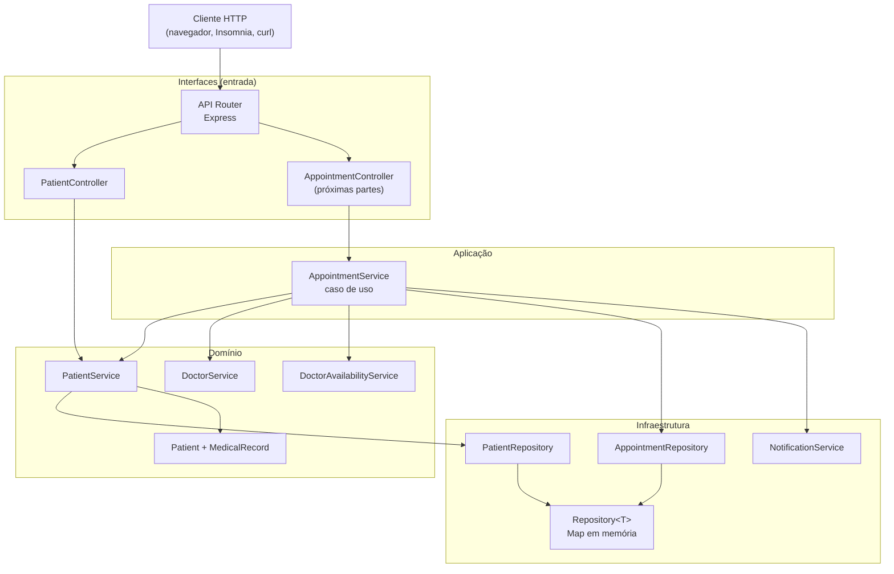
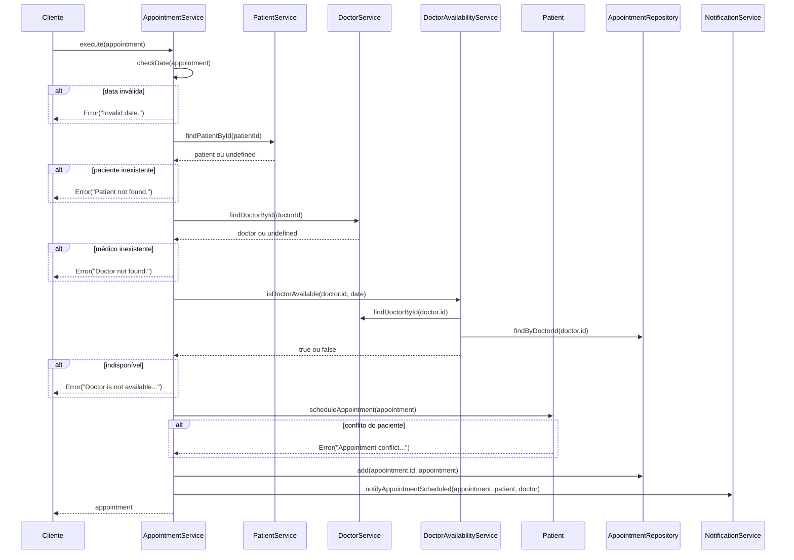
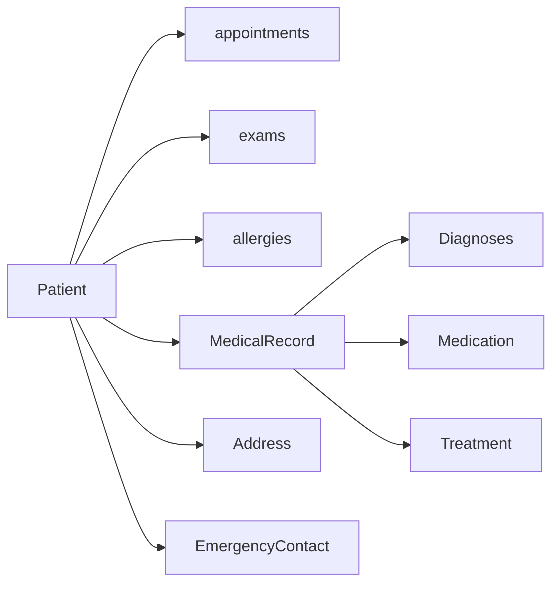
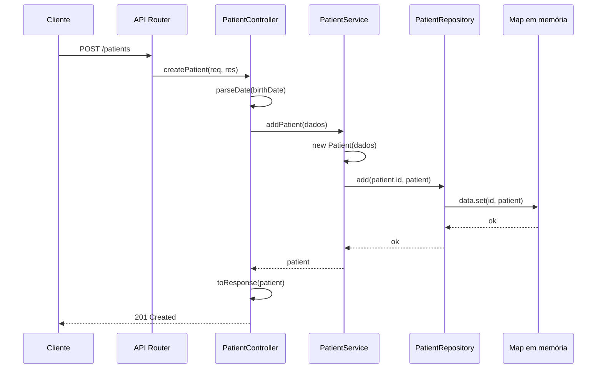
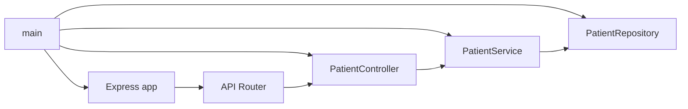

# Agendando Uma Consulta - Parte 1

## Introdução e contexto

No material da aula, a aplicação **Rocket Magic** chega com o domínio implementado e uma API pronta para os primeiros testes — ainda longe de produção, mas já navegável. O foco do módulo é o **agendamento de consulta**; esta primeira parte faz uma revisão geral das mudanças e apresenta a **camada de interfaces**, que expõe o sistema por HTTP.

O roteiro da aula passa por quatro pontos:

1. o **`AppointmentService`**, que conecta paciente, médico, disponibilidade e notificação;
2. a **entidade `Patient`** e sua relação com o prontuário (`MedicalRecord`);
3. o **repositório global** e o **`PatientRepository`**;
4. o **`PatientService`** e o **`PatientController`**, com as rotas da API.

A grande novidade é a camada `interfaces/`: ela não contém regra de negócio, apenas **adaptadores de entrada** que traduzem HTTP para chamadas de serviço. A arquitetura fica assim:



> **`interfaces` aqui é camada, não `interface` do TypeScript.** O nome vem da arquitetura hexagonal: é o lado de entrada, onde ficam controllers, rotas e adaptadores de transporte.

## O `AppointmentService`

O serviço de agendamento é o caso de uso central. Ele recebe cinco colaboradores por injeção de dependência — `PatientService`, `DoctorService`, `AppointmentRepository`, `DoctorAvailabilityService` e `NotificationService` — e oferece uma API pequena:

| Método | O que faz |
| --- | --- |
| `execute` | valida a data, busca paciente e médico, verifica a disponibilidade, agenda no paciente, persiste e notifica |
| `findById` | busca uma consulta pelo ID ou lança `Appointment not found.` |
| `findAll` | devolve todas as consultas do repositório |
| `checkDate` | rejeita datas que não sejam `Date` válidas |

```typescript
// src/application/services/AppointmentService.ts
execute(appointment: Appointment): Appointment {
  const date = this.checkDate(appointment);
  const patient = this.patientService.findPatientById(appointment.patientId);
  const doctor = this.doctorService.findDoctorById(appointment.doctorId);

  if (!patient) {
    throw new Error("Patient not found.");
  }

  if (!doctor) {
    throw new Error("Doctor not found.");
  }

  const isDoctorAvailable = this.doctorAvailabilityService.isDoctorAvailable(
    doctor.id,
    date
  );

  if (!isDoctorAvailable) {
    throw new Error("Doctor is not available at the specified date and time.");
  }

  // A entidade valida o conflito do paciente antes de a consulta ser persistida.
  patient.scheduleAppointment(appointment);
  this.appointmentRepository.add(appointment.id, appointment);
  this.notificationService.notifyAppointmentScheduled(
    appointment,
    patient,
    doctor
  );

  return appointment;
}

findById(id: string): Appointment {
  const appointment = this.appointmentRepository.findById(id);

  if (!appointment) {
    throw new Error("Appointment not found.");
  }

  return appointment;
}

findAll(): Appointment[] {
  return this.appointmentRepository.findAll();
}

private checkDate(appointment: Appointment): Date {
  const date = appointment.date;

  if (!(date instanceof Date) || isNaN(date.getTime())) {
    throw new Error("Invalid date.");
  }

  return date;
}
```

O fluxo do `execute` tem cinco validações antes de persistir:



> **O agregado voltou a participar.** O `Patient.scheduleAppointment` valida o conflito de agenda do paciente antes de a consulta chegar ao repositório. A regra não fica só no serviço de aplicação: a entidade protege o próprio estado.

### `checkDate`

A validação exige uma `Date` válida; não há conversão de string:

```typescript
const date = appointment.date;

if (!(date instanceof Date) || isNaN(date.getTime())) {
  throw new Error("Invalid date.");
}

return date;
```

Quem expõe a API é que faz a conversão de string para `Date` — no controller, isso acontece para o `birthDate` do paciente. O agendamento trabalha com o tipo de domínio já resolvido.

## A entidade `Patient`

O `Patient` continua sendo a raiz do agregado do atendimento. A entidade guarda os dados cadastrais, as consultas, os exames, as alergias e o prontuário:

```typescript
// src/domain/entities/Patient.ts
export type CreatePatientDTO = Omit<
  PatientDTO,
  | "appointments"
  | "exams"
  | "allergies"
  | "medicalRecord"
  | "scheduleAppointment"
  | "addExam"
>;

export class Patient implements PatientDTO {
  id: string;
  identificationDocument: string;
  name: string;
  birthDate: Date;
  gender: "Male" | "Female";
  bloodType: "A+" | "A-" | "B+" | "B-" | "AB+" | "AB-" | "O+" | "O-";
  address: AddressDTO;
  phone: string;
  email: string;
  emergencyContact: EmergencyContactDTO;

  #appointments: Appointment[] = [];
  #exams: Exam[] = [];

  allergies: Allergy[] = [];
  medicalRecord: MedicalRecord = new MedicalRecord();

  constructor(data: CreatePatientDTO) {
    // atribui os dados cadastrais
    this.medicalRecord = new MedicalRecord();
    this.#appointments = [];
    this.#exams = [];
    this.allergies = [];
  }

  addExam(exam: Exam): void {
    // valida e adiciona o exame à coleção privada
  }

  scheduleAppointment(appointment: Appointment): void {
    if (!appointment || !(appointment instanceof Appointment)) {
      throw new Error("Invalid appointment object.");
    }

    const hasConflict = this.#appointments.some((existing) =>
      existing.hasConflict(appointment)
    );

    if (hasConflict) {
      throw new Error(
        `Appointment conflict: ${this.name} already has an appointment with Dr. ${appointment.doctorId} at ${appointment.date}.`,
      );
    }

    this.#appointments.push(appointment);
  }

  get appointments(): ReadonlyArray<Appointment> {
    return [...this.#appointments];
  }

  get exams(): ReadonlyArray<Exam> {
    return [...this.#exams];
  }
}
```

### O que mudou

A entidade mantém o comportamento essencial, mas as coleções e os dados ficaram mais organizados:

| Responsabilidade | Onde fica |
| --- | --- |
| conflito de agenda do paciente | `Patient.scheduleAppointment` |
| inclusão de exame no paciente | `Patient.addExam` |
| disponibilidade do médico | `DoctorAvailabilityService` |
| cadastro, atualização e remoção | `PatientService` |
| persistência | `PatientRepository` |

As coleções `#appointments` e `#exams` são privadas e só saem por **cópias** (`[...]`). Já `allergies` e `medicalRecord` continuam públicos porque são manipulados diretamente pelo `PatientService` — uma concessão prática que mantém o serviço simples, mas enfraquece o encapsulamento.

### O agregado e o prontuário



| Dado | Tipo | Observação |
| --- | --- | --- |
| `id`, `name`, `birthDate` | campos simples | identidade e dados básicos |
| `address` | `AddressDTO` | objeto de valor |
| `emergencyContact` | `EmergencyContactDTO` | objeto de valor |
| `allergies` | `Allergy[]` | manipulada pelo serviço |
| `medicalRecord` | `MedicalRecord` | prontuário do paciente |
| `appointments` | `ReadonlyArray<Appointment>` | coleção privada com getter |
| `exams` | `ReadonlyArray<Exam>` | coleção privada com getter |

> **Nenhuma validação em runtime no construtor.** A obrigatoriedade dos campos existe nos tipos; como o controller repassa `req.body` convertido, um corpo incompleto ainda pode criar um `Patient` com campos `undefined`. A validação de negócio precisa ser adicionada antes de a API ir para produção.

## Repositório global e `PatientRepository`

O `Repository<T>` continua sendo a base de todos os repositórios. Ele é deliberadamente simples e usa um **`Map` como banco de dados em memória**:

```typescript
// src/domain/repositories/Repository.ts
export class Repository<T> {
  data: Map<string, T>;

  constructor() {
    this.data = new Map();
  }

  add(id: string, entity: T): void {
    if (this.data.has(id)) {
      throw new Error(`Entity with id ${id} already exists.`);
    }
    this.data.set(id, entity);
  }

  findById(id: string): T | undefined {
    return this.data.get(id);
  }

  findAll(): T[] {
    return Array.from(this.data.values());
  }

  update(id: string, entity: T): void {
    if (!this.data.has(id)) {
      throw new Error(`Entity with id ${id} does not exist.`);
    }
    this.data.set(id, entity);
  }

  delete(id: string): void {
    if (!this.data.has(id)) {
      throw new Error(`Entity with id ${id} does not exist.`);
    }
    this.data.delete(id);
  }
}
```

A aula aponta o próximo passo: trocar o `Map` por um banco real, provavelmente com um **ORM** como **TypeORM** ou **Sequelize**. O `Repository<T>` é justamente o ponto de entrada para essa migração.

O `PatientRepository` acrescenta duas buscas de negócio:

```typescript
// src/infrastructure/persistence/PatientRepository.ts
export class PatientRepository extends Repository<Patient> {
  findByName(name: string): Patient[] {
    return this.findAll().filter((patient) => patient.name === name);
  }

  findByBloodType(bloodType: string): Patient[] {
    return this.findAll().filter((patient) => patient.bloodType === bloodType);
  }
}
```

| Busca | Pergunta respondida | Critério |
| --- | --- | --- |
| `findByName` | quem se chama exatamente assim? | igualdade exata, case-sensitive |
| `findByBloodType` | quem tem este tipo sanguíneo? | igualdade exata |

## `PatientService`

O serviço recebe o repositório por **injeção de dependência** — ele não instancia o repositório:

```typescript
// src/domain/services/PatientService.ts
export class PatientService {
  private readonly patientRepository: PatientRepository;

  constructor(patientRepository: PatientRepository) {
    this.patientRepository = patientRepository;
  }

  addPatient(patientData: CreatePatientDTO): Patient {
    const patient = new Patient(patientData);
    this.patientRepository.add(patient.id, patient);
    return patient;
  }

  findPatientById(patientId: string): Patient | undefined {
    return this.patientRepository.findById(patientId);
  }

  findAllPatients(): Patient[] {
    return this.patientRepository.findAll();
  }

  findPatientsByName(name: string): Patient[] {
    return this.patientRepository.findByName(name);
  }

  findPatientsByBloodType(bloodType: string): Patient[] {
    return this.patientRepository.findByBloodType(bloodType);
  }

  updatePatient(patientId: string, updatedData: Partial<Patient>): Patient {
    const patient = this.patientRepository.findById(patientId);
    if (!patient) {
      throw new Error(`Paciente com ID ${patientId} não encontrado.`);
    }

    Object.assign(patient, updatedData);
    this.patientRepository.update(patientId, patient);
    return patient;
  }

  deletePatient(patientId: string): Patient {
    const patient = this.patientRepository.findById(patientId);
    if (!patient) {
      throw new Error(`Paciente com ID ${patientId} não encontrado.`);
    }

    this.patientRepository.delete(patientId);
    return patient;
  }
}
```

| Método | Delega para | Resultado |
| --- | --- | --- |
| `addPatient` | `add(id, patient)` | paciente criado |
| `findPatientById` | `findById` | paciente ou `undefined` |
| `findAllPatients` | `findAll` | lista (possivelmente vazia) |
| `findPatientsByName` | `findByName` | lista filtrada |
| `findPatientsByBloodType` | `findByBloodType` | lista filtrada |
| `updatePatient` | `update` | paciente atualizado ou erro |
| `deletePatient` | `delete` | paciente removido ou erro |

O serviço também concentra as operações de prontuário: `addPatientAllergy`, `addPatientDiagnosis`, `addPatientMedication` e `addPatientTreatment`. Todas seguem o mesmo roteiro — **buscar → validar → alterar o agregado → persistir**.

> **O service recebe o DTO, não a entidade pronta.** `addPatient` aceita `CreatePatientDTO` e é ele que constrói o `Patient`. Isso evita que o controller precise conhecer o construtor da entidade e mantém a criação em um único lugar.

## `PatientController`

O controller é o **adaptador de entrada** do paciente. Ele usa o `Router` do Express, recebe o `PatientService` por injeção de dependência e registra as rotas no construtor:

```typescript
// src/interfaces/controllers/PatientController.ts
import { Router, type Request, type Response } from "express";
import type {
  CreatePatientDTO,
  Patient,
} from "../../domain/entities/Patient.ts";
import type { PatientService } from "../../domain/services/PatientService.ts";

export class PatientController {
  readonly router: Router;
  private readonly patientService: PatientService;

  constructor(patientService: PatientService) {
    this.router = Router();
    this.patientService = patientService;
    this.initializeRoutes();
  }

  private initializeRoutes(): void {
    this.router.post("/", this.createPatient.bind(this));
    this.router.get("/", this.getAllPatients.bind(this));
    this.router.get("/search/name/:name", this.getPatientsByName.bind(this));
    this.router.get(
      "/search/bloodType/:bloodType",
      this.getPatientsByBloodType.bind(this),
    );
    this.router.get("/:id", this.getPatientById.bind(this));
    this.router.put("/:id", this.updatePatient.bind(this));
    this.router.delete("/:id", this.deletePatient.bind(this));
  }
  // ...
}
```

Três detalhes importantes:

- **`bind(this)`** garante que `this.patientService` continue disponível quando o Express chamar o método como callback.
- **Buscas antes de `/:id`** deixam a precedência explícita: rotas mais específicas são registradas primeiro.
- **Tipagem de `Request`/`Response`** permite ao TypeScript validar parâmetros, corpo e status codes.

### Rotas

| Método | Rota (montada em `/patients`) | Ação | Sucesso | Erro |
| --- | --- | --- | --- | --- |
| `POST` | `/patients` | cria um paciente | `201` | `400` |
| `GET` | `/patients` | lista todos | `200` | `500` |
| `GET` | `/patients/:id` | busca por ID | `200` | `404` |
| `PUT` | `/patients/:id` | atualiza | `200` | `400` |
| `DELETE` | `/patients/:id` | remove | `200` | `404` |
| `GET` | `/patients/search/name/:name` | busca por nome | `200` | `404` |
| `GET` | `/patients/search/bloodType/:bloodType` | busca por tipo sanguíneo | `200` | `404` |

### Criação

```typescript
private createPatient(req: Request, res: Response): void {
  try {
    const data = (req.body ?? {}) as CreatePatientDTO;
    const birthDate = this.parseDate(data.birthDate);

    if (Number.isNaN(birthDate.getTime())) {
      throw new Error("Invalid birth date.");
    }

    const createdPatient = this.patientService.addPatient({
      ...data,
      birthDate,
    });

    res.status(201).json(this.toResponse(createdPatient));
  } catch (error) {
    this.sendError(res, error, 400);
  }
}
```

O `201 Created` é o código correto para uma criação bem-sucedida. O `400` cobre qualquer falha — inclusive erros que não são de validação, já que não há distinção entre os tipos de exceção.

### Leitura, atualização e remoção

O `getPatientById` agora trata explicitamente o paciente inexistente:

```typescript
private getPatientById(req: Request<{ id: string }>, res: Response): void {
  const patient = this.patientService.findPatientById(req.params.id);

  if (!patient) {
    this.sendError(res, new Error("Patient not found."), 404);
    return;
  }

  res.status(200).json(this.toResponse(patient));
}
```

O `getAllPatients` retorna `200` mesmo quando a lista está vazia — afinal, uma lista vazia é uma resposta válida. Já as buscas por nome e tipo sanguíneo tratam a lista vazia como `404`:

```typescript
private getPatientsByName(
  req: Request<{ name: string }>,
  res: Response,
): void {
  const patients = this.patientService.findPatientsByName(req.params.name);

  if (patients.length === 0) {
    this.sendError(
      res,
      new Error("No patients found with the given name."),
      404,
    );
    return;
  }

  res.status(200).json(patients.map((patient) => this.toResponse(patient)));
}
```

### Serialização e erros

O controller não devolve a instância do `Patient` diretamente. Ele monta um objeto de resposta com os campos e as coleções expostas por getters:

```typescript
private toResponse(patient: Patient) {
  return {
    id: patient.id,
    identificationDocument: patient.identificationDocument,
    name: patient.name,
    birthDate: patient.birthDate,
    gender: patient.gender,
    bloodType: patient.bloodType,
    address: patient.address,
    phone: patient.phone,
    email: patient.email,
    emergencyContact: patient.emergencyContact,
    appointments: patient.appointments,
    exams: patient.exams,
    allergies: patient.allergies,
    medicalRecord: patient.medicalRecord,
  };
}
```

O mapeamento explícito é necessário porque `appointments`, `exams` e `medicalRecord` são getters de protótipo — um spread simples não os incluiria.

Já o tratamento de erro usa um único helper, que lida com `unknown`:

```typescript
private sendError(res: Response, error: unknown, statusCode: number): void {
  const message =
    error instanceof Error ? error.message : "Unexpected error.";
  res.status(statusCode).json({ error: message });
}
```

### O caminho de uma requisição



## API Router e `main`

Para que as rotas funcionem, a aula descreve duas peças de composição:

- o **API Router**, que monta `PatientController` e os demais controllers em seus caminhos (`/patients`, e assim por diante);
- a **`main`**, que instancia repositórios, serviços e controllers e injeta cada dependência.



Esse é o **composition root** da aplicação: o único lugar que conhece todas as implementações concretas. O controller não cria o service, o service não cria o repository — tudo desce por injeção.

> **`express` instalado, composição pendente.** O projeto já tem `express` e `@types/express` nas dependências, e o controller typechecka. Ainda faltam o `main` e o `apiRouter` que montam o servidor e conectam as rotas — o desenho acima representa o alvo da próxima etapa.

## Benefícios

- **Primeira porta de entrada real.** O sistema deixa de ser apenas um domínio executável e passa a ter uma camada HTTP.
- **Controller magro e tipado.** Ele traduz HTTP, delega ao service e escolhe o status code; `Request`/`Response` dão suporte do compilador.
- **Injeção de dependência consistente.** Repository → service → controller são montados de fora, facilitando testes e trocas.
- **CRUD completo.** Criar, listar, buscar, atualizar e remover estão expostos com rotas REST previsíveis.
- **Buscas de domínio na API.** Nome e tipo sanguíneo viram rotas próprias, em vez de filtros genéricos.
- **Resposta serializada.** O `toResponse` inclui as coleções expostas por getters sem devolver a instância crua.
- **Erros centralizados.** O `sendError` trata `unknown`, evita repetição e mantém o status code explícito.
- **Caminho claro para novos controllers.** O mesmo molde serve para `DoctorController`, `AppointmentController` e `ExamController`.

## Limitações e pontos de atenção

- **Composição ainda ausente.** Não há `main` nem `apiRouter` versionados; o controller existe, mas ainda não está montado em um servidor executável.
- **`req.body` sem validação completa.** O corpo é convertido para `CreatePatientDTO`, mas apenas `birthDate` é validado. Campos obrigatórios ausentes não são rejeitados.
- **`Object.assign` no update.** `Partial<Patient>` permite sobrescrever `id`, `allergies`, `medicalRecord` e outros campos. O ideal é um DTO com campos permitidos.
- **Resposta ainda exposta.** O `toResponse` inclui prontuário, alergias e contato de emergência; o ideal é um DTO específico de saída, com apenas o que o cliente precisa.
- **Sem paginação.** `GET /patients` retorna todos os registros; com um banco real isso não escala.
- **Busca exata.** `findByName` compara o nome inteiro e diferencia maiúsculas de minúsculas; não há busca parcial.
- **Persistência em `Map`.** Sem transação, sem índices, sem concorrência e sem sobrevivência a reinícios.
- **Agendamento sem atomicidade.** `patient.scheduleAppointment` altera o paciente em memória antes de `repository.add`; se a persistência falhar, o paciente fica com a consulta e o repositório não.
- **Conflito do paciente limitado.** `Appointment.hasConflict` compara data e `doctorId`; o mesmo paciente no mesmo horário com outro médico não é considerado conflito.
- **Efeitos colaterais no domínio.** `Patient.scheduleAppointment`, `Patient.addExam` e `DoctorAvailabilityService` usam `console.log`; o domínio não deveria depender da saída padrão.
- **Notificação simulada.** O adaptador só escreve no console, a mensagem é fixa e a data sai no formato bruto do `Date` (`Dr. Dr.` inclusive).
- **Sem testes do controller.** O `AppointmentService` tem suíte própria, mas as rotas e os status codes do `PatientController` não são exercitados por testes automatizados.
- **`PUT` integral.** A rota usa `PUT`, mas aceita atualização parcial; `PATCH` seria semanticamente mais correto.

## Conclusão

Esta parte abriu a **camada de interfaces** e colocou a aplicação para conversar com o mundo externo:

- o **`AppointmentService`** foi consolidado como caso de uso central, validando paciente, médico, disponibilidade e conflito do paciente;
- a **`Patient`** manteve o comportamento de agregado, com coleções encapsuladas e o prontuário separado em `MedicalRecord`;
- o **`Repository<T>`** e o **`PatientRepository`** continuam como persistência em memória, prontos para a migração a um ORM;
- o **`PatientService`** concentra CRUD, buscas e operações de prontuário;
- o **`PatientController`** expõe tudo via Express, com rotas REST, tipagem, resposta serializada e tratamento de `404`;
- o **API Router** e a **`main`** completam o desenho de composição descrito na aula, ainda pendentes de versionamento.

O desenho da API está montado, com `express` instalado, `typecheck` limpo e testes verdes. Nas próximas partes, o foco se volta ao **agendamento**: criar o controller da consulta, percorrer o fluxo completo por HTTP e, por fim, refinar a **persistência** — deixando o `Map` para trás.
