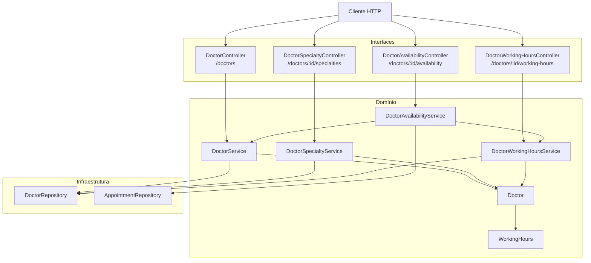
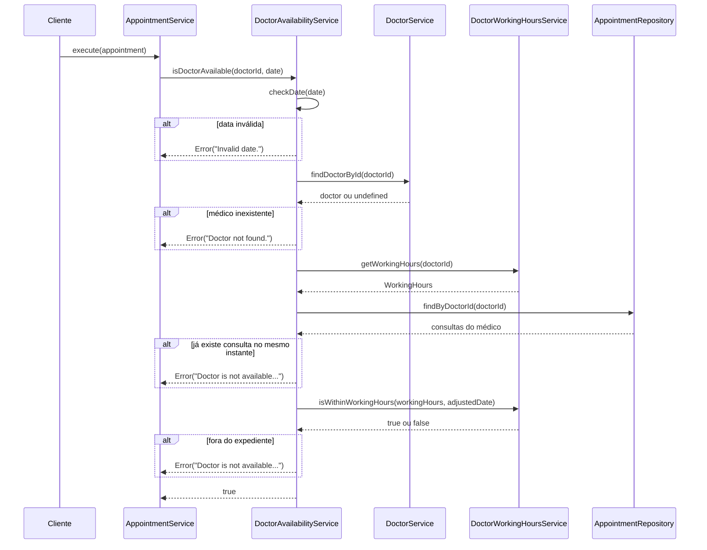
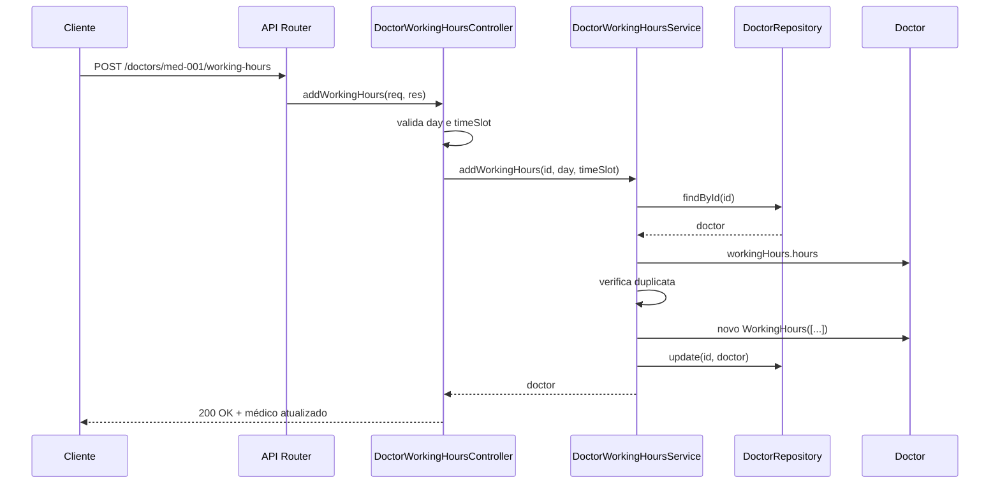
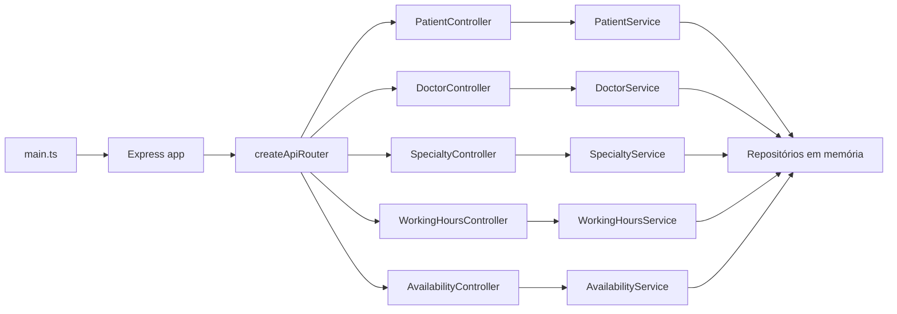

# Agendando Uma Consulta - Parte 2

## Introdução e contexto

Na [Parte 1](./2%20-%20Agendando%20Uma%20Consulta%20-%20Parte%201.md) a camada de
interfaces nasceu com o `PatientController`. Esta aula olha para o outro lado do
agendamento: o **médico**.

O `Doctor` já existia, com `specialties` e o objeto de valor `WorkingHours`, e o
`DoctorRepository` já oferecia buscas por nome e por especialidade. O problema é
que o `DoctorService` acumulava responsabilidades demais: cadastro, atualização,
remoção, especialidades e horários de atendimento. Cada novo requisito aumentava
o mesmo arquivo e obrigava qualquer mudança a mexer em um serviço que faz coisas
demais.

A solução da aula é **quebrar o serviço por responsabilidade**:

- `DoctorService` — ciclo de vida cadastral do médico;
- `DoctorSpecialtyService` — especialidades;
- `DoctorWorkingHoursService` — horários de atendimento;
- `DoctorAvailabilityService` — disponibilidade do médico.

O mesmo critério vale para a entrada: em vez de um controller gigante, cada
serviço ganha o seu adaptador HTTP. O desenho final do módulo fica assim:



## Ajustes na entidade e no objeto de valor

O `Doctor` passou a receber `workingHours` no DTO e a tratar `specialties` como
opcional. Além disso, a coleção é copiada na construção, evitando que o array do
chamador seja compartilhado com a entidade:

```typescript
// src/domain/entities/Doctor.ts
export type CreateDoctorDTO = Omit<
  DoctorDTO,
  "specialties" | "workingHours"
> & {
  specialties?: string[];
  workingHours?: WorkingHours;
};

export type UpdateDoctorDTO = Partial<
  Omit<CreateDoctorDTO, "id" | "workingHours">
>;

export class Doctor implements DoctorDTO {
  id: string;
  rcm: string;
  name: string;
  phone: string;
  specialties: string[];
  workingHours: WorkingHours;

  constructor(data: CreateDoctorDTO) {
    this.id = data.id;
    this.rcm = data.rcm;
    this.name = data.name;
    this.specialties = data.specialties ? [...data.specialties] : [];
    this.phone = data.phone;
    this.workingHours = data.workingHours ?? new WorkingHours();
  }
}
```

`UpdateDoctorDTO` exclui `id` e `workingHours` de propósito. Identidade não se
altera e horários têm um serviço próprio — a atualização cadastral não deve
substituir o objeto de valor por um objeto anônimo vindo do corpo da requisição.

O `WorkingHours` ganhou um construtor que aceita a coleção inicial:

```typescript
// src/domain/value-objects/WorkingHours.ts
export class WorkingHours implements WorkingHoursDTO {
  hours: HourDTO[];

  constructor(hours: HourDTO[] = []) {
    this.hours = [...hours];
  }

  equals(other: WorkingHours): boolean {
    return sameItems(
      this.hours,
      other.hours,
      (hour, otherHour) =>
        hour.day === otherHour.day && hour.timeSlot === otherHour.timeSlot,
    );
  }
}
```

Isso permite reconstruir o objeto de valor ao adicionar ou remover uma faixa, em
vez de mutar o array interno diretamente.

## Os quatro serviços do médico

| Serviço | Pergunta que responde | Dependências |
| --- | --- | --- |
| `DoctorService` | quem é o médico e como ele é criado/atualizado/removido? | `DoctorRepository` |
| `DoctorSpecialtyService` | quais especialidades o médico tem e como mudam? | `DoctorRepository` |
| `DoctorWorkingHoursService` | quando o médico atende? | `DoctorRepository` |
| `DoctorAvailabilityService` | o médico pode atender nesta data e horário? | `DoctorRepository`/`DoctorService`, `DoctorWorkingHoursService`, `AppointmentRepository` |

### `DoctorService`

O serviço base ficou enxuto: só o CRUD cadastral.

```typescript
// src/domain/services/doctor-services/DoctorService.ts
export class DoctorService {
  private readonly doctorRepository: DoctorRepository;

  constructor(doctorRepository: DoctorRepository) {
    this.doctorRepository = doctorRepository;
  }

  addDoctor(doctorData: CreateDoctorDTO): Doctor {
    const doctor = new Doctor(doctorData);
    this.doctorRepository.add(doctor.id, doctor);
    return doctor;
  }

  findDoctorById(doctorId: string): Doctor | undefined {
    return this.doctorRepository.findById(doctorId);
  }

  findAllDoctors(): Doctor[] {
    return this.doctorRepository.findAll();
  }

  updateDoctor(doctorId: string, updatedData: UpdateDoctorDTO): Doctor {
    const doctor = this.findDoctorOrThrow(doctorId);
    Object.assign(doctor, updatedData);
    this.doctorRepository.update(doctorId, doctor);
    return doctor;
  }

  deleteDoctor(doctorId: string): Doctor {
    const doctor = this.findDoctorOrThrow(doctorId);
    this.doctorRepository.delete(doctorId);
    return doctor;
  }

  private findDoctorOrThrow(doctorId: string): Doctor {
    const doctor = this.doctorRepository.findById(doctorId);

    if (!doctor) {
      throw new Error("Doctor not found.");
    }

    return doctor;
  }
}
```

A busca por ID continua devolvendo `undefined`; quem precisa de um médico
obrigatório usa o `findDoctorOrThrow` interno. Os demais serviços repetem esse
pequeno helper — é a alternativa simples a um erro tipado compartilhado.

### `DoctorSpecialtyService`

Adicionar, remover e listar especialidades saiu do `DoctorService`:

```typescript
// src/domain/services/doctor-services/DoctorSpecialtyService.ts
addSpecialty(doctorId: string, specialty: string): Doctor {
  const doctor = this.findDoctorOrThrow(doctorId);

  if (doctor.specialties.includes(specialty)) {
    throw new Error("Specialty already exists.");
  }

  doctor.specialties.push(specialty);
  this.doctorRepository.update(doctor.id, doctor);
  return doctor;
}

removeSpecialty(doctorId: string, specialty: string): Doctor {
  const doctor = this.findDoctorOrThrow(doctorId);

  doctor.specialties = doctor.specialties.filter(
    (currentSpecialty) => currentSpecialty !== specialty,
  );

  this.doctorRepository.update(doctor.id, doctor);
  return doctor;
}

listSpecialties(doctorId: string): string[] {
  return [...this.findDoctorOrThrow(doctorId).specialties];
}
```

| Operação | Regra | Resultado |
| --- | --- | --- |
| `addSpecialty` | médico existe e especialidade ainda não cadastrada | médico atualizado |
| `removeSpecialty` | médico existe | lista filtrada (idempotente) |
| `listSpecialties` | médico existe | cópia da coleção |

> **A checagem de lista vazia não é mais necessária.** A entidade garante
> `specialties: string[]`, então o serviço não precisa repetir
> `if (!doctor.specialties) doctor.specialties = []`. Essa garantia vem do
> construtor, não de uma verificação defensiva em cada método.

### `DoctorWorkingHoursService`

O serviço de horários reúne o cadastro da agenda e a interpretação das faixas:

```typescript
// src/domain/services/doctor-services/DoctorWorkingHoursService.ts
addWorkingHours(doctorId: string, day: string, timeSlot: string): Doctor {
  const doctor = this.findDoctorOrThrow(doctorId);

  const hasWorkingHours = doctor.workingHours.hours.some(
    (workingHours) =>
      workingHours.day === day && workingHours.timeSlot === timeSlot,
  );

  if (hasWorkingHours) {
    throw new Error("Working hours already exist.");
  }

  doctor.workingHours = new WorkingHours([
    ...doctor.workingHours.hours,
    { day, timeSlot },
  ]);

  this.doctorRepository.update(doctor.id, doctor);
  return doctor;
}

removeWorkingHours(doctorId: string, day: string, timeSlot: string): Doctor {
  const doctor = this.findDoctorOrThrow(doctorId);

  doctor.workingHours = new WorkingHours(
    doctor.workingHours.hours.filter(
      (workingHours) =>
        !(workingHours.day === day && workingHours.timeSlot === timeSlot),
    ),
  );

  this.doctorRepository.update(doctor.id, doctor);
  return doctor;
}

getWorkingHours(doctorId: string): WorkingHours {
  return this.findDoctorOrThrow(doctorId).workingHours;
}
```

| Método | Devolve | Erro |
| --- | --- | --- |
| `addWorkingHours` | médico com a nova faixa | `Doctor not found.` / `Working hours already exist.` |
| `removeWorkingHours` | médico sem a faixa | `Doctor not found.` |
| `listWorkingHours` | `HourDTO[]` (cópia) | `Doctor not found.` |
| `getWorkingHours` | o objeto de valor `WorkingHours` | `Doctor not found.` |
| `isWithinWorkingHours` | `boolean` | faixa de horário inválida |

A verificação de expediente usa o **dia da semana em inglês** e um horário no
formato `HH:mm`, porque é assim que as faixas são armazenadas:

```typescript
isWithinWorkingHours(workingHours: WorkingHours, date: Date): boolean {
  const dayOfWeek = date.toLocaleDateString("en-US", {
    weekday: "long",
    timeZone: "UTC",
  });
  const timeSlot = `${this.pad(date.getUTCHours())}:${this.pad(
    date.getUTCMinutes(),
  )}`;

  return workingHours.hours.some(
    (workingHours) =>
      workingHours.day === dayOfWeek &&
      this.isTimeWithinSlot(timeSlot, workingHours.timeSlot),
  );
}
```

O parser aceita `08:00-12:00` e `09:00 AM - 05:00 PM`, dividindo a faixa por
hífen com espaços opcionais. Também corrige um detalhe clássico: `12:00 AM` vale
zero hora, não meio-dia.

```typescript
private timeToMinutes(value: string): number {
  const match = value.trim().match(/^(\d{1,2}):(\d{2})\s*(AM|PM)?$/i);

  if (!match) {
    throw new Error(`Invalid time: ${value}`);
  }

  let hours = Number(match[1]);
  const minutes = Number(match[2]);
  const period = match[3]?.toUpperCase();

  if (period === "AM" && hours === 12) {
    hours = 0;
  }

  if (period === "PM" && hours !== 12) {
    hours += 12;
  }

  return hours * 60 + minutes;
}
```

> **A faixa é inclusiva no fim.** Uma consulta exatamente às 17:00 é aceita em
> `09:00 AM - 05:00 PM`. Como o sistema não conhece a duração do atendimento,
> não há como saber se ela terminaria depois do expediente.

### `DoctorAvailabilityService`

O serviço de disponibilidade agora compõe os outros dois e responde a uma única
pergunta: **o médico pode atender neste instante?**

```typescript
// src/domain/services/doctor-services/DoctorAvailabilityService.ts
export class DoctorAvailabilityService {
  private readonly appointmentRepository: AppointmentRepository;
  private readonly doctorService: DoctorService;
  private readonly doctorWorkingHoursService: DoctorWorkingHoursService;

  constructor(
    appointmentRepository: AppointmentRepository,
    doctorService: DoctorService,
    doctorWorkingHoursService: DoctorWorkingHoursService,
  ) {
    this.appointmentRepository = appointmentRepository;
    this.doctorService = doctorService;
    this.doctorWorkingHoursService = doctorWorkingHoursService;
  }

  isDoctorAvailable(doctorId: string, date: Date | string): true {
    if (!doctorId || !date) {
      throw new Error("Invalid doctor ID or date.");
    }

    const adjustedDate = this.checkDate(date);

    const doctor = this.doctorService.findDoctorById(doctorId);
    if (!doctor) {
      throw new Error("Doctor not found.");
    }

    const workingHours = this.doctorWorkingHoursService.getWorkingHours(
      doctor.id,
    );

    const hasAppointmentConflict = this.hasAppointmentConflict(
      doctor.id,
      adjustedDate,
    );
    const isWithinWorkingHours =
      this.doctorWorkingHoursService.isWithinWorkingHours(
        workingHours,
        adjustedDate,
      );

    if (hasAppointmentConflict || !isWithinWorkingHours) {
      throw new Error(
        "Doctor is not available at the specified date and time.",
      );
    }

    return true;
  }
  // ...
}
```

O fluxo de decisão tem três perguntas antes de aceitar a data:



Diferente da versão anterior, o serviço **lança exceção** quando o médico não
pode atender, em vez de retornar `false` e escrever no console. Isso deixa uma
única forma de representar a indisponibilidade e elimina o efeito colateral no
domínio. O `AppointmentService` apenas propaga a exceção:

```typescript
// src/application/services/AppointmentService.ts
// O serviço de disponibilidade lança exceção quando o médico não pode atender.
this.doctorAvailabilityService.isDoctorAvailable(doctor.id, date);
```

O controller de disponibilidade é quem traduz a exceção em uma resposta de
consulta: `200 { "available": false }`.

#### Fuso horário no `checkDate`

Comparar consultas por instante é simples (`getTime()`), mas descobrir o **dia da
semana e o horário de parede** depende do fuso. A normalização usada é:

```typescript
private checkDate(date: Date | string): Date {
  const parsedDate = date instanceof Date ? date : new Date(date);

  if (Number.isNaN(parsedDate.getTime())) {
    throw new Error("Invalid date.");
  }

  const offset = parsedDate.getTimezoneOffset() * 60_000;
  return new Date(parsedDate.getTime() - offset);
}
```

O resultado é uma `Date` cujos campos **UTC** representam o relógio de parede
local. Por isso `isWithinWorkingHours` lê `getUTCDay`/`getUTCHours` (via
`toLocaleDateString` com `timeZone: "UTC"`). O conflito também compara as duas
datas já normalizadas:

```typescript
private hasAppointmentConflict(doctorId: string, date: Date): boolean {
  const doctorAppointments =
    this.appointmentRepository.findByDoctorId(doctorId);

  return doctorAppointments.some(
    (appointment) =>
      this.checkDate(appointment.date).getTime() === date.getTime(),
  );
}
```

| Validação | Pergunta | Falha |
| --- | --- | --- |
| ID e data | os dois valores existem? | `Invalid doctor ID or date.` |
| data | é uma `Date` válida? | `Invalid date.` |
| médico | o ID corresponde a alguém? | `Doctor not found.` |
| conflito | já existe consulta no mesmo instante? | `Doctor is not available...` |
| expediente | o dia e o horário estão em alguma faixa? | `Doctor is not available...` |

> **Fuso do servidor, não do consultório.** A normalização usa o fuso da máquina
> que executa a API. Para atender várias regiões, o ideal é receber o fuso (ou um
> `Instant` com offset explícito) e usar `Intl.DateTimeFormat` com um
> `timeZone` fixo.

## Controllers separados

A aula poderia concentrar tudo em um `DoctorController`, mas cada serviço ganhou
seu próprio adaptador. O motivo é o mesmo da separação dos serviços: manter cada
arquivo com uma responsabilidade clara.

| Controller | Rota base | Rotas |
| --- | --- | --- |
| `DoctorController` | `/doctors` | `POST /`, `GET /`, `GET /:id`, `PUT /:id`, `DELETE /:id` |
| `DoctorSpecialtyController` | `/doctors/:id/specialties` | `POST /`, `GET /`, `DELETE /` |
| `DoctorWorkingHoursController` | `/doctors/:id/working-hours` | `POST /`, `GET /`, `DELETE /` |
| `DoctorAvailabilityController` | `/doctors/:id/availability` | `GET /?date=...` |

Os três controllers aninhados usam `Router({ mergeParams: true })` para acessar o
`:id` do médico que vem da rota pai:

```typescript
// src/interfaces/controllers/doctor-controllers/DoctorSpecialtyController.ts
constructor(specialtyService: DoctorSpecialtyService) {
  this.router = Router({ mergeParams: true });
  this.specialtyService = specialtyService;
  this.initializeRoutes();
}

private initializeRoutes(): void {
  this.router.post("/", this.addSpecialty.bind(this));
  this.router.delete("/", this.removeSpecialty.bind(this));
  this.router.get("/", this.listSpecialties.bind(this));
}
```

A rota de disponibilidade recebe a data pela query string e devolve um booleano:

```typescript
// src/interfaces/controllers/doctor-controllers/DoctorAvailabilityController.ts
private checkAvailability(
  req: Request<{ id: string }, unknown, unknown, { date?: string }>,
  res: Response,
): void {
  try {
    const { date } = req.query;

    if (!date) {
      throw new Error("Date is required.");
    }

    const parsedDate = new Date(date);
    if (Number.isNaN(parsedDate.getTime())) {
      throw new Error("Invalid date format.");
    }

    this.doctorAvailabilityService.isDoctorAvailable(
      req.params.id,
      parsedDate,
    );

    res.status(200).json({ available: true });
  } catch (error) {
    const message =
      error instanceof Error ? error.message : "Unexpected error.";

    // Indisponibilidade é uma resposta válida da consulta, não um erro HTTP.
    if (message === UNAVAILABLE_MESSAGE) {
      res.status(200).json({ available: false });
      return;
    }

    sendDoctorError(res, error, 400);
  }
}
```

### Status HTTP

| Situação | Status |
| --- | --- |
| médico criado | `201` |
| leitura, atualização, remoção e alterações de especialidade/horário | `200` |
| disponibilidade consultada (disponível ou não) | `200` |
| médico inexistente | `404` |
| especialidade ou horário duplicado | `400` |
| corpo incompleto ou data inválida | `400` |
| erro inesperado | `500` |

O mapeamento fica em um helper compartilhado pelos controllers:

```typescript
// src/interfaces/controllers/doctor-controllers/doctorResponse.ts
export function sendDoctorError(
  res: Response,
  error: unknown,
  fallbackStatus: number,
): void {
  const message =
    error instanceof Error ? error.message : "Unexpected error.";
  const status = message === "Doctor not found." ? 404 : fallbackStatus;

  res.status(status).json({ error: message });
}
```

`toDoctorResponse` serializa o médico incluindo `workingHours.hours`. Como o
`WorkingHours` guarda o array em uma propriedade própria, o JSON sai no formato
esperado sem precisar expor o método `equals`.

### Caminho de uma requisição



## API Router e `main`

Com quatro controllers novos, a composição precisou sair do papel. O
`createApiRouter` recebe os controllers prontos e apenas os monta nos caminhos:

```typescript
// src/interfaces/apiRouter.ts
export function createApiRouter(
  dependencies: ApiRouterDependencies,
): Router {
  const router = Router();

  router.use("/patients", dependencies.patientController.router);
  router.use("/doctors", dependencies.doctorController.router);
  router.use(
    "/doctors/:id/specialties",
    dependencies.doctorSpecialtyController.router,
  );
  router.use(
    "/doctors/:id/working-hours",
    dependencies.doctorWorkingHoursController.router,
  );
  router.use(
    "/doctors/:id/availability",
    dependencies.doctorAvailabilityController.router,
  );

  return router;
}
```

O `main` é o **composition root** — o único lugar que instancia implementações
concretas e conecta tudo:

```typescript
// src/main.ts
const doctorRepository = new DoctorRepository();
const appointmentRepository = new AppointmentRepository();

const doctorService = new DoctorService(doctorRepository);
const doctorWorkingHoursService = new DoctorWorkingHoursService(
  doctorRepository,
);
const doctorAvailabilityService = new DoctorAvailabilityService(
  appointmentRepository,
  doctorService,
  doctorWorkingHoursService,
);

const doctorWorkingHoursController = new DoctorWorkingHoursController(
  doctorWorkingHoursService,
);

const app = express();
app.use(express.json());
app.use(
  createApiRouter({
    patientController,
    doctorController,
    doctorSpecialtyController,
    doctorWorkingHoursController,
    doctorAvailabilityController,
  }),
);
```



Para subir a API:

```bash
pnpm start
# API disponível em http://localhost:3000
```

O `main` usa `import.meta.main` para só chamar `app.listen` quando executado
diretamente; o `app` continua exportado para futuros testes de integração.

### Exemplos de uso

```bash
# cria o médico
curl -X POST http://localhost:3000/doctors \
  -H 'Content-Type: application/json' \
  -d '{"id":"med-001","rcm":"CRM-SP 123456","name":"Maria Santos","specialties":["Cardiologia"],"phone":"(11) 91234-5678"}'

# cadastra o expediente de sexta
curl -X POST http://localhost:3000/doctors/med-001/working-hours \
  -H 'Content-Type: application/json' \
  -d '{"day":"Friday","timeSlot":"09:00 AM - 05:00 PM"}'

# adiciona uma especialidade
curl -X POST http://localhost:3000/doctors/med-001/specialties \
  -H 'Content-Type: application/json' \
  -d '{"specialty":"Clínica Geral"}'

# verifica a disponibilidade em uma sexta ao meio-dia
curl 'http://localhost:3000/doctors/med-001/availability?date=2025-03-07T12:00:00'
# {"available":true}
```

## Testes e verificação

Os testes acompanharam a separação, um arquivo por serviço:

| Arquivo | Cobertura |
| --- | --- |
| `DoctorService.test.ts` | CRUD e erros de ID inexistente |
| `DoctorSpecialtyService.test.ts` | adicionar, remover, listar, duplicata e cópia |
| `DoctorWorkingHoursService.test.ts` | cadastro, remoção, duplicata, faixas 12h/24h e `12:00 AM` |
| `DoctorAvailabilityService.test.ts` | disponível, conflito, fora do expediente, data inválida e médico inexistente |
| `AppointmentService.test.ts` | fluxo de agendamento com o novo grafo de dependências |

```bash
pnpm typecheck
pnpm test
pnpm start
```

## Benefícios

- **Serviços coesos.** Cada arquivo responde a uma pergunta; especialidades e
  horários não sobrecarregam mais o CRUD do médico.
- **Entidade mais expressiva.** `Doctor` garante as coleções padrão e o
  `WorkingHours` pode ser reconstruído com segurança.
- **Disponibilidade isolada.** A regra que combina agenda, expediente e fuso
  vive em um único serviço de domínio.
- **Sem efeitos colaterais.** `isDoctorAvailable` lança exceção em vez de
  imprimir no console e retornar `false`.
- **Controllers enxutos.** Cada adaptador traduz HTTP para um serviço e devolve
  o status adequado.
- **Rotas previsíveis.** O recurso do médico expõe sub-recursos claros:
  especialidades, horários e disponibilidade.
- **Composition root explícito.** `main.ts` mostra todo o grafo de dependências
  em um só lugar.
- **Cobertura dos serviços.** As regras de especialidade, horário e
  disponibilidade têm testes automatizados próprios.

## Limitações e pontos de atenção

- **Erros por mensagem.** Os controllers comparam `error.message` para decidir
  entre `404`, `400` e `500`. Um erro tipado (`DoctorNotFoundError`,
  `SpecialtyAlreadyExistsError`) seria mais seguro e menos acoplado ao texto.
- **Sem testes de controller.** As rotas foram validadas manualmente com `curl`;
  não há teste automatizado de status HTTP ou serialização.
- **Persistência em `Map`.** Tudo continua em memória: sem transação, índices,
  concorrência ou sobrevivência a reinícios.
- **Sem validação de corpo.** O TypeScript garante os tipos em tempo de
  compilação, mas o corpo da requisição pode chegar incompleto. Só
  `specialty`, `day`, `timeSlot` e `date` são verificados.
- **Fuso da máquina.** O `checkDate` normaliza pelo fuso do servidor. Uma clínica
  em outro fuso precisa de um `timeZone` explícito.
- **Conflito por instante exato.** Consultas com minutos de diferença não são
  detectadas, porque não existe duração de atendimento nem cálculo de
  sobreposição.
- **Consultas canceladas bloqueiam.** `findByDoctorId` não filtra por status; uma
  consulta `canceled` no mesmo horário ainda faz o médico parecer ocupado.
- **Faixas sobrepostas.** É possível cadastrar `08:00-12:00` e `10:00-14:00` para
  o mesmo dia; não há validação de sobreposição.
- **Expediente inclusivo no fim.** `<=` aceita uma consulta que começa exatamente
  no horário de fechamento.
- **`PUT` parcial.** A rota usa `PUT`, mas aceita atualização parcial; `PATCH`
  seria semanticamente mais correto.
- **Sem paginação.** `GET /doctors` devolve todos os registros.
- **Buscas do repositório sem rota.** `findByName` e `findBySpecialty` existem no
  `DoctorRepository`, mas ainda não são expostos pela API.
- **Agendamento ainda sem controller.** O `AppointmentService` existe, mas não há
  rotas de consulta — é o gancho para a próxima parte.

## Conclusão

Esta aula quebrou o módulo do médico em peças menores e colocou a API de pé:

- o **`DoctorService`** ficou restrito ao CRUD;
- **`DoctorSpecialtyService`** e **`DoctorWorkingHoursService`** assumiram,
  respectivamente, especialidades e expediente;
- **`DoctorAvailabilityService`** passou a compor os dois, validar data, conflito
  e expediente, lançando exceção quando o médico não pode atender;
- **quatro controllers** expõem esses serviços em rotas REST separadas;
- **`apiRouter`** e **`main`** completaram a composição, com injeção de
  dependência do repositório até o adaptador de entrada.

O próximo passo é o que o próprio `AppointmentService` já antecipa: expor o
**agendamento de consulta** via HTTP, ligar paciente, médico e disponibilidade em
um caso de uso completo e, depois, revisar a persistência para deixar o `Map` em
memória para trás.
