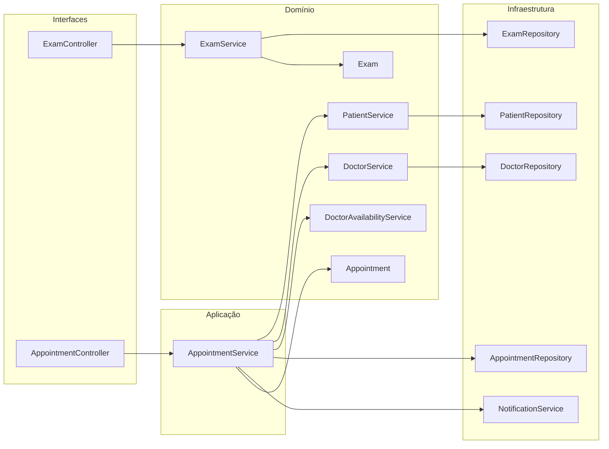
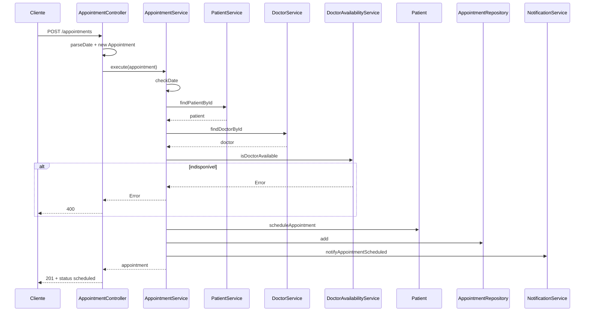
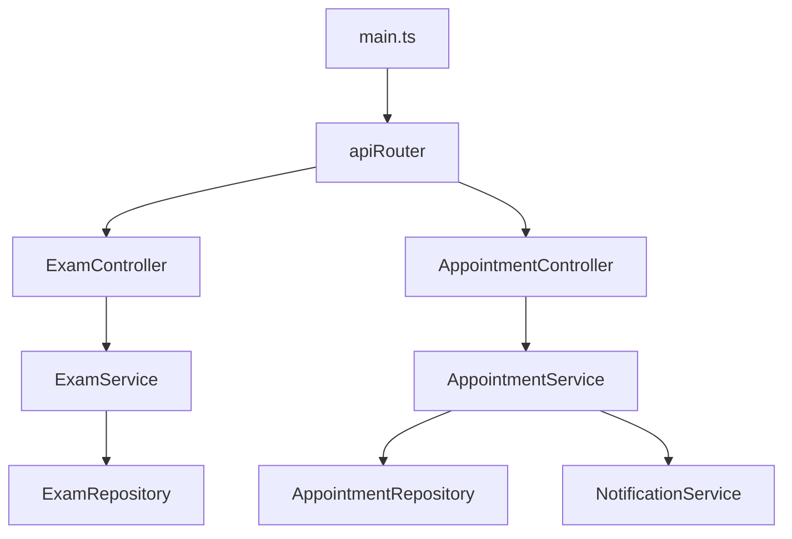

# Agendando Uma Consulta - Parte 3

## Introdução e contexto

As duas partes anteriores montaram o caminho até o agendamento: a camada de
interfaces, o módulo do médico e a verificação de disponibilidade. Falta fechar o
circuito com as duas entidades que ainda não tinham porta de entrada HTTP:

- **`Exam`** — o exame, com seus filtros por paciente, tipo e data;
- **`Appointment`** — a consulta agendada, com o status que a mantém viva mesmo
  depois de um cancelamento.

Esta aula também é a primeira em que o fluxo completo é exercitado de ponta a
ponta: cadastrar paciente, cadastrar médico, definir o expediente, agendar a
consulta e consultar o resultado pela API.



## A entidade `Exam`

O `Exam` é deliberadamente simples: dados do exame e o vínculo com o paciente por
`patientId`.

```typescript
// src/domain/entities/Exam.ts
export interface ExamDTO {
  id: string;
  type: string;
  result: string;
  date: Date;
  location: string;
  responsible: string;
  patientId: string;
}

export type CreateExamDTO = ExamDTO;
export type UpdateExamDTO = Partial<Omit<CreateExamDTO, "id">>;
```

| Campo | Significado |
| --- | --- |
| `type` | tipo do exame (`Hemograma`, `Eletrocardiograma`…) |
| `result` | resultado disponível |
| `date` | data e hora da realização |
| `location` | local onde foi feito |
| `responsible` | profissional responsável |
| `patientId` | paciente associado, por ID |

`UpdateExamDTO` impede trocar o `id`, mas permite atualizar o resultado — o caso
de uso citado na aula para um hemograma cujos sub-exames chegam do laboratório
aos poucos.

> **A entidade não valida o paciente.** O vínculo é apenas um `patientId`; o
> `ExamService` não consulta o `PatientRepository` para confirmar que o paciente
> existe. Essa validação ainda não faz parte do escopo da aula.

## `ExamRepository`

O repositório herda o `Repository<Exam>` e acrescenta três filtros de negócio:

```typescript
// src/infrastructure/persistence/ExamRepository.ts
export class ExamRepository extends Repository<Exam> {
  findByPatientId(patientId: string): Exam[] {
    return this.findAll().filter((exam) => exam.patientId === patientId);
  }

  findByType(type: string): Exam[] {
    return this.findAll().filter((exam) => exam.type === type);
  }

  findByDate(date: Date): Exam[] {
    return this.findAll().filter(
      (exam) => exam.date.toDateString() === date.toDateString(),
    );
  }
}
```

| Filtro | Critério | Observação |
| --- | --- | --- |
| `findByPatientId` | igualdade de `patientId` | todos os exames do paciente |
| `findByType` | igualdade exata de `type` | diferencia maiúsculas/minúsculas |
| `findByDate` | mesmo dia (`toDateString`) | ignora o horário |

O filtro por data compara o **dia do calendário no fuso do servidor**, não o
instante. É o comportamento desejado para "exames feitos em 15/06", mas significa
que o resultado depende do fuso da máquina.

## `ExamService`

O serviço expõe o CRUD e os três filtros:

```typescript
// src/domain/services/ExamService.ts
export class ExamService {
  private readonly examRepository: ExamRepository;

  constructor(examRepository: ExamRepository) {
    this.examRepository = examRepository;
  }

  scheduleExam(examData: CreateExamDTO): Exam {
    const exam = new Exam(examData);
    this.examRepository.add(exam.id, exam);
    return exam;
  }

  findExamById(id: string): Exam | undefined {
    return this.examRepository.findById(id);
  }

  findAllExams(): Exam[] {
    return this.examRepository.findAll();
  }

  findExamsByPatientId(patientId: string): Exam[] {
    return this.examRepository.findByPatientId(patientId);
  }

  findExamsByType(type: string): Exam[] {
    return this.examRepository.findByType(type);
  }

  findExamsByDate(date: Date): Exam[] {
    return this.examRepository.findByDate(date);
  }

  updateExam(examId: string, updatedData: UpdateExamDTO): Exam {
    const exam = this.findExamById(examId);
    if (!exam) {
      throw new Error("Exam not found.");
    }

    Object.assign(exam, updatedData);
    this.examRepository.update(examId, exam);
    return exam;
  }

  deleteExam(examId: string): Exam {
    const exam = this.findExamById(examId);
    if (!exam) {
      throw new Error("Exam not found.");
    }

    this.examRepository.delete(examId);
    return exam;
  }
}
```

| Método | Delega para | Erro |
| --- | --- | --- |
| `scheduleExam` | `add` | ID duplicado (repositório) |
| `findExamById` | `findById` | devolve `undefined` |
| `findAllExams` | `findAll` | — |
| `findExamsByPatientId` | `findByPatientId` | — |
| `findExamsByType` | `findByType` | — |
| `findExamsByDate` | `findByDate` | — |
| `updateExam` | `update` | `Exam not found.` |
| `deleteExam` | `delete` | `Exam not found.` |

## `ExamController`

O controller de exames segue o mesmo molde dos anteriores. A única
particularidade é a **conversão de data**: o corpo e a URL chegam como string, e
o domínio trabalha com `Date`.

```typescript
// src/interfaces/controllers/ExamController.ts
private initializeRoutes(): void {
  this.router.post("/", this.scheduleExam.bind(this));
  this.router.get("/", this.getAllExams.bind(this));
  this.router.get("/patient/:patientId", this.getExamsByPatientId.bind(this));
  this.router.get("/type/:type", this.getExamsByType.bind(this));
  this.router.get("/date/:date", this.getExamsByDate.bind(this));
  this.router.get("/:id", this.getExamById.bind(this));
  this.router.put("/:id", this.updateExam.bind(this));
  this.router.delete("/:id", this.deleteExam.bind(this));
}
```

As rotas específicas são registradas **antes** de `/:id`. Hoje `/:id` não
capturaria `/patient/1` por ter dois segmentos, mas manter a ordem explícita
evita surpresas quando novas rotas forem adicionadas.

```typescript
private scheduleExam(req: Request, res: Response): void {
  try {
    const data = (req.body ?? {}) as CreateExamDTO;
    const date = this.parseDate(data.date);

    if (Number.isNaN(date.getTime())) {
      throw new Error("Invalid exam date.");
    }

    const createdExam = this.examService.scheduleExam({ ...data, date });
    res.status(201).json(createdExam);
  } catch (error) {
    this.sendError(res, error, 400);
  }
}
```

| Método | Rota | Ação | Sucesso | Erro |
| --- | --- | --- | --- | --- |
| `POST` | `/exams` | agenda um exame | `201` | `400` |
| `GET` | `/exams` | lista todos | `200` | `500` |
| `GET` | `/exams/:id` | busca por ID | `200` | `404` |
| `PUT` | `/exams/:id` | atualiza | `200` | `400`/`404` |
| `DELETE` | `/exams/:id` | remove | `200` | `404` |
| `GET` | `/exams/patient/:patientId` | filtra por paciente | `200` | `500` |
| `GET` | `/exams/type/:type` | filtra por tipo | `200` | `500` |
| `GET` | `/exams/date/:date` | filtra por dia | `200` | `400` |

> **Lista vazia é sucesso.** Diferente das buscas do paciente, os filtros de
> exame devolvem `200` com `[]` quando não encontram nada. A aula não trata a
> ausência como erro; é uma decisão de contrato da API.

## A entidade `Appointment` e o status

O `Appointment` já existia, mas agora o status ganha papel de destaque. A aula
insiste em **não remover** uma consulta cancelada: ela continua no histórico e é
o `status` que diz se ela ainda vale.

```typescript
// src/domain/entities/Appointments.ts
export type AppointmentStatus = "scheduled" | "completed" | "canceled";

export type CreateAppointmentDTO = Omit<AppointmentDTO, "status"> & {
  status?: AppointmentStatus;
};

export class Appointment implements AppointmentDTO {
  // ...
  #status: AppointmentStatus;

  constructor(data: CreateAppointmentDTO) {
    // ...
    this.#status = data.status ?? "scheduled";
  }

  complete(): void {
    if (this.#status !== "scheduled") {
      throw new Error("Only scheduled appointments can be completed.");
    }

    this.#status = "completed";
  }

  cancel(): void {
    if (this.#status === "completed") {
      throw new Error("A completed appointment cannot be canceled.");
    }

    this.#status = "canceled";
  }

  get status(): AppointmentStatus {
    return this.#status;
  }
}
```

| Status | Significado | Transições permitidas |
| --- | --- | --- |
| `scheduled` | consulta marcada | `completed` ou `canceled` |
| `completed` | atendimento realizado | nenhuma |
| `canceled` | consulta cancelada | nenhuma |

O status é um **getter de protótipo** e fica em um campo privado (`#status`).
Isso significa que `res.json(appointment)` não o inclui: o controller precisa
montar a resposta explicitamente.

> **Union type em vez de `enum`.** O projeto usa `"scheduled" | "completed" |
> "canceled"`. É a alternativa idiomática ao enumerador citado na aula: dá
> autocomplete, restringe os valores em tempo de compilação e não gera código
> extra em runtime.

## `AppointmentController`

O controller de consultas expõe apenas o necessário para o fluxo desta aula:

```typescript
// src/interfaces/controllers/AppointmentController.ts
private initializeRoutes(): void {
  this.router.post("/", this.scheduleAppointment.bind(this));
  this.router.get("/", this.getAllAppointments.bind(this));
  this.router.get("/:id", this.getAppointmentById.bind(this));
}
```

Não existe `DELETE`. A consulta cancelada permanece no repositório, coerente com
o status. O cancelamento existe na entidade (`appointment.cancel()`), mas ainda
não tem rota própria.

### O controller constrói a entidade

O corpo da requisição é um objeto simples. Antes de chegar ao caso de uso, ele
precisa virar uma instância de `Appointment` — o `Patient.scheduleAppointment`
valida `instanceof Appointment`.

```typescript
private scheduleAppointment(req: Request, res: Response): void {
  try {
    const data = (req.body ?? {}) as AppointmentBody;
    const appointment = new Appointment({
      ...data,
      date: this.parseDate(data.date),
    });

    const scheduledAppointment = this.appointmentService.execute(appointment);
    res.status(201).json(this.toResponse(scheduledAppointment));
  } catch (error) {
    this.sendError(res, error, 400);
  }
}

private toResponse(appointment: Appointment) {
  return {
    id: appointment.id,
    date: appointment.date,
    patientId: appointment.patientId,
    doctorId: appointment.doctorId,
    reason: appointment.reason,
    notes: appointment.notes,
    status: appointment.status,
  };
}
```

> **Diferença em relação ao exemplo da aula.** Lá o corpo era repassado direto
> ao serviço. No nosso domínio, a entidade exige uma instância real; por isso o
> controller converte a data e constrói o `Appointment`. É a tradução HTTP →
> domínio acontecendo na fronteira, como deve ser.

| Método | Rota | Ação | Sucesso | Erro |
| --- | --- | --- | --- | --- |
| `POST` | `/appointments` | agenda uma consulta | `201` | `400` |
| `GET` | `/appointments` | lista todas | `200` | `500` |
| `GET` | `/appointments/:id` | busca por ID | `200` | `404` |

O `POST` pode falhar por vários motivos: paciente inexistente, médico
inexistente, data inválida, horário fora do expediente, conflito de agenda ou
conflito do paciente. Todos chegam como `400` com a mensagem do domínio.

### O fluxo completo do agendamento



## Composição: router e `main`

O `apiRouter` ganhou mais dois controllers:

```typescript
// src/interfaces/apiRouter.ts
router.use("/patients", dependencies.patientController.router);
router.use("/doctors", dependencies.doctorController.router);
router.use("/exams", dependencies.examController.router);
router.use("/appointments", dependencies.appointmentController.router);
```

O `main` passou a instanciar o `ExamService`, o `AppointmentService` e o
`NotificationService`, completando o grafo:

```typescript
// src/main.ts
const examService = new ExamService(examRepository);
const notificationService = new NotificationService();
const appointmentService = new AppointmentService(
  patientService,
  doctorService,
  appointmentRepository,
  doctorAvailabilityService,
  notificationService,
);

const examController = new ExamController(examService);
const appointmentController = new AppointmentController(appointmentService);
```



## Teste de mesa pela API

O roteiro da aula executa as requisições na ordem em que o domínio as exige.

### 1. Paciente

```bash
curl -X POST http://localhost:3000/patients \
  -H 'Content-Type: application/json' \
  -d '{
    "id": "patient-001",
    "identificationDocument": "123.456.789-00",
    "name": "João Silva",
    "birthDate": "1990-01-01",
    "gender": "Male",
    "bloodType": "O+",
    "address": {
      "street": "Rua das Flores",
      "number": "123",
      "city": "São Paulo",
      "state": "SP",
      "zipCode": "01234-567"
    },
    "phone": "(11) 99999-9999",
    "email": "joao.silva@email.com",
    "emergencyContact": {
      "name": "Maria Silva",
      "phone": "(11) 88888-8888"
    }
  }'
# 201 Created
```

### 2. Médico e expediente

```bash
curl -X POST http://localhost:3000/doctors \
  -H 'Content-Type: application/json' \
  -d '{
    "id": "doctor-001",
    "rcm": "CRM-SP 123456",
    "name": "Maria Santos",
    "specialties": ["Cardiologia"],
    "phone": "(11) 91234-5678"
  }'
# 201 Created

curl -X POST http://localhost:3000/doctors/doctor-001/working-hours \
  -H 'Content-Type: application/json' \
  -d '{"day": "Friday", "timeSlot": "09:00 AM - 05:00 PM"}'
# 200 OK
```

Sem expediente cadastrado, o agendamento falha. O médico precisa estar
disponível no dia e na faixa informados.

### 3. Consulta

```bash
curl -X POST http://localhost:3000/appointments \
  -H 'Content-Type: application/json' \
  -d '{
    "id": "appointment-001",
    "date": "2025-03-07T12:00:00",
    "patientId": "patient-001",
    "doctorId": "doctor-001",
    "reason": "Checkup"
  }'
# 201 Created
# {"id":"appointment-001","date":"2025-03-07T15:00:00.000Z",
#  "patientId":"patient-001","doctorId":"doctor-001",
#  "reason":"Checkup","status":"scheduled"}
```

A data sai em UTC porque o `Date` é serializado em ISO. O horário
`12:00` local aparece como `15:00Z` no fuso de Brasília.

### 4. Exame e filtros

```bash
curl -X POST http://localhost:3000/exams \
  -H 'Content-Type: application/json' \
  -d '{
    "id": "exam-001",
    "type": "Hemograma",
    "result": "Normal",
    "date": "2025-03-07T08:30:00",
    "location": "Laboratório Central",
    "responsible": "Dra. Ana",
    "patientId": "patient-001"
  }'
# 201 Created

curl http://localhost:3000/exams/patient/patient-001
curl http://localhost:3000/exams/type/Hemograma
curl http://localhost:3000/exams/date/2025-03-07
# 200 OK + lista filtrada
```

## Benefícios

- **CRUD completo de exames.** Criar, listar, buscar, atualizar e remover estão
  expostos com rotas REST previsíveis.
- **Filtros de domínio na API.** Paciente, tipo e data viram rotas próprias em
  vez de filtros genéricos na query string.
- **Agendamento de ponta a ponta.** Paciente, médico, expediente, disponibilidade,
  persistência e notificação participam do mesmo caso de uso.
- **Status preservado.** A consulta cancelada continua no histórico; o estado é
  explícito e restrito por tipo.
- **Tradução na fronteira.** Datas e corpos HTTP são convertidos para tipos de
  domínio no controller, sem contaminar serviços e entidades.
- **Resposta com status.** O `toResponse` inclui o getter privado que o JSON
  direto perderia.
- **Composition root completo.** `main.ts` mostra todas as dependências da API
  em um único lugar.
- **Padrão repetível.** Entidade → repositório → serviço → controller → rota se
  repete para paciente, médico e exame; o agendamento apenas orquestra.

## Limitações e pontos de atenção

- **Exame não entra no agregado do paciente.** `Patient.addExam` existe, mas o
  `ExamService` só persiste no repositório; a coleção do paciente não é
  atualizada.
- **Exame não valida paciente.** É possível agendar um exame para um
  `patientId` inexistente.
- **Status sem transições na API.** `complete()` e `cancel()` existem na
  entidade, mas não há rotas para acioná-los.
- **Sem filtro por status.** `GET /appointments` devolve canceladas e concluídas
  junto com as agendadas.
- **Sem paginação.** Listagens devolvem todos os registros.
- **Datas dependentes de fuso.** O filtro por data usa o dia do calendário local
  do servidor; o corpo aceita string sem offset.
- **Conflito por instante exato.** Consultas com minutos de diferença não são
  detectadas, porque não há duração de atendimento.
- **Consultas canceladas bloqueiam.** A disponibilidade não filtra por status;
  uma consulta cancelada no mesmo horário ainda ocupa a agenda.
- **Sem transação.** Agendar no paciente, persistir a consulta e notificar são
  passos separados; uma falha no meio deixa o estado inconsistente.
- **Sem testes de controller.** As rotas foram validadas manualmente com `curl`;
  não há suíte automatizada de status HTTP ou serialização.
- **Erros por mensagem.** O mapeamento de status compara `error.message`.
- **`PUT` parcial.** A atualização de exame aceita corpo parcial, mas o verbo
  semanticamente correto seria `PATCH`.
- **ID fornecido pelo cliente.** Não há geração de identidade no servidor.
- **Persistência em `Map`.** Tudo continua em memória, sem índices, transações
  ou concorrência.

## Conclusão

Esta aula fechou o ciclo do agendamento e colocou o sistema para rodar de ponta a
ponta:

- o **`Exam`** ganhou repositório com filtros, serviço com CRUD e controller com
  rotas por paciente, tipo e data;
- o **`Appointment`** foi exposto pelo `AppointmentController`, com criação,
  busca por ID e listagem;
- o **status** foi mantido como estado explícito, com transições controladas
  pela entidade e sem remoção de consultas;
- o **`main`** passou a compor exames, agendamento e notificação;
- o **teste de mesa** percorreu paciente → médico → expediente → consulta →
  exame, provando o fluxo completo pela API.

O domínio agora está funcionalmente completo para o recorte do curso. As próximas
aulas saem do código operacional e voltam ao desenho: **contextos delimitados** e
**camadas anticorrupção**, os limites que mantêm esse domínio isolado quando o
sistema cresce e passa a conversar com outros sistemas.
