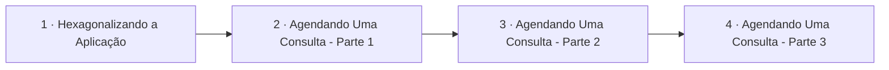

# Integração e Aplicação

## Índice

| # | Aula | Duração |
| --- | --- | --- |
| 1 | [Hexagonalizando a Aplicação](./1%20-%20Hexagonalizando%20a%20Aplica%C3%A7%C3%A3o.md) | 15:03 |
| 2 | [Agendando Uma Consulta - Parte 1](./2%20-%20Agendando%20Uma%20Consulta%20-%20Parte%201.md) | 10:16 |
| 3 | [Agendando Uma Consulta - Parte 2](./3%20-%20Agendando%20Uma%20Consulta%20-%20Parte%202.md) | 10:14 |
| 4 | [Agendando Uma Consulta - Parte 3](./4%20-%20Agendando%20Uma%20Consulta%20-%20Parte%203.md) | 10:28 |

## Sequência das aulas

