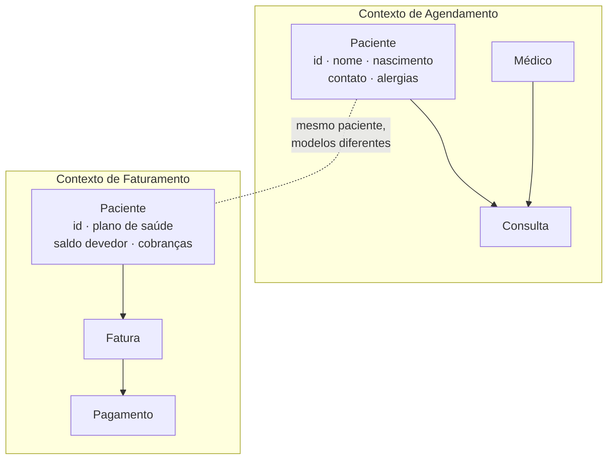
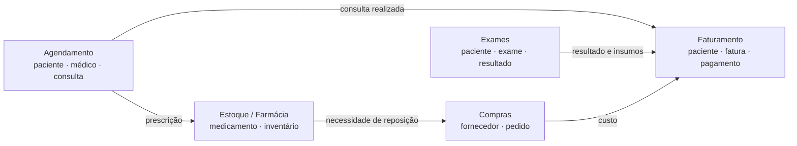

# Contexto Delimitado

## Introdução e contexto

As aulas anteriores percorreram o lado tático do DDD: entidades, objetos de valor,
agregados, repositórios e serviços de domínio. Esta aula sobe um nível e olha para
o **estratégico**: como dividir um sistema grande em partes que façam sentido para
o negócio e para as equipes que o constroem.

O ponto de partida continua sendo o mesmo: **entender o domínio antes de
delimitar qualquer coisa**. Contexto delimitado não é uma divisão arbitrária de
pastas ou de microserviços; é o reconhecimento de que um mesmo termo pode ter
significados diferentes em partes diferentes do negócio.

## O problema da linguagem

No nosso sistema hospitalar, **paciente** tem um significado claro até agora:

> a pessoa que agenda uma consulta com o médico, recebe um diagnóstico e segue um
> tratamento.

Mas um hospital privado também precisa **faturar**. E no faturamento o paciente é
outra coisa: é o responsável por uma fatura, que pode ter plano de saúde, saldo
devedor, cobertura parcial e histórico de pagamentos. O nome é o mesmo; o modelo,
as regras e os dados relevantes são diferentes.

O erro que o contexto delimitado evita é tentar criar **um único `Patient`** que
sirva para tudo. Esse supermodelo acumula campos que só fazem sentido em um
contexto, cria validações conflitantes e transforma qualquer mudança em um risco
para o sistema inteiro.

> **Mesmo ID, modelos diferentes.** Os dois contextos podem se referir à mesma
> pessoa por um identificador comum, mas cada um mantém apenas os dados e as
> regras de que precisa. Compartilhar identidade não significa compartilhar o
> modelo.

## O que é um contexto delimitado

Um **bounded context** é a fronteira dentro da qual um termo, um conceito ou um
modelo tem um significado preciso e consistente. Tudo que está dentro da
fronteira fala a mesma linguagem; o que está fora pode usar a mesma palavra com
outro sentido.

| Dentro do contexto | Fora do contexto |
| --- | --- |
| o termo tem um significado único | o termo pode significar outra coisa |
| o modelo é consistente | o modelo pode ser incompatível |
| as regras são explícitas | as regras pertencem a outro contexto |
| a equipe pode evoluir com autonomia | a mudança pode exigir negociação entre times |

Delimitar contexto não é a mesma coisa que criar um microserviço. Um contexto
pode ser um módulo, um pacote, um conjunto de casos de uso ou até um sistema
separado. A decisão de implantação vem depois; primeiro vem o limite do modelo.

> **Subdomínio não é contexto delimitado.** O subdomínio pertence ao **problema**
> (a área de negócio: agendamento, faturamento, estoque). O contexto delimitado
> pertence à **solução** (onde o modelo daquela área vive). Os dois costumam se
> alinhar, mas não são sinônimos.

## Identificando os contextos

O processo sugerido pela aula:

1. **Entender o domínio** antes de desenhar soluções.
2. **Identificar os subdomínios** — áreas específicas do negócio que podem ser
   tratadas separadamente.
3. **Mapear os termos exclusivos** de cada área e os termos que mudam de
   significado.
4. **Mapear as relações** entre os contextos: quem depende de quem, quem fornece
   dado, quem apenas referencia um ID.
5. **Definir os contratos** de integração entre eles.

No hospital, um mapa possível:

Cada caixa pode ser desenvolvida por uma equipe diferente, com seu próprio
modelo de paciente, seu próprio repositório e suas próprias regras. A integração
acontece por contratos explícitos — não por compartilhamento indiscriminado de
entidades.

## Independência e isolamento

A promessa do contexto delimitado é que **mudanças em um contexto afetem pouco ou
nada os outros**. Isso só funciona se algumas condições forem respeitadas:

| Prática | Por quê |
| --- | --- |
| modelos separados por contexto | evita o supermodelo e validações conflitantes |
| comunicação por contratos | o formato interno de um não vaza para o outro |
| identificadores estáveis | os contextos conseguem se referenciar sem acoplar |
| testes por contexto | cada equipe valida suas regras isoladamente |
| testes de integração | garantem que os contratos continuam válidos após a junção |

A aula é enfática: **cada contexto precisa dos seus testes unitários funcionando
antes e depois da integração**. A integração não pode ser a primeira vez que o
sistema inteiro é exercitado.

## Benefícios

- **Clareza e organização.** Cada termo tem um dono e um significado explícito.
- **Modelos menores.** Ninguém precisa carregar campos que só interessam a outro
  contexto.
- **Autonomia de equipes.** Times diferentes evoluem com pouco impacto cruzado.
- **Isolamento do domínio.** As regras centrais ficam protegidas de detalhes de
  outros contextos.
- **Manutenção mais simples.** Uma mudança no faturamento não obriga a mexer no
  agendamento.
- **Comunicação melhor.** A linguagem ubíqua de cada contexto é documentada e
  compartilhada.

## Limitações e desafios

- **Alinhamento é difícil.** Exige conversa constante entre times e especialistas
  de domínio; não sai pronto do código.
- **Contextos evoluem.** O que hoje é um contexto pode precisar se dividir ou se
  juntar amanhã.
- **Identidade compartilhada.** Definir se o `patientId` é o mesmo em todos os
  contextos (e como ele é propagado) é uma decisão de arquitetura.
- **Duplicação aparente.** Dois modelos de paciente parecem redundância, mas são
  intencionais.
- **Custo de integração.** Contratos, tradução, testes e monitoramento não são
  gratuitos.
- **Risco de fragmentação excessiva.** Dividir demais cria mais integrações do
  que valor.
- **Fronteiras erradas são caras.** Um contexto mal delimitado tende a acumular
  dependências e voltar a virar um monólito confuso.

## Conclusão

Contexto delimitado é o limite que dá **sentido** ao modelo. Ele permite que o
mesmo termo — como `Patient` — tenha versões diferentes em agendamento e
faturamento sem que o sistema perca coerência.

A consequência prática é que os contextos precisam conversar. E toda conversa
entre modelos diferentes exige tradução. É exatamente aí que entra a próxima
aula: a **camada anticorrupção**, que protege o domínio das influências externas
e traduz os dados que chegam de fora.
