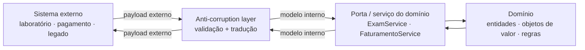
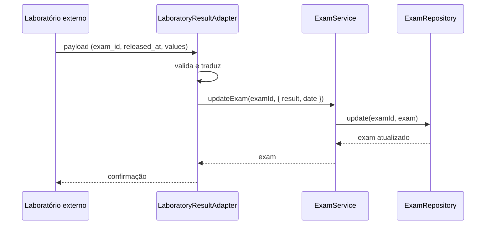
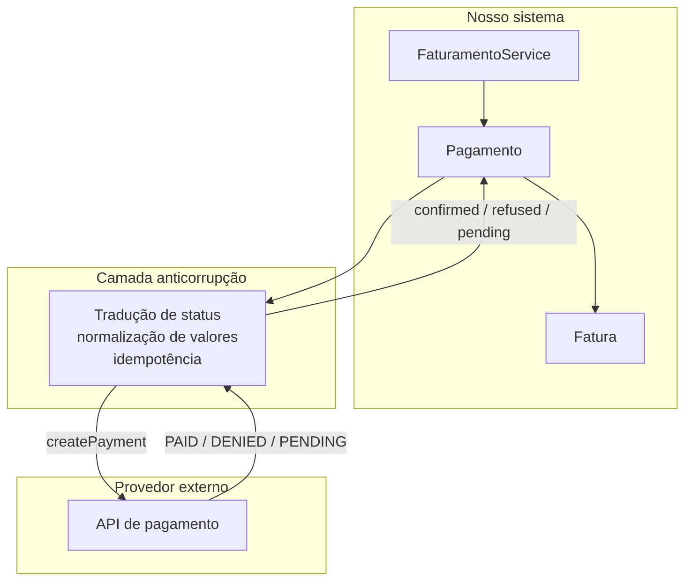

# Anticorruption Layer

## Introdução e contexto

A aula anterior mostrou que contextos delimitados precisam conversar. E toda
conversa entre modelos diferentes envolve tradução. Quando o outro lado é um
sistema externo — uma API de terceiros, um laboratório, um gateway de pagamento
ou um sistema legado — a tradução deixa de ser um detalhe e vira uma **camada de
proteção**.

Essa camada é a **anticorruption layer (ACL)** ou **camada anticorrupção**. Ela
fica entre o nosso domínio e o mundo externo, convertendo dados e normalizando
comportamentos para que as diferenças não vazem para dentro.

> **Não é plug and play.** Conectar dois sistemas raramente é só apontar uma URL
> e um token. Modelos de dados, regras de negócio, formatos, erros e ciclos de
> vida são diferentes. A ACL existe para tornar essa diferença explícita e
> controlada.

## O que a camada faz

A ACL é uma camada extra com uma responsabilidade clara: **proteger o domínio das
influências externas**. Ela recebe o dado no formato do outro sistema, valida,
traduz e entrega ao nosso domínio no formato que ele já conhece.



Na arquitetura hexagonal, a ACL é um **adaptador**:

- **adaptador de saída** quando o nosso sistema chama um serviço externo;
- **adaptador de entrada** quando o sistema externo envia dados por webhook,
  callback ou fila.

Em ambos os casos, o domínio continua dependendo apenas das suas portas. Quem
conhece o formato externo é a ACL.

## Por que traduzir

Sistemas diferentes raramente compartilham o mesmo modelo:

| Diferença comum | Exemplo |
| --- | --- |
| nomes de campos | `exam_id` no laboratório, `examId` no nosso domínio |
| formatos | XML, JSON aninhado, CSV, datas em padrões distintos |
| unidades | resultado em `mg/dL` ou `g/L` |
| semântica | `"PAID"` externo vs `"confirmed"` interno |
| códigos | `"A"` externo significando `"scheduled"` |
| erros | códigos numéricos proprietários vs exceções do domínio |
| identidade | ID numérico externo vs ID string interno |

Sem uma camada de tradução, cada uma dessas diferenças aparece espalhada em
serviços, entidades e controllers. O domínio passa a conhecer detalhes que não
deveria conhecer — e fica refém de mudanças externas.

## Exemplo: resultados de laboratório

Nosso sistema já tem `Exam` e `ExamService`. Imagine integrar com um laboratório
externo que envia o resultado assim que ele sai:

```typescript
// Formato externo — não pertence ao nosso domínio.
interface LaboratoryResultPayload {
  exam_id: string;
  exam_type: string;
  released_at: string;
  values: Array<{
    analyte: string;
    value: string;
    unit: string;
  }>;
}
```

A ACL traduz esse payload para uma atualização de `Exam`:

```typescript
// src/infrastructure/laboratory/LaboratoryResultAdapter.ts
import type { Exam } from "../../domain/entities/Exam.ts";
import type { ExamService } from "../../domain/services/ExamService.ts";
import type { LaboratoryResultPayload } from "./LaboratoryResultPayload.ts";

export class LaboratoryResultAdapter {
  private readonly examService: ExamService;

  constructor(examService: ExamService) {
    this.examService = examService;
  }

  receive(payload: LaboratoryResultPayload): Exam {
    const exam = this.examService.findExamById(payload.exam_id);

    if (!exam) {
      throw new Error("Exam not found.");
    }

    const result = payload.values
      .map((item) => `${item.analyte}: ${item.value} ${item.unit}`)
      .join("; ");

    return this.examService.updateExam(exam.id, {
      result,
      date: this.parseDate(payload.released_at),
    });
  }

  private parseDate(value: string): Date {
    const date = new Date(value);

    if (Number.isNaN(date.getTime())) {
      throw new Error("Invalid laboratory result date.");
    }

    return date;
  }
}
```

O `ExamService` não sabe que existe um laboratório, nem que o payload usa
`snake_case`, nem que o resultado vem em uma lista de analitos. Ele recebe apenas
`UpdateExamDTO` — o modelo que o domínio já entende.



## Exemplo: pagamento

No contexto de faturamento, a ACL é ainda mais crítica. Um gateway externo pode
responder com códigos próprios, atrasos, retries e notificações assíncronas. A
camada precisa garantir que:

- o valor seja convertido para a unidade correta (centavos ↔ reais);
- o status externo seja mapeado para o status interno;
- o identificador da transação seja preservado para **idempotência**;
- uma resposta duplicada não gere **pagamento em duplicidade**;
- erros do provedor virem erros compreensíveis para o nosso domínio.



## Responsabilidades da camada

| Responsabilidade | O que inclui |
| --- | --- |
| **tradução de modelo** | nomes, estrutura, tipos e unidades |
| **validação** | campos obrigatórios, formatos e faixas |
| **normalização de erros** | código externo → erro interno compreensível |
| **idempotência** | evitar processar o mesmo evento duas vezes |
| **segurança** | não expor detalhes internos ao parceiro |
| **observabilidade** | logar payloads, falhas e tempos de resposta |
| **versionamento** | lidar com mudanças de contrato do fornecedor |

> **A ACL não é um lugar para regra de negócio.** Ela traduz e valida o formato.
> Decidir se um pagamento pode ser confirmado, ou se um exame está dentro do
> prazo, continua sendo responsabilidade do domínio.

## Benefícios

- **Proteção do domínio.** Mudanças externas não obrigam a alterar entidades e
  serviços.
- **Manutenção localizada.** Quando o fornecedor muda o contrato, o impacto fica
  concentrado na ACL.
- **Clareza.** A integração fica explícita em um lugar, em vez de espalhada.
- **Testabilidade.** É possível testar a tradução com payloads gravados, sem
  depender do sistema externo.
- **Segurança.** O parceiro conhece apenas o contrato necessário, não os detalhes
  internos do nosso modelo.
- **Padronização de erros.** O resto do sistema lida com um conjunto previsível
  de falhas.

## Limitações e pontos de atenção

- **Custo adicional.** Mais uma camada significa mais código, testes e
  manutenção.
- **Não é bala de prata.** Ela reduz o acoplamento, mas não elimina a
  complexidade da integração.
- **Pode virar depósito.** Sem disciplina, a ACL acumula regras de negócio,
  chamadas e transformações que não lhe pertencem.
- **Latência e falhas.** O sistema externo continua podendo falhar; é preciso
  tratar timeout, retry, circuit breaker e filas.
- **Contratos mudam.** Versionamento e compatibilidade precisam ser planejados.
- **Risco de tradução incompleta.** Um mapeamento errado pode corromper dados
  silenciosamente; testes de contrato são obrigatórios.
- **Observabilidade é essencial.** Sem logs e métricas, um problema de integração
  vira uma caixa-preta.

## Conclusão

A camada anticorrupção é a fronteira que permite integrar sem se contaminar. Ela
traduz o modelo externo para o nosso, valida o que entra, normaliza o que sai e
mantém o domínio ignorante dos detalhes de terceiros.

Junto com os **contextos delimitados**, ela completa o conjunto de proteções
estratégicas do DDD: contextos definem **onde cada modelo vale**; a ACL define
**como modelos diferentes se encontram** sem se corromper.

Com isso, o domínio permanece isolado — que é justamente o fio condutor de toda
a disciplina.
