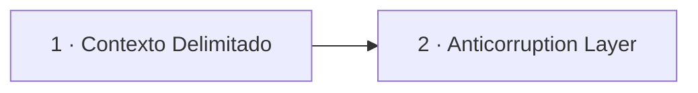

# Conceitos Avançados

## Índice

| # | Aula | Duração |
| --- | --- | --- |
| 1 | [Contexto Delimitado](./1%20-%20Contexto%20Delimitado.md) | 09:55 |
| 2 | [Anticorruption Layer](./2%20-%20Anticorruption%20Layer.md) | 06:24 |

## Sequência das aulas

