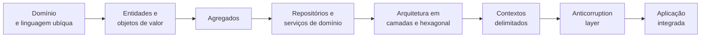

# Conclusão

## Introdução e contexto

Esta aula encerra a trilha de **Arquitetura de Software** e retoma o fio que
atravessou todo o curso: **manter o domínio no centro**, mesmo quando o sistema
cresce, ganha integrações e passa a ser construído por várias pessoas.

O DDD não é um conjunto de padrões para decorar. É uma forma de **representar o
negócio** em modelos construídos em parceria entre desenvolvedores e
especialistas de domínio. As entidades, objetos de valor, agregados, repositórios,
serviços, contextos delimitados e camadas anticorrupção existem para sustentar
essa representação ao longo do tempo.

## O caminho percorrido

| Etapa | Pergunta central |
| --- | --- |
| domínio e linguagem ubíqua | que problema estamos resolvendo e com que palavras? |
| entidades e objetos de valor | o que tem identidade e o que é definido apenas pelos seus valores? |
| agregados | quais invariantes precisam ser protegidas juntas? |
| repositórios | como acessamos e persistimos sem vazar detalhes? |
| serviços de domínio | que regra não pertence a uma única entidade? |
| camadas / hexagonal | como isolamos o domínio de framework, banco e transporte? |
| contextos delimitados | onde cada modelo tem significado? |
| anticorruption layer | como conversamos com modelos diferentes sem nos corromper? |

No repositório, esse caminho aparece em código:

- `Patient`, `Doctor`, `Exam` e `Appointment` como entidades;
- `Address`, `EmergencyContact`, `WorkingHours` e `MedicalRecord` como objetos de
  valor;
- `MedicalRecord` e `Patient` exercitando as regras do agregado;
- repositórios em memória com buscas de negócio;
- serviços de domínio e um caso de uso de aplicação (`AppointmentService`);
- controllers, `apiRouter` e `main` como adaptadores e composition root;
- quatro contextos de API convivendo: pacientes, médicos, exames e consultas.

## O que fica

### O domínio no centro

A regra de negócio não deve depender de Express, de `Map` ou de um ORM. Frameworks
e bancos são detalhes de infraestrutura; o domínio é o que dá sentido ao sistema.

### Linguagem ubíqua

O código, a documentação e a conversa com o especialista devem usar os mesmos
termos. Se o negócio diz "consulta", o código não deveria dizer "booking" apenas
por preferência pessoal.

### Modelos menores e explícitos

Entidades limpas, coleções encapsuladas, construtores por DTO e regras dentro do
agregado tornam o modelo mais fácil de entender e de evoluir. O supermodelo que
tenta servir a todos os contextos termina servindo mal a todos.

### Isolamento e independência

Contextos delimitados permitem que equipes diferentes trabalhem no mesmo sistema
com pouco impacto cruzado. A camada anticorrupção protege o domínio quando o
sistema precisa conversar com APIs de terceiros e sistemas legados.

### Testes como contrato

Cada parte precisa ser verificável isoladamente. Os testes unitários garantem as
regras; os testes de integração garantem que os contextos continuam se entendendo
depois de conectados. A integração não pode ser a primeira vez que o sistema
inteiro roda.

## Trabalho em equipe

A comparação da aula com uma equipe de Fórmula 1 é precisa: ninguém constrói um
carro competitivo sozinho. São dezenas de engenheiros, cada um entendendo uma
parte específica, mas compartilhando uma visão do todo.

Em software é igual:

- cada pessoa domina uma parte do sistema;
- a linguagem ubíqua mantém a comunicação coerente;
- os contextos delimitados definem fronteiras de responsabilidade;
- a ACL define como as fronteiras se encontram;
- os testes dão segurança para evoluir.

O objetivo não é que todos saibam tudo. É que cada um saiba **o suficiente sobre
o todo** para que as partes continuem encaixando.

## Leituras recomendadas

| Livro | Autor | Por que ler |
| --- | --- | --- |
| **Domain-Driven Design: Tackling Complexity in the Heart of Software** | Eric Evans | o livro fundador do DDD; apresenta a linguagem ubíqua, os blocos táticos e o desenho estratégico |
| **Implementing Domain-Driven Design** | Vaughn Vernon | a ponte entre a teoria e a implementação; aprofunda agregados, contextos e integração |

> **Sobre os nomes.** A transcrição da aula cita "Volk Werner"; o autor de
> *Implementing Domain-Driven Design* é **Vaughn Vernon**. Vale conferir sempre a
> referência antes de comprar ou citar.

## Exercício prático

O melhor jeito de fixar o conteúdo é sair do exemplo do hospital:

1. escolha um negócio que você conhece — o da sua família, de um amigo ou da
   empresa onde trabalha;
2. converse com quem vive esse negócio e levante os termos que ela usa;
3. identifique entidades, objetos de valor e agregados;
4. desenhe os contextos delimitados e as relações entre eles;
5. escolha uma integração externa e esboce a camada anticorrupção;
6. implemente um recorte pequeno, com testes.

Só o exercício de imaginar como você resolveria o problema daquela pessoa já
treina o olhar para o domínio. Quando a implementação chegar, o modelo estará
mais claro.

## Conclusão

O curso termina, mas o trabalho de modelagem continua em cada projeto. O que fica
é um método:

- **entender antes de codar**;
- **modelar com o negócio**, não apenas com o framework;
- **proteger o domínio** com fronteiras explícitas;
- **testar** as regras e as integrações;
- **conversar** com as pessoas que conhecem o problema.

Arquitetura de software é, no fim, uma forma de organizar a complexidade para que
o conhecimento do negócio não se perca no código. Continue praticando — é a parte
mais importante do processo.
