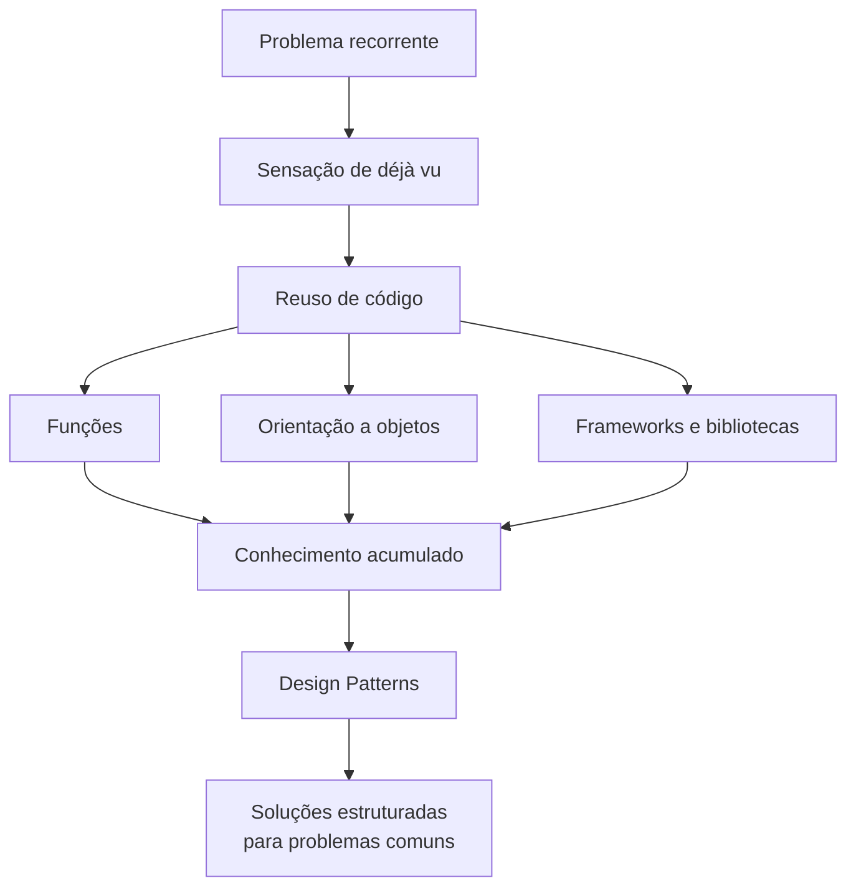

# Boas-vindas

## Introdução e contexto

Esta aula abre o módulo de **Design Patterns** com uma situação familiar a quem
já desenvolve software há algum tempo: a **sensação de déjà vu** diante de um
novo projeto.

Ao começar uma implementação, é comum surgirem perguntas como:

- será que eu **já enfrentei** este problema no passado?
- se sim, **como** eu resolvi?
- eu **lembro** da solução?

Na prática, a resposta costuma ser "não lembro" — e o problema acaba sendo
resolvido de novo, do zero. Quanto maior o número de projetos vividos, mais
frequente fica essa sensação.

O exemplo mais corriqueiro para quem trabalha no back-end é a criação de mais um
**CRUD**: aplicações novas e antigas, de domínios diferentes, continuam
precisando **criar**, **ler**, **atualizar** e **excluir** dados. A forma muda
pouco; o problema se repete.

É desse incômodo que nasce a necessidade central da aula: o **reuso de código**.

## Do reuso de código aos padrões

O reuso é uma necessidade inerente ao desenvolvimento de software moderno — e
não por acaso. Ao longo dos anos, as linguagens de programação evoluíram
justamente para oferecer mecanismos que facilitam reaproveitar soluções:

| Mecanismo | O que permite reaproveitar | Exemplo |
| --- | --- | --- |
| **Funções** | um bloco de código chamado várias vezes no mesmo projeto | validação de um documento, cálculo de frete |
| **Orientação a objetos** | classes, **herança** e **polimorfismo** | um modelo base reutilizado por várias entidades |
| **Frameworks e bibliotecas** | tarefas comuns já resolvidas por terceiros | conexão com banco de dados, componentes **React** |

O caso do **React** deixa o alcance do reuso evidente: um componente pode ser
usado em vários lugares da mesma aplicação e até em aplicações distintas. A
ideia é sempre a mesma — **maximizar o reaproveitamento** do que já foi feito.

Esse reaproveitamento também está ligado à necessidade de **desenvolvimento
ágil**. Entregar funcionalidades mais rápido é uma demanda que veio do
**Manifesto Ágil** e se consolidou nas fábricas de software e nos times do mundo
inteiro.

### Reuso também é comunicação

A agilidade aproximou o desenvolvedor back-end do restante do time: arquitetos,
engenheiros, projetistas de software e o próprio **cliente**. Décadas atrás, essa
interação era bem menos intensa.

O objetivo dessa aproximação é:

- **evitar erros** durante o desenvolvimento;
- **alinhar demanda e expectativa**;
- entregar o projeto o mais rápido possível com o **mínimo de retrabalho**.

## O que são design patterns

Aplicações sempre têm algo em comum — seja o **problema**, seja a **solução**,
com pouca alteração de um contexto para outro. Os **design patterns** existem
exatamente para capturar esse conhecimento recorrente.

> **Design patterns são soluções comuns para problemas comuns no projeto de
> desenvolvimento de software.**

Eles não são um código pronto para copiar e colar. São uma forma mais
**estruturada** de resolver problemas corriqueiros, registrando o que já
funcionou para que não seja preciso redescobrir a solução a cada projeto.

Os padrões foram catalogados pela **Gangue dos Quatro** (*Gang of Four*, GoF) no
livro *Design Patterns: Elements of Reusable Object-Oriented Software*, de
**1994**. A pergunta que fica é: um catálogo tão antigo ainda é relevante? Sim —
porque os **problemas continuam os mesmos**; o que muda é a linguagem, o
framework e o contexto em que a solução é aplicada.

## Os padrões que vamos estudar

O módulo percorre três famílias de padrões, cada uma com aulas de teoria e de
implementação:

| Categoria | Padrões | Foco |
| --- | --- | --- |
| **Criacionais** | Singleton, Builder, Factory Method | **como criar** objetos |
| **Estruturais** | Adapter, Decorator, Facade | **como compor** classes e objetos |
| **Comportamentais** | Iterator, Strategy, Observer | **como os objetos interagem** e dividem responsabilidades |

## Benefícios

- **Menos retrabalho:** a solução não precisa ser redescoberta a cada projeto.
- **Entrega mais rápida:** reaproveitar código e conhecimento acelera o
  desenvolvimento.
- **Consistência:** problemas parecidos recebem soluções parecidas.
- **Vocabulário comum:** o nome do padrão comunica a intenção para todo o time.
- **Qualidade:** soluções já testadas e compreendidas tendem a ser mais seguras.

## Limitações e cuidados

- **Padrão não é código pronto.** É uma ideia que precisa ser adaptada ao
  contexto, à linguagem e ao framework do projeto.
- **Não é bala de prata.** Nem todo problema precisa de um padrão; forçá-lo onde
  não há recorrência gera **complexidade desnecessária**.
- **Existe curva de aprendizado.** Entender a intenção do padrão é mais
  importante do que decorar sua estrutura.
- **O contexto manda.** Um padrão de 1994 continua válido, mas a implementação
  muda conforme a plataforma e as necessidades atuais.

## Conclusão

O ponto de partida do módulo é o **reuso**: a percepção de que os mesmos
problemas reaparecem e de que resolvê-los novamente é desperdício. As linguagens
evoluíram para facilitar esse reaproveitamento — de **funções** à **orientação a
objetos**, passando por **frameworks e bibliotecas** —, e os **design patterns**
são a evolução natural dessa ideia no nível do **conhecimento**: soluções comuns,
organizadas e nomeadas para problemas comuns.

Com o "porquê" firmado, a próxima aula entra no "o quê": *Design Patterns Parte
1* aprofunda o conceito e apresenta como esses padrões são organizados.
