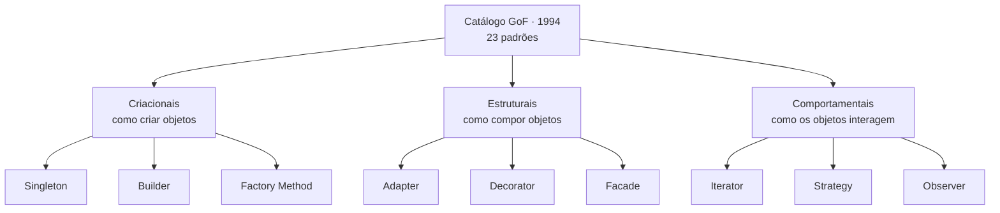

# Design Patterns Parte 1

## Introdução e contexto

Esta aula retoma o fio da aula anterior — o **reuso** e a sensação de resolver
sempre os mesmos problemas — e apresenta o marco que deu origem ao conceito de
**design patterns**: o catálogo publicado em **1994** pela **Gangue dos Quatro**
(*Gang of Four*, GoF).

O livro *Design Patterns: Elements of Reusable Object-Oriented Software*, de
Erich Gamma, Richard Helm, Ralph Johnson e John Vlissides, é um dos pilares da
disciplina e documenta **23 padrões** de projeto usados na **programação
orientada a objetos**.

## O livro que organizou o caos

Um ponto central da aula: os autores **não inventaram** os padrões. Eles
observaram o que já acontecia no desenvolvimento orientado a objetos e
**detectaram** um conjunto de soluções recorrentes.

Antes desse trabalho, o cenário era de pouca padronização:

- alguns padrões **não tinham nome**;
- outros **não eram reconhecidos** como padrões de projeto;
- o mesmo padrão podia receber **nomes diferentes** em grupos diferentes.

O resultado era um verdadeiro caos de vocabulário e de reconhecimento. Catalogar
e **padronizar** esses padrões resolveu dois problemas de uma vez: deu **nome**
às soluções e criou uma **linguagem comum** para falar sobre elas.

### Catalogar antes do GitHub

O trabalho foi feito no **início dos anos 90**, quando a internet ainda
engatinhava e a ideia de um **GitHub** — ou de um repositório universal de
código — estava longe do dia a dia.

Sem busca em repositórios, a coleta era manual: leitura de **código-fonte
impresso em papel** e de **manuais de grandes sistemas computacionais**. Depois
vinha a análise e a comparação lado a lado para determinar se aquilo era, de
fato, um padrão.

O contexto tecnológico também era outro:

- os computadores **não eram padronizados** para conversar entre si;
- o código precisava ser **compilado manualmente** para cada sistema
  operacional e plataforma;
- ainda não existia um **JavaScript universal** na web.

Isso torna o catálogo de 1994 mais impressionante: a documentação foi construída
com muito esforço, antes de qualquer facilidade de busca ou compartilhamento.

## As três categorias

Os 23 padrões foram subdivididos em **três categorias**, de acordo com a
**finalidade** de cada um:

| Categoria | Finalidade | Exemplos estudados no módulo |
| --- | --- | --- |
| **Criacionais** | lidar com a **criação de objetos** | Singleton, Builder, Factory Method |
| **Estruturais** | lidar com a **composição** de classes e objetos | Adapter, Decorator, Facade |
| **Comportamentais** | lidar com a **interação** e a distribuição de responsabilidades | Iterator, Strategy, Observer |

No catálogo original são **5 padrões criacionais**, **7 estruturais** e **11
comportamentais**. O curso não esgota os 23: aprofunda os principais, com aulas
de teoria e de implementação.

## Por que estudar padrões hoje

Mesmo com tantas novidades — inclusive ferramentas como o **Copilot** — é comum
investir tempo e esforço **reinventando a roda** para resolver um problema que
outras pessoas já solucionaram décadas atrás. Pior: às vezes a solução é pior do
que a existente, e nem percebemos que o problema era **comum**.

Esse é o argumento central para estudar padrões: eles evitam o retrabalho
invisível, aquele em que a solução é reconstruída sem saber que ela já tinha
nome e estrutura.

### O que mudou e o que continua igual

| Dimensão | 1994 | Hoje |
| --- | --- | --- |
| **Distribuição** | aplicações majoritariamente desktop e monolíticas | web e dispositivos móveis, via browsers e apps |
| **Entrega** | compilação e implantação manuais | atualizações quase em tempo real, com CI/CD |
| **Código** | leitura de fontes impressas e manuais | busca em repositórios e apoio de ferramentas de IA |
| **Desempenho** | hardware e sistemas operacionais limitados | evolução considerável de desempenho |

As **tecnologias** mudaram; os **problemas** não. As dificuldades de **lógica** e
de **implementação** dentro de um sistema continuam semelhantes e exigem
soluções similares. Por isso os padrões seguem relevantes.

### Frameworks já nascem com padrões

Depois de 1994, muitos outros padrões surgiram. As linguagens evoluíram, e os
**frameworks** nasceram com alguns desses padrões já embutidos. Graças ao
**encapsulamento**, muitas vezes nem sabemos quais padrões estão por dentro das
bibliotecas que usamos — e isso é bom: é um processo **abstraído**, que não
precisa ser conhecido para usar a ferramenta.

## Onde esse conhecimento ajuda

Entender os padrões é útil **independentemente do cargo** — desenvolvedor,
gerente ou qualquer posição no time:

- em um **code review**, apontar que determinado padrão deixaria o sistema
  melhor;
- ao **explicar um artefato** construído, justificar as decisões com base no
  padrão adotado;
- ao **ler o código de outra pessoa**, entender por que ela escolheu aquele
  padrão em vez de outra construção;
- antes de iniciar o desenvolvimento, identificar **o que é realmente
  necessário** para resolver o problema.

Quanto mais se conhece o funcionamento dos sistemas, melhor para a pessoa, para
o time e para a empresa.

## Limitações e cuidados

- **O catálogo não é definitivo.** Os 23 padrões da GoF são um recorte histórico;
  novos padrões surgiram nas últimas décadas.
- **Conhecer o nome não basta.** É preciso saber **quando** aplicar e **por que**
  ele resolve o problema naquele contexto.
- **Padrão não é obrigação.** Aplicar um padrão sem necessidade gera
  complexidade desnecessária.
- **O catálogo é orientado a objetos.** A implementação muda conforme a
  linguagem, o framework e o paradigma adotado.
- **Abstração é saudável.** Nem todo padrão usado por uma biblioteca precisa
  aparecer no código da aplicação.

## Conclusão

Em **1994**, a **Gangue dos Quatro** não criou padrões: ela **observou, nomeou e
organizou** soluções que já eram usadas na programação orientada a objetos. O
resultado foram **23 padrões** divididos em **criacionais**, **estruturais** e
**comportamentais** — um vocabulário comum que atravessou décadas.

As ferramentas, a forma de entregar software e o desempenho dos computadores
mudaram muito. Os problemas de lógica e de implementação, não. Por isso estudar
padrões continua sendo uma forma de **não reinventar a roda** e de tomar
decisões melhores em qualquer etapa do desenvolvimento.

Na próxima aula, *Design Patterns Parte 2*, o panorama continua: entendemos
melhor como os padrões se encaixam no desenvolvimento moderno antes de começar
a implementá-los.
