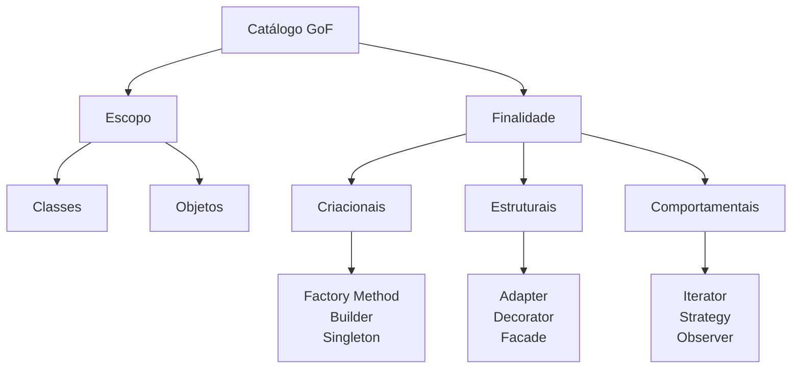

# Design Patterns Parte 2

## Introdução e contexto

Depois de apresentar o catálogo da **Gangue dos Quatro** e defender sua
relevância, esta aula mostra **como os 23 padrões se organizam** e faz um
panorama dos nove que serão estudados no módulo.

A classificação da GoF usa **dois critérios**:

- **escopo** — o padrão atua sobre **classes** ou sobre **objetos**;
- **finalidade** — o padrão é **criacional**, **estrutural** ou
  **comportamental**.

O curso adota principalmente a **finalidade**, porque ela permite associar
diretamente o **problema** à **solução** correspondente.

## Além do catálogo da GoF

Nem todo padrão de projeto está entre os 23. A aula cita outras famílias:

- **padrões arquiteturais** — por exemplo, **DDD** (Domain-Driven Design);
- **padrões de concorrência** — por exemplo, o **Reactor**, que é a base da
  arquitetura **não bloqueante** do Node.js.

São padrões que também resolvem problemas recorrentes, mas com foco em
**características distintas** da criação e da comunicação entre objetos. O
recorte do curso é justamente esse último: **objetos**.

## Padrões criacionais

Os padrões **criacionais** lidam com a **criação de objetos**. Eles buscam
**encapsular a lógica de criação**, distanciar o cliente das classes concretas e
aumentar a **flexibilidade** do processo.

| Padrão | Escopo | Ideia central |
| --- | --- | --- |
| **Factory Method** | classes | criar objetos sem expor a lógica de criação |
| **Builder** | objetos | montar um objeto por etapas |
| **Singleton** | objetos | garantir uma única instância com acesso global |

### Factory Method

É o **único criacional focado em classes**. Ele permite instanciar objetos sem
expor a lógica por trás da criação: uma **interface** na superclasse define o
método de criação, e as **subclasses** decidem qual tipo concreto será
instanciado.

O exemplo da aula é um sistema de **logística**. A encomenda pode ser levada de
moto, carro, avião, bicicleta ou navio. Para o cliente, importa apenas que
exista um método capaz de **entregar**; os meios de transporte são detalhes
internos. O Factory Method esconde essa decisão.

### Builder

O **Builder** constrói objetos **por partes**, em etapas, permitindo gerar
**representações diferentes** de um mesmo objeto com o mesmo código base.

O cenário clássico é um **cadastro de usuário** em que apenas nome de usuário e
senha são obrigatórios, enquanto nome completo, e-mail e outros campos são
opcionais. Sem o padrão, seria preciso criar vários construtores ou lidar com
muitos valores padrão. Com o Builder, um único construtor é suficiente para
montar o objeto com dois ou quarenta campos.

### Singleton

O **Singleton** garante que uma classe tenha **apenas uma instância** e fornece
**acesso global** a ela.

O uso mais comum é a **conexão com banco de dados**. Se cada operação de um CRUD
abrisse uma nova conexão, o sistema poderia acumular conexões e comprometer a
persistência, especialmente em cenários concorrentes. O Singleton centraliza
esse recurso.

A aula já adianta o cuidado: **estado global** pode causar problemas sérios
adiante — o padrão será examinado a fundo, inclusive com as críticas ao seu uso
indiscriminado.

## Padrões estruturais

Os padrões **estruturais** lidam com a **composição e organização** de classes e
objetos para formar **estruturas maiores**.

| Padrão | Ideia central | Exemplo |
| --- | --- | --- |
| **Adapter** | converter a interface de uma classe na interface esperada pelo cliente | integrar APIs e bibliotecas de terceiros |
| **Facade** | oferecer uma interface simplificada para um subsistema complexo | tela inicial do Excel/PowerPoint |
| **Decorator** | adicionar funcionalidades dinamicamente, sem alterar a estrutura | camadas de um sistema de notificações |

### Adapter

O **Adapter** converte a interface de uma classe em outra que o **cliente
espera**. Pode atuar tanto no escopo de **classes** quanto no de **objetos**.

Ele é especialmente útil para integrar **APIs e bibliotecas de terceiros** sem
reescrever o código que já existe. A aula rebate a ideia de "gambiarra": adaptar
código de terceiros é, muitas vezes, a única opção disponível e uma forma
refinada de evitar reinventar a roda.

### Facade

O **Facade** fornece uma **interface simplificada e universal** para acessar um
sistema ou subsistema complexo. Ele reduz o **acoplamento** entre o código
cliente e os detalhes internos de uma biblioteca ou framework.

O exemplo é a **tela inicial** do Excel ou do PowerPoint: de um único ponto, o
usuário abre um documento existente, cria um novo, aplica funções prontas e
acessa diversas funcionalidades. Toda a complexidade fica atrás do menu.

### Decorator

O **Decorator** adiciona funcionalidades a um objeto de forma **dinâmica**, sem
modificar sua estrutura. A analogia é a de uma **boneca russa**: capas e mais
capas de comportamento são acrescentadas ao objeto original.

Um **sistema de notificações** é o exemplo natural: uma classe base fornece a
notificação, e camadas adicionais — e-mail, SMS, push — "abraçam" essa
implementação inicial.

## Padrões comportamentais

Os padrões **comportamentais** focam em **classes e objetos e na forma como eles
se comunicam**. A GoF concentra aqui a maior quantidade de padrões.

Dois têm escopo de **classe**: **Interpreter** e **Template Method**. A maioria
tem escopo de **objeto**: **Chain of Responsibility**, **Command**,
**Iterator**, **Mediator**, **Observer**, **State**, **Strategy** e
**Visitor**.

O curso aprofunda três:

| Padrão | Problema que resolve | Exemplo |
| --- | --- | --- |
| **Strategy** | escolher algoritmos de forma dinâmica, em classes intercambiáveis | trocar a estratégia de cálculo sem alterar o cliente |
| **Iterator** | percorrer coleções sem expor a representação interna | iterar em listas, árvores e grafos |
| **Observer** | notificar vários objetos sobre eventos | sistema de notícias, arquitetura de eventos do Node.js |

### Strategy

O **Strategy** permite escolher **algoritmos de forma dinâmica**. Cada algoritmo
fica em uma **classe separada**, e os objetos se tornam **intercambiáveis**: é
possível usar um objeto A no lugar de um B sem quebrar o cliente.

### Iterator

O **Iterator** acessa os elementos de uma coleção **de forma sequencial**, sem
expor sua representação interna. Ele permite **personalizar a travessia**:
frente para trás, trás para frente, índices ímpares, etc.

É especialmente útil em estruturas complexas como **grafos** e **árvores**, em
que a forma de percorrer não é trivial.

### Observer

O **Observer** define um **mecanismo de observação**: objetos observadores são
notificados sobre eventos que acontecem no sistema. É a lógica por trás de
sistemas de notícias — cada atualização é enviada a vários usuários por meios
diferentes — e também da arquitetura **baseada em eventos** do Node.js.

A analogia da aula é bem-humorada: o padrão é "fofoqueiro", pois um objeto
observado conta a novidade para todos os interessados.

## Panorama dos nove padrões

| Categoria | Padrões do módulo |
| --- | --- |
| **Criacionais** | Factory Method, Builder, Singleton |
| **Estruturais** | Adapter, Facade, Decorator |
| **Comportamentais** | Iterator, Strategy, Observer |

## Limitações e cuidados

- **Conhecer o nome não é saber aplicar.** O valor está em reconhecer o
  problema e escolher a solução adequada.
- **Alguns padrões têm custo.** O Singleton, por exemplo, introduz estado
  global.
- **O catálogo não é uma checklist.** Nem todo sistema precisa dos 23 padrões.
- **Escopo importa.** Um padrão de classe e um de objeto resolvem problemas
  diferentes, mesmo dentro da mesma categoria.
- **Padrões arquiteturais e de concorrência** também existem, mas ficam fora do
  recorte desta disciplina.

## Conclusão

A GoF organiza os padrões por **escopo** (classes ou objetos) e **finalidade**
(criacional, estrutural ou comportamental). O curso usa a finalidade como fio
condutor e percorre nove padrões: **Factory Method, Builder e Singleton** para
criar; **Adapter, Facade e Decorator** para compor; **Iterator, Strategy e
Observer** para comunicar.

Este panorama funciona como mapa: nas próximas aulas, cada padrão será
destrinchado em teoria e implementação. O próximo bloco começa pelos
**criacionais**, com o *O Padrão Singleton*.
