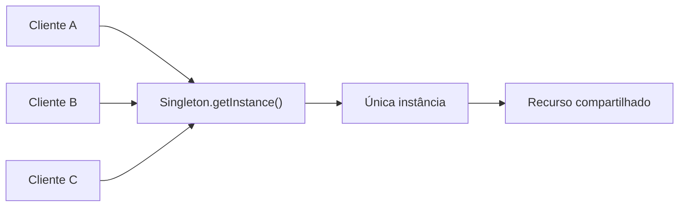

# O Padrão Singleton

## Introdução e contexto

O **Singleton** é um padrão **criacional** com escopo de **objeto**. Sua
promessa é direta: garantir que uma classe tenha **uma única instância em todo o
programa** e oferecer um **ponto único de acesso global** a ela.

A aula parte de uma pergunta natural: isso não é a mesma coisa que uma
**variável global**? A resposta é "parecido, mas diferente".

| Aspecto | Variável global | Singleton |
| --- | --- | --- |
| **Redeclaração** | pode ser sobrescrita livremente | sempre aponta para o mesmo objeto |
| **Controle** | fica a cargo de quem usa | fica a cargo da própria classe |
| **Instanciação** | direta | controlada; em algumas linguagens, com construtor privado |
| **Ciclo de vida** | criada cedo, conforme o escopo | pode ser criada sob demanda |

Em linguagens que permitem **construtor privado**, o cliente nem consegue
instanciar a classe manualmente. A própria classe cria e disponibiliza a
instância. Em JavaScript, essa garantia é obtida verificando uma propriedade
estática dentro do construtor.



## Quando faz sentido ter uma única instância

O critério não é "usar Singleton porque é bonito". É existir um recurso em que
**várias instâncias atrapalham**. A aula apresenta três cenários clássicos:

| Cenário | Por que uma instância só |
| --- | --- |
| **Gerenciador de telas** do sistema operacional | só faz sentido um gerenciador ativo, mesmo que existam vários instalados |
| **Sistema de logs** | centraliza erros, acertos e acessos de toda a aplicação |
| **Conexão com banco de dados** | uma conexão pode ser requisitada por qualquer operação do CRUD |

No caso do **log**, a explicação é bem concreta: se cada módulo tivesse seu
próprio logger, monitorar o sistema exigiria delegar a atividade a várias
pessoas e cruzar informações dispersas. Um ponto único permite **filtrar** e
**entender** o que aconteceu na aplicação.

No caso do **banco**, abrir uma conexão nova a cada método de um CRUD poderia
gerar uma infinidade de conexões e prejudicar a persistência, sobretudo em
cenários com **concorrência**.

## O problema sem o padrão

A prática começa pelo caminho inverso: um sistema de logs **sem** Singleton.

A classe `Logger` tem um construtor que inicializa uma lista de logs, um método
`log(message)` que insere a mensagem nessa lista e um método `print()` para
exibir o conteúdo.

No arquivo de teste, são instanciados dois loggers:

```js
const logger1 = new Logger();
const logger2 = new Logger();

logger1.log("primeira mensagem");
logger2.log("segunda mensagem");
```

Cada um recebe sua própria mensagem e mantém sua própria lista. O resultado é
que `logger1.print()` e `logger2.print()` mostram **listas diferentes** — ou
seja, existem dois sistemas de log independentes.

Em um projeto grande, isso se multiplica: qualquer lugar pode criar um novo
`Logger` e inserir eventos. O controle sobre o que a aplicação registra se
perde, e a centralização — que era justamente o objetivo — deixa de existir.

## Benefícios

- **Instância única** para gerenciar um recurso compartilhado.
- **Acesso global controlado**, sem a possibilidade de sobrescrever o objeto
  acidentalmente.
- **Economia de recursos**, porque a instância só é criada quando necessária
  (*lazy load*).
- **Centralização** de logs, conexões e configurações.

## Limitações e cuidados

A aula já antecipa que o Singleton é um padrão polêmico:

- **Estado global** traz os problemas clássicos de acoplamento e efeitos
  colaterais.
- **Responsabilidade única**: a classe passa a cuidar de si mesma, da criação e
  do acesso global.
- **Concorrência**: em ambientes multi-thread, garantir uma única instância é
  bem mais difícil.
- **Testabilidade**: uma instância global e um construtor privado dificultam
  isolar o objeto em testes unitários.
- **Risco de antipattern**: para alguns autores, o uso indiscriminado o
  transforma em um **antipadrão**.

## Conclusão

O **Singleton** resolve um problema real: garantir que um recurso compartilhado
tenha **um único ponto de acesso** e não seja duplicado pelo sistema. Ele se
diferencia de uma variável global porque o controle fica dentro da classe e a
instância não pode ser simplesmente sobrescrita.

Mas é uma solução de **exceção**, não de uso geral. Logs, conexões com banco e
configurações são bons candidatos; espalhar estado global pelo sistema é o
caminho para acoplamento e dificuldade de teste. Na próxima aula, a
implementação mostra como garantir a instância única no construtor e fecha o
balanço entre vantagens e desvantagens.
