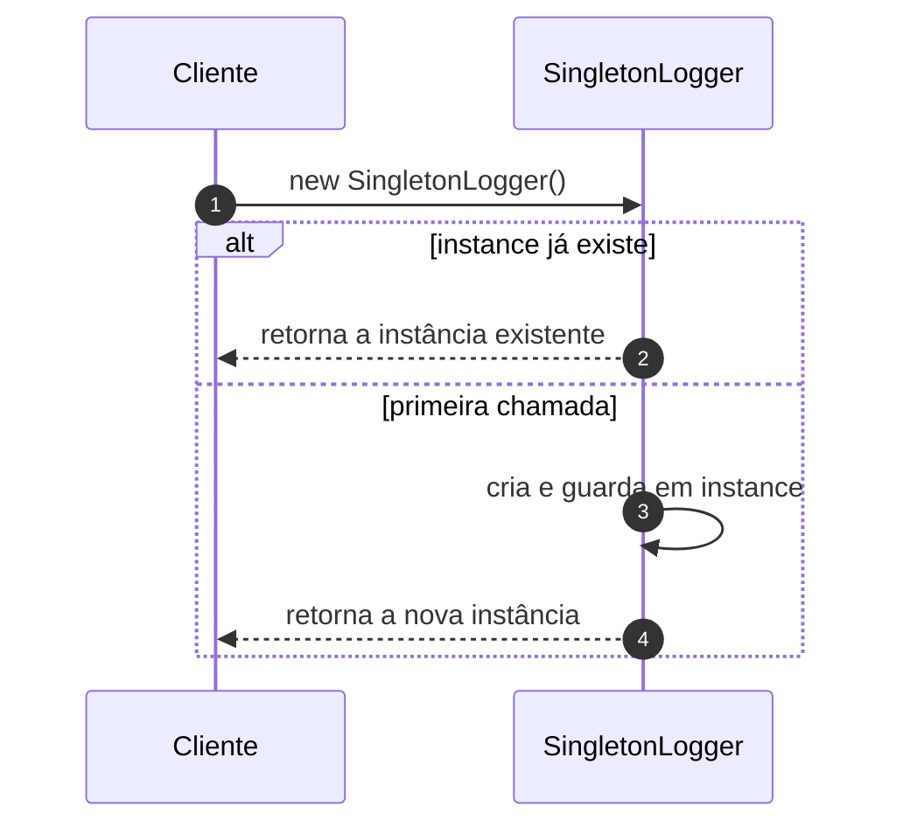

# Implementando o Singleton

## Introdução e contexto

Esta aula transforma o `Logger` da aula anterior em **`SingletonLogger`** e
mostra que a mudança é menor do que parece: toda a lógica de unicidade fica no
**construtor**.

O objetivo é garantir que, independentemente de quantas vezes o cliente chame
`new SingletonLogger()`, todas as referências apontem para **o mesmo objeto**.

## A implementação

A classe ganha uma propriedade **estática** `instance`, que guarda a instância
já criada. No construtor:

1. verifica se `SingletonLogger.instance` **já existe**;
2. se existir, **retorna essa instância**;
3. se não existir, **cria a instância**, armazena em `instance` e a retorna.

```js
class SingletonLogger {
  static instance;
  #logs = [];

  constructor() {
    if (SingletonLogger.instance) {
      return SingletonLogger.instance;
    }

    SingletonLogger.instance = this;
  }

  log(message) {
    this.#logs.push(message);
  }

  print() {
    console.log(this.#logs);
  }
}
```

Em JavaScript, retornar um objeto de dentro do construtor faz com que `new`
devolva esse objeto em vez da instância recém-criada. É esse detalhe da
linguagem que permite reaproveitar a instância existente. Em outras linguagens,
o mesmo efeito é obtido com **construtor privado** e um método estático de
acesso.



## O que muda na prática

No código de teste, as duas variáveis continuam sendo criadas:

```js
const logger1 = new SingletonLogger();
const logger2 = new SingletonLogger();
```

A diferença aparece no comportamento: as duas referências apontam para o **mesmo
objeto**. Quando `logger1` registra uma mensagem e `logger2` registra outra, o
contador e a lista são **compartilhados**. Não há mais dois sistemas de log
independentes.

É possível verificar isso comparando as referências:

```js
console.log(logger1 === logger2); // true
```

## Vantagens

| Vantagem | Explicação |
| --- | --- |
| **Instância única** | um só objeto gerencia o recurso compartilhado |
| **Acesso global** | qualquer ponto do sistema obtém a mesma instância |
| **Proteção contra sobrescrita** | não adianta reinstanciar; o objeto é sempre o mesmo |
| **Lazy load** | a instância só é criada quando realmente necessária |
| **Economia de recursos** | evita duplicar conexões, logs e configurações |

O **lazy load** é um ganho importante: enquanto ninguém precisa do logger (ou da
conexão), o objeto não ocupa espaço nem consome recursos.

## Desvantagens

A aula é explícita: o Singleton tem um custo de design.

- **Viola o princípio da responsabilidade única.** A classe passa a ter duas
  atribuições: gerenciar a si mesma e controlar a criação/acesso da instância.
- **Ambientes multi-thread são complexos.** Garantir uma única instância entre
  threads exige sincronização e cuidado; é fácil introduzir bugs de concorrência.
- **Testes unitários ficam mais difíceis.** Com uma instância global e, em
  algumas linguagens, construtor privado, isolar o objeto em um teste é
  trabalhoso. Mocks também podem ficar mais lentos e complicados.
- **Acoplamento global.** Todo mundo conhece e depende da mesma instância, o que
  espalha dependências pelo sistema.

Por causa desse conjunto de problemas, alguns autores classificam o Singleton
como **antipadrão** quando usado sem critério.

## Quando usar

O padrão é indicado quando existe um **recurso genuinamente compartilhado** e a
duplicação causa dano real:

- **mecanismos de log**;
- **conexão com banco de dados**;
- **gerenciamento de configurações**;
- estruturas internas de outros padrões, como o **Facade**.

## Limitações e cuidados

- **Não é atalho para variável global.** Se o estado não precisa ser único, não
  há motivo para o padrão.
- **Cuidado com concorrência.** Em Node.js o modelo é single-threaded para o
  event loop, mas processos, workers e recursos externos ainda exigem atenção.
- **Priorize injeção de dependência.** Em muitos casos, passar a instância como
  dependência é mais testável do que acessá-la globalmente.
- **Use com cautela.** O próprio curso reforça: Singleton é uma ferramenta
  pontual, não a base da arquitetura.

## Conclusão

A implementação do Singleton é surpreendentemente pequena: uma propriedade
estática e uma verificação no construtor bastam para garantir que todas as
referências apontem para a mesma instância. O ganho é a **centralização** de
logs, conexões e configurações; o preço é **estado global**, violação de
responsabilidade única e dificuldade de teste e concorrência.

Com o Singleton encerrado, o módulo segue para outro padrão criacional: o
*Builder*, que ataca um problema diferente — a construção de objetos complexos
em etapas.
