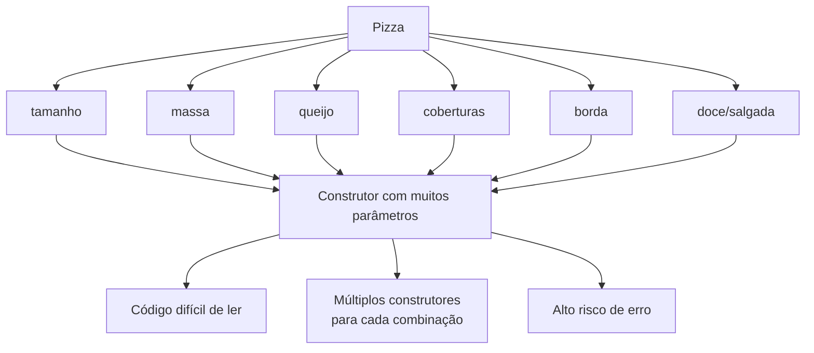

# O Padrão Builder - Parte 1

## Introdução e contexto

O **Builder** é um padrão **criacional** voltado para a criação de **objetos
complexos**, montados **pouco a pouco**. Ele permite produzir **variações
diferentes** de um mesmo objeto a partir de um ponto de partida comum.

A motivação da aula é um problema bem conhecido de quem já modelou uma classe
com muitos campos: o **construtor telescópico**.

> **Construtor telescópico** é um construtor com uma quantidade enorme de
> parâmetros, em que cada novo campo aumenta a confusão da chamada.

O exemplo do mundo real é uma **pizza**. Uma modelagem ingênua poderia ter:

- tamanho;
- tipo de massa;
- se leva queijo;
- lista de coberturas;
- borda;
- se é doce ou salgada;
- e por aí vai.

Cada característica vira um parâmetro no construtor. Na hora de instanciar, o
cliente precisa lembrar a **ordem** e o **significado** de cada valor.



## O problema na prática

A primeira modelagem da aula tem uma classe `Pizza` com construtor recebendo
**tamanho**, **massa**, **queijo** e **coberturas**. Só isso já produz chamadas
como:

```js
new Pizza("grande", "fina", true, ["mussarela", "tomate", "manjericão"]);
```

Funciona, mas a leitura piora conforme o número de parâmetros cresce. Para
completar, campos opcionais exigem **valores padrão** ou **construtores
adicionais**. Se houver muitas combinações, a classe acumula uma **análise
combinatória** de construtores — um para cada variação possível.

A aula compara a situação ao garçom de uma pizzaria: ele precisaria perguntar e
anotar cada detalhe individualmente. Por isso os cardápios costumam oferecer
**combinações prontas** e um campo extra para observações. O Builder faz esse
papel no código: organiza a montagem sem transformar o cliente em refém de
dezenas de parâmetros.

## Onde o Builder aparece sem você notar

O padrão é mais comum no dia a dia do que parece. **Requisições HTTP** são um
exemplo: `fetch`, Axios e bibliotecas semelhantes aceitam dezenas de opções —
método, headers, body, timeout, credenciais —, mas normalmente usamos só o
mínimo necessário. A biblioteca oferece uma forma **incremental** e
**configurável** de montar a requisição.

## O que o padrão propõe

O objetivo central do Builder é **separar a construção do objeto da sua
representação**.

Normalmente, o objeto e sua representação andam juntos: a classe `Pizza` dita
como a pizza é criada. Com o Builder, entram em cena duas responsabilidades
distintas:

| Responsabilidade | Quem cuida |
| --- | --- |
| **Representar** o objeto final | classe `Pizza` |
| **Construir** o objeto passo a passo | `PizzaBuilder` |
| **Orquestrar** receitas prontas | `PizzaDirector` (na parte 3) |

Isso permite criar **diferentes representações** com o **mesmo processo de
construção**, sem inflar o construtor da classe principal.

## Benefícios

- **Código mais legível**: cada método diz o que está sendo configurado.
- **Menos parâmetros**: o cliente informa apenas o que importa.
- **Valores padrão**: campos opcionais não precisam ser repetidos.
- **Flexibilidade**: a mesma base produz variações diferentes.
- **Encapsulamento da montagem**: a lógica de construção fica separada da
  representação.

## Limitações e cuidados

- **Mais classes e mais código.** Para objetos simples, o Builder é exagero.
- **Nem todo objeto precisa de etapas.** Se o construtor é curto e estável,
  criar um builder só adiciona indireção.
- **A montagem ainda pode ser manual.** Encadear muitos métodos sem um diretor
  pode ficar repetitivo — problema que a próxima aula resolve.
- **Não substitui validações de domínio.** O Builder organiza a construção; as
  regras sobre o que é uma pizza válida continuam sendo responsabilidade do
  domínio.

## Conclusão

O Builder existe para domar **objetos complexos e configuráveis**. Em vez de um
construtor telescópico com dezenas de parâmetros, o cliente monta o objeto em
etapas nomeadas, com valores padrão e a possibilidade de variar a representação
final.

A aula termina no ponto de dor: a criação direta funciona, mas é difícil de ler
e de manter. Na sequência, o **`PizzaBuilder`** entra em cena para transformar
essa montagem em uma API fluente e organizada.
