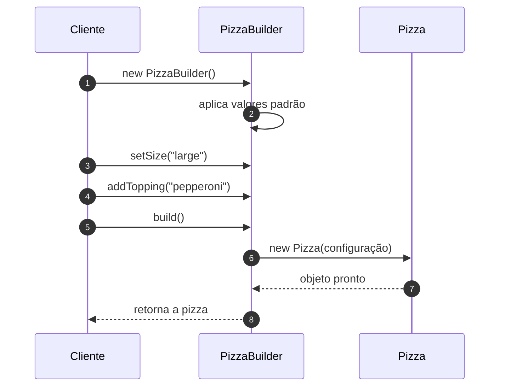

# O Padrão Builder - Parte 2

## Introdução e contexto

Esta aula implementa o **`PizzaBuilder`**. A classe `Pizza` continua sendo a
**representação** do objeto; o builder passa a ser o **construtor** — o
"pizzaiolo" que monta a pizza passo a passo.

A grande mudança é que o cliente deixa de chamar o construtor de `Pizza` com
todos os parâmetros. Ele conversa com o builder, define apenas o que deseja e,
no final, chama `build()` para receber o objeto pronto.

## A estrutura do builder

O `PizzaBuilder` tem os mesmos atributos da pizza, mas com **valores padrão**
definidos no próprio construtor:

| Atributo | Valor padrão |
| --- | --- |
| `size` | pizza média |
| `crust` | massa tradicional |
| `cheese` | sem queijo |
| `toppings` | lista vazia |

Esses padrões eliminam a necessidade de o cliente informar tudo. Se ele quiser
uma pizza média, de massa tradicional e sem queijo, basta adicionar as
coberturas.

Os métodos de configuração são **encadeáveis**, pois retornam `this`:

```js
class PizzaBuilder {
  #size = "medium";
  #crust = "traditional";
  #cheese = false;
  #toppings = [];

  setSize(size) {
    this.#size = size;
    return this;
  }

  setCrust(crust) {
    this.#crust = crust;
    return this;
  }

  addCheese() {
    this.#cheese = true;
    return this;
  }

  addTopping(topping) {
    this.#toppings.push(topping);
    return this;
  }

  build() {
    return new Pizza({
      size: this.#size,
      crust: this.#crust,
      cheese: this.#cheese,
      toppings: this.#toppings,
    });
  }
}
```

## Construindo uma pizza

Com o builder, a criação da marguerita fica assim:

```js
const margherita = new PizzaBuilder()
  .setSize("large")
  .setCrust("thin")
  .addCheese()
  .addTopping("mussarela")
  .addTopping("tomate")
  .addTopping("manjericão")
  .build();
```

A leitura é praticamente uma receita: cada linha nomeia uma decisão. Se o
cliente quiser a pizza padrão, pode omitir quase tudo:

```js
const pepperoni = new PizzaBuilder()
  .addTopping("pepperoni")
  .build();
```

O resultado é exatamente o mesmo objeto que seria produzido pelo construtor
longo — mas com **muito menos acoplamento** à ordem dos parâmetros.



## Por que isso melhora o código

| Antes | Depois |
| --- | --- |
| construtor com vários parâmetros posicionais | métodos com nomes explícitos |
| cliente precisa conhecer a ordem dos argumentos | cliente escolhe apenas o que quer configurar |
| campos opcionais exigem defaults ou construtores extras | defaults ficam no builder |
| criação espalhada e repetitiva | processo centralizado no builder |

A aula mostra que a saída do programa continua **idêntica**. O ganho não é
funcional, é de **design**: o código fica mais simples de ler, alterar e
reutilizar.

## O limite do builder sozinho

Mesmo com o encadeamento, o cliente ainda precisa **montar a receita**:

```js
const margherita = builder
  .setSize("large")
  .setCrust("thin")
  .addCheese()
  .addTopping("mussarela")
  .build();
```

Se a pizzaria vende sempre as mesmas combinações, repetir essa sequência em cada
parte do sistema é trabalhoso e sujeito a divergências. Falta alguém que
conheça as **receitas prontas** e coordene o processo.

É aí que entra o **diretor**: ele encapsula as combinações e deixa o cliente
apenas pedir "uma marguerita" ou "uma pepperoni".

## Benefícios

- **API fluente e expressiva**: cada passo tem nome e intenção.
- **Valores padrão centralizados**: menos repetição.
- **Construção isolada**: a classe `Pizza` não precisa conhecer detalhes de
  montagem.
- **Variações com o mesmo código base**: basta mudar a sequência de métodos.

## Limitações e cuidados

- **Encadeamento manual ainda é verboso** para receitas repetidas.
- **Estado mutável no builder**: reutilizar a mesma instância sem resetar pode
  misturar configurações de objetos diferentes.
- **Nem todo objeto justifica o padrão**: classes simples continuam simples.
- **O builder não valida o domínio sozinho**: regras de negócio precisam ser
  garantidas na pizza ou em um serviço.

## Conclusão

O `PizzaBuilder` transforma um construtor telescópico em uma **construção por
etapas**, com valores padrão e métodos encadeáveis. O cliente passa a declarar
**o que quer**, não **a ordem dos parâmetros**.

O padrão ainda não está completo: falta o **diretor**, responsável por
orquestrar receitas prontas e garantir que cada pizza seja construída do zero.
É o que a próxima aula implementa.
