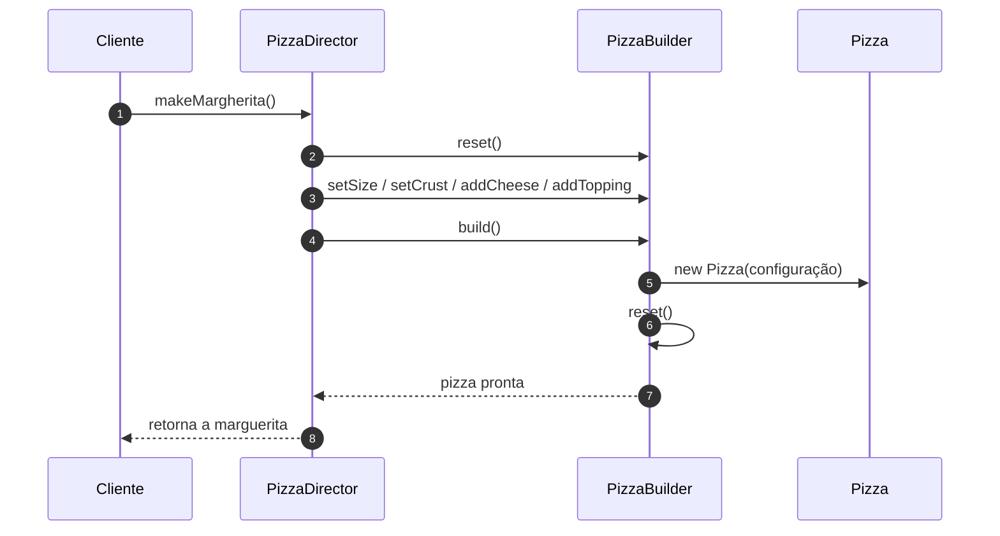

# Implementando o Padrão Builder

## Introdução e contexto

Esta aula fecha o Builder com a peça que faltava: o **diretor**
(`PizzaDirector`). Ele conhece as **receitas** — marguerita, pepperoni — e
coordena o `PizzaBuilder` para produzi-las.

Antes do diretor, o cliente precisava montar a sequência de métodos. Agora ele
só pede a pizza desejada:

```js
const builder = new PizzaBuilder();
const director = new PizzaDirector(builder);

const margherita = director.makeMargherita();
const pepperoni = director.makePepperoni();
```

## O problema do estado acumulado

Reutilizar um builder entre construções traz um risco: os atributos definidos
para uma pizza podem "vazar" para a próxima. Se o builder já tem queijo e
coberturas, a nova pizza herdaria configurações da anterior.

Para evitar isso, a aula introduz o método **`reset()`**:

- o corpo que inicializava os atributos sai do construtor e vai para `reset()`;
- o construtor chama `reset()`;
- o método `build()` também chama `reset()` **depois** de criar a pizza,
  garantindo que a próxima construção comece do zero.

```js
class PizzaBuilder {
  constructor() {
    this.reset();
  }

  reset() {
    this.#size = "medium";
    this.#crust = "traditional";
    this.#cheese = false;
    this.#toppings = [];
  }

  build() {
    const pizza = new Pizza({
      size: this.#size,
      crust: this.#crust,
      cheese: this.#cheese,
      toppings: this.#toppings,
    });

    this.reset();
    return pizza;
  }
}
```

Assim, cada chamada a `build()` entrega uma pizza **independente** e deixa o
builder pronto para a próxima.



## O diretor

O `PizzaDirector` recebe o builder no construtor e expõe métodos com o nome das
receitas:

```js
class PizzaDirector {
  #builder;

  constructor(builder) {
    this.#builder = builder;
  }

  makeMargherita() {
    return this.#builder
      .setSize("large")
      .setCrust("thin")
      .addCheese()
      .addTopping("mussarela")
      .addTopping("tomate")
      .addTopping("manjericão")
      .build();
  }

  makePepperoni() {
    return this.#builder
      .setSize("medium")
      .setCrust("traditional")
      .addCheese()
      .addTopping("pepperoni")
      .build();
  }
}
```

O cliente não conhece os detalhes de cada receita. Ele instancia o builder e o
diretor uma vez e chama o método da pizza desejada. A montagem fica **centralizada**
e consistente: se a receita mudar, muda em um único lugar.

## O código final

| Responsabilidade | Classe |
| --- | --- |
| Representar a pizza | `Pizza` |
| Montar a pizza passo a passo | `PizzaBuilder` |
| Conhecer e orquestrar as receitas | `PizzaDirector` |

O `test-pizza` fica bem mais simples: em vez de instanciar pizzas com todos os
parâmetros ou encadear métodos manualmente, ele pede ao diretor. A saída do
programa continua idêntica — o que muda é a **organização**.

## Quando aplicar

O Builder é indicado para objetos **complexos**, **configuráveis** e construídos
**por etapas**:

- cadastro de usuário com muitos campos opcionais;
- configuração de uma compra ou pedido;
- objetos de requisição HTTP;
- cardápios e produtos com variações;
- qualquer classe cujo construtor tenha virado um **construtor telescópico**.

## Benefícios

- **Criação desacoplada da representação.**
- **Receitas reutilizáveis** e centralizadas no diretor.
- **Objetos independentes** graças ao `reset()`.
- **Código cliente enxuto** e legível.
- **Variações com um único processo de construção.**

## Limitações e cuidados

- **Complexidade adicional**: três classes para criar uma pizza.
- **Overkill para objetos simples**: se o construtor tem dois parâmetros, o
  padrão atrapalha mais do que ajuda.
- **Reset é obrigatório**: esquecer de limpar o estado compromete a próxima
  construção.
- **Diretor acoplado às receitas**: novas variações exigem novos métodos ou uma
  estrutura mais flexível.
- **Validação continua no domínio**: o Builder monta; não garante sozinho que o
  objeto é válido.

## Conclusão

O Builder completo separa **representação** (`Pizza`), **construção**
(`PizzaBuilder`) e **orquestração** (`PizzaDirector`). O `reset()` garante que
cada pizza nasça do zero, e o diretor transforma sequências de configuração em
receitas nomeadas.

É o padrão certo quando o construtor cresce demais e o objeto precisa de
variações. Para objetos simples, continua valendo a regra: **não introduza
complexidade sem necessidade**.

Com os criacionais encerrados, o próximo bloco entra nos **estruturais**, a
começar pelo *Adapter*.
