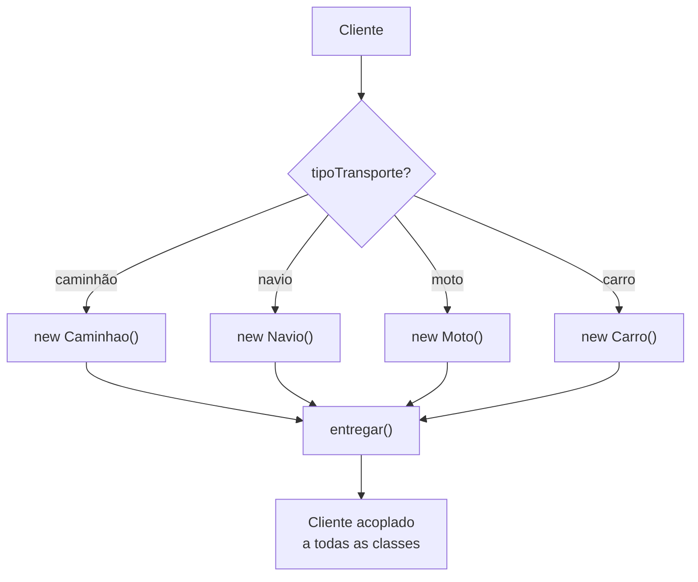
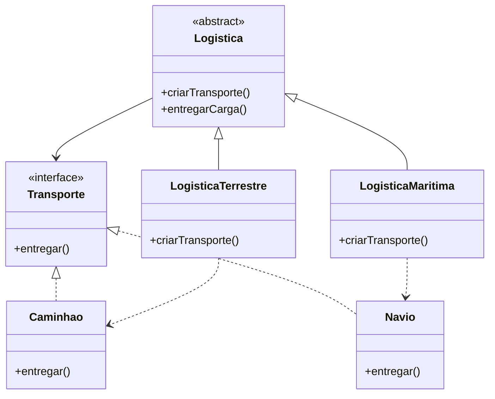

# O Padrão Factory Method - Parte 1

## Introdução e contexto

O **Factory Method** é um padrão **criacional** com foco em **classes**: ele
delega a criação de objetos a classes especializadas, em vez de espalhar
`new` e condicionais pelo código cliente.

A ideia central é oferecer uma **interface de criação** em uma classe base. As
**subclasses** decidem qual objeto concreto será instanciado. O cliente pede o
produto, mas não conhece a classe que o constrói.

## O problema: criação manual e acoplamento

O exemplo é uma empresa de **logística**. Uma encomenda pode ser entregue por
**caminhão**, **navio**, **moto**, **carro**, **avião** e por aí vai. Cada meio
de transporte tem sua própria classe e seu próprio método `entregar()`.

Sem o padrão, o cliente faz a escolha manualmente:

```js
let transporte;

if (tipoTransporte === "caminhao") {
  transporte = new Caminhao();
} else if (tipoTransporte === "navio") {
  transporte = new Navio();
} else if (tipoTransporte === "moto") {
  transporte = new Moto();
}
// ...

transporte.entregar();
```

Funciona para dois casos, mas o problema cresce rápido:

- o cliente fica **acoplado** a todas as classes concretas;
- adicionar um meio de transporte exige **alterar o cliente**;
- combinações — caminhão + navio + moto — geram condicionais cada vez mais
  complexas;
- a lógica de decisão se espalha e vira uma **coleção infinita de `if/else`**.



## A proposta do padrão

O Factory Method inverte a responsabilidade: o cliente **não instancia** os
produtos. Ele conversa com um **criador**, e o criador decide qual objeto
concreto usar.

Isso traz dois ganhos imediatos:

| Sem Factory Method | Com Factory Method |
| --- | --- |
| cliente conhece cada classe concreta | cliente conhece apenas a interface |
| novo transporte exige mudar o cliente | novo transporte exige um novo criador/produto |
| condicionais crescem no cliente | decisão fica encapsulada nas classes |
| manutenção difícil | hierarquia extensível |

## Estrutura conceitual

O padrão tem quatro participantes:

| Participante | Papel |
| --- | --- |
| **Product** | interface ou classe abstrata do objeto criado |
| **ConcreteProduct** | implementações concretas (navio, caminhão) |
| **Creator** | classe abstrata que declara o **Factory Method** |
| **ConcreteCreator** | subclasse que implementa o método e cria o produto |



## Benefícios

- **Baixo acoplamento** entre cliente e produtos concretos.
- **Extensibilidade**: novos produtos entram com novas subclasses.
- **Responsabilidade única**: a criação fica em um lugar dedicado.
- **Legibilidade**: o cliente expressa a intenção, não a construção.
- **Consistência**: todos os produtos seguem a mesma interface.

## Limitações e cuidados

- **Mais classes.** O padrão aumenta a complexidade estrutural inicial.
- **Nem toda variação justifica uma hierarquia.** Para dois objetos fixos, um
  `if` simples pode ser suficiente.
- **O cliente ainda escolhe o criador.** Em algum momento alguém precisa decidir
  se a logística é terrestre ou marítima.
- **Não elimina todas as condicionais.** Ele as move para o lugar certo e evita
  que se multipliquem no cliente.

## Conclusão

O Factory Method resolve o acoplamento causado pela criação manual de objetos.
Em vez de o cliente conhecer caminhão, navio, moto e carro, ele trabalha com a
interface de **transporte** e com um **criador** que sabe instanciar o produto
adequado.

A aula termina no diagnóstico do problema. Na sequência, o projeto é
reestruturado em `transporte` e `logística` para dar vida ao padrão.
