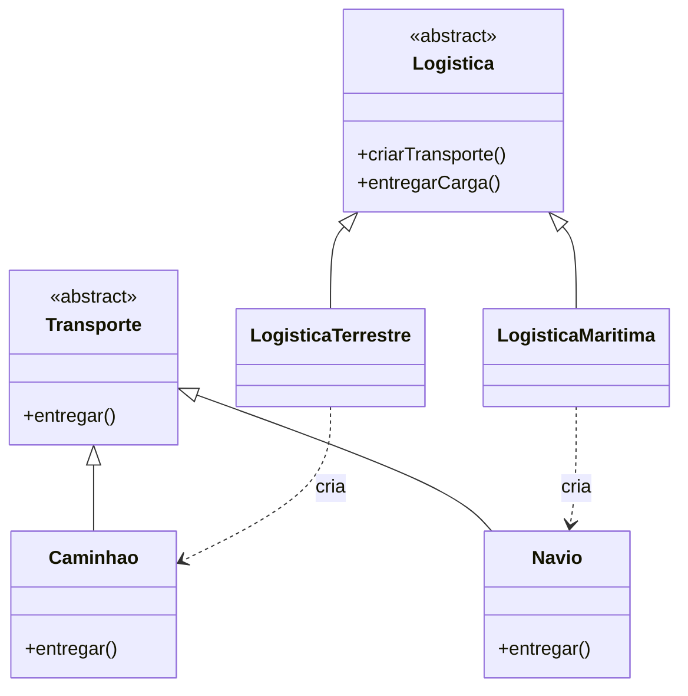

# O Padrão Factory Method - Parte 2

## Introdução e contexto

Esta aula monta a **estrutura** do Factory Method. O projeto de logística deixa
de ser um arquivo único com classes soltas e passa a ser organizado em duas
áreas:

```
src/
├── transporte/
│   ├── Transporte.js
│   ├── Caminhao.js
│   └── Navio.js
└── logistica/
    ├── Logistica.js
    ├── LogisticaTerrestre.js
    └── LogisticaMaritima.js
```

A separação não é estética: ela materializa o **desacoplamento** entre o
**produto** e o **criador**.

## O lado do produto

O **produto** é o que será entregue. Aqui, a hierarquia é de meios de
transporte.

A classe abstrata `Transporte` define o contrato:

```js
class Transporte {
  entregar() {
    throw new Error("O método entregar precisa ser implementado");
  }
}
```

O corpo lança uma exceção de propósito. É uma forma de **obrigar as subclasses**
a implementar o método. Em linguagens com interfaces ou métodos abstratos
nativos, o efeito é o mesmo.

As classes concretas herdam de `Transporte` e implementam `entregar()`:

```js
class Caminhao extends Transporte {
  entregar() {
    console.log("Entrega realizada por caminhão");
  }
}

class Navio extends Transporte {
  entregar() {
    console.log("Entrega realizada por navio");
  }
}
```

O cliente não precisa saber como cada transporte funciona. Basta saber que
**todo transporte entrega**.

## O lado do criador

O **criador** é a classe que sabe **criar** transportes. `Logistica` é abstrata
e declara o **Factory Method**:

```js
class Logistica {
  criarTransporte() {
    throw new Error("O Factory Method precisa ser implementado");
  }

  entregarCarga() {
    const transporte = this.criarTransporte();
    transporte.entregar();
  }
}
```

O método `entregarCarga()` é **comum a todos os criadores**: ele chama o Factory
Method e usa o produto. Quem decide **qual** transporte será criado são as
subclasses.



## Por que separar produto e criador

| Produto | Criador |
| --- | --- |
| define **o que** será usado | define **como** será criado |
| interface estável (`entregar`) | ponto de extensão (`criarTransporte`) |
| não conhece o cliente | concentra a decisão de instanciação |

Quando surge um novo meio de transporte, o produto ganha uma classe nova. O
criador correspondente também. O cliente, porém, continua chamando
`entregarCarga()` sem saber o que mudou.

## O contrato de entrega

O método `entregarCarga()` é o exemplo mais importante da aula: ele mostra que o
Factory Method **não é um método isolado**. Ele existe para ser usado por uma
operação de mais alto nível.

O fluxo é sempre:

1. o criador recebe a responsabilidade de entregar;
2. internamente, chama `criarTransporte()`;
3. a subclasse instancia o transporte adequado;
4. o transporte executa `entregar()`.

O cliente vê apenas o passo 1. Os demais são detalhes do criador.

## Benefícios

- **Organização explícita** entre produtos e criadores.
- **Contrato claro**: todo transporte entrega; todo criador cria.
- **Extensibilidade controlada**: novos produtos e criadores sem tocar no
  cliente.
- **Testabilidade**: é possível substituir criadores e produtos por dublês.

## Limitações e cuidados

- **Mais arquivos e mais indireção** para um exemplo pequeno.
- **A classe abstrata não impede tudo sozinha.** Em JavaScript, lançar exceção é
  uma convenção; a linguagem não força a implementação em tempo de compilação.
- **A escolha do criador ainda existe.** O cliente precisa decidir se usa
  logística terrestre ou marítima.
- **Herança como mecanismo**: o padrão depende de subclasses; em alguns casos,
  composição pode ser mais flexível.

## Conclusão

A estrutura do Factory Method separa **produto** (`Transporte`) de **criador**
(`Logistica`). O produto define o comportamento comum; o criador define o ponto
de extensão e oferece uma operação pronta — `entregarCarga()` — que usa o
produto sem conhecer sua classe concreta.

Com a base montada, a última parte implementa os criadores concretos e mostra o
cliente final funcionando sem `new Caminhao()` nem `new Navio()`.
