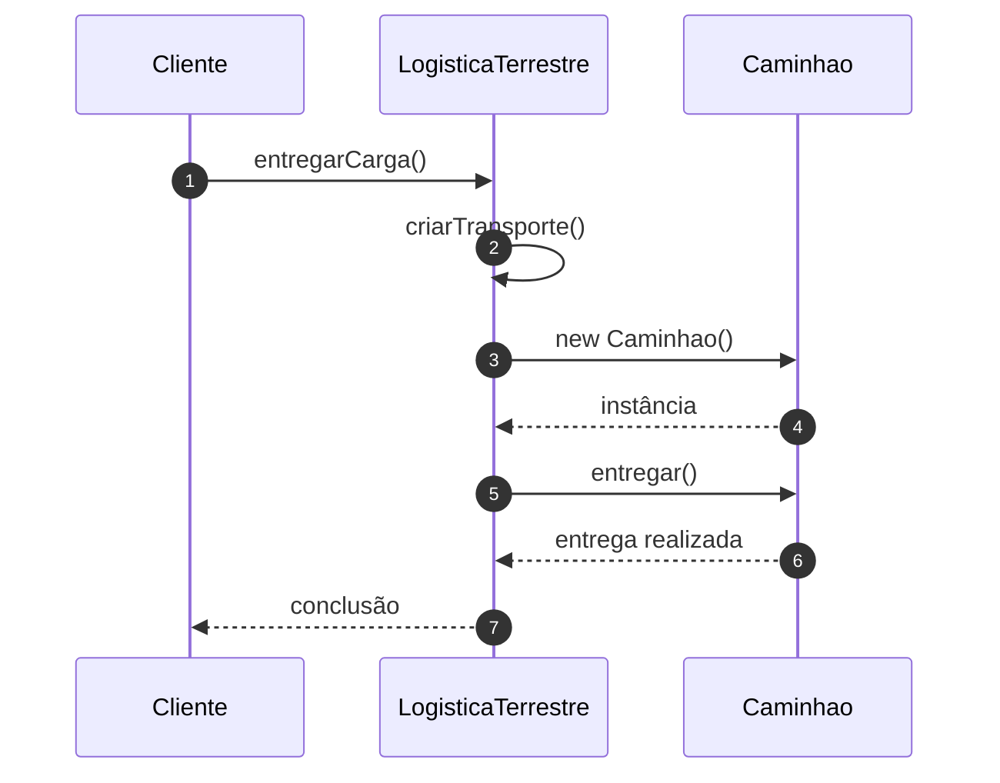

# Implementando o Padrão Factory

## Introdução e contexto

Esta aula completa o Factory Method com os **criadores concretos** e reescreve
o cliente para não instanciar transportes diretamente.

As classes finais são:

| Classe | Papel |
| --- | --- |
| `Transporte` | produto abstrato |
| `Caminhao`, `Navio` | produtos concretos |
| `Logistica` | criador abstrato com o Factory Method |
| `LogisticaTerrestre` | cria caminhão |
| `LogisticaMaritima` | cria navio |

## Implementando os criadores

A classe `Logistica` declara o Factory Method e já oferece o método comum:

```js
class Logistica {
  criarTransporte() {
    throw new Error("O Factory Method precisa ser implementado");
  }

  entregarCarga() {
    const transporte = this.criarTransporte();
    transporte.entregar();
  }
}
```

A `LogisticaTerrestre` estende `Logistica` e implementa a criação:

```js
class LogisticaTerrestre extends Logistica {
  criarTransporte() {
    return new Caminhao();
  }
}
```

A `LogisticaMaritima` faz o mesmo com o navio:

```js
class LogisticaMaritima extends Logistica {
  criarTransporte() {
    return new Navio();
  }
}
```

Perceba: o `new` não desapareceu do sistema. Ele foi **movido** para dentro das
classes que têm a responsabilidade de criar. O cliente não o vê mais.



## O cliente depois do padrão

O arquivo de teste deixa de fazer `if/else` para instanciar caminhão ou navio.
Ele escolhe o **tipo de logística**:

```js
const tipoLogistica = "terrestre";
let logistica;

if (tipoLogistica === "terrestre") {
  logistica = new LogisticaTerrestre();
} else if (tipoLogistica === "maritima") {
  logistica = new LogisticaMaritima();
}

logistica.entregarCarga();
```

A condicional ainda existe — alguém precisa escolher o criador —, mas ela não
conhece mais os **produtos**. O cliente não sabe se o transporte é caminhão,
navio, moto ou bicicleta. Ele apenas pede a entrega.

Se a decisão depender de uma **rota**, por exemplo, essa lógica pode ir para
dentro do criador. O cliente continua chamando `entregarCarga()`.

## O trade-off

O código parece mais complexo do que o `if/else` inicial. E, de fato, há mais
classes. A aula é honesta sobre isso:

| Ganho | Custo |
| --- | --- |
| menor acoplamento | mais classes |
| cliente simples | estrutura inicial maior |
| fácil adicionar transportes | necessidade de novos criadores |
| código mais legível | indireção |

O ganho aparece **quando o projeto cresce**. Adicionar uma moto deixa de exigir
alterações no cliente: basta criar `Moto` e um criador que a instancie — ou
ajustar um criador existente.

## Quando usar

O Factory Method é indicado quando:

- existe uma **hierarquia de objetos** que compartilha uma interface;
- o cliente **não deve conhecer** as classes concretas;
- a criação precisa ser **centralizada** e **extensível**;
- há variações que podem crescer com o tempo.

Exemplos citados na aula:

- acesso a **bancos de dados** diferentes;
- integração com **APIs de terceiros**;
- meios de transporte, como no exercício;
- qualquer família de produtos com contrato comum.

## Benefícios

- **Desacoplamento real** entre cliente e produtos concretos.
- **Extensibilidade**: novos produtos entram sem mexer no cliente.
- **Legibilidade**: a intenção fica explícita (`entregarCarga`).
- **Manutenção localizada**: a criação fica nas classes criadoras.
- **Consistência de contrato**: todos os produtos implementam `entregar()`.

## Limitações e cuidados

- **Complexidade inicial maior.** Para um cenário fixo e pequeno, pode não
  valer a pena.
- **Muitas classes.** Cada produto e cada criador adicionam arquivos.
- **A escolha do criador permanece.** O padrão não elimina toda decisão; ele a
  desloca.
- **Herança acopla criador e produto.** Em cenários muito dinâmicos, outras
  abordagens (como injeção de dependência) podem ser mais flexíveis.
- **Não confunda com Abstract Factory.** O Factory Method cria **um** produto
  por criador; a Abstract Factory cria **famílias** de produtos.

## Conclusão

O Factory Method tira do cliente a responsabilidade de instanciar produtos
concretos. `LogisticaTerrestre` e `LogisticaMaritima` implementam o método
fábrica, enquanto `entregarCarga()` permanece igual para todos.

O resultado é um sistema em que **quem cria** está separado de **quem usa**, e
novos transportes entram sem espalhar `if/else` pelo cliente. O custo é mais
estrutura — um investimento que compensa quando a hierarquia tende a crescer.

Com isso, os padrões **criacionais** do módulo estão concluídos: Singleton,
Builder e Factory Method. O próximo bloco abre os **estruturais**, começando
pelo *Adapter*.
