# Padrões Criacionais

## Índice

| # | Aula | Duração |
| --- | --- | --- |
| 1 | [O Padrão Singleton](./1%20-%20O%20Padr%C3%A3o%20Singleton.md) | 09:06 |
| 2 | [Implementando o Singleton](./2%20-%20Implementando%20o%20Singleton.md) | 06:21 |
| 3 | [O Padrão Builder - Parte 1](./3%20-%20O%20Padr%C3%A3o%20Builder%20-%20Parte%201.md) | 07:14 |
| 4 | [O Padrão Builder - Parte 2](./4%20-%20O%20Padr%C3%A3o%20Builder%20-%20Parte%202.md) | 08:40 |
| 5 | [Implementando o Padrão Builder](./5%20-%20Implementando%20o%20Padr%C3%A3o%20Builder.md) | 07:15 |
| 6 | [O Padrão Factory Method - Parte 1](./6%20-%20O%20Padr%C3%A3o%20Factory%20Method%20-%20Parte%201.md) | 08:17 |
| 7 | [O Padrão Factory Method - Parte 2](./7%20-%20O%20Padr%C3%A3o%20Factory%20Method%20-%20Parte%202.md) | 05:57 |
| 8 | [Implementando o Padrão Factory](./8%20-%20Implementando%20o%20Padr%C3%A3o%20Factory.md) | 08:57 |

## Sequência das aulas

```mermaid
flowchart LR
    A1["1 · O Padrão Singleton"] --> A2["2 · Implementando o Singleton"]
    A2 --> A3["3 · O Padrão Builder - Parte 1"]
    A3 --> A4["4 · O Padrão Builder - Parte 2"]
    A4 --> A5["5 · Implementando o Padrão Builder"]
    A5 --> A6["6 · O Padrão Factory Method - Parte 1"]
    A6 --> A7["7 · O Padrão Factory Method - Parte 2"]
    A7 --> A8["8 · Implementando o Padrão Factory"]
```

