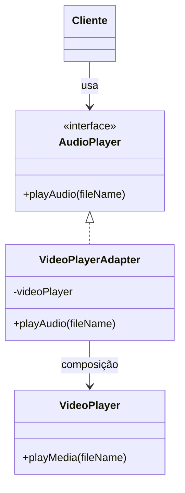

# O Padrão Adapter

## Introdução e contexto

O **Adapter** é um padrão **estrutural**. Sua função é fazer **duas coisas
incompatíveis cooperarem** para um objetivo comum, sem exigir que uma delas seja
reescrita.

A analogia da aula é o **adaptador de tomada**: o carregador tem três pinos, a
tomada tem outro formato, e o adaptador resolve o desencontro. No software, o
desencontro é de **interfaces**.

O padrão pode atuar no escopo de **classes** ou de **objetos**. A aula
implementa a versão baseada em **objetos**, usando **composição**.

## O problema

Imagine um **player de vídeo** fornecido por terceiros. Ele sabe reproduzir
vídeos, mas não músicas:

```js
class VideoPlayer {
  playMedia(fileName) {
    console.log(`Reproduzindo ${fileName}`);
  }
}
```

Agora imagine que o sistema precisa reproduzir **áudio**. A solução ingênua
seria criar um player de áudio do zero — ou reescrever o player de terceiros.
Nenhuma das opções é boa: joga fora código pronto e aumenta o custo de
manutenção.

## A solução

O Adapter cria uma **ponte** entre a interface que o cliente espera e a
interface que o componente existente oferece.

A estrutura clássica tem quatro participantes:

| Participante | Papel | No exemplo |
| --- | --- | --- |
| **Client** | quem usa a interface esperada | aplicação de áudio |
| **Target** | interface que o cliente conhece | `AudioPlayer` com `playAudio()` |
| **Adapter** | faz a ponte entre as interfaces | `VideoPlayerAdapter` |
| **Adaptee** | componente incompatível já existente | `VideoPlayer` com `playMedia()` |



O cliente depende apenas de `AudioPlayer`. O `VideoPlayerAdapter` implementa
essa interface e, por dentro, delega ao `VideoPlayer` — que continua sendo o
componente de terceiros, sem alterações.

## Outro exemplo: XML para JSON

A aula cita um segundo cenário: o sistema recebe **XML**, mas já existe um
processador de **JSON** pronto. Em vez de reescrever o processador, um Adapter
converte o XML para JSON e utiliza o processador existente.

O padrão é o mesmo: **converter a interface** de um componente para o formato
que o cliente sabe usar.

## Quando usar

O Adapter é indicado quando:

- é preciso integrar **bibliotecas, APIs ou serviços de terceiros**;
- existe **código legado** que não pode ser alterado;
- a interface de um componente não bate com a interface esperada pelo sistema;
- reescrever o componente seria caro ou inviável.

## Benefícios

- **Reuso de código existente**, sem modificá-lo.
- **Baixo acoplamento**: o cliente depende da interface, não da implementação.
- **Integração pragmática** com APIs incompatíveis.
- **Isolamento de mudanças**: se a biblioteca de terceiros mudar, o adaptador
  concentra o impacto.
- **Compatibilidade com legado**, estendendo sistemas antigos para novas
  necessidades.

## Limitações e cuidados

- **Não é gambiarra por definição**, mas pode virar uma se for usado para
  esconder problemas de modelagem.
- **Mais uma camada de indireção**: aumenta o número de classes.
- **Adaptação imperfeita**: nem sempre a interface de origem cobre tudo o que o
  target exige.
- **Manutenção do adaptador**: mudanças na API de terceiros ainda exigem
  atualização da ponte.
- **Cuidado com excesso de adaptadores**: empilhar camadas sem necessidade
  dificulta o rastreamento do fluxo.

## Conclusão

O **Adapter** permite que sistemas incompatíveis trabalhem juntos por meio de uma
**interface de adaptação**. Em vez de reescrever o player de vídeo ou o
processador de JSON, o padrão cria uma camada fina que traduz uma interface para
outra.

É uma das aplicações mais comuns no dia a dia — especialmente ao integrar
bibliotecas de terceiros — e a base para a implementação prática da próxima
aula.
