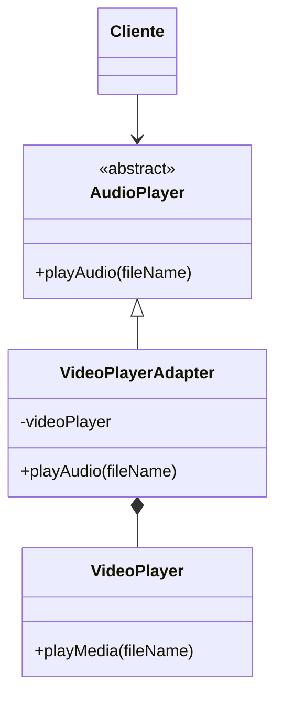
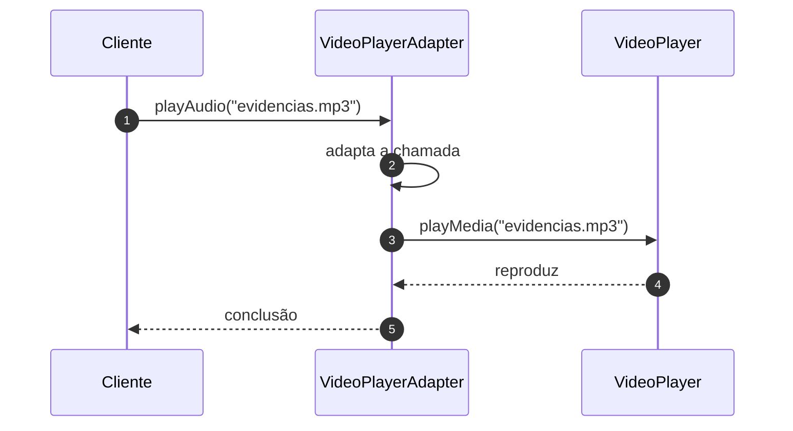

# Implementando o Adapter

## Introdução e contexto

Esta aula implementa o exemplo do **player de áudio** com um componente de
vídeo de terceiros. A estrutura do projeto é:

```
src/
├── AudioPlayer.js
├── VideoPlayer.js
├── VideoPlayerAdapter.js
└── teste-audio-player.js
```

O objetivo é reproduzir um arquivo **MP3** usando um player que só entende
**vídeo**.

## As três peças

### Adaptee: o player de terceiros

O `VideoPlayer` já existe e não deve ser alterado:

```js
class VideoPlayer {
  playMedia(fileName) {
    console.log(`Reproduzindo ${fileName}`);
  }
}
```

O método se chama `playMedia`, não `playAudio`. É essa diferença de interface
que cria o problema.

### Target: a interface esperada

O `AudioPlayer` define o contrato que o cliente conhece:

```js
class AudioPlayer {
  playAudio(fileName) {
    throw new Error("O método playAudio precisa ser implementado");
  }
}
```

Aqui ele é uma classe abstrata "à moda JavaScript": o método base lança uma
exceção para obrigar as subclasses a implementá-lo.

### Adapter: a ponte

O `VideoPlayerAdapter` **herda** de `AudioPlayer` e **compõe** um `VideoPlayer`:

```js
class VideoPlayerAdapter extends AudioPlayer {
  #videoPlayer;

  constructor() {
    super();
    this.#videoPlayer = new VideoPlayer();
  }

  playAudio(fileName) {
    console.log("Adaptador em ação: usando o player de vídeo para áudio");
    this.#videoPlayer.playMedia(fileName);
  }
}
```

Dois detalhes importantes:

- a **herança** garante que o adapter seja um `AudioPlayer` para o cliente;
- a **composição** permite reutilizar o `VideoPlayer` sem modificá-lo.



## O cliente

O cliente instancia o adapter, mas o trata como `AudioPlayer`:

```js
const audioPlayer = new VideoPlayerAdapter();

audioPlayer.playAudio("evidencias.mp3");
```

A saída é:

```
Adaptador em ação: usando o player de vídeo para áudio
Reproduzindo evidencias.mp3
```

O cliente não conhece `VideoPlayer` nem `playMedia`. Ele só sabe que existe um
`AudioPlayer` capaz de tocar áudio. A conversão de interface acontece dentro do
adapter.

## O fluxo completo



## Por que isso é útil

| Sem Adapter | Com Adapter |
| --- | --- |
| reescrever o player de vídeo | reaproveitar o player existente |
| duplicar lógica de reprodução | delegar ao componente de terceiros |
| cliente acoplado ao `VideoPlayer` | cliente depende de `AudioPlayer` |
| adaptação espalhada | adaptação concentrada em uma classe |

O padrão também é útil para **serviços legados**: um sistema antigo com uma
interface esquisita pode ser adaptado para a interface nova sem reescrita.

## Benefícios

- **Integração com APIs incompatíveis** usando poucas linhas.
- **Reuso de bibliotecas de terceiros** sem alterá-las.
- **Cliente desacoplado** da implementação concreta.
- **Ponto único de adaptação** quando a API externa muda.
- **Compatibilidade com legado** e evolução incremental.

## Limitações e cuidados

- **Nem toda diferença é só de nome.** Se os dados e comportamentos forem muito
  distintos, a adaptação pode esconder complexidade real.
- **Adaptador não corrige API ruim.** Ele apenas traduz.
- **Cuidado com adaptadores em excesso.** Muitas camadas dificultam o
  diagnóstico de problemas.
- **Manutenção contínua**: mudanças no componente de terceiros podem exigir
  ajustes no adapter.
- **Testes específicos**: o adapter precisa de testes que garantam a tradução
  correta entre as interfaces.

## Conclusão

O Adapter implementado usa **herança** para se encaixar na interface esperada e
**composição** para reutilizar o componente de terceiros. O cliente chama
`playAudio()` e, por baixo, o `VideoPlayer` executa `playMedia()`.

É a solução certa quando o código existente funciona, mas fala uma "língua"
diferente da que o sistema precisa. Em vez de reescrever, adapta-se.

O próximo padrão estrutural é o *Decorator*, que também usa composição — mas
para **adicionar comportamento**, não para traduzir interfaces.
