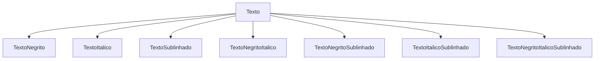
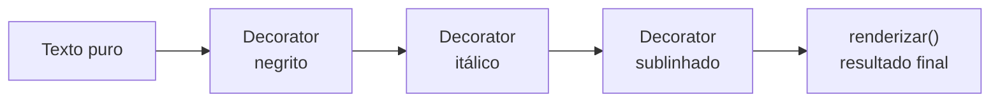

# O Padrão Decorator

## Introdução e contexto

O **Decorator** é um padrão **estrutural** de escopo de **objetos**. Ele permite
**adicionar responsabilidades a um objeto individualmente**, de forma
**dinâmica**, sem modificar a classe base.

A motivação vem de uma limitação da **herança**: ela é **estática**. A subclasse
é definida antes da execução e vale para todos os objetos daquele tipo. Se o
comportamento precisa variar **por objeto** ou ser **combinado** de formas
diferentes, a herança começa a produzir uma explosão de classes.

> A imagem mental do Decorator é uma **boneca russa**: camadas de funcionalidade
> são acrescentadas ao objeto, uma sobre a outra.

## O problema: formatar texto

O exemplo da aula é um **editor de texto**. Existe uma classe `Texto` com um
conteúdo e um método `renderizar()` que devolve o texto puro.

A partir dela, o sistema precisa oferecer:

- **negrito**;
- **itálico**;
- **sublinhado**;
- e **combinações**: negrito + itálico, itálico + sublinhado, os três juntos,
  etc.

Com herança, cada variação vira uma subclasse:

Para **três** formatações, já são **sete** classes — e a conta cresce de forma
combinatória. Pior: cada nova formatação multiplica as combinações existentes.

## A solução

O Decorator troca a herança por **composição encadeada**. Em vez de criar uma
subclasse para cada combinação, cada formatação é um **decorador** que envolve
um texto e acrescenta seu comportamento ao resultado.

O cliente monta a pilha que quiser:

- texto + negrito;
- texto + itálico;
- texto + negrito + itálico;
- texto + negrito + itálico + sublinhado;
- e assim por diante.

As combinações deixam de ser **classes** e passam a ser **composições em tempo
de execução**.

## Por que não usar herança

| Herança | Decorator |
| --- | --- |
| comportamento definido em tempo de compilação | comportamento definido em tempo de execução |
| uma subclasse por variação | uma classe por **responsabilidade** |
| combinações explodem | combinações são livres |
| objeto recebe tudo de uma vez | objeto recebe camadas sob demanda |
| altera a estrutura da classe | não modifica a classe base |

A herança continua útil para relações **estáveis** de tipo. O Decorator brilha
quando o comportamento precisa ser **opcional**, **combinável** e **dinâmico**.

## O primeiro contato com o problema

Na implementação inicial, a aula cria subclasses como `TextoNegrito`,
`TextoItalico` e `TextoSublinhado`, cada uma sobrescrevendo `renderizar()` para
envolver o texto em tags.

Isso funciona para um comportamento isolado. Mas, para combinar, seria preciso:

1. instanciar um texto;
2. envolver em um texto negrito;
3. envolver o resultado em um texto itálico;
4. e chamar `renderizar()` várias vezes pelo caminho.

O código fica confuso, expõe detalhes de implementação e ainda não resolve o
problema das combinações. É exatamente aí que o Decorator entra.

## Benefícios

- **Comportamento dinâmico**: a decoração é escolhida em tempo de execução.
- **Combinações livres**: não é preciso criar uma classe por combinação.
- **Princípio aberto/fechado**: é possível adicionar comportamento sem alterar
  a classe base.
- **Responsabilidades pequenas**: cada decorador faz uma coisa.
- **Menos subclasses**: a hierarquia para de crescer de forma combinatória.

## Limitações e cuidados

- **Encadeamento pode confundir.** Muitas camadas dificultam o rastreamento do
  fluxo.
- **Ordem importa.** A ordem dos decoradores pode alterar o resultado.
- **Depuração mais trabalhosa.** O comportamento final está distribuído entre
  vários objetos.
- **Nem todo caso precisa de decoradores.** Para uma variação fixa, herança ou
  uma simples composição podem ser suficientes.
- **Cuidado com identidade do objeto.** O cliente passa a lidar com wrappers, e
  comparações de tipo podem exigir atenção.

## Conclusão

O Decorator resolve o problema de adicionar comportamento **sem inflar a
hierarquia**. Em vez de uma classe para cada combinação de negrito, itálico e
sublinhado, o cliente empilha decoradores e chama uma única operação no final.

A implementação da próxima aula mostra a estrutura formal: um componente base,
um decorador abstrato e decoradores concretos que envolvem o objeto.
