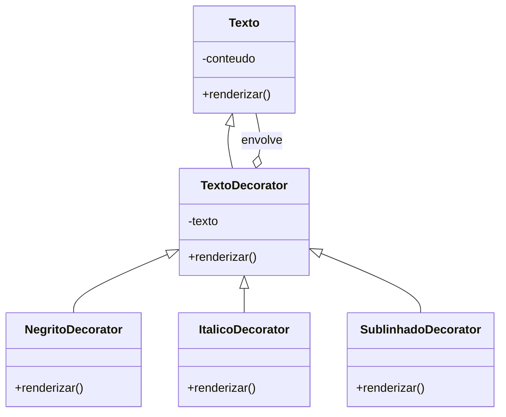
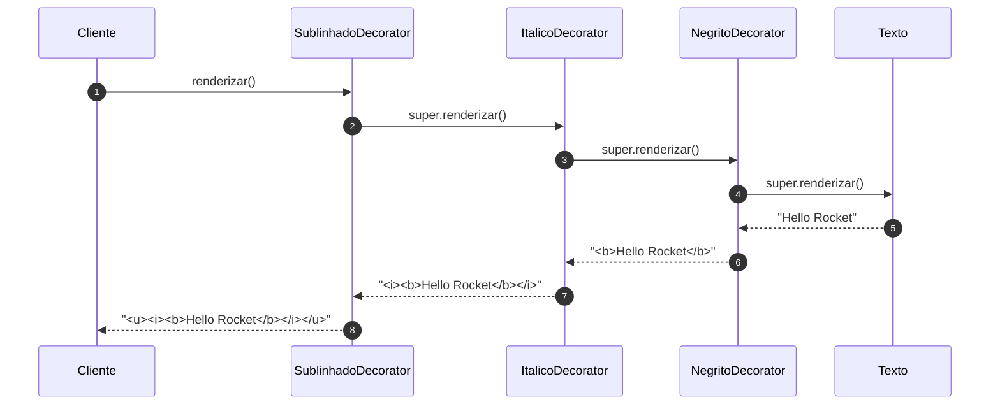

# Implementando o Decorator - Parte 1

## Introdução e contexto

Esta aula refatora o exemplo do texto para a estrutura completa do Decorator:

| Participante | Classe |
| --- | --- |
| **Component** | `Texto` |
| **Decorator base** | `TextoDecorator` |
| **ConcreteDecorators** | `NegritoDecorator`, `ItalicoDecorator`, `SublinhadoDecorator` |
| **Client** | arquivo de teste |

A mudança principal é que `Texto` deixa de ter subclasses para cada formatação e
passa a ser **envolvido** por decoradores.

## O componente base

A classe `Texto` guarda o conteúdo e expõe `renderizar()`:

```js
class Texto {
  #conteudo;

  constructor(conteudo) {
    this.#conteudo = conteudo;
  }

  renderizar() {
    return this.#conteudo;
  }
}
```

Ela representa o texto **cru**, sem formatação. É o objeto que será decorado.

## O decorator base

`TextoDecorator` herda de `Texto` e **recebe outro texto** no construtor:

```js
class TextoDecorator extends Texto {
  #texto;

  constructor(texto) {
    super(texto.renderizar());
    this.#texto = texto;
  }

  renderizar() {
    return this.#texto.renderizar();
  }
}
```

Dois pontos essenciais:

- a **herança** faz o decorador ser um `Texto`, então ele pode substituir o
  objeto original;
- a **composição** mantém uma referência ao texto interno, que será decorado.

O `renderizar()` do decorator base apenas **delega** ao texto envolvido. Os
decoradores concretos sobrescrevem esse método para acrescentar a formatação.

## Os decoradores concretos

Cada formatação é uma subclasse de `TextoDecorator`:

```js
class NegritoDecorator extends TextoDecorator {
  renderizar() {
    return `<b>${super.renderizar()}</b>`;
  }
}

class ItalicoDecorator extends TextoDecorator {
  renderizar() {
    return `<i>${super.renderizar()}</i>`;
  }
}

class SublinhadoDecorator extends TextoDecorator {
  renderizar() {
    return `<u>${super.renderizar()}</u>`;
  }
}
```

`super.renderizar()` chama o `renderizar()` do decorator base, que delega ao
texto interno. É assim que as camadas se empilham.



## Usando no cliente

O cliente monta a pilha na ordem desejada:

```js
const texto = new Texto("Hello Rocket");

const negrito = new NegritoDecorator(texto);
const italico = new ItalicoDecorator(negrito);
const sublinhado = new SublinhadoDecorator(italico);

console.log(sublinhado.renderizar());
// <u><i><b>Hello Rocket</b></i></u>
```

Também é possível combinar apenas alguns:

```js
const negritoItalico = new ItalicoDecorator(new NegritoDecorator(texto));
console.log(negritoItalico.renderizar());
// <i><b>Hello Rocket</b></i>
```

A ordem dos decoradores define a ordem das tags. Não é preciso criar
`TextoNegritoItalico`, `TextoItalicoSublinhado` nem qualquer outra combinação.

## O fluxo de renderização



Cada camada recebe o resultado da camada interna e o envolve com sua própria
formatação. O cliente chama `renderizar()` **uma única vez**, no decorador mais
externo.

## O que mudou em relação à versão com herança

| Antes | Depois |
| --- | --- |
| uma subclasse por formatação **e** por combinação | uma subclasse por formatação |
| combinações crescendo de forma combinatória | combinações montadas em runtime |
| cliente chamava `renderizar()` em vários níveis | cliente chama uma vez |
| detalhes de implementação expostos | detalhes encapsulados nos decoradores |

O resultado visual é o mesmo; o que muda é a **estrutura**. A classe base não
precisa conhecer as formatações, e novas decorações entram sem alterá-la.

## Benefícios

- **Composição dinâmica** de comportamentos.
- **Princípio aberto/fechado**: extensão sem modificação.
- **Menos subclasses** e menos duplicação.
- **Responsabilidades isoladas** por decorador.
- **Cliente simples**: uma chamada no final da cadeia.

## Limitações e cuidados

- **Cadeia longa é difícil de depurar.** O comportamento está distribuído.
- **Ordem altera o resultado.** `<b><i>` é diferente de `<i><b>`.
- **O construtor precisa repassar o texto corretamente** para a superclasse.
- **Wrapper não é o objeto original.** Comparações de identidade e tipo podem
  precisar de atenção.
- **Para uma variação única**, a solução pode ser mais complexa do que o
  problema.

## Conclusão

O Decorator implementado usa **herança** para manter o tipo `Texto` e
**composição** para encadear comportamentos. Cada decorador concreto adiciona
uma camada — negrito, itálico, sublinhado — e delega ao texto interno.

O cliente monta a combinação que quiser e chama `renderizar()` uma única vez. A
hierarquia para de explodir, e a classe base permanece fechada para modificação.

A próxima aula aplica o mesmo padrão a um caso mais realista: um **sistema de
notificações** com múltiplos canais.
