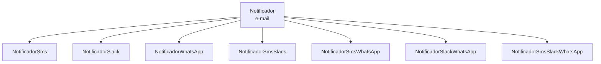
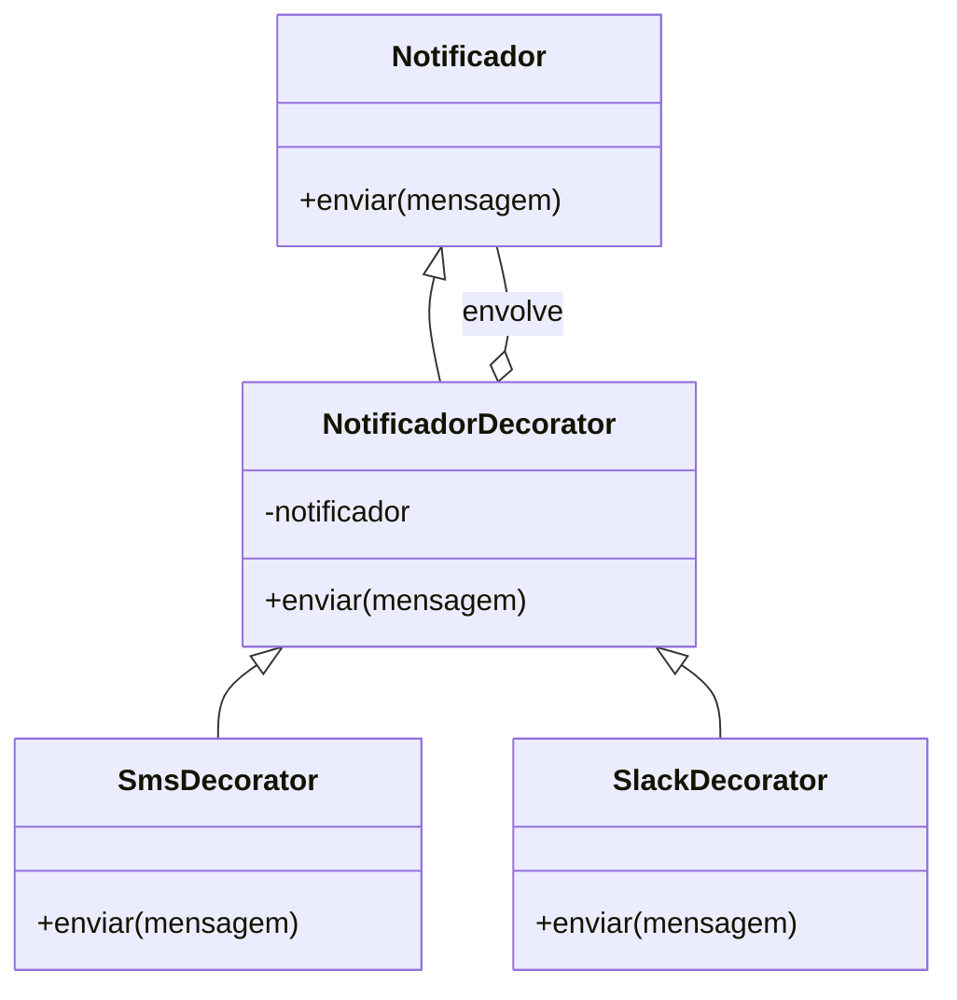

# Implementando o Decorator - Parte 2

## Introdução e contexto

A aula troca o exemplo do texto por um cenário mais próximo do mundo real: um
**sistema de notificações**. A base envia mensagens por **e-mail**; o sistema
precisa também notificar por **SMS**, **Slack** e **WhatsApp**, inclusive em
combinações.

O objetivo é o mesmo: adicionar canais **sem criar uma classe para cada
combinação**.

## A primeira tentativa: herança

A implementação inicial tem uma classe `Notificador` que envia a mensagem por
e-mail:

```js
class Notificador {
  constructor(mensagem) {
    this.mensagem = mensagem;
  }

  enviar() {
    console.log(`E-mail: ${this.mensagem}`);
  }
}
```

Depois, cada canal vira uma subclasse:

```js
class NotificadorSms extends Notificador {
  enviar() {
    super.enviar();
    console.log(`SMS: ${this.mensagem}`);
  }
}
```

O mesmo vale para `NotificadorSlack` e `NotificadorWhatsApp`. Cada subclasse
chama `super.enviar()` e acrescenta seu próprio canal.

Funciona para um canal extra. Mas, quando o cliente quer **e-mail + SMS +
Slack**, surge o mesmo problema do exemplo do texto: seria preciso criar
`NotificadorSmsSlack`, `NotificadorSmsWhatsApp`,
`NotificadorSmsSlackWhatsApp` e assim por diante.



A herança até funciona, mas o número de classes cresce de forma combinatória.
Além disso, cada combinação repete lógica de envio.

## A estrutura do Decorator

A solução separa o **componente** dos **decoradores**:

| Participante | Classe |
| --- | --- |
| Component | `Notificador` |
| Decorator base | `NotificadorDecorator` |
| ConcreteDecorators | `SmsDecorator`, `SlackDecorator` |

O `Notificador` continua sendo a base que envia e-mail. O
`NotificadorDecorator` **envolve outro notificador** e delega a ele. Os
decoradores concretos acrescentam o canal correspondente.



## Montagem da cadeia

O cliente passa a construir a pilha:

```js
const base = new Notificador("Sistema em manutenção");

const comSms = new SmsDecorator(base);
const comSlack = new SlackDecorator(comSms);

comSlack.enviar();
```

O resultado é o envio por **e-mail**, depois **SMS**, depois **Slack**. A ordem
pode ser alterada, e a mesma composição pode ser reutilizada em outros pontos.

## Por que isso resolve o problema

| Herança | Decorator |
| --- | --- |
| uma classe por combinação de canais | uma classe por canal |
| combinações fixas | combinações montadas no cliente |
| lógica repetida em cada subclasse | cada decorador cuida do seu canal |
| classe base precisa ser alterada | classe base permanece intacta |

A quantidade de classes cai de **combinatória** para **linear**: uma por canal,
não uma por subconjunto de canais.

## O que a aula prepara

Esta parte monta a base e a estrutura. A implementação completa — incluindo os
detalhes de `super()`, delegação e o bug do método `enviar` ausente — fica para a
próxima aula.

Os pontos de atenção já aparecem:

- o decorador precisa **herdar** do notificador para ser tratado como tal;
- precisa **receber** outro notificador via composição;
- precisa **repassar** a chamada para o notificador envolvido;
- cada decorador concreto acrescenta seu canal **sem quebrar a cadeia**.

## Benefícios

- **Canais combináveis** sem explosão de classes.
- **Princípio aberto/fechado**: novos canais entram como novos decoradores.
- **Classe base preservada**.
- **Cliente monta apenas a combinação desejada**.
- **Reutilização** de decoradores em várias composições.

## Limitações e cuidados

- **Ordem importa.** A sequência de envio depende da montagem.
- **Cadeia longa complica o entendimento.** É preciso saber o que está envolvido.
- **Construtor exige cuidado.** Esquecer `super()` ou a delegação quebra a
  cadeia.
- **Duplicação é possível.** O mesmo decorador pode ser aplicado duas vezes, o
  que pode ou não ser desejado.
- **Nem toda notificação precisa de combinação.** Para um canal fixo, herança
  simples resolve.

## Conclusão

O exemplo de notificações mostra por que o Decorator é útil: os canais são
**responsabilidades independentes** que o usuário quer combinar livremente. Com
herança, cada combinação vira uma classe; com decoradores, cada canal vira uma
camada.

A próxima aula implementa a cadeia completa e expõe os erros comuns — inclusive
os que fazem a notificação "sumir" no meio do caminho.
