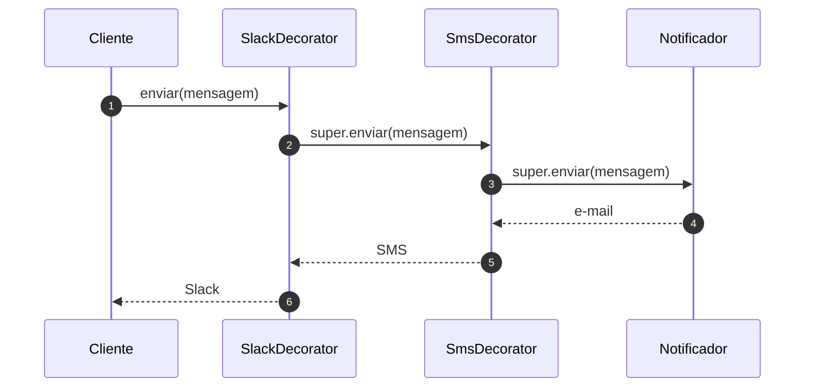

# Implementando o Decorator - Parte 3

## Introdução e contexto

Esta aula conclui o exemplo de **notificações** com a implementação completa dos
decoradores. A base envia e-mail; `SmsDecorator` e `SlackDecorator` acrescentam
canais; o cliente monta a cadeia na ordem que precisar.

## Implementando as classes

O `Notificador` base fica em seu próprio arquivo:

```js
class Notificador {
  enviar(mensagem) {
    console.log(`E-mail: ${mensagem}`);
  }
}
```

O `NotificadorDecorator` herda de `Notificador`, recebe outro notificador e
**delega** o envio:

```js
class NotificadorDecorator extends Notificador {
  #notificador;

  constructor(notificador) {
    super();
    this.#notificador = notificador;
  }

  enviar(mensagem) {
    this.#notificador.enviar(mensagem);
  }
}
```

O `super()` é obrigatório em uma subclasse de classe. Sem ele, o JavaScript lança
erro na construção.

Os decoradores concretos estendem `NotificadorDecorator`:

```js
class SmsDecorator extends NotificadorDecorator {
  enviar(mensagem) {
    super.enviar(mensagem);
    console.log(`SMS: ${mensagem}`);
  }
}

class SlackDecorator extends NotificadorDecorator {
  enviar(mensagem) {
    super.enviar(mensagem);
    console.log(`Slack: ${mensagem}`);
  }
}
```

Cada um chama `super.enviar(mensagem)` para que a cadeia continue e, em seguida,
acrescenta seu próprio canal.



## Montando a cadeia no cliente

```js
const base = new Notificador();
const comSms = new SmsDecorator(base);
const comSlack = new SlackDecorator(comSms);

comSlack.enviar("Sistema em manutenção");
```

Saída:

```
E-mail: Sistema em manutenção
SMS: Sistema em manutenção
Slack: Sistema em manutenção
```

A ordem pode ser invertida — `new SmsDecorator(new SlackDecorator(base))` — e o
resultado muda apenas na sequência dos envios. Também é possível aplicar o mesmo
decorador duas vezes, embora isso duplique a notificação.

## Os dois bugs da aula

A implementação expõe erros comuns e didáticos:

### 1. Esquecer `super()` no construtor

Sem chamar `super()`, a classe filha não inicializa a base e o código quebra.
O erro força a entender que o decorador **é** um notificador, além de **conter**
outro.

### 2. Esquecer `enviar()` no decorator base

Em um dos testes, apenas e-mail e Slack são enviados; o SMS desaparece. A causa
é que o `NotificadorDecorator` não implementou `enviar()`. Sem esse método, a
cadeia não consegue delegar ao notificador interno.

A correção é justamente adicionar o método de delegação:

```js
enviar(mensagem) {
  this.#notificador.enviar(mensagem);
}
```

Esse bug é valioso: mostra que o Decorator depende de **todos os elos da
cadeia** implementarem o contrato. Um elo quebrado interrompe o fluxo.

## Vantagens

| Vantagem | Explicação |
| --- | --- |
| **Dinamismo** | a combinação é escolhida em tempo de execução |
| **Aberto/fechado** | novos canais entram sem alterar a base |
| **Menos subclasses** | uma classe por canal, não por combinação |
| **Responsabilidades isoladas** | cada decorador cuida do seu envio |
| **Reutilização** | os mesmos decoradores servem a várias cadeias |

## Desvantagens

- **Encadeamento complexo.** Entender o fluxo exige conhecer a ordem e os
  decoradores envolvidos.
- **Depuração mais difícil.** O comportamento final está distribuído.
- **Ordem importa.** A sequência dos canais pode ser relevante.
- **Risco de elo quebrado.** Se um decorador não delegar, os anteriores somem.
- **Pode duplicar envios.** Aplicar o mesmo decorador duas vezes não é erro
  técnico, mas pode não ser o desejado.

## Quando aplicar

O Decorator é indicado quando:

- o comportamento precisa ser **adicionado dinamicamente**;
- as responsabilidades são **combináveis**;
- a herança geraria **explosão de subclasses**;
- a classe base deve permanecer **fechada para modificação**.

Exemplos: formatação de texto, canais de notificação, camadas de cache,
compressão, criptografia e logs.

## Conclusão

A implementação completa mostra o Decorator em ação: `Notificador` envia e-mail,
`SmsDecorator` e `SlackDecorator` acrescentam canais, e o cliente compõe a
cadeia. O `super()` garante a construção correta; a delegação em `enviar()`
garante que todos os elos participem.

O padrão entrega **flexibilidade** e **abertura para extensão** ao custo de um
encadeamento mais difícil de rastrear. Usado com critério, evita a explosão
combinatória de subclasses e mantém cada responsabilidade no seu lugar.

O próximo padrão estrutural é o *Facade*, que também simplifica a relação com
estruturas complexas — mas por meio de uma **interface única**, não de camadas.
