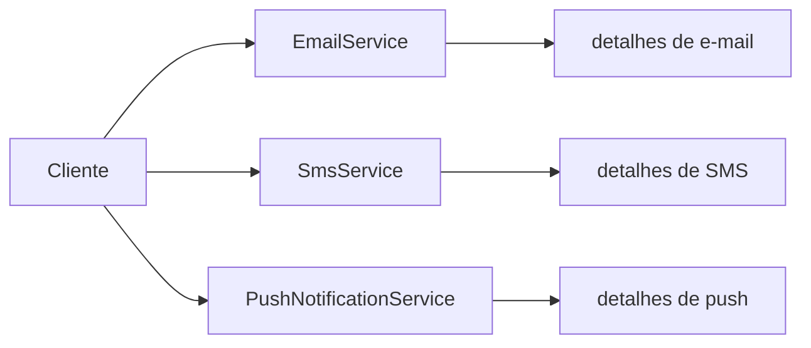
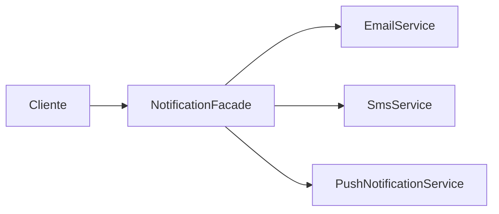

# O Padrão Facade

## Introdução e contexto

O **Facade** — também chamado de *fachada* — é um padrão **estrutural** de
escopo de **objetos**. Ele oferece uma **interface simplificada** para um
**sistema complexo**, escondendo os detalhes internos de quem está do lado de
fora.

A analogia da aula é o **garçom de um restaurante**:

- o cliente conversa com o garçom;
- o garçom leva o pedido para a cozinha;
- a cozinha é um subsistema complexo, com vários processos;
- o cliente não precisa saber como o prato é preparado — só precisa receber a
  refeição.

O Facade é esse intermediador: uma porta de entrada única para um conjunto de
classes que trabalham juntas.

## O problema: cliente falando com todo mundo

Sem o padrão, o cliente precisa conhecer e instanciar **cada parte** do
subsistema. Em um sistema de notificações, por exemplo, ele teria de lidar com:

- `EmailService` e seu método `sendMail`;
- `SmsService` e seu método `sendSms`;
- `PushNotificationService` e seu método `sendPushNotification`.

Cada serviço tem um método diferente, parâmetros diferentes e regras próprias.
O cliente fica **acoplado** a todos eles.

Esse desenho tem problemas:

- o cliente precisa **entender detalhes** que não são do seu interesse;
- qualquer mudança em um serviço pode afetar o cliente;
- o código do cliente fica repetitivo e difícil de ler;
- a lógica de escolha do canal se espalha.

## A solução: uma fachada

O Facade coloca uma classe na frente do subsistema. O cliente conversa **apenas
com a fachada**, e a fachada conversa com as classes internas.

O cliente passa a ter uma única dependência. A complexidade continua existindo,
mas fica **encapsulada** na fachada.

## O que o Facade não é

| Facade | Adapter |
| --- | --- |
| simplifica o acesso a um subsistema | converte uma interface em outra |
| reduz o número de dependências do cliente | torna compatível o que era incompatível |
| esconde complexidade | traduz contratos |

| Facade | Decorator |
| --- | --- |
| oferece um ponto de entrada único | adiciona camadas de comportamento |
| não altera o comportamento dos serviços | altera o resultado por composição |

## Benefícios

- **Interface simplificada**: o cliente vê só o que precisa.
- **Redução de acoplamento**: uma dependência no lugar de várias.
- **Melhor encapsulamento**: detalhes internos ficam escondidos.
- **Legibilidade**: o código cliente fica curto e expressivo.
- **Ponto único de coordenação**: a lógica de orquestração fica em um lugar.

## Limitações e cuidados

- **A fachada pode crescer demais.** Se o subsistema tem muitos serviços, a
  classe acumula métodos e condicionais.
- **Pode esconder complexidade excessiva.** Às vezes o problema não é o acesso,
  mas o subsistema mal desenhado.
- **Não impede o acesso direto.** Em algumas linguagens, nada obriga o cliente a
  usar a fachada.
- **Pode virar um "Deus".** Sem disciplina, centraliza responsabilidades demais.
- **Nomeie explicitamente.** Usar `Facade` no nome da classe comunica a intenção
  ao time.

## Conclusão

O Facade é uma **porta de entrada** para um conjunto complexo de classes. Ele
não substitui os serviços internos nem muda o comportamento deles: apenas
oferece uma forma mais simples de usá-los.

No exemplo da aula, o cliente deixa de instanciar três serviços e passa a
chamar um único método de notificação. A complexidade não desaparece — ela é
**organizada** em um lugar só.

A implementação prática mostra exatamente essa transformação: primeiro o cliente
acoplado a três serviços; depois uma fachada que centraliza a escolha do canal.
