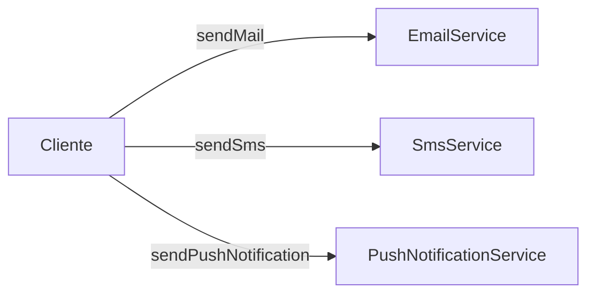

# Implementando o Facade - Parte 1

## Introdução e contexto

Esta aula implementa o **cenário sem Facade**: três serviços de notificação e um
cliente que precisa conhecer todos eles.

O objetivo é sentir o problema na prática antes de refatorar.

## Os três serviços

O arquivo `TestService` reúne as classes:

```js
class EmailService {
  sendMail(recipient, message) {
    console.log(`Enviando e-mail para ${recipient}: ${message}`);
  }
}

class SmsService {
  sendSms(recipient, message) {
    console.log(`Enviando SMS para ${recipient}: ${message}`);
  }
}

class PushNotificationService {
  sendPushNotification(recipient, message) {
    console.log(`Enviando push para ${recipient}: ${message}`);
  }
}
```

Cada serviço tem:

- um **método com nome diferente** (`sendMail`, `sendSms`,
  `sendPushNotification`);
- o mesmo par de dados: **destinatário** e **mensagem**;
- um formato de destinatário diferente: e-mail, telefone ou usuário.

## O cliente acoplado

No teste, o cliente instancia os três serviços:

```js
const emailService = new EmailService();
const smsService = new SmsService();
const pushService = new PushNotificationService();

emailService.sendMail("user@example.com", "Seu pedido foi enviado");
smsService.sendSms("0123456789", "Seu pedido foi enviado");
pushService.sendPushNotification("user123", "Seu pedido foi enviado");
```

A saída é a esperada: as três notificações são enviadas. Mas o código revela o
problema:

| Problema | Consequência |
| --- | --- |
| cliente conhece três classes | acoplamento alto |
| métodos têm nomes diferentes | cliente precisa memorizar cada API |
| destinatários têm formatos diferentes | lógica de escolha se espalha |
| novas notificações exigem mudanças no cliente | baixa extensibilidade |
| repetição de instanciação | código verboso |



O cliente precisa saber **que existem três serviços**, **como cada um se chama**
e **qual formato de destinatário usar**. Isso é exatamente o tipo de detalhe que
o Facade vai esconder.

## Por que não está "errado"

O código funciona e, para três chamadas, parece aceitável. O problema aparece
quando:

- o número de canais cresce;
- a escolha do canal depende de uma regra de negócio;
- o mesmo envio é repetido em vários pontos;
- o front-end precisa consumir essa funcionalidade.

Nesses casos, cada cliente precisa reimplementar a mesma lógica de decisão. É
aí que a fachada se paga.

## O que vem a seguir

A próxima aula cria a **`NotificationFacade`**, que:

1. instancia os três serviços no construtor;
2. expõe um único método `sendNotification(type, recipient, message)`;
3. decide internamente qual serviço chamar;
4. devolve um erro para tipos inválidos.

O cliente passa a instanciar **um único objeto** e chamar **um único método**.

## Benefícios que serão obtidos

- **Um ponto de entrada** para o subsistema.
- **Menos dependências** no cliente.
- **Encapsulamento** da lógica de escolha.
- **Código cliente mais legível**.
- **Facilidade de evolução**: novos canais ficam dentro da fachada.

## Limitações e cuidados

- **A fachada não corrige o subsistema.** Os serviços continuam existindo e
  podem ser usados diretamente.
- **A lógica de seleção precisa de manutenção.** Um `switch` cresce com os
  canais.
- **Não confunda com regra de negócio.** A fachada orquestra chamadas; decisões
  de domínio devem ficar no lugar certo.
- **Evite criar fachadas gigantes.** Se o subsistema é grande, considere dividir
  em fachadas menores.

## Conclusão

A primeira parte mostra o problema concreto: três serviços, três APIs, três
formatos e um cliente que precisa conhecer tudo. O código funciona, mas está
**acoplado** e **repetitivo**.

Com o cenário bem compreendido, a próxima aula aplica o Facade e compara o antes
e o depois.
