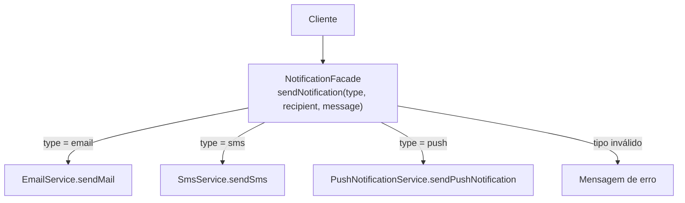
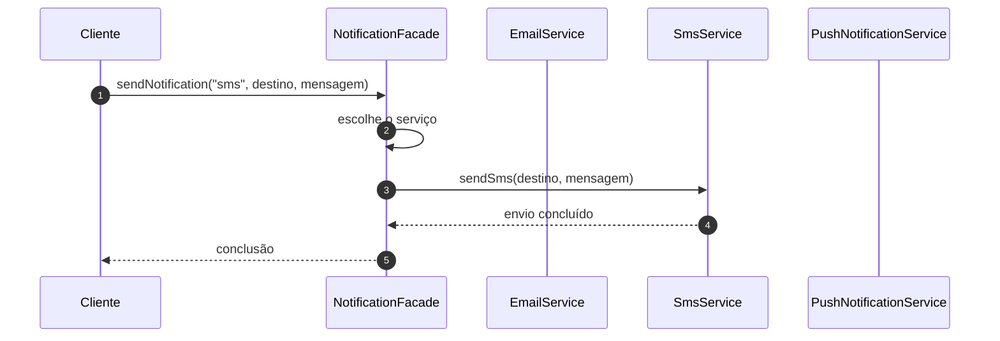

# Implementando o Facade - Parte 2

## Introdução e contexto

Esta aula refatora o cenário de notificações com o **Facade**. O cliente deixa
de conhecer `EmailService`, `SmsService` e `PushNotificationService` e passa a
conversar apenas com `NotificationFacade`.

As três classes de serviço **não são alteradas**. A fachada é adicionada por
cima delas.

## A classe da fachada

O construtor instancia os serviços internos:

```js
class NotificationFacade {
  constructor() {
    this.emailService = new EmailService();
    this.smsService = new SmsService();
    this.pushService = new PushNotificationService();
  }
}
```

O cliente não vê essas instâncias. Elas são detalhes de implementação da
fachada.

## O método unificado

A fachada expõe um único método:

```js
sendNotification(type, recipient, message) {
  switch (type) {
    case "email":
      this.emailService.sendMail(recipient, message);
      break;
    case "sms":
      this.smsService.sendSms(recipient, message);
      break;
    case "push":
      this.pushService.sendPushNotification(recipient, message);
      break;
    default:
      console.log("Tipo de notificação inválido");
  }
}
```

Agora existe uma **interface universal**: tipo, destinatário e mensagem. O
`switch` concentra a escolha do canal em um único lugar.



## O cliente simplificado

Antes:

```js
const emailService = new EmailService();
const smsService = new SmsService();
const pushService = new PushNotificationService();

emailService.sendMail("user@example.com", "Pedido enviado");
smsService.sendSms("0123456789", "Pedido enviado");
pushService.sendPushNotification("user123", "Pedido enviado");
```

Depois:

```js
const notifier = new NotificationFacade();

notifier.sendNotification("email", "user@example.com", "Pedido enviado");
notifier.sendNotification("sms", "0123456789", "Pedido enviado");
notifier.sendNotification("push", "user123", "Pedido enviado");
```

O cliente instancia **um objeto** e chama **um método**. A diferença entre os
canais fica restrita ao valor de `type`.

## O fluxo completo



O cliente não sabe qual serviço foi usado. Ele só conhece o contrato da fachada.

## Antes e depois

| Antes | Depois |
| --- | --- |
| cliente instancia 3 serviços | cliente instancia 1 fachada |
| cliente conhece 3 APIs | cliente conhece 1 método |
| lógica de escolha no cliente | lógica de escolha na fachada |
| alto acoplamento | baixo acoplamento |
| repetição em cada chamada | ponto único de orquestração |

## Vantagens

| Vantagem | Explicação |
| --- | --- |
| **Interface simplificada** | um método no lugar de três |
| **Redução de acoplamento** | cliente depende só da fachada |
| **Encapsulamento** | detalhes dos serviços ficam escondidos |
| **Legibilidade** | o código cliente expressa a intenção |
| **Facilidade para o front-end** | basta conhecer o tipo de notificação |
| **Ponto único de evolução** | novos canais entram na fachada |

## Desvantagens

- **Mais código inicial.** A fachada adiciona uma classe e um `switch`.
- **Complexidade escondida.** Quem olha de fora pode não perceber o que há por
  trás.
- **Risco de classe grande.** Com muitos canais, a fachada acumula casos.
- **Pode esconder um subsistema mal desenhado.** Esconder não é corrigir.
- **Necessidade de convenção.** Usar `Facade` no nome ajuda o time a reconhecer
  o padrão.

## Cuidados

- **Mantenha a fachada coesa.** Se ela começar a cuidar de regras de negócio,
  divida responsabilidades.
- **Valide entradas.** O caso `default` evita falhas silenciosas para tipos
  inválidos.
- **Considere estratégias para o `switch`.** Com muitos canais, um mapa de
  serviços ou o padrão Strategy pode substituir a cadeia de casos.
- **Documente o contrato.** O cliente precisa saber quais tipos são aceitos.
- **Não obrigue o uso.** A fachada é uma facilidade, não uma prisão; em casos
  específicos, o acesso direto pode ser legítimo.

## Conclusão

O Facade transforma três serviços com APIs diferentes em **uma interface única**.
O cliente passa a instanciar `NotificationFacade` e chamar `sendNotification`,
enquanto a fachada decide internamente qual serviço usar.

O subsistema continua intacto; o que muda é a **forma de acessá-lo**. O ganho é
clareza, baixo acoplamento e um ponto único para evoluir. O custo é mais uma
classe e a responsabilidade de manter a orquestração organizada.

Com isso, os padrões **estruturais** do módulo estão concluídos: Adapter,
Decorator e Facade. O próximo bloco abre os **comportamentais**, começando pelo
*Iterator*.
